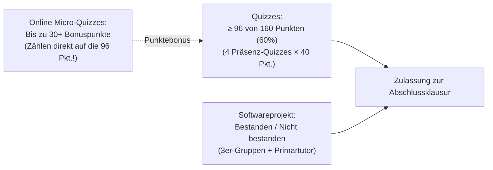

import { Badge, Card, CardGrid } from '@astrojs/starlight/components';
import RmiStudyDashboard from '../../../../../components/rmi/RmiStudyDashboard.astro';
import RmiMatrixVisualizer from '../../../../../components/rmi/RmiMatrixVisualizer.astro';
import RmiMatrixDeepDive from '../../../../../components/rmi/RmiMatrixDeepDive.astro';
import RmiFormulaCard from '../../../../../components/rmi/RmiFormulaCard.astro';
import RmiConfusableCard from '../../../../../components/rmi/RmiConfusableCard.astro';
import RmiQuizCard from '../../../../../components/rmi/RmiQuizCard.astro';
import RmiHardwareLab from '../../../../../components/rmi/RmiHardwareLab.astro';
import DriveAsset from '../../../../../components/DriveAsset.astro';
import LanguageSwitch from '../../../../../components/LanguageSwitch.astro';
import { RMI_FORMULA_RULES, RMI_CONFUSABLE_PAIRS, RMI_QUIZ_PRACTICE_ITEMS, RMI_COURSE_INFO } from '../../../../../data/rmiData';

<div class="page-bg-rmi-anatomy" aria-hidden="true"></div>

# 🤖 Robotics & Machine Intelligence <Badge text="Argon UX Architektur" variant="tip" size="medium" />

<LanguageSwitch current="de" enHref="/lectures/ai-and-med/rmi-anatomy/" deHref="/lectures/ai-and-med/de/rmi-anatomy/" />

Interaktives Studien- und Nachschlagewerk für das Master-Modul **Robotics and Machine Intelligence (IRMI)** bei **Prof. Dr. Artur Andrzejak** (*Künstliche Intelligenz für Programmierung — AIP*, Universität Heidelberg, Wintersemester 2026/27).

:::tip[Warum die Argon UX-Architektur das Robotik-Lernen revolutioniert]
* **Beherrschung räumlicher & algebraischer Dichte**: Robotik-Kinematik erfordert den sicheren Umgang mit komplexen Matrixstrukturen: $SO(3)$ Rotationsmatrizen, $se(3)$ Lie-Algebra-Klammern $[\omega]$, Matrix-Exponentiale $e^{[\mathcal{S}]\theta}$, Rodrigues-Formel und Product of Exponentials (PoE). Auf statischen Skriptseiten führt dies rasch zu kognitiver Überlastung.
* **Saubere Trennung der Lernschwerpunkte**: Das interaktive Dashboard gliedert die Kursinhalte in 5 fokussierte Modi:
  1. 📐 **Kinematik & Lie-Gruppen Explorer**: 8 standardisierte 3-Zonen Bento-Cards mit mathematischer Definition, geometrischer Intuition und lauffähigem Python/NumPy-Code.
  2. ⚖️ **Robotik-Fallstricke & Vergleiche**: Direkte Gegenüberstellung chronischer Klausurfallen (*FK vs. IK*, *PoE vs. DH*, *Feste vs. Bewegte Achsen*, *Gimbal Lock vs. Quaternionen*).
  3. 🎯 **60s Micro-Quiz Simulator**: Interaktiver Übungstest mit Sofort-Feedback, Fehlerursachenanalyse der Distraktoren und Foliennachweisen für die montäglichen Micro-Quizzes.
  4. 🤖 **AR4 Roboter & Python-Labor**: Exakte Geometriedaten des Annin AR4 6-DoF Roboterarms, Home-Pose-Matrix $M$, Schraubenachsen-Tabelle, URDF-XML und `modern_robotics`-Code.
  5. 🗂️ **Kurs-Hub & Prüfungslogistik**: Direkter Download aller Foliensätze s00–s03, Zulassungsregeln (96/160 Pkt.), Bonuspunkte, anatomische Koordinatenebenen und Discord-Tutorien.
:::

---

## 🧭 Lernmodus-Dashboard (Study Mode Navigation)

Klicke auf eine der Kacheln unten, um den **sichtbaren Inhalt der Seite live umzuschalten**:

<RmiStudyDashboard activeSection="kinematics" lang="de" />

---

{/* ========================================================================= */}
{/* SECTION 1: KINEMATIK & LIE-GRUPPEN EXPLORER */}
{/* ========================================================================= */}
<div id="study-mode-kinematics" class="study-mode-section" data-study-mode="kinematics">

## 📐 Modus: Kinematik & Lie-Gruppen Explorer <Badge text="8 Kern-Operatoren • SO(3) & SE(3)" variant="success" />

Die Raumkinematik moderner Roboter beruht auf der eleganten Theorie der **Lie-Gruppen** und **Lie-Algebren**. Statt rein trockener Gleichungen kannst du hier Koordinaten-Frames im 3D-Raum drehen, Rotationsmatrizen live ablesen und mehrgelenkige Roboterarme mit der Product-of-Exponentials-Formel (PoE) steuern:

<RmiMatrixVisualizer lang="de" />

<RmiMatrixDeepDive lang="de" />

---

### 🗺️ Transformationsgraph einer Roboterszene

Jedes Koordinatensystem (Frame) ist ein Knoten; jede bekannte Starrkörper-Transformation ist eine gerichtete Kante:

```mermaid
flowchart LR
    S["{s}<br/>Roboter-Basis"] -->|T_se: Vorwärtskinematik| E["{e}<br/>Greifer / Tool"]
    S -->|T_sc: Kamera-Kalibrierung| C["{c}<br/>Deckenkamera"]
    C -->|T_co: Posenschätzung| O["{o}<br/>Objekt / Tasse"]
    E -.->|T_eo = inv(T_se) * T_sc * T_co<br/>Greifziel| O
```

* **Mit dem Pfeil multiplizieren**: Multiplikation mit Transformationsmatrix ($T_{ac} = T_{ab} T_{bc}$).
* **Gegen den Pfeil**: Multiplikation mit inverser Matrix ($T_{ba} = T_{ab}^{-1}$).
* **Greifziel vom Greifer aus berechnen**: $T_{eo} = T_{se}^{-1} T_{sc} T_{co}$.

---

### 🗂️ Kern-Operatoren der Raumkinematik

<CardGrid>
  {RMI_FORMULA_RULES.slice(0, 4).map((rule) => (
    <RmiFormulaCard rule={rule} lang="de" />
  ))}
</CardGrid>

<CardGrid>
  {RMI_FORMULA_RULES.slice(4, 8).map((rule) => (
    <RmiFormulaCard rule={rule} lang="de" />
  ))}
</CardGrid>

</div>

{/* ========================================================================= */}
{/* SECTION 2: ROBOTIK-FALLSTRICKE & VERGLEICHE */}
{/* ========================================================================= */}
<div id="study-mode-confusables" class="study-mode-section" data-study-mode="confusables" style="display: none;">

## ⚖️ Modus: Robotik-Fallstricke & Vergleiche Spotlight <Badge text="6 Direktvergleiche" variant="tip" />

Robotik-Klausuren und Steuerungsprogramme führen bei mathematisch eng verwandten Konzepten häufig zu chronischer Verwirrung. Nachfolgend findest du direkte Gegenüberstellungen mit Formeln, Gültigkeitsbedingungen und typischen Fallen:

{RMI_CONFUSABLE_PAIRS.map((pair) => (
  <RmiConfusableCard pair={pair} lang="de" />
))}

</div>

{/* ========================================================================= */}
{/* SECTION 3: 60S MICRO-QUIZ SIMULATOR */}
{/* ========================================================================= */}
<div id="study-mode-quiz" class="study-mode-section" data-study-mode="quiz" style="display: none;">

## 🎯 Modus: 60s Micro-Quiz Simulator & Prüfungstraining <Badge text="10 Aufgaben • Sofort-Feedback" variant="success" />

Vor jeder Montags-Vorlesung öffnet auf `https://rmi-heidelberg.de/` ein freiwilliges Online-Micro-Quiz (strikt **1 Minute Bearbeitungszeit pro Frage**, 3 Fragen pro Quiz, bis zu **30+ Bonuspunkte** für die Klausurzulassung).

:::note[Micro-Quiz Trainingsstrategie]
Diese Aufgaben testen schnelle geometrische Intuition und Definitionsgenauigkeit statt langer Rechnungen. Klicke auf eine Antwort für **sofortiges Feedback** (**✅ Richtig** oder **❌ Falsch**), klappe den vollständigen Beweis aus und prüfe die Analyse der falschen Antwortmöglichkeiten (Distraktoren)!
:::

{RMI_QUIZ_PRACTICE_ITEMS.map((item) => (
  <RmiQuizCard item={item} lang="de" />
))}

<div class="not-content" style="margin-top: 1.5rem; text-align: center;">
  <a href="/assets/rmi/quiz1_practice_sheet.pdf" download="quiz1_practice_sheet.pdf" class="btn-download-sheet">
    📥 Vollständiges LaTeX Übungsblatt herunterladen (PDF)
  </a>
</div>

</div>

{/* ========================================================================= */}
{/* SECTION 4: AR4 ROBOTER & PYTHON-LABOR */}
{/* ========================================================================= */}
<div id="study-mode-hardware" class="study-mode-section" data-study-mode="hardware" style="display: none;">

## 🤖 Modus: AR4 Roboter-Anatomie & Python-Labor <Badge text="Annin AR4 MK5 • URDF & PoE" variant="note" />

<RmiHardwareLab lang="de" />

</div>

{/* ========================================================================= */}
{/* SECTION 5: KURS-HUB & PRÜFUNGSLOGISTIK */}
{/* ========================================================================= */}
<div id="study-mode-course" class="study-mode-section" data-study-mode="course" style="display: none;">

## 🗂️ Modus: Kurs-Hub & Prüfungslogistik <Badge text="WS 2026/27 • 6 CP" variant="tip" />

### 📋 Kurs-Überblick

| Parameter | Spezifikation | Details |
| :--- | :--- | :--- |
| **Modul** | Robotics & Machine Intelligence (IRMI) | Master Informatik, Data and Computer Science, Scientific Computing |
| **Dozent** | Prof. Dr. Artur Andrzejak | AIP-Gruppe, INF 205 (Mathematikon), Raum 2.214 |
| **Übungsleitung & Tutoren** | Lennart Stöpler, Til Gramlich, Ole Plechinger | Wöchentliche Übungen, Präsenztutorien & Roboterlabor |
| **Vorlesungstermin** | Montag 11:15–12:45 | Hörsaal, INF 205 (Mathematikon) |
| **Tutorien 1 & 2** | Dienstag 11:15–12:45 (SR 1) & Donnerstag 16:15–17:45 (SR C) | INF 205 |
| **Arbeitsaufwand** | 180 Stunden gesamt (6 ECTS) | ca. 12 Stunden/Woche über 15 Wochen (Vorlesung, Übung, Projekt) |
| **Community** | Discord-Server | [discord.gg/GPFutgV9R](https://discord.gg/GPFutgV9R) |

---

### 🏆 Zulassungsbedingungen zur Abschlussklausur

Die Zulassung zur Abschlussklausur erfordert das Bestehen von **zwei unabhängigen Kriterien**:



1. **Quizzes ($\ge 96$ / 160 Punkte = 60%)**:
   - 4 schriftliche Quizzes in den letzten 20 Minuten der Vorlesung (je 40 Punkte, 4 Aufgaben $\times$ 10 Punkte).
   - **Quiz A**: 02.11.2026 (Vorlesungen 1 & 2: Anatomie, Kinematik, Rotationen)
   - **Quiz B**: 23.11.2026 (Vorlesungen 3 & 4: PoE, Inverse Kinematik, Dynamik)
   - **Quiz C**: 14.12.2026 (Vorlesungen 5 & 6: ML Refresher, Deep Learning Vision)
   - **Quiz D**: 18.01.2027 (Vorlesungen 7 & 8: 3D Vision, Imitation & RL)
   - **Micro-Quiz Bonus**: 10 wöchentliche Online-Micro-Quizzes bringen **bis zu 30+ Bonuspunkte**, die direkt auf die 96-Punkte-Schwelle angerechnet werden!
2. **Softwareprojekt (Bestanden / Nicht bestanden)**:
   - Umsetzung in **3er-Gruppen** an simulierten / physischen Roboterarmen.
   - Jede Gruppe erhält einen Primärtutor zur Betreuung und Zwischenabnahme.

---

### 🔬 Medizinische Bildgebung & Anatomische Koordinatensysteme

Grundlagen für die Registrierung von Robotik-Endeffektoren und medizinischen Sensoren mit der menschlichen Anatomie:
* **Sagittalebene**: Teilt den Körper in linke und rechte Hälfte.
* **Frontal- / Koronalebene**: Teilt den Körper in vordere (anteriore) und hintere (posteriore) Hälfte.
* **Transversal- / Axialebene**: Teilt den Körper in obere (superiore) und untere (inferiore) Hälfte.
* **Starrkörpertransformationen im 3D-Raum**: Dargestellt über homogene Transformationsmatrizen in $SE(3)$:

$$
T = \begin{bmatrix} R & \mathbf{t} \\ \mathbf{0}^T & 1 \end{bmatrix} \in \mathbb{R}^{4 \times 4}, \quad R \in SO(3), \; \mathbf{t} \in \mathbb{R}^3
$$

---

### 📂 Offizielle Vorlesungsunterlagen (Heibox / Google Drive)

<DriveAsset
  title="Lecture 0: Administrative Informationen & Modulüberblick"
  type="slides"
  description="Prüfungsmodalitäten, Quiz-Termine, Bonuspunkte-Regelung, empfohlene Literatur und Kontaktdaten."
  href="https://bit.ly/HDRMI2026"
/>

<DriveAsset
  title="Lecture 1: Einführung & Roboteranatomie"
  type="slides"
  description="Fabrik- vs. offene Weltrobotik, Sense-Think-Act Schleife, Moravec-Paradoxon, AR4 6-DoF Arm-Anatomie, Freiheitsgrade und Grübler-Formel."
  href="https://bit.ly/HDRMI2026"
/>

<DriveAsset
  title="Lecture 2: Rotationen, Transformationen & Vorwärtskinematik"
  type="slides"
  description="SO(2) und SO(3) Drehmatrizen, Rechte-Hand-Regel, Roll-Pitch-Yaw vs. Euler ZYX, Gimbal Lock, homogene Transformationen in SE(3) und URDF."
  href="https://bit.ly/HDRMI2026"
/>

<DriveAsset
  title="Lecture 3: Product of Exponentials (Tutorial Notes)"
  type="slides"
  description="Matrix-Exponential auf SO(3) & SE(3), Herleitung der Rodrigues-Formel, Schraubenachsen S = (omega, v), PoE Space- & Body-Form und AR4 Beispiel."
  href="https://bit.ly/HDRMI2026"
/>

<DriveAsset
  title="Übungsblatt: Vorbereitung Micro-Quiz 1 (PDF)"
  type="pdf"
  description="Gezieltes Trainingsblatt mit 10 Multiple-Choice-Aufgaben, detaillierten mathematischen Lösungsschritten und Distraktoren-Erklärungen."
  href="/assets/rmi/quiz1_practice_sheet.pdf"
/>

---

### 📚 Empfohlene Lehrbücher & Software-Bibliotheken

* **Modern Robotics: Mechanics, Planning, and Control** — Kevin M. Lynch & Frank C. Park (Cambridge University Press, 2019). [Kostenloses PDF, Videos und Code](https://modernrobotics.org).
* **Robotics, Vision and Control (in Python)** — Peter Corke (3. Auflage, Springer, 2023).
* **Python Modern Robotics Bibliothek**: `pip install modern_robotics` ([GitHub: NxRLab/ModernRobotics](https://github.com/NxRLab/ModernRobotics)).
* **SciPy Spatial Transform**: `from scipy.spatial.transform import Rotation as R`.

</div>
