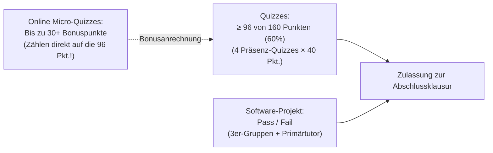

import { Badge, Card, CardGrid } from '@astrojs/starlight/components';
import RmiStudyDashboard from '../../../../../components/rmi/RmiStudyDashboard.astro';
import RmiMatrixVisualizer from '../../../../../components/rmi/RmiMatrixVisualizer.astro';
import RmiMatrixDeepDive from '../../../../../components/rmi/RmiMatrixDeepDive.astro';
import RmiFormulaCard from '../../../../../components/rmi/RmiFormulaCard.astro';
import RmiConfusableCard from '../../../../../components/rmi/RmiConfusableCard.astro';
import RmiQuizCard from '../../../../../components/rmi/RmiQuizCard.astro';
import RmiHardwareLab from '../../../../../components/rmi/RmiHardwareLab.astro';
import DriveAsset from '../../../../../components/DriveAsset.astro';
import LanguageSwitch from '../../../../../components/LanguageSwitch.astro';
import { RMI_FORMULA_RULES, RMI_CONFUSABLE_PAIRS, RMI_QUIZ_PRACTICE_ITEMS, RMI_COURSE_INFO } from '../../../../../data/rmiData';

<div class="page-bg-rmi-anatomy" aria-hidden="true"></div>

# 🤖 Robotics & Machine Intelligence <Badge text="Argon UX Prototyp" variant="tip" size="medium" />

<LanguageSwitch current="de" enHref="/lectures/ai-and-med/rmi-prototype/" deHref="/lectures/ai-and-med/de/rmi-prototype/" />

Interaktives Studien- und Nachschlagewerk für das Master-Modul **Robotics and Machine Intelligence (IRMI)** bei **Prof. Dr. Artur Andrzejak** (*Künstliche Intelligenz für Programmierung — AIP*, Universität Heidelberg, Wintersemester 2026/27).

:::tip[Warum die Argon UX-Architektur das Robotik-Lernen revolutioniert]
* **Beherrschung räumlicher & algebraischer Dichte**: Robotik-Kinematik erfordert den sicheren Umgang mit komplexen Matrixstrukturen: $SO(3)$ Rotationsmatrizen, $se(3)$ Lie-Algebra-Klammern $[\omega]$, Matrix-Exponentiale $e^{[\mathcal{S}]\theta}$, Rodrigues-Formel und Product of Exponentials (PoE). Auf statischen Skriptseiten führt dies rasch zu kognitiver Überlastung.
* **Saubere Trennung der Lernschwerpunkte**: Das interaktive Dashboard gliedert die Kursinhalte in 5 fokussierte Modi:
  1. 📐 **Kinematik & Lie-Gruppen Explorer**: 8 standardisierte 3-Zonen Bento-Cards mit mathematischer Definition, geometrischer Intuition und lauffähigem Python/NumPy-Code.
  2. ⚖️ **Robotik-Fallstricke & Vergleiche**: Direkte Gegenüberstellung chronischer Klausurfallen (*FK vs. IK*, *PoE vs. DH*, *Feste vs. Bewegte Achsen*, *Gimbal Lock vs. Quaternionen*).
  3. 🎯 **60s Micro-Quiz Simulator**: Interaktiver Übungstest mit Sofort-Feedback, Fehlerursachenanalyse der Distraktoren und Foliennachweisen für die montäglichen Micro-Quizzes.
  4. 🤖 **AR4 Roboter & Python-Labor**: Exakte Geometriedaten des Annin AR4 6-DoF Roboterarms, Home-Pose-Matrix $M$, Schraubenachsen-Tabelle, URDF-XML und `modern_robotics`-Code.
  5. 🗂️ **Kurs-Hub & Prüfungslogistik**: Direkter Download aller Foliensätze s00–s03, Zulassungsregeln (96/160 Pkt.), Bonuspunkte und Discord-Tutorien.
:::

---

## 🧭 Lernmodus-Dashboard (Study Mode Navigation)

Klicke auf eine der Kacheln unten, um den **sichtbaren Inhalt der Seite live umzuschalten**:

<RmiStudyDashboard activeSection="kinematics" lang="de" />

---

{/* ========================================================================= */}
{/* SECTION 1: KINEMATIK & LIE-GRUPPEN EXPLORER */}
{/* ========================================================================= */}
<div id="study-mode-kinematics" class="study-mode-section" data-study-mode="kinematics">

## 📐 Modus: Kinematik & Lie-Gruppen Explorer <Badge text="8 Kern-Operatoren • SO(3) & SE(3)" variant="success" />

Die Raumkinematik moderner Roboter beruht auf der eleganten Theorie der **Lie-Gruppen** und **Lie-Algebren**. Statt rein trockener Gleichungen kannst du hier Koordinaten-Frames im 3D-Raum drehen, Rotationsmatrizen live ablesen und mehrgelenkige Roboterarme mit der Product-of-Exponentials-Formel (PoE) steuern:

<RmiMatrixVisualizer lang="de" />

<RmiMatrixDeepDive lang="de" />

---

### 🗺️ Transformationsgraph einer Roboterszene

Jedes Koordinatensystem (Frame) ist ein Knoten; jede bekannte Starrkörper-Transformation ist eine gerichtete Kante:

```mermaid
flowchart LR
    S["{s}<br/>Roboter-Basis"] -->|T_se: Vorwärtskinematik| E["{e}<br/>Greifer / Tool"]
    S -->|T_sc: Kamera-Kalibrierung| C["{c}<br/>Deckenkamera"]
    C -->|T_co: Posenschätzung| O["{o}<br/>Objekt / Tasse"]
    E -.->|T_eo = inv(T_se) * T_sc * T_co<br/>Greifziel| O
```

* **Pfeil in Vorwärtsrichtung**: Multiplikation mit Transformationsmatrix ($T_{ac} = T_{ab} T_{bc}$).
* **Pfeil gegen die Richtung**: Multiplikation mit inverser Matrix ($T_{ba} = T_{ab}^{-1}$).
* **Greifziel vom Greifer aus gesehen**: $T_{eo} = T_{se}^{-1} T_{sc} T_{co}$.

---

### 🗂️ Kinematische Transformations-Karten

<CardGrid>
  {RMI_FORMULA_RULES.slice(0, 4).map((rule) => (
    <RmiFormulaCard rule={rule} lang="de" />
  ))}
</CardGrid>

<CardGrid>
  {RMI_FORMULA_RULES.slice(4, 8).map((rule) => (
    <RmiFormulaCard rule={rule} lang="de" />
  ))}
</CardGrid>

</div>

{/* ========================================================================= */}
{/* SECTION 2: ROBOTIK-FALLSTRICKE & VERGLEICHE */}
{/* ========================================================================= */}
<div id="study-mode-confusables" class="study-mode-section" data-study-mode="confusables" style="display: none;">

## ⚖️ Modus: Robotik-Fallstricke & Vergleiche <Badge text="6 Direktvergleiche • Klausurfallen" variant="tip" />

In Prüfungen und ROS-Pipelines führen ähnlich klingende oder formal verwandte Konzepte häufig zu Fehlern. Nachfolgend findest du direkte 2-Spalten-Gegenüberstellungen:

{RMI_CONFUSABLE_PAIRS.map((pair) => (
  <RmiConfusableCard pair={pair} lang="de" />
))}

</div>

{/* ========================================================================= */}
{/* SECTION 3: 60S MICRO-QUIZ SIMULATOR */}
{/* ========================================================================= */}
<div id="study-mode-quiz" class="study-mode-section" data-study-mode="quiz" style="display: none;">

## 🎯 Modus: 60s Micro-Quiz Simulator & Prüfungstraining <Badge text="10 Aufgaben • Sofort-Auswertung" variant="success" />

Jeden Montag öffnet circa 10 Minuten vor der Vorlesung online auf `https://rmi-heidelberg.de/` ein Micro-Quiz mit 3 Multiple-Choice-Aufgaben (**strenger 1-Minuten-Timer pro Frage**). Über 10 Vorlesungen können so bis zu **30+ Bonuspunkte** für die Klausurzulassung gesammelt werden.

:::note[Trainingsstrategie für die Micro-Quizzes]
Die Fragen verlangen keine langwierigen Rechnungen, sondern testen exaktes Begriffsverständnis, Matrix-Eigenschaften und Vorzeichenregeln. Klicke auf deine Wunschantwort, um sofort zu sehen, ob sie korrekt ist (**✅ Richtig** bzw. **❌ Falsch**), und studiere die ausführliche Herleitung!
:::

{RMI_QUIZ_PRACTICE_ITEMS.map((item) => (
  <RmiQuizCard item={item} lang="de" />
))}

<div class="not-content" style="margin-top: 1.5rem; text-align: center;">
  <a href="/assets/rmi/quiz1_practice_sheet.pdf" download="quiz1_practice_sheet.pdf" class="btn-download-sheet">
    📥 Komplettes LaTeX-Übungsblatt herunterladen (PDF)
  </a>
</div>

</div>

{/* ========================================================================= */}
{/* SECTION 4: AR4 ROBOTER & PYTHON-LABOR */}
{/* ========================================================================= */}
<div id="study-mode-hardware" class="study-mode-section" data-study-mode="hardware" style="display: none;">

## 🤖 Modus: AR4 Roboterarm & Python-Labor <Badge text="Annin AR4 MK5 • URDF & PoE" variant="note" />

<RmiHardwareLab lang="de" />

</div>

{/* ========================================================================= */}
{/* SECTION 5: KURS-HUB & PRÜFUNGSLOGISTIK */}
{/* ========================================================================= */}
<div id="study-mode-course" class="study-mode-section" data-study-mode="course" style="display: none;">

## 🗂️ Modus: Kurs-Hub & Prüfungslogistik <Badge text="WS 2026/27 • 6 ECTS" variant="tip" />

### 📋 Kursübersicht auf einen Blick

| Parameter | Spezifikation | Details |
| :--- | :--- | :--- |
| **Modul** | Robotics & Machine Intelligence (IRMI) | Master Data & Computer Science, Scientific Computing |
| **Dozent** | Prof. Dr. Artur Andrzejak | Gruppe AIP, INF 205 (Mathematikon), Raum 2.214 |
| **Assistent & Tutoren** | Lennart Stöpler, Til Gramlich, Ole Plechinger | Wöchentliche Übungen, Quiz-Besprechung & Simulationslabor |
| **Vorlesungstermin** | Montag 11:15–12:45 | Hörsaal, INF 205 (Mathematikon) |
| **Tutorien 1 & 2** | Dienstag 11:15–12:45 (SR 1) & Donnerstag 16:15–17:45 (SR C) | INF 205 |
| **Arbeitsaufwand** | 180 Arbeitsstunden (6 ECTS) | ca. 12 Stunden/Woche über 15 Wochen |
| **Discord** | Offizieller Diskussionskanal | [discord.gg/GPFutgV9R](https://discord.gg/GPFutgV9R) |

---

### 🏆 Zulassungsbedingungen zur Klausur

Die Zulassung zur schriftlichen Abschlussklausur erfordert das Erfüllen von **zwei Bedingungen**:



1. **Quizzes ($\ge 96$ / 160 Punkte = 60%)**:
   - 4 schriftliche Quizzes in den letzten 20 Minuten der Vorlesung (je 40 Punkte, 4 Aufgaben $\times$ 10 Punkte).
   - **Quiz A**: 02.11.2026 (Vorlesung 1 & 2: Anatomie, Kinematik, Rotationen)
   - **Quiz B**: 23.11.2026 (Vorlesung 3 & 4: PoE, Inverse Kinematik, Dynamik)
   - **Quiz C**: 14.12.2026 (Vorlesung 5 & 6: ML Refresher, Deep Learning Vision)
   - **Quiz D**: 18.01.2027 (Vorlesung 7 & 8: 3D Vision, Imitation & RL)
   - **Micro-Quiz Bonus**: 10 wöchentliche Online-Micro-Quizzes (je 3 Fragen) bringen **bis zu 30+ Bonuspunkte**, die auf die 96 Punkte angerechnet werden!
2. **Software-Projekt (Pass / Fail)**:
   - Bearbeitung in **3er-Gruppen** an simulierten bzw. realen Roboterarmen.
   - Jede Gruppe erhält einen primären Tutor zur Betreuung.

---

### 📂 Offizielle Vorlesungsfolien (Heibox / Google Drive)

<DriveAsset
  title="Vorlesung 0: Administrative Informationen & Kursüberblick"
  type="slides"
  description="Prüfungsmodalitäten, Quiz-Termine, Bonuspunkteregelung, Literaturempfehlungen und Kontaktadressen."
  href="https://bit.ly/HDRMI2026"
/>

<DriveAsset
  title="Vorlesung 1: Einführung & Roboteranatomie"
  type="slides"
  description="Fabrik vs. offene Welt, Sense-Think-Act-Schleife, Moravec-Paradoxon, AR4 6-DoF Anatomie, Freiheitsgrade und Grübler-Formel."
  href="https://bit.ly/HDRMI2026"
/>

<DriveAsset
  title="Vorlesung 2: Rotationen, Transformationen, Vorwärtskinematik"
  type="slides"
  description="SO(2) und SO(3) Rotationsmatrizen, Rechte-Hand-Regel, Roll-Pitch-Yaw vs. Euler ZYX, Gimbal Lock, homogene Transformationen in SE(3) und URDF."
  href="https://bit.ly/HDRMI2026"
/>

<DriveAsset
  title="Vorlesung 3: Product of Exponentials (Tutorial Notes)"
  type="slides"
  description="Matrix-Exponential auf SO(3) & SE(3), Herleitung der Rodrigues-Formel, Schraubenachsen S = (omega, v), PoE Space- und Body-Form."
  href="https://bit.ly/HDRMI2026"
/>

<DriveAsset
  title="Übungsblatt: Micro-Quiz 1 Vorbereitung (PDF)"
  type="pdf"
  description="10 gezielte Multiple-Choice-Aufgaben mit ausführlichen mathematischen Musterlösungen und Fehleranalysen."
  href="/assets/rmi/quiz1_practice_sheet.pdf"
/>

---

### 📚 Empfohlene Literatur & Software

* **Modern Robotics: Mechanics, Planning, and Control** — Kevin M. Lynch & Frank C. Park (Cambridge University Press, 2019). [Kostenloses PDF, Videos & Software](https://modernrobotics.org).
* **Robotics, Vision and Control (in Python)** — Peter Corke (3. Auflage, Springer, 2023).
* **Python Modern Robotics Library**: `pip install modern_robotics` ([GitHub: NxRLab/ModernRobotics](https://github.com/NxRLab/ModernRobotics)).
* **SciPy Spatial Transform**: `from scipy.spatial.transform import Rotation as R`.

</div>

