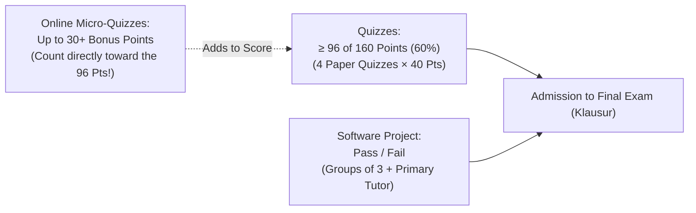

import { Badge, Card, CardGrid } from '@astrojs/starlight/components';
import RmiStudyDashboard from '../../../../components/rmi/RmiStudyDashboard.astro';
import RmiMatrixVisualizer from '../../../../components/rmi/RmiMatrixVisualizer.astro';
import RmiMatrixDeepDive from '../../../../components/rmi/RmiMatrixDeepDive.astro';
import RmiFormulaCard from '../../../../components/rmi/RmiFormulaCard.astro';
import RmiConfusableCard from '../../../../components/rmi/RmiConfusableCard.astro';
import RmiQuizCard from '../../../../components/rmi/RmiQuizCard.astro';
import RmiHardwareLab from '../../../../components/rmi/RmiHardwareLab.astro';
import DriveAsset from '../../../../components/DriveAsset.astro';
import LanguageSwitch from '../../../../components/LanguageSwitch.astro';
import { RMI_FORMULA_RULES, RMI_CONFUSABLE_PAIRS, RMI_QUIZ_PRACTICE_ITEMS, RMI_COURSE_INFO } from '../../../../data/rmiData';

<div class="page-bg-rmi-anatomy" aria-hidden="true"></div>

# 🤖 Robotics & Machine Intelligence <Badge text="Argon UX Architecture" variant="tip" size="medium" />

<LanguageSwitch current="en" enHref="/lectures/ai-and-med/rmi-prototype/" deHref="/lectures/ai-and-med/de/rmi-prototype/" />

Interactive academic vault and learning prototype for **Robotics and Machine Intelligence (IRMI)** taught by **Prof. Dr. Artur Andrzejak** (*Artificial Intelligence for Programming — AIP*, Heidelberg University, Wintersemester 2026/27).

:::tip[Why the Argon UX Architecture Transforms Robotics Education]
* **Taming Spatial & Matrix Complexity**: Robotics kinematics introduces high-dimensional algebraic structures: $SO(3)$ rotation matrices, $se(3)$ Lie algebra brackets $[\omega]$, matrix exponentials $e^{[\mathcal{S}]\theta}$, Rodrigues' formula, and Product of Exponentials (PoE). In traditional flat lecture notes, students face severe cognitive overload trying to connect formulas with 3D physical motion.
* **Separation of Cognitive Concerns**: The interactive dashboard decouples learning goals into 5 targeted focus modes:
  1. 📐 **Kinematics & Lie Group Explorer**: 8 standardized 3-zone Bento Cards pairing mathematical definitions, geometric intuitions, and runnable Python/NumPy verification scripts.
  2. ⚖️ **Robotics Confusables & Pitfalls**: Side-by-side contrastive analysis of recurring exam traps (*FK vs. IK*, *PoE vs. DH*, *Fixed vs. Moving Axes*, *Gimbal Lock vs. Quaternions*).
  3. 🎯 **60s Micro-Quiz Simulator**: Rapid-fire multiple choice test engine with instant feedback, distractor breakdowns, and slide citations for the Monday micro-quizzes.
  4. 🤖 **AR4 Robot & Python Lab**: Physical specs of the Annin AR4 6-DoF arm, home pose matrix $M$, screw axes table, URDF XML, and `modern_robotics` code.
  5. 🗂️ **Course Hub & Exam Logistics**: Download links for slide decks s00–s03, admission rules (96/160 pts), bonus points, and tutor contacts.
:::

---

## 🧭 Study Mode Navigation Dashboard

Click any tile below to **dynamically switch visible page sections live** without page reloads:

<RmiStudyDashboard activeSection="kinematics" lang="en" />

---

{/* ========================================================================= */}
{/* SECTION 1: KINEMATICS & LIE GROUP EXPLORER */}
{/* ========================================================================= */}
<div id="study-mode-kinematics" class="study-mode-section" data-study-mode="kinematics">

## 📐 Mode: Kinematics & Lie Group Explorer <Badge text="8 Core Operators • SO(3) & SE(3)" variant="success" />

Spatial robotics is built on the mathematical foundation of **Lie Groups** and **Lie Algebras**. Rather than studying purely theoretical equations, interact with 3D coordinate frames, real-time matrix transformations, and multi-joint robot arms below:

<RmiMatrixVisualizer lang="en" />

<RmiMatrixDeepDive lang="en" />

---

### 🗺️ Transform Graph of a Robotic Scene

Every coordinate frame in a robotics workspace is a node; every known rigid transformation is a directed edge:

```mermaid
flowchart LR
    S["{s}<br/>Robot Base"] -->|T_se: Forward Kinematics| E["{e}<br/>Gripper / Tool"]
    S -->|T_sc: Camera Calibration| C["{c}<br/>Overhead Camera"]
    C -->|T_co: Pose Estimation| O["{o}<br/>Object / Cup"]
    E -.->|T_eo = inv(T_se) * T_sc * T_co<br/>Grasp Target| O
```

* **Follow an arrow**: Multiply by transformation matrix ($T_{ac} = T_{ab} T_{bc}$).
* **Go against an arrow**: Multiply by inverse matrix ($T_{ba} = T_{ab}^{-1}$).
* **Grasp target from gripper**: $T_{eo} = T_{se}^{-1} T_{sc} T_{co}$.

---

### 🗂️ Core Kinematic Transformation Cards

<CardGrid>
  {RMI_FORMULA_RULES.slice(0, 4).map((rule) => (
    <RmiFormulaCard rule={rule} lang="en" />
  ))}
</CardGrid>

<CardGrid>
  {RMI_FORMULA_RULES.slice(4, 8).map((rule) => (
    <RmiFormulaCard rule={rule} lang="en" />
  ))}
</CardGrid>

</div>

{/* ========================================================================= */}
{/* SECTION 2: ROBOTICS CONFUSABLES & PITFALLS SPOTLIGHT */}
{/* ========================================================================= */}
<div id="study-mode-confusables" class="study-mode-section" data-study-mode="confusables" style="display: none;">

## ⚖️ Mode: Robotics Confusables & Pitfalls Spotlight <Badge text="6 Direct Contrast Pairs" variant="tip" />

Robotics exams and codebases frequently trigger chronic conceptual confusion between mathematically adjacent concepts. Inspect side-by-side comparative cards with correct rules and fatal exam traps below:

{RMI_CONFUSABLE_PAIRS.map((pair) => (
  <RmiConfusableCard pair={pair} lang="en" />
))}

</div>

{/* ========================================================================= */}
{/* SECTION 3: 60S MICRO-QUIZ SIMULATOR */}
{/* ========================================================================= */}
<div id="study-mode-quiz" class="study-mode-section" data-study-mode="quiz" style="display: none;">

## 🎯 Mode: 60s Micro-Quiz Simulator & Exam Practice <Badge text="10 Interactive Tasks • Immediate Feedback" variant="success" />

Before each Monday lecture, a voluntary online micro-quiz opens on `https://rmi-heidelberg.de/` (strictly **1 minute per question**, 3 questions per quiz, earning up to **30+ bonus points** toward the 96 points needed for exam admission).

:::note[Micro-Quiz Training Strategy]
These questions test rapid geometric intuition and definition precision rather than lengthy algebra. Click any answer to receive **instant feedback** (**✅ Correct** or **❌ Incorrect**), expand the detailed worked proof, and inspect why the distractors fail!
:::

{RMI_QUIZ_PRACTICE_ITEMS.map((item) => (
  <RmiQuizCard item={item} lang="en" />
))}

<div class="not-content" style="margin-top: 1.5rem; text-align: center;">
  <a href="/assets/rmi/quiz1_practice_sheet.pdf" download="quiz1_practice_sheet.pdf" class="btn-download-sheet">
    📥 Download Complete LaTeX Quiz Practice Sheet (PDF)
  </a>
</div>

</div>

{/* ========================================================================= */}
{/* SECTION 4: AR4 ROBOT & PYTHON LAB */}
{/* ========================================================================= */}
<div id="study-mode-hardware" class="study-mode-section" data-study-mode="hardware" style="display: none;">

## 🤖 Mode: AR4 Robot Anatomy & Python Lab <Badge text="Annin AR4 MK5 • URDF & PoE" variant="note" />

<RmiHardwareLab lang="en" />

</div>

{/* ========================================================================= */}
{/* SECTION 5: COURSE HUB & EXAM LOGISTICS */}
{/* ========================================================================= */}
<div id="study-mode-course" class="study-mode-section" data-study-mode="course" style="display: none;">

## 🗂️ Mode: Course Hub & Exam Logistics <Badge text="WS 2026/27 • 6 CP" variant="tip" />

### 📋 Course at a Glance

| Parameter | Specification | Details |
| :--- | :--- | :--- |
| **Module** | Robotics & Machine Intelligence (IRMI) | Master Data & Computer Science, Scientific Computing |
| **Lecturer** | Prof. Dr. Artur Andrzejak | AIP Group, INF 205 (Mathematikon), Room 2.214 |
| **Assistant & Tutors** | Lennart Stöpler, Til Gramlich, Ole Plechinger | Regular exercises, solutions & simulated arm lab |
| **Lecture Schedule** | Monday 11:15–12:45 | Hörsaal, INF 205 (Mathematikon) |
| **Tutorial 1 & 2** | Tuesday 11:15–12:45 (SR 1) & Thursday 16:15–17:45 (SR C) | INF 205 |
| **Workload** | 180 hours total (6 ECTS) | ~12 hours/week over 15 weeks (lecture, tutorial, project) |
| **Community** | Discord Channel | [discord.gg/GPFutgV9R](https://discord.gg/GPFutgV9R) |

---

### 🏆 Exam Admission Requirements (Zulassungsbedingungen)

Admission to the final exam (*Klausur*) requires fulfilling **two independent conditions**:



1. **Quizzes ($\ge 96$ / 160 Points = 60%)**:
   - 4 paper quizzes written in the last 20 minutes of lectures (40 points each, 4 tasks $\times$ 10 points).
   - **Quiz A**: 02.11.2026 (Lectures 1 & 2: Anatomy, Kinematics, Rotations)
   - **Quiz B**: 23.11.2026 (Lectures 3 & 4: PoE, Inverse Kinematics, Dynamics)
   - **Quiz C**: 14.12.2026 (Lectures 5 & 6: ML Refresher, Deep Learning Vision)
   - **Quiz D**: 18.01.2027 (Lectures 7 & 8: 3D Vision, Imitation & RL)
   - **Micro-Quiz Bonus**: 10 weekly online micro-quizzes (3 questions each) provide **up to 30+ bonus points** that count directly toward the 96-point threshold!
2. **Software Project (Pass / Fail)**:
   - Implemented in **groups of 3** on simulated / physical robot arms.
   - Each group is assigned a primary tutor who monitors progress and evaluates submissions.

---

### 📂 Official Lecture Slide Decks (Heibox / Google Drive)

<DriveAsset
  title="Lecture 0: Administrative Information & Course Overview"
  type="slides"
  description="Course syllabus, exam conditions, quiz dates, micro-quiz bonus point rules, literature recommendations, and contact info."
  href="https://bit.ly/HDRMI2026"
/>

<DriveAsset
  title="Lecture 1: Introduction and Robot Anatomy"
  type="slides"
  description="Factory vs. open world robotics, Sense-Think-Act loop, Moravec's paradox, AR4 6-DoF arm anatomy, DoF counting, and Grübler's formula."
  href="https://bit.ly/HDRMI2026"
/>

<DriveAsset
  title="Lecture 2: Rotations, Transforms, Forward Kinematics"
  type="slides"
  description="SO(2) and SO(3) rotation matrices, Right-Hand Rule, Roll-Pitch-Yaw vs. Euler ZYX, Gimbal lock, homogeneous transforms in SE(3), and URDF."
  href="https://bit.ly/HDRMI2026"
/>

<DriveAsset
  title="Lecture 3: Product of Exponentials (Tutorial Notes)"
  type="slides"
  description="Matrix exponential on SO(3) & SE(3), Rodrigues' formula derivation, screw axes S = (omega, v), PoE space form, PoE body form, and AR4 example."
  href="https://bit.ly/HDRMI2026"
/>

<DriveAsset
  title="Practice Sheet: Micro-Quiz 1 Preparation (PDF)"
  type="pdf"
  description="Rapid-fire preparation sheet containing 10 targeted multiple-choice tasks with detailed step-by-step mathematical proofs and distractor breakdowns."
  href="/assets/rmi/quiz1_practice_sheet.pdf"
/>

---

### 📚 Primary Literature & Software

* **Modern Robotics: Mechanics, Planning, and Control** — Kevin M. Lynch & Frank C. Park (Cambridge University Press, 2019). [Free PDF, videos and software](https://modernrobotics.org).
* **Robotics, Vision and Control (in Python)** — Peter Corke (3rd ed., Springer, 2023).
* **Python Modern Robotics Library**: `pip install modern_robotics` ([GitHub: NxRLab/ModernRobotics](https://github.com/NxRLab/ModernRobotics)).
* **SciPy Spatial Transform**: `from scipy.spatial.transform import Rotation as R`.

</div>

