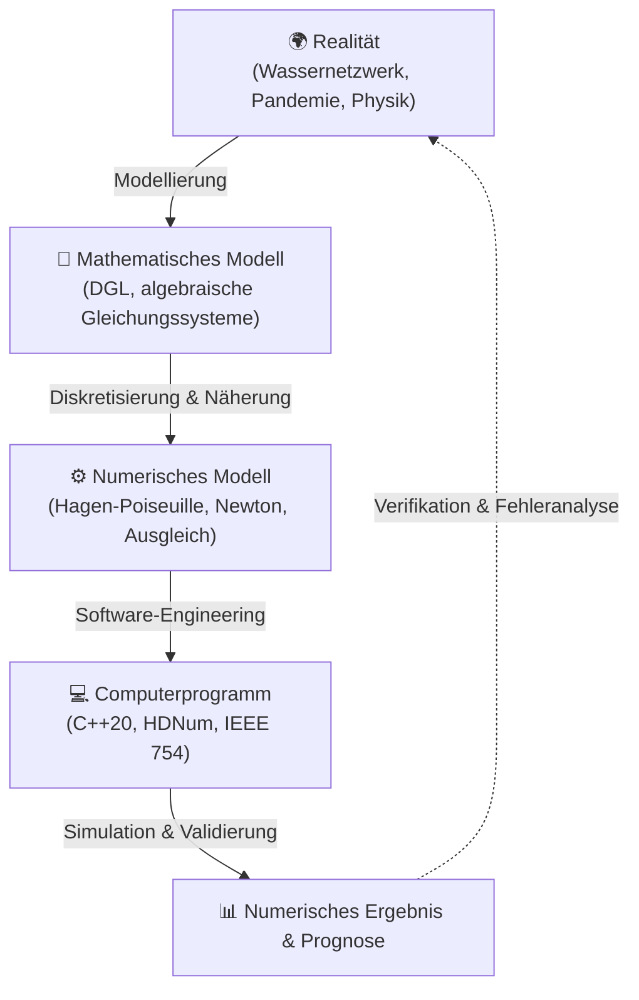

import { Badge, Card, CardGrid } from '@astrojs/starlight/components';
import LanguageSwitch from '../../../../../components/LanguageSwitch.astro';
import NumerikStudyDashboard from '../../../../../components/numerik/NumerikStudyDashboard.astro';
import NumerikVisualizerHub from '../../../../../components/numerik/NumerikVisualizerHub.astro';
import NumerikFormulaCard from '../../../../../components/numerik/NumerikFormulaCard.astro';
import NumerikConfusableCard from '../../../../../components/numerik/NumerikConfusableCard.astro';
import NumerikQuizCard from '../../../../../components/numerik/NumerikQuizCard.astro';
import NumerikCodeLab from '../../../../../components/numerik/NumerikCodeLab.astro';
import { NUMERIK_FORMULA_RULES, NUMERIK_CONFUSABLE_PAIRS, NUMERIK_QUIZ_ITEMS, NUMERIK_COURSE_INFO } from '../../../../../data/numerikData';

# 🔢 Einführung in die Numerik <Badge text="Argon UX Prototyp" variant="tip" size="medium" />

<LanguageSwitch current="de" enHref="/lectures/core-cs/numerik-prototype/" deHref="/lectures/core-cs/de/numerik-prototype/" />

Interaktives akademisches Vault- und Lernportal für die Vorlesung **Einführung in die Numerik** bei **Prof. Dr. Peter Bastian** (*Interdisziplinäres Zentrum für Wissenschaftliches Rechnen — IWR*, Universität Heidelberg, Wintersemester 2026/27).

:::tip[Warum die Argon UX-Architektur das Numerik-Verständnis transformiert]
* **Numerik muss man ausprobieren**: Statische Vorlesungsskripte verschleiern oft das dramatische Verhalten von Fließkomma-Phänomenen. Erst wenn man am Regler zieht und sieht, wie die naive pq-Formel bei $p = 10^8$ sofort $8$ signifikante Dezimalstellen im Nichts auflöst (katastrophale Auslöschung), begreift man die Notwendigkeit von Algorithmenstabilität.
* **Saubere Trennung der kognitiven Schwerpunkte**: Das Lernmodus-Dashboard gliedert den Stoff in 6 fokussierte Spezialmodi:
  1. 🔬 **Interaktive Labore & Visualisierungen**: Fließkommasysteme $\mathbb{F}(\beta,r,s)$ & IEEE 754 Sandbox, Auslöschungs-Labor ($x^2 - px + q = 0$, $e^{-20}$, Nulladdition), Rohrnetzwerk-Kirchhoff-Simulator und Corona-Epidemie-Fitting.
  2. 📐 **Formeln, Sätze & Definitionen**: 8 standardisierte 3-Zonen Bento-Cards mit LaTeX-Formeln, numerischer Intuition, Invarianten-Checklisten und Verifikationscode.
  3. ⚖️ **Numerik-Fallstricke & Vergleiche**: Direkte Gegenüberstellung chronischer Klausurfallen (*Kaufmännisch vs. Gerade Rundung*, *Kondition vs. Stabilität*, *pq-Formel vs. Vieta*, *Interpolation vs. Ausgleichsrechnung*).
  4. 🎯 **60s Micro-Quiz Simulator & Klausurzulassung**: Interaktives Prüfungstraining für die 3 Miniklausuren mit Timer, Sofort-Feedback, Fehlerursachenanalyse der Distraktoren und Skript-Zitaten.
  5. 💻 **C++ & HDNum Code-Labor**: Lauffähige, saubere Implementierungen von `nulladdition.cpp`, linearer Ausgleichsrechnung in HDNum, Newton-Optimierung und robustem Vieta-Löser.
  6. 🗂️ **Kurs-Hub & Übungsbetrieb**: 11 Übungsblätter, Klausurzulassungskriterien (mind. 50% in 2 von 3 Quizzes), Moodle-Hub und Pilotprojekt Lytris KI-Tutor.
:::

---

## 🧭 Lernmodus-Dashboard (Study Mode Navigation)

Klicke auf eine der Kacheln unten, um den **sichtbaren Modus live ohne Neuladen der Seite umzuschalten**:

<NumerikStudyDashboard activeSection="visualizers" lang="de" />

---

{/* ========================================================================= */}
{/* SECTION 1: INTERAKTIVE LABORE & VISUALISIERUNGEN */}
{/* ========================================================================= */}

## 🔬 Modus: Interaktive Labore & Visualisierungen <Badge text="4 Live-Simulatoren" variant="success" />

Numerische Mathematik lebt vom Experiment. Nutze die 4 interaktiven Labore unten, um Fließkommazahlen zu zerlegen, Rundungsverfahren zu vergleichen, Stellenauslöschung live zu provozieren und Strömungsnetzwerke in Echtzeit zu lösen:

<NumerikVisualizerHub lang="de" />

---

### 🗺️ Graphischer Überblick: Vom realen Prozess zum numerischen Ergebnis

Wie im Skript von Prof. Bastian (Vorlesung 1, Folie 10) dargestellt, bildet das wissenschaftliche Rechnen eine geschlossene Kette:

{/* ========================================================================= */}
{/* SECTION 2: FORMELN, SÄTZE & DEFINITIONEN */}
{/* ========================================================================= */}

## 📐 Modus: Formeln, Sätze & Definitionen <Badge text="8 Kern-Bento-Cards" variant="tip" />

Jede Bento-Card ist in drei Zonen unterteilt: **Kopfbereich** mit server-gerenderter $\KaTeX$-Formel, **Körper** mit geometrisch-numerischer Intuition und Invarianten-Checkliste, sowie **Fußbereich** mit lauffähigem Verifikationscode.

<CardGrid>
  {NUMERIK_FORMULA_RULES.slice(0, 4).map((rule) => (
    <NumerikFormulaCard rule={rule} lang="de" />
  ))}
</CardGrid>

<CardGrid>
  {NUMERIK_FORMULA_RULES.slice(4, 8).map((rule) => (
    <NumerikFormulaCard rule={rule} lang="de" />
  ))}
</CardGrid>

{/* ========================================================================= */}
{/* SECTION 3: NUMERIK-FALLSTRICKE & VERGLEICHE */}
{/* ========================================================================= */}

## ⚖️ Modus: Numerik-Fallstricke & Vergleiche <Badge text="6 Direkte Kontrastpaare" variant="danger" />

In Numerik-Klausuren führen subtile Begriffsverwechslungen regelmäßig zu massiven Punktabzügen. Die folgenden Kontrastkarten stellen die typischen Fallen den korrekten Konzepten gegenüber:

{NUMERIK_CONFUSABLE_PAIRS.map((pair) => (
  <NumerikConfusableCard pair={pair} lang="de" />
))}

{/* ========================================================================= */}
{/* SECTION 4: 60S MICRO-QUIZ & KLAUSURZULASSUNG */}
{/* ========================================================================= */}

## 🎯 Modus: 60s Micro-Quiz & Klausurzulassungs-Training <Badge text="10 Aufgaben • Sofort-Feedback" variant="success" />

Die Zulassung zur Klausur basiert auf **drei über das Semester verteilten 20-minütigen Miniklausuren / Quizzes**. Um zur Abschlussklausur zugelassen zu werden, müssen **mindestens zwei der drei Quizzes bestanden werden (jeweils $\ge 50\%$)**.

:::note[Trainings-Strategie für die Miniklausuren]
Die Quizzes prüfen präzise mathematische Definitionen, geometrische Intuition und schnelles Kopfrechnen (z. B. Kardinalität von $\mathbb{F}(3,2,2)$, Schranken der Nulladdition, Rundungsregeln). Klicke eine Antwort an, um sofortige Rückmeldung (**✅ Richtig** oder **❌ Falsch**) zu erhalten, die vollständige mathematische Herleitung aufzuklappen und die Distraktoren zu analysieren.
:::

{NUMERIK_QUIZ_ITEMS.map((item) => (
  <NumerikQuizCard item={item} lang="de" />
))}

{/* ========================================================================= */}
{/* SECTION 5: C++ & HDNUM CODE-LABOR */}
{/* ========================================================================= */}

## 💻 Modus: C++ & HDNum Programmierlabor <Badge text="Header-Only Lehre" variant="note" />

Alle praktischen Programmieraufgaben des Moduls basieren auf modernem C++ und der am IWR entwickelten Lehrbibliothek **HDNum**. Untersuche die lösungsorientierten Codebeispiele unten:

<NumerikCodeLab lang="de" />

{/* ========================================================================= */}
{/* SECTION 6: KURS-HUB & ÜBUNGSBETRIEB */}
{/* ========================================================================= */}

## 🗂️ Modus: Kurs-Hub & Prüfungslogistik <Badge text="Uni Heidelberg • WS 2026/27" variant="tip" />

<CardGrid>
  <Card title="Vorlesung & Dozent" icon="open-book">
    * **Dozent**: Prof. Dr. Peter Bastian
    * **Institut**: Interdisziplinäres Zentrum für Wissenschaftliches Rechnen (IWR)
    * **Semester**: Wintersemester 2026/27
    * **Moodle-Kurs**: [moodle.uni-heidelberg.de/course/view.php?id=34201](https://moodle.uni-heidelberg.de/course/view.php?id=34201)
  </Card>

  <Card title="Übungsbetrieb & Tutorien" icon="pencil">
    * **Übungsleitung**: Nils Schiefer-Frieß
    * **Umfang**: Insgesamt 11 Übungsblätter (Ausgabe montags, Besprechung in 5 Tutorien)
    * **Abgabe**: Keine Abgabepflicht; Besprechung der Musterlösungen in Präsenztutorien
  </Card>

  <Card title="Klausurzulassung & Quizzes" icon="warning">
    * **Dienstag 17.11.2026**: Quiz 1 (Übungsblätter 1–3, 20 Min.)
    * **Dienstag 08.12.2026**: Quiz 2 (Übungsblätter 4–6, 20 Min.)
    * **Dienstag 19.01.2027**: Quiz 3 (Übungsblätter 7–9, 20 Min.)
    * **Kriterium**: Mindestens **50% in zwei der drei Quizzes** zwingend erforderlich!
  </Card>

  <Card title="Software & KI-Tutor" icon="laptop">
    * **HDNum**: C++-basierte Numerikbibliothek für die Lehre (Header-only, Open Source).
    * **Lytris KI-Tutor**: Pilotprojekt der Fakultät mit dem KI-Startup Lytris aus Heilbronn zur individuellen Unterstützung beim Skript- und Aufgabenverständnis.
  </Card>
</CardGrid>

---

### 📚 Foliensätze & Begleitmaterialien im Projekt

Alle PDF-Originale und extrahierten Skripttexte sind im lokalen Studienverzeichnis organisiert:

* **Vorlesung 1**: Einführung, wissenschaftliches Rechnen, Pandemiemodellierung & Gauß-Ausgleichsrechnung &rarr; [`slides_pdf/NumerikEinfuehrung-VL01_tablet.pdf`](file:///home/nikku/Documents/Numerik/slides_pdf/NumerikEinfuehrung-VL01_tablet.pdf)
* **Vorlesung 2**: Zahlendarstellung, Fließkommasystem $\mathbb{F}(\beta,r,s)$, Rundungsarten & Maschinengenauigkeit &rarr; [`slides_pdf/NumerikEinfuehrung-VL02_tablet.pdf`](file:///home/nikku/Documents/Numerik/slides_pdf/NumerikEinfuehrung-VL02_tablet.pdf)
* **Vorlesung 3**: Fließkommaarithmetik, Konditionsanalyse, Verstärkungsfaktor $\kappa$, Satz von Taylor & Landau-Symbole &rarr; [`slides_pdf/NumerikEinfuehrung-VL03_tablet.pdf`](file:///home/nikku/Documents/Numerik/slides_pdf/NumerikEinfuehrung-VL03_tablet.pdf)
* **Vorlesung 4**: Auslöschungsanalyse, Vieta-Stabilisierung, Motivation linearer Gleichungssysteme & Rohrnetzwerke &rarr; [`slides_pdf/NumerikEinfuehrung-VL04.pdf`](file:///home/nikku/Documents/Numerik/slides_pdf/NumerikEinfuehrung-VL04.pdf)
* **Übungsblatt 1**: Mini-Fließkommasystem $\mathbb{F}(3,2,2)$, Rundung in der Praxis, Basiswechsel & Nulladdition &rarr; [`uebungen/uebung01.pdf`](file:///home/nikku/Documents/Numerik/uebungen/uebung01.pdf)
* **C++ Nulladdition**: Kompilierbarer Quellcode aus Übung 6d &rarr; [`nulladdition.cpp`](file:///home/nikku/Documents/Numerik/nulladdition.cpp)

