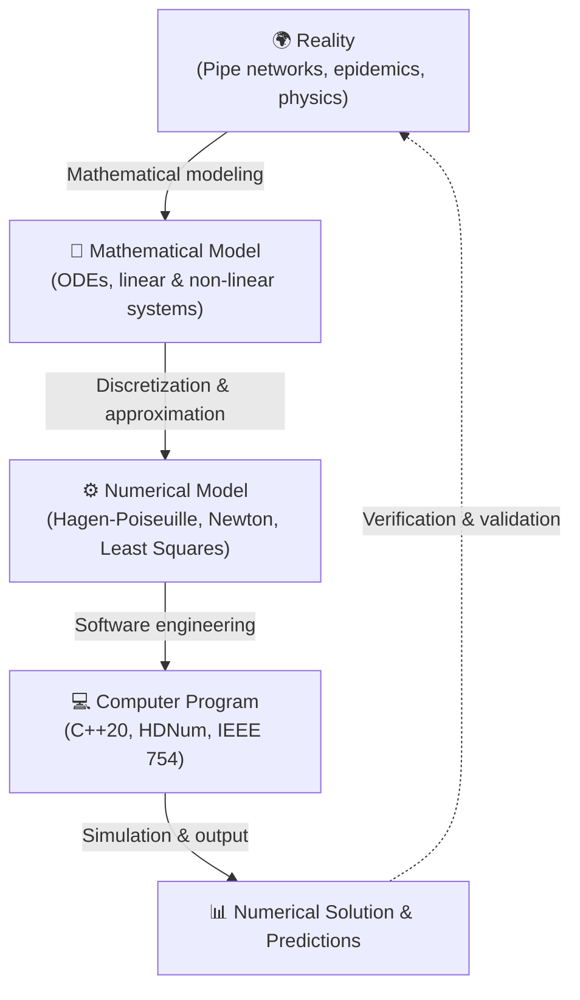

import { Badge, Card, CardGrid } from '@astrojs/starlight/components';
import LanguageSwitch from '../../../../components/LanguageSwitch.astro';
import NumerikStudyDashboard from '../../../../components/numerik/NumerikStudyDashboard.astro';
import NumerikVisualizerHub from '../../../../components/numerik/NumerikVisualizerHub.astro';
import NumerikFormulaCard from '../../../../components/numerik/NumerikFormulaCard.astro';
import NumerikConfusableCard from '../../../../components/numerik/NumerikConfusableCard.astro';
import NumerikQuizCard from '../../../../components/numerik/NumerikQuizCard.astro';
import NumerikCodeLab from '../../../../components/numerik/NumerikCodeLab.astro';
import { NUMERIK_FORMULA_RULES, NUMERIK_CONFUSABLE_PAIRS, NUMERIK_QUIZ_ITEMS, NUMERIK_COURSE_INFO } from '../../../../data/numerikData';

# 🔢 Numerical Analysis <Badge text="Argon UX Architecture" variant="tip" size="medium" />

<LanguageSwitch current="en" enHref="/lectures/core-cs/numerik-prototype/" deHref="/lectures/core-cs/de/numerik-prototype/" />

Interactive academic vault and learning prototype for **Numerical Analysis (Einführung in die Numerik)** taught by **Prof. Dr. Peter Bastian** (*Interdisciplinary Center for Scientific Computing — IWR*, Heidelberg University, Wintersemester 2026/27).

:::tip[Why the Argon UX Architecture Transforms Numerical Education]
* **Numerics requires hands-on experimentation**: Static lecture slides often hide the dramatic failure modes of floating-point representations. Only when adjusting live sliders and witnessing how the naive quadratic formula loses 8 significant decimal digits instantly at $p = 10^8$ due to catastrophic cancellation does algorithmic stability become intuitive.
* **Separation of cognitive concerns**: The study mode dashboard organizes the curriculum into 6 targeted focus modes:
  1. 🔬 **Interactive Labs & Visualizers**: Floating point system $\mathbb{F}(\beta,r,s)$ & IEEE 754 sandbox, catastrophic cancellation lab ($x^2 - px + q = 0$, $e^{-20}$, null addition), pipe network flow solver, and COVID-19 epidemic fitting.
  2. 📐 **Core Formulas, Theorems & Bounds**: 8 standardized 3-zone Bento Cards pairing LaTeX equations, numerical intuitions, invariant checklists, and verification code.
  3. ⚖️ **Numerics Confusables & Pitfalls**: Contrastive analysis of recurring exam traps (*Half-up vs. Round-to-even*, *Problem condition vs. Algorithm stability*, *Naive pq formula vs. Vieta*, *Interpolation vs. Least-squares regression*).
  4. 🎯 **60s Micro-Quiz Simulator & Exam Admission**: Multiple choice practice engine for the 3 mandatory mini-quizzes with timer, instant feedback, distractor breakdowns, and slide citations.
  5. 💻 **C++ & HDNum Code Lab**: Clean implementations of `nulladdition.cpp`, linear regression in HDNum, Newton optimization, and robust quadratic solvers.
  6. 🗂️ **Course Hub & Exam Logistics**: 11 exercise sheets, admission rules ($\ge 50\%$ on 2 of 3 quizzes), Moodle hub, and the Lytris AI Tutor pilot project.
:::

---

## 🧭 Study Mode Navigation Dashboard

Click any tile below to **dynamically switch visible page sections live** without page reloads:

<NumerikStudyDashboard activeSection="visualizers" lang="en" />

---

{/* ========================================================================= */}
{/* SECTION 1: INTERACTIVE LABS & VISUALIZERS */}
{/* ========================================================================= */}

## 🔬 Mode: Interactive Labs & Visualizers <Badge text="4 Live Simulators" variant="success" />

Numerical mathematics thrives on experimentation. Use the 4 interactive simulators below to deconstruct floating-point numbers, compare rounding methods, provoke cancellation, and solve laminar pipe flow networks in real-time:

<NumerikVisualizerHub lang="en" />

---

### 🗺️ The Scientific Computing Pipeline

As illustrated in Prof. Bastian's lecture notes (Lecture 1, Slide 10), scientific computing forms a rigorous verification loop:

{/* ========================================================================= */}
{/* SECTION 2: FORMULAS, THEOREMS & BOUNDS */}
{/* ========================================================================= */}

## 📐 Mode: Core Formulas & Theorems <Badge text="8 Core Bento Cards" variant="tip" />

Each Bento Card is structured into three distinct cognitive zones: **Header** with server-rendered $\KaTeX$ formulas, **Body** with geometric intuition and theorem invariants, and **Footer** with runnable verification code.

<CardGrid>
  {NUMERIK_FORMULA_RULES.slice(0, 4).map((rule) => (
    <NumerikFormulaCard rule={rule} lang="en" />
  ))}
</CardGrid>

<CardGrid>
  {NUMERIK_FORMULA_RULES.slice(4, 8).map((rule) => (
    <NumerikFormulaCard rule={rule} lang="en" />
  ))}
</CardGrid>

{/* ========================================================================= */}
{/* SECTION 3: NUMERICS CONFUSABLES & PITFALLS */}
{/* ========================================================================= */}

## ⚖️ Mode: Numerics Confusables & Pitfalls Spotlight <Badge text="6 Direct Contrast Pairs" variant="danger" />

Exam questions frequently exploit confusion between mathematically adjacent concepts. Inspect side-by-side comparative cards with exact rules and fatal exam traps below:

{NUMERIK_CONFUSABLE_PAIRS.map((pair) => (
  <NumerikConfusableCard pair={pair} lang="en" />
))}

{/* ========================================================================= */}
{/* SECTION 4: 60S MICRO-QUIZ SIMULATOR */}
{/* ========================================================================= */}

## 🎯 Mode: 60s Micro-Quiz Simulator & Exam Practice <Badge text="10 Interactive Tasks • Immediate Feedback" variant="success" />

Exam admission requires passing **at least two of the three 20-minute mini-quizzes** administered during the semester ($\ge 50\%$ pass mark).

:::note[Micro-Quiz Training Strategy]
These rapid-fire questions test definition precision, geometric intuition, and swift mental arithmetic (e.g. cardinality of $\mathbb{F}(3,2,2)$, null-addition boundaries, tie-breaking rounding rules). Click any answer to receive **instant feedback** (**✅ Correct** or **❌ Incorrect**), expand the detailed worked proof, and inspect why distractors fail.
:::

{NUMERIK_QUIZ_ITEMS.map((item) => (
  <NumerikQuizCard item={item} lang="en" />
))}

{/* ========================================================================= */}
{/* SECTION 5: C++ & HDNUM CODE LAB */}
{/* ========================================================================= */}

## 💻 Mode: C++ & HDNum Programming Lab <Badge text="Modern C++20" variant="note" />

All practical assignments use modern C++ and the **HDNum** teaching library developed at the IWR Heidelberg. Inspect runnable implementations below:

<NumerikCodeLab lang="en" />

{/* ========================================================================= */}
{/* SECTION 6: COURSE HUB & LOGISTICS */}
{/* ========================================================================= */}

## 🗂️ Mode: Course Hub & Exam Logistics <Badge text="Heidelberg University • WS 2026/27" variant="tip" />

<CardGrid>
  <Card title="Lecture & Instructor" icon="open-book">
    * **Lecturer**: Prof. Dr. Peter Bastian
    * **Institute**: Interdisciplinary Center for Scientific Computing (IWR)
    * **Semester**: Winter Semester 2026/27
    * **Moodle Course**: [moodle.uni-heidelberg.de/course/view.php?id=34201](https://moodle.uni-heidelberg.de/course/view.php?id=34201)
  </Card>

  <Card title="Exercises & Tutorials" icon="pencil">
    * **Head of Exercises**: Nils Schiefer-Frieß
    * **Scope**: 11 exercise sheets published weekly
    * **Submissions**: Voluntary; solutions and live code reviewed in 5 weekly tutorials
  </Card>

  <Card title="Exam Admission & Quizzes" icon="warning">
    * **Tuesday Nov 17, 2026**: Quiz 1 (Sheets 1–3, 20 min)
    * **Tuesday Dec 08, 2026**: Quiz 2 (Sheets 4–6, 20 min)
    * **Tuesday Jan 19, 2027**: Quiz 3 (Sheets 7–9, 20 min)
    * **Requirement**: Scoring at least **50% on two out of the three quizzes** is mandatory for exam admission!
  </Card>

  <Card title="Software & AI Tutor" icon="laptop">
    * **HDNum**: Header-only open-source C++ numerical library designed for higher education.
    * **Lytris AI Tutor**: Heidelberg faculty pilot project in collaboration with startup Lytris (Heilbronn) providing context-aware course script support.
  </Card>
</CardGrid>

---

### 📚 Course Slides & Project Materials

Original PDF slide decks and extracted markdown notes are cataloged in the local vault:

* **Lecture 1**: Introduction, scientific computing pipeline, epidemic growth & least-squares regression &rarr; [`slides_pdf/NumerikEinfuehrung-VL01_tablet.pdf`](file:///home/nikku/Documents/Numerik/slides_pdf/NumerikEinfuehrung-VL01_tablet.pdf)
* **Lecture 2**: Number representation, floating point $\mathbb{F}(\beta,r,s)$, rounding modes & machine precision &rarr; [`slides_pdf/NumerikEinfuehrung-VL02_tablet.pdf`](file:///home/nikku/Documents/Numerik/slides_pdf/NumerikEinfuehrung-VL02_tablet.pdf)
* **Lecture 3**: Floating point arithmetic, condition number $\kappa$, Taylor expansion & Landau notation &rarr; [`slides_pdf/NumerikEinfuehrung-VL03_tablet.pdf`](file:///home/nikku/Documents/Numerik/slides_pdf/NumerikEinfuehrung-VL03_tablet.pdf)
* **Lecture 4**: Catastrophic cancellation, Vieta stabilization, and pipe networks (Kirchhoff / Hagen-Poiseuille) &rarr; [`slides_pdf/NumerikEinfuehrung-VL04.pdf`](file:///home/nikku/Documents/Numerik/slides_pdf/NumerikEinfuehrung-VL04.pdf)
* **Exercise Sheet 1**: Mini floating point system $\mathbb{F}(3,2,2)$, rounding in practice, base conversion & null addition &rarr; [`uebungen/uebung01.pdf`](file:///home/nikku/Documents/Numerik/uebungen/uebung01.pdf)
* **C++ Null Addition**: Compilable source code from Exercise 6d &rarr; [`nulladdition.cpp`](file:///home/nikku/Documents/Numerik/nulladdition.cpp)

