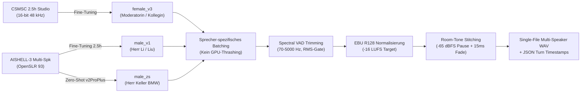

import { Badge, Card, CardGrid, Tabs, TabItem } from '@astrojs/starlight/components';
import DriveAsset from '../../../../components/DriveAsset.astro';
import DialoguePlayer from '../../../../components/DialoguePlayer.astro';
import { CHINESE_DIALOGUES } from '../../../../data/chineseDialogues';

# Chinesisch (Mandarin) <Badge text="Grundkurs & Dialoge" variant="success" size="medium" />

Interaktives Studien- und Nachschlagewerk für den Grundkurs **Chinesisch (Mandarin Sprachpraxis I & II)** am Zentralen Sprachlabor (*ZSL / heiSKILLS*) der Universität Heidelberg. 

Diese Seite bündelt die vollständigen, mit **GPT-SoVITS v3** synthetisierten **Multi-Speaker Audio-Dialoge** (Lektionen 2 bis 4), fundierte Übersichten zum **Tonsystem (Tone Sandhi)**, grammatische Kernstrukturen sowie den direkten Zugang zum **107 MB Dual-Audio Anki-Deck**.

---

## 🗺️ Schnellnavigation

| Bereich | Inhalt & thematischer Fokus | Audio / Material |
| :--- | :--- | :--- |
| **[Lektion 2: Dialoge](#lektion-2--geschäftspartner-herkunft--sprachen)** | Dialog 2.1 (Vorstellung & Nationalität) & Dialog 2.2 (Sprachen & Übersetzung) | 🎙️ 2 Multi-Speaker Audios (3 Sprecher) |
| **[Lektion 3: Dialoge](#lektion-3--einkaufszentrum-kontaktdaten--adressen)** | Dialog 3.1 (Asiamarkt & Nummern) & Dialog 3.2 (Kontaktdaten in Tianjin) | 🎙️ 2 Multi-Speaker Audios (Telefon / Fax) |
| **[Lektion 4: Dialoge](#lektion-4--uhrzeit-zeitzonen--kalender)** | Dialog 4.1 (Uhrzeit & Zeitzonen) & Dialog 4.2 (Datum, Wochentag & Kalender) | 🎙️ 2 Multi-Speaker Audios (Zeit / Kalender) |
| **[Tonsystem & Sandhi](#-tonales-system--tonwechsel-regeln-tone-sandhi)** | Die 5 Töne, $3+3 \to 2+3$, Halb-dritter Ton, `不` (*bù*) & `一` (*yī / yāo*) | 📐 Phonetische Regeln & Tonhöhen |
| **[Grammatik-Strukturen](#-grammatische-kernstrukturen-der-dialoge)** | S-Z-O-V-Regeln, Auswahlsätze mit `还是`, 4 Fragetypen, Zeitangaben | 🧩 Mustersätze & Syntax-Schemata |
| **[Course Assets](#️-course-assets--google-drive-vault)** | 107 MB Anki-Deck (`.apkg`) & Google Drive Studio-WAV Master | 💾 Google Drive Integration |

---

## 🎙️ Lektion 2 — Geschäftspartner, Herkunft & Sprachen

In Lektion 2 stehen das förmliche Vorstellen von Personen im geschäftlichen Kontext, das Erfragen von Herkunftsländern und Nationalitäten sowie Fremdsprachenkenntnisse im Mittelpunkt.

:::note[Grammatische Schlüsselmuster]
* **Vorstellen mit `介绍`**: `我介绍一下，这是……` (*Wǒ jièshào yíxià, zhè shì...* – „Ich stelle kurz vor: Das ist...“)
* **Familienname vs. Vorname**: `我姓李，叫李刚。` (*Wǒ xìng Lǐ, jiào Lǐ Gāng.* – „Mein Nachname ist Li, ich heiße Li Gang.“)
* **Höflichkeitsform**: `您` (*nín*) für Kunden und neue Geschäftspartner.
* **Nationalitätsbildung**: `[Land] + 人` (z. B. `泰国人` Thailänder, `中国人` Chinese, `日本人` Japaner, `德国人` Deutscher).
* **Auswahlsatz mit `还是` (*háishi*)**: `她是中国人还是日本人？` („Ist sie Chinesin oder Japanerin?“)
* **Rückbestätigungspartikel `吧` (*ba*)**: `...是日本名字吧？` („...ist doch ein japanischer Name, nicht wahr?“)
:::

### Dialog 2.1: Geschäftskontakte & Herkunft
*Drei-Personen-Gespräch*: Eine Kollegin stellt Herrn Li Gang und Herrn Keller von der Firma BMW einander vor. Visitenkarten werden ausgetauscht.

<DialoguePlayer
	dialogue={CHINESE_DIALOGUES[0]}
	driveFolderHref="https://drive.google.com/drive/folders/1w3qC6G6t4q0f5o2G1L7n5d3jX"
/>

---

### Dialog 2.2: Sprachkenntnisse & Übersetzung
*Zwei-Personen-Gespräch*: Zwei Kollegen sprechen über Sato Enling (佐藤燕玲), Übersetzerin der Firma mit japanischem Vater und chinesischer Mutter, die Chinesisch, Englisch und Japanisch beherrscht.

<DialoguePlayer
	dialogue={CHINESE_DIALOGUES[1]}
	driveFolderHref="https://drive.google.com/drive/folders/1w3qC6G6t4q0f5o2G1L7n5d3jX"
/>

---

## 🎙️ Lektion 3 — Einkaufszentrum, Kontaktdaten & Adressen

Lektion 3 behandelt räumliche Orientierung, das Erfragen von Ruf- und Telefaxnummern sowie das genaue Notieren von Wohn- und Büroadressen in China.

:::note[Grammatische Schlüsselmuster]
* **Ortsabfrage mit `在` & `哪儿`**: `购物中心的广告在哪儿？` (*...zài nǎr?* – „Wo ist die Werbung...?“)
* **Lokativ-Suffixe**: `里边` (*lǐbian* – innen / darin), `外边` (*wàibian* – außen).
* **Existenzanzeige mit `有`**: `里边有亚洲超市的电话号码吗？` („Gibt es darin die Telefonnummer...?“)
* **Ziffer `一` bei Rufnummern**: In Telefon- und Faxnummern wird die Ziffer `1` als **`yāo`** (幺) gesprochen, um akustische Verwechslungen mit `7` (*qī*) zu verhindern!
* **A-not-A Fragemuster**: `你有没有她的电话？` (*Nǐ yǒu méiyǒu tā de diànhuà?* – „Hast du ihre Nummer [oder nicht]?“)
* **Adressfolge vom Großen zum Kleinen**: *Land $\to$ Stadt $\to$ Straße $\to$ Hausnummer*: `天津五一路十号` (*Tiānjīn Wǔyī Lù shí hào* – Tianjin, Wuyi-Straße Nr. 10).
:::

### Dialog 3.1: Einkaufszentrum & Telefonnummern
Helen sucht nach der Anzeige des Einkaufszentrums, um Telefon- und Faxnummer des asiatischen Supermarktes herauszusuchen.

<DialoguePlayer
	dialogue={CHINESE_DIALOGUES[2]}
	driveFolderHref="https://drive.google.com/drive/folders/1w3qC6G6t4q0f5o2G1L7n5d3jX"
/>

---

### Dialog 3.2: Kontaktdaten & Adresse in Tianjin
Gespräch über die ehemalige Hamburger Studentin Zhang Lijia (张丽佳), ihre aktuelle Tätigkeit in Tianjin, ihre Anschrift und Rufnummern.

<DialoguePlayer
	dialogue={CHINESE_DIALOGUES[3]}
	driveFolderHref="https://drive.google.com/drive/folders/1w3qC6G6t4q0f5o2G1L7n5d3jX"
/>

---

## 🎙️ Lektion 4 — Uhrzeit, Zeitzonen & Kalender

Lektion 4 festigt Uhrzeitangaben, Zeitverschiebungen zwischen China (CST, UTC+8) und Deutschland (MEZ/MESZ) sowie Datums- und Wochentagsangaben.

:::note[Grammatische Schlüsselmuster]
* **Uhrzeitangabe**: `点` (*diǎn* – Stunde), `半` (*bàn* – halbe Stunde), `分` (*fēn* – Minute).
* **Tageszeitpräfixe**: Werden *vor* die Uhrzeit gesetzt: `早上` (*zǎoshang* – früher Morgen), `下午` (*xiàwǔ* – Nachmittag), z. B. `下午一点半` (13:30 Uhr).
* **Datumsreihenfolge**: Immer hierarchisch *Jahr $\to$ Monat $\to$ Tag/Nummer $\to$ Wochentag*: `二〇一〇年一月十日星期天` (Sonntag, 10. Januar 2010).
* **Wochentage**: `星期一` bis `星期六` (Montag bis Samstag, durchnummeriert 1–6), Sonntag ist `星期天` oder `星期日`.
* **Zeitliche Relationen**: `昨天` (*zuótiān* – gestern), `今天` (*jīntiān* – heute), `明天` (*míngtiān* – morgen); `去年` (*qùnián* – letztes Jahr), `今年` (*jīnnián* – dieses Jahr).
:::

### Dialog 4.1: Uhrzeit & Zeitzonen
Kollegen vergleichen die aktuelle Uhrzeit in China (13:30 Uhr) mit Deutschland unter Berücksichtigung der Sommerzeit (7:30 Uhr, 6 Stunden Zeitverschiebung).

<DialoguePlayer
	dialogue={CHINESE_DIALOGUES[4]}
	driveFolderHref="https://drive.google.com/drive/folders/1w3qC6G6t4q0f5o2G1L7n5d3jX"
/>

---

### Dialog 4.2: Datum, Wochentag & Kalender
Herr Liu und eine Kollegin diskutieren über das heutige Datum und den Geburtstag der jüngeren Schwester, bis auffällt, dass der Wandkalender noch aus dem Vorjahr stammt.

<DialoguePlayer
	dialogue={CHINESE_DIALOGUES[5]}
	driveFolderHref="https://drive.google.com/drive/folders/1w3qC6G6t4q0f5o2G1L7n5d3jX"
/>

---

## 🇨🇳 Tonales System & Tonwechsel-Regeln (Tone Sandhi)

Mandarin-Chinesisch ist eine tonale Sprache. Dieselbe Silbe hat bei unterschiedlicher Tonhöhe eine vollkommen andere lexikalische Bedeutung.

### 1. Die vier Grundtöne & der Neutralton

| Ton | Name | Tonhöhenverlauf (Chao) | Symbol | Beispiel | Bedeutung |
| :--- | :--- | :--- | :--- | :--- | :--- |
| **1. Ton** | Hoch-eben (*High level*) | $55$ (durchgehend hoch) | $\bar{a}$ | 妈 (*mā*) | Mutter |
| **2. Ton** | Steigend (*Rising*) | $35$ (mittel nach hoch) | $\acute{a}$ | 麻 (*má*) | Hanf |
| **3. Ton** | Fallend-steigend (*Dipping*) | $214$ (mittel-tief nach tief nach mittel-hoch) | $\check{a}$ | 马 (*mǎ*) | Pferd |
| **4. Ton** | Fallend (*Falling*) | $51$ (hoch nach tief) | $\grave{a}$ | 骂 (*mà*) | schimpfen |
| **Neutral** | Leichter Ton (*Light tone*) | — (kurz, unbetont, pegelt sich nach Vortontiefe) | $a$ | 吗 (*ma*) | Fragepartikel |

---

### 2. Tone Sandhi: Die unverzichtbaren Tonwechsel-Regeln

In der gesprochenen Sprache verändern sich Töne in bestimmten Wortkombinationen nach festen phonetischen Gesetzen:

#### Regel 1: Zwei aufeinanderfolgende 3. Töne ($3 + 3 \to 2 + 3$)
Treffen zwei Silben im 3. Ton aufeinander, wird die erste Silbe als **2. Ton** gesprochen (obwohl sie im Wörterbuch und in der Standard-Pinyin-Schreibung weiterhin als 3. Ton geschrieben wird):
* `你好` (*nǐ + hǎo*) $\to$ gesprochen als **`ní hǎo`**
* `可以` (*kě + yǐ*) $\to$ gesprochen als **`ké yǐ`**
* `手表` (*shǒu + biǎo*) $\to$ gesprochen als **`shóu biǎo`**

#### Regel 2: Halb-dritter Ton (*Half Third Tone: $214 \to 21$*)
Folgt auf eine Silbe im 3. Ton ein 1., 2., 4. Ton oder ein Neutralton, wird der 3. Ton **nur abgesenkt ($21$)**, ohne am Ende wieder anzusteigen. Er klingt wie ein tiefer, ebener Bass-Ton:
* `北京` (*Běijīng*): `Běi` (Ton 3) vor `jīng` (Ton 1) $\to$ tiefes $21$.
* `很忙` (*hěnmáng*): `hěn` (Ton 3) vor `máng` (Ton 2) $\to$ tiefes $21$.
* `好看` (*hǎokàn*): `hǎo` (Ton 3) vor `kàn` (Ton 4) $\to$ tiefes $21$.

#### Regel 3: Tonwechsel der Verneinungspartikel `不` (*bù*)
* Grundton: **4. Ton** vor dem 1., 2. und 3. Ton:
  * `不高` (*bù gāo* – nicht hoch)
  * `不来` (*bù lái* – nicht kommen)
  * `不好` (*bù hǎo* – nicht gut)
* Vor einem weiteren **4. Ton** wechselt `不` in den **2. Ton (*bú*)**:
  * `不是` (*bú shì* – nicht sein)
  * `不对` (*bú duì* – nicht richtig)
  * `不太` (*bú tài* – nicht sehr)

#### Regel 4: Tonwechsel des Zahlworts `一` (*yī*)
* **1. Ton (*yī*)**: Beim Zählen, in Ordnungszahlen oder am Wortende:
  * `第一` (*dì-yī* – erster)
  * `一月` (*yī yuè* – Januar)
* Vor dem **4. Ton** wechselt `一` in den **2. Ton (*yí*)**:
  * `一共` (*yí gòng* – insgesamt)
  * `一下` (*yí xià* – kurz, einmal)
  * `一块` (*yí kuài* – zusammen / ein Yuan)
* Vor dem **1., 2. und 3. Ton** wechselt `一` in den **4. Ton (*yì*)**:
  * `一天` (*yì tiān* – ein Tag, vor Ton 1)
  * `一年` (*yì nián* – ein Jahr, vor Ton 2)
  * `一起` (*yì qǐ* – gemeinsam, vor Ton 3)
* **Sonderfall Telefonnummern (`yāo`)**:
  * In Telefon-, Fax-, Zimmer- und Flugnummern wird `一` als **`yāo`** gesprochen, um akustische Verwechslung mit `七` (*qī*) über Rauschen zu vermeiden.

---

## 📐 Grammatische Kernstrukturen der Dialoge

### 1. Grundlegende Satzstellung (Die S-Z-O-V-Regel)
Im Chinesischen steht das Prädikat (Verb) wie im Englischen vor dem Objekt (**SVO**). Modifizierende Zeit- und Ortsangaben stehen jedoch **immer vor dem Prädikat**:

$$\text{Subjekt} + \text{Zeitpunkt} + \text{Ort} + [\text{Modalverb / Negation}] + \text{Verb} + \text{Objekt}$$

* *Beispiel aus Dialog 3.2*:  
  `张小姐` (Subjekt) + `现在` (Zeit) + `在天津` (Ort) + `工作` (Verb) 。  
  *(„Frau Zhang arbeitet zurzeit in Tianjin.“)*

---

### 2. Die vier Fragetypen im Chinesischen

<Tabs>
  <TabItem label="1. Partikelfragen (吗 / 呢)">
    **Ja/Nein-Frage mit `吗` (*ma*)**: Wird einfach an das Ende eines normalen Aussagesatzes gehängt:
    * Aussagesatz: `你是学生。` (*Nǐ shì xuésheng.* – Du bist Student.)
    * Frage: `你是学生吗？` (*Nǐ shì xuésheng ma?* – Bist du Student?)

    **Elliptische Rückfrage mit `呢` (*ne*)**: „Und was ist mit...?“
    * `我叫李刚。你呢？` (*Wǒ jiào Lǐ Gāng. Nǐ ne?* – Ich heiße Li Gang. Und du?)
  </TabItem>

  <TabItem label="2. Fragepronomen">
    Im Chinesischen wird bei W-Fragen die **normale Satzstellung nicht umgestellt**! Das Fragewort ersetzt exakt die Stelle im Satz, an der die Antwort stehen würde:
    * `她叫什么名字？` (*Tā jiào shénme míngzi?* – Sie heißt welchen Namen?)
    * `李先生是哪国人？` (*Lǐ xiānsheng shì nǎ guó rén?* – Herr Li ist welcher Nation?)
    * `张小姐是谁？` (*Zhāng xiǎojiě shì shéi?* – Frau Zhang ist wer?)
    * `广告在哪儿？` (*Guǎnggào zài nǎr?* – Die Werbung ist wo?)
    * `现在几点？` (*Xiànzài jǐ diǎn?* – Jetzt wie viel Uhr?)
    * `传真是多少？` (*Chuánzhēn shì duōshao?* – Das Fax ist wie viel?)
  </TabItem>

  <TabItem label="3. A-not-A (Verb-Negations-Fragen)">
    Fragen ohne Fragepartikel durch Aneinanderreihung von bejahter und verneinter Form:
    * `你有没有她的电话？` (*Nǐ yǒu méiyǒu tā de diànhuà?* – Hast du [oder hast du nicht] ihre Nummer?)
    * `你去不去中国？` (*Nǐ qù bú qù Zhōngguó?* – Gehst du nach China [oder nicht]?)
  </TabItem>

  <TabItem label="4. Auswahlsatz (还是)">
    Verbindet zwei Alternativen in einer Frage mit `还是` (*háishi* = oder):
    * `她是中国人还是日本人？` (*Tā shì Zhōngguórén háishi Rìběnrén?* – Ist sie Chinesin oder Japanerin?)
  </TabItem>
</Tabs>

---

## 🗂️ Course Assets & Google Drive Vault

Die synchronisierten Kursmaterialien, Audio-Masterdateien und das vollständige Vokabeldeck liegen im verknüpften **Google Drive Vault** bereit:

<CardGrid>
	<Card title="Anki Spaced Repetition Deck" icon="document">
		**Chinesisch Vokabeln (Alle Lektionen) — Dual-Audio v3**
		
		107 MB `.apkg` Paket mit allen 345 Vokabeln, Kontext-Beispielsätzen, Tonfarben und dualem Audio-Tempo (1.0x Normal + 0.65x Lernmodus).
		
		<DriveAsset
			title="Chinesisch Vokabeln (Alle Lektionen) — Anki Deck (107 MB)"
			type="anki"
			description="Google Drive: University/Chinesisch_Vokabeln_Alle_Lektionen.apkg"
			href="https://drive.google.com"
		/>
	</Card>

	<Card title="Studio WAV & Timestamps Master" icon="laptop">
		**Lossless Multi-Speaker Dialoge & JSON Alignment**
		
		Enthält die verlustfreien 32 kHz Broadcast-WAV-Master aller Dialoge, Room-Tone-Stitching-Informationen sowie framegenaue Timestamps für Tutor-Scoring.
		
		<DriveAsset
			title="Dialogues Master Archive (WAV & JSON)"
			type="dataset"
			description="Google Drive: University/dialogues/"
			href="https://drive.google.com"
		/>
	</Card>
</CardGrid>

---

## 🎙️ Technische Synthese-Architektur (Voice-ML v3)

Die auf dieser Seite eingebundenen Dialoge wurden mit der eigens entwickelten **Voice-ML Pipeline v3** synthetisiert:

* **Stimmen-Profile**:
  * `female_v3`: 2.5 Stunden kuratierte Studioaufnahmen aus dem CSMSC-Datensatz (`v2ProPlus` Backing, $\text{CER} \le 2.5\%$).
  * `male_v1`: 2.5 Stunden Fine-Tuning auf dem akustisch reinsten männlichen Sprecher aus AISHELL-3.
  * `male_zs`: Zero-Shot Sprecher-Extraktion für den 3-Personen-Dialog (Herr Keller / BMW).
* **Audio-Aufbereitung**:
  * Bereinigung durch spektrale Voice Activity Detection (VAD) mit Frequenz-Bandpass ($70\text{--}5000\text{ Hz}$).
  * Lautstärke-Angleichung aller Sprecher auf **$-16\text{ LUFS}$** nach ITU-R BS.1770 / EBU R128.
  * Natürliche Room-Tone-Pausen ($520\text{ ms}$ nach Aussagen, $620\text{ ms}$ nach Fragen) mit $15\text{ ms}$ Raised-Cosine-Crossfades.
