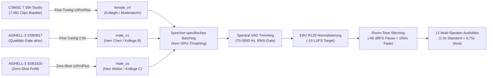

import { Badge, Card, CardGrid, Tabs, TabItem } from '@astrojs/starlight/components';
import DriveAsset from '../../../../components/DriveAsset.astro';
import DialoguePlayer from '../../../../components/DialoguePlayer.astro';
import { CHINESE_DIALOGUES } from '../../../../data/chineseDialogues';

# Chinesisch (Mandarin) <Badge text="Grundkurs & Dialoge" variant="success" size="medium" />

Interaktives Studien- und Nachschlagewerk für den Grundkurs **Chinesisch (Mandarin Sprachpraxis I & II)** am Zentralen Sprachlabor (*ZSL / heiSKILLS*) der Universität Heidelberg. 

Diese Seite bündelt die vollständigen, mit **Voice-ML v4 (GPT-SoVITS v2ProPlus)** synthetisierten **Multi-Speaker Audio-Dialoge** (Lektionen 2 bis 7), fundierte Übersichten zum **Tonsystem (Tone Sandhi)**, grammatische Kernstrukturen sowie den direkten Zugang zum **107 MB Dual-Audio Anki-Deck**.

---

## 🗺️ Schnellnavigation

| Bereich | Inhalt & thematischer Fokus | Audio / Material |
| :--- | :--- | :--- |
| **[Lektion 2: Dialoge](#lektion-2--geschäftskontakte-herkunft--sprachen)** | Dialog 2.1 (Vorstellung & Singapur) & Dialog 2.2 (Sprachen & Übersetzung) | 🎙️ 2 Multi-Speaker Audios (3 Sprecher) |
| **[Lektion 3: Dialoge](#lektion-3--messezentrum-kontaktdaten--adressen)** | Dialog 3.1 (Messebroschüre & Durchwahlen) & Dialog 3.2 (Studio in Chengdu) | 🎙️ 2 Multi-Speaker Audios (Festnetz / Adressen) |
| **[Lektion 4: Dialoge](#lektion-4--uhrzeit-zeitzonen--kalender)** | Dialog 4.1 (Uhrzeit Zürich & Sommerzeit) & Dialog 4.2 (Datum & Kalender) | 🎙️ 2 Multi-Speaker Audios (Zeit / Kalender) |
| **[Lektion 5: Dialoge](#lektion-5--büroumgebung-raumorientierung--werkstatt)** | Dialog 5.1 (Büroräume & Baupläne) & Dialog 5.2 (Weg zur Werkstatt & Kiosk) | 🎙️ 2 Multi-Speaker Audios (Orientierung / Distanzen) |
| **[Lektion 6: Dialoge](#lektion-6--industriemesse-reisen--stadt-vs-land)** | Dialog 6.1 (Messe Shanghai & Herbstferien) & Dialog 6.2 (Großstadt vs. Landleben Dali) | 🎙️ 2 Multi-Speaker Audios (Termine / Lebensstil) |
| **[Lektion 7: Dialoge](#lektion-7--restaurantkultur-sichuan-küche--aa-system)** | Dialog 7.1 (Sichuan-Küche & Menüwahl) & Dialog 7.2 (Rechnung & AA-Kostenteilung) | 🎙️ 2 Multi-Speaker Audios (Speisen / Bezahlkultur) |
| **[Tonsystem & Sandhi](#-tonales-system--tonwechsel-regeln-tone-sandhi)** | Die 5 Töne, $3+3 \to 2+3$, Halb-dritter Ton, `不` (*bù*) & `一` (*yī / yāo*) | 📐 Phonetische Regeln & Tonhöhen |
| **[Grammatik-Strukturen](#-grammatische-kernstrukturen-der-dialoge)** | S-Z-O-V-Regeln, Auswahlsätze mit `还是`, 4 Fragetypen, Zeitangaben | 🧩 Mustersätze & Syntax-Schemata |
| **[Course Assets](#️-course-assets)** | 107 MB Anki-Deck (`.apkg`) | 🚧 Work In Progress |

---

## 🎙️ Lektion 2 — Geschäftskontakte, Herkunft & Sprachen

In Lektion 2 stehen das förmliche Vorstellen von Geschäftspartnern, das Erfragen von Herkunft und Heimatstadt sowie multilinguale Kompetenzen im Mittelpunkt.

:::note[Grammatische Schlüsselmuster]
* **Vorstellen mit `介绍`**: `各位好，我来给二位介绍一下，这位是……` (*...zhè wèi shì...* – „Guten Tag allerseits, ich möchte Ihnen beiden einander vorstellen: Das ist...“)
* **Familienname vs. Vorname**: `我姓陈，名字叫陈明。` (*Wǒ xìng Chén, míngzi jiào Chén Míng.* – „Mein Nachname ist Chen, mein Name ist Chen Ming.“)
* **Höflichkeitsform**: `幸会，认识您非常高兴！` (*Xìnghuì, rènshi nín fēicháng gāoxìng!* – „Sehr erfreut, Sie kennenzulernen!“)
* **Herkunftsangabe mit `出生在`**: `陈先生出生在新加坡，现在在上海工作。` (*Chén xiānsheng chūshēng zài Xīnjiāpō...* – „Herr Chen ist in Singapur geboren...“)
* **Auswahlsatz mit `还是` (*háishi*)**: `她是日本人还是中国人呢？` („Ist sie Japanerin oder Chinesin?“)
* **Rückbestätigungspartikel `吧` (*ba*)**: `从上周起已经开始实行夏令时了吧？` („...oder? / nicht wahr?“)
:::

### Dialog 2.1: Geschäftskontakte & Herkunft
*Drei-Personen-Gespräch*: Eine Kollegin stellt Herrn Weber von der Firma Siemens und Herrn Chen Ming einander vor. Visitenkarten werden ausgetauscht und die Herkunft aus Singapur geklärt.

<DialoguePlayer
	dialogue={CHINESE_DIALOGUES[0]}
/>

---

### Dialog 2.2: Sprachkenntnisse & Übersetzung
*Zwei-Personen-Gespräch*: Zwei Kollegen sprechen über Tanaka Yahui (田中雅慧), Übersetzerin der Außenwirtschaftsabteilung mit japanischem Vater aus Tokio und chinesischer Mutter aus Peking, die Chinesisch, Deutsch und Japanisch beherrscht.

<DialoguePlayer
	dialogue={CHINESE_DIALOGUES[1]}
/>

---

## 🎙️ Lektion 3 — Messezentrum, Kontaktdaten & Adressen

Lektion 3 behandelt räumliche Orientierung im Büro, das Erfragen von Festnetznummern und Durchwahlen sowie das genaue Notieren von Wohn- und Geschäftsadressen in China.

:::note[Grammatische Schlüsselmuster]
* **Ortsabfrage mit `在` & `哪儿`**: `宣传册放在哪儿了？` (*...fàng zài nǎr le?* – „Wo ist die Broschüre abgelegt?“)
* **Lokativ-Kombinationen**: `在电脑旁边的那本文件夹里` („In dem Aktenordner neben dem Computer“).
* **Festnetz vs. Durchwahl**: `座机号码` (*zuòjī hàomǎ* – Festnetznummer) vs. `分机号` (*fēnjī hào* – Durchwahlnummer).
* **Ziffer `一` bei Rufnummern**: In Telefonnummern wird die Ziffer `1` als **`yāo`** (幺) gesprochen, um akustische Verwechslungen mit `7` (*qī*) zu verhindern!
* **A-not-A Fragemuster**: `他的私人手机号码你存了没有？` (*...nǐ cún le méiyǒu?* – „Hast du seine Handynummer abgespeichert [oder nicht]?“)
* **Adressfolge vom Großen zum Kleinen**: *Stadt $\to$ Bezirk $\to$ Straße $\to$ Hausnummer*: `青羊区春熙路六十八号` (*Qīngyáng Qū Chūnxī Lù liùshíbā hào* – Qingyang-Bezirk, Chunxi-Straße Nr. 68).
:::

### Dialog 3.1: Messezentrum & Telefonnummern
Zwei Kollegen suchen im Büro nach der Broschüre des neuen Business-Messezentrums, um die Telefonnummer der Zentrale und die Durchwahl der Marketingabteilung herauszusuchen.

<DialoguePlayer
	dialogue={CHINESE_DIALOGUES[2]}
/>

---

### Dialog 3.2: Kontaktdaten & Studio in Chengdu
Gespräch über den ehemaligen TUM-Kommilitonen Zhou Wenqiang (Zhou Ming), der in Chengdu im Stadtbezirk Qingyang ein Beratungsstudio eröffnet hat.

<DialoguePlayer
	dialogue={CHINESE_DIALOGUES[3]}
/>

---

## 🎙️ Lektion 4 — Uhrzeit, Zeitzonen & Kalender

Lektion 4 vertieft exakte Uhrzeitangaben, Zeitverschiebungen zwischen China (CST, UTC+8) und Zentraleuropa (Schweiz/Deutschland) sowie Kalenderabgleiche.

:::note[Grammatische Schlüsselmuster]
* **Uhrzeitangabe**: `点` (*diǎn* – Stunde), `刻` (*kè* – Viertelstunde, 15 Min.), `半` (*bàn* – halbe Stunde, 30 Min.).
* **Vergleichskonstruktion mit `比`**: `北京时间比瑞士快六个小时` („Peking-Zeit ist der Schweiz sechs Stunden voraus“).
* **Tageszeitpräfixe**: Werden *vor* die Uhrzeit gesetzt: `早晨` (*zǎochen* – früher Morgen), `上午` (*shàngwǔ* – Vormittag), `凌晨` (*língchén* – nachts/Frühstunden), `下午` (*xiàwǔ* – Nachmittag).
* **Datumsreihenfolge**: Immer hierarchisch *Monat $\to$ Tag $\to$ Wochentag*: `五月二十六日星期日` (Sonntag, 26. Mai).
* **Wochentage**: `周几` (*zhōu jǐ*) oder `星期几` (*xīngqī jǐ*) zur Frage nach dem Wochentag; Antworten: `周四` (Donnerstag), `周六` (Samstag), `周日` (Sonntag).
* **Relative Zeitangaben**: `前天` (*qiántiān* – vorgestern), `昨天` (*zuótiān* – gestern), `今天` (*jīntiān* – heute), `后天` (*hòutiān* – übermorgen).
:::

### Dialog 4.1: Uhrzeit & Zeitzonen Zürich
Zwei Kollegen vergleichen die aktuelle Uhrzeit in China (10:15 Uhr) mit Zürich unter Berücksichtigung der europäischen Sommerzeit (5 Stunden Differenz), um ein Online-Meeting sinnvoll zu terminieren.

<DialoguePlayer
	dialogue={CHINESE_DIALOGUES[4]}
/>

---

### Dialog 4.2: Datum, Wochentag & Kalender
Herr Abteilungsleiter Zhao und eine Kollegin ermitteln das aktuelle Datum. Ein Missverständnis klärt sich auf, als auffällt, dass der Wandkalender noch aus dem Vormonat stammt.

<DialoguePlayer
	dialogue={CHINESE_DIALOGUES[5]}
/>

---

## 🎙️ Lektion 5 — Büroumgebung, Raumorientierung & Werkstatt

Lektion 5 erweitert den Wortschatz um räumliche Orientierung im Büro- und Werksgelände, Richtungsangaben und Distanzen sowie die Vorbereitung geschäftlicher Betriebsbesichtigungen.

:::note[Grammatische Schlüsselmuster]
* **Lokativ-Nomen (Positionen)**: `上面` (*shàngmiàn* – oben/auf), `下边` (*xiàbian* – unten/darunter), `里边` (*lǐbian* – innen/in), `后边` (*hòubiān* – hinter), `前边` (*qiánbiān* – vor), `旁边` (*pángbiān* – neben), `中间` (*zhōngjiān* – Mitte/zwischen).
* **Ortspräposition `在` mit Lokativ**: `在门后边的墙上` („An der Wand hinter der Tür“), `在书架第二层` („Im zweiten Fach des Bücherregals“).
* **Entfernungsangabe mit `从...到...有多远`**: `从咱们办公楼到一号生产车间大概有多远？` („Wie weit ist es ungefähr vom Bürogebäude zur Werkstatt 1?“)
* **Distanzangabe**: `走过去大概只有两百米，非常近。` (*...zhǐ yǒu liǎngbǎi mǐ...* – „Zu Fuß sind es nur ca. 200 Meter, sehr nah.“)
* **Bewegungsverben mit `穿过`**: `穿过中间的小花园` (*chuānguò...* – „durch den kleinen Garten hindurchgehen“).
* **Höfliche Gesprächsführung**: `顺便问一下` (*shùnbiàn wèn yíxià* – „Darf ich bei der Gelegenheit fragen...“), `多谢二位` („Vielen Dank euch beiden“), `辛苦大家了` („Danke für euren Einsatz!“).
:::

### Dialog 5.1: Büroräume & Werkstattvorbereitung
*Drei-Personen-Gespräch*: Drei Kollegen suchen nach den Bauplänen des Bürogebäudes, prüfen Klimaanlage, Heizung und Büromöbel und bereiten sich auf den Kontrollbesuch von Manager Zhang vor.

<DialoguePlayer
	dialogue={CHINESE_DIALOGUES[6]}
/>

---

### Dialog 5.2: Orientierung zur Produktionswerkstatt
*Drei-Personen-Gespräch*: Die Kollegen besprechen den kurzen Fußweg zur Produktionswerkstatt 1 durch den Garten und verabreden sich zu einem kurzen Gang an die frische Luft und zum Werkskiosk.

<DialoguePlayer
	dialogue={CHINESE_DIALOGUES[7]}
/>

---

## 🎙️ Lektion 6 — Industriemesse, Reisen & Stadt vs. Land

Lektion 6 behandelt Geschäftsreisen zur Industriemesse Shanghai, Reisedauer, Jahreszeiten und Klimavorzüge sowie eine lebhafte Diskussion über das Leben in dynamischen Metropolen gegenüber der Ruhe kleinerer Städte wie Dali.

:::note[Grammatische Schlüsselmuster]
* **Zeitdauer mit `待 + Dauer`**: `咱们部门这次打算在上海待几天左右？` (*...dāi jǐ tiān...* – „Wie viele Tage plant unsere Abteilung in Shanghai zu bleiben?“)
* **Planung & Absicht mit `打算` / `计划`**: `我们计划先在展厅待四天` („Wir planen, zunächst vier Tage in der Messehalle zu verbringen“).
* **Kausalgefüge mit `为什么...？因为...`**: `为什么选秋天呢？因为那边的秋天景色很美...` („Warum im Herbst? Weil die Herbstlandschaft dort wunderschön ist...“).
* **Doppelnegation / Fragemuster mit `想不想`**: `大家想不想一起去周围的南方城市看看？` („Möchtet ihr [oder nicht] umliegende Städte im Süden besuchen?“)
* **Präferenzvergleich**: `更喜欢在大城市工作，还是更向往安静的农村生活？` („Arbeitet ihr lieber in der Großstadt oder zieht ihr das Landleben vor?“)
* **Konzessives `不过` (*búguò*)**: `不过大城市也有烦恼...` („Großstädte bringen jedoch auch Nachteile mit sich...“).
* **Adjektivsteigerung mit `比...得多`**: `生活节奏也比东部沿海慢得多` („Das Lebenstempo ist viel langsamer als an der Ostküste“).
:::

### Dialog 6.1: Industriemesse Shanghai & Reisepläne
*Drei-Personen-Gespräch*: Drei Kollegen koordinieren die Ankunft des Projektleiters für die Industriemesse Shanghai und planen im Anschluss einen herbstlichen Ausflug nach Shaoxing und Hangzhou.

<DialoguePlayer
	dialogue={CHINESE_DIALOGUES[8]}
/>

---

### Dialog 6.2: Großstadt-Dynamik vs. Landleben in Dali
*Drei-Personen-Gespräch*: Angeregte Diskussion über Vor- und Nachteile zwischen Metropolen (Chancen, Verkehrsstau) und dem entschleunigten Leben im südwestchinesischen Dali.

<DialoguePlayer
	dialogue={CHINESE_DIALOGUES[9]}
/>

---

## 🎙️ Lektion 7 — Restaurantkultur, Sichuan-Küche & AA-System

Lektion 7 vermittelt authentische Speise- und Restaurantkultur in China: Bestellen von Gerichten, Nachfragen zu Schärfegraden und Zutaten sowie die gesellschaftlichen Gepflogenheiten beim Bezahlen (Einladen vs. Kostenteilung im Kollegium).

:::note[Grammatische Schlüsselmuster]
* **Zählwörter für Speisen & Getränke**: `一份菜单` (*yí fèn càidān* – eine Speisekarte), `一壶热茶` (*yì hú rè chá* – eine Kanne heißer Tee), `三碗香米饭` (*sān wǎn xiāngmǐfàn* – drei Schalen Duftreis), `一瓶矿泉水` (*yì píng kuàngquánshuǐ* – eine Flasche Mineralwasser).
* **Vorlieben & Unverträglichkeiten**: `你们有什么忌口的吗？` (*...jìkǒu de ma?* – „Gibt es Speisen, die ihr meidet/nicht esst?“), `我不太能吃特别辣的菜` („Ich vertrage sehr scharfes Essen nicht so gut“).
* **Doppelkonjunktion `既...又...`**: `既解油腻，又能放松身心` („Sowohl fettneutralisierend als auch entspannend für Körper und Geist“), `既保留了传统风味，又融合了创新烹饪` („Bewahrt traditionelle Aromen und verbindet moderne Kochkunst“).
* **Ergebnis- & Richtungsanzeige mit `下来`**: `把这几道菜定下来` („Diese Gerichte jetzt festlegen/bestellen“).
* **Bezahlkultur & Rechnung**: `买单` (*mǎidān* – zahlen), `我来请客，大家千万不要争` („Das geht auf mich, protestiert bitte gar nicht erst!“).
* **Kostenteilung / AA-Prinzip**: `平摊餐费` (*píngtān cānfèi* – Mahlzeit gleichmäßig aufteilen) bzw. **`AA制`** (*AA-zhì* – getrennte Rechnung nach dem niederländischen Prinzip).
:::

### Dialog 7.1: Sichuan-Restaurant & Menübestellung
*Drei-Personen-Gespräch*: Drei Kollegen studieren nach Feierabend die Speisekarte eines Sichuan-Restaurants und wählen Gerichte aus: Wolfsbarsch, Tomaten-Rührei, Kung-Pao-Huhn und Longjing-Tee.

<DialoguePlayer
	dialogue={CHINESE_DIALOGUES[10]}
/>

---

### Dialog 7.2: Rechnungsbegleichung & Kostenteilung (AA-System)
*Drei-Personen-Gespräch*: Nach dem Festessen loben die Kollegen die Spezialitäten und klären die Abrechnung – die Gastgeberin möchte einladen, die Kollegen plädieren für faire Kostenteilung (AA-System).

<DialoguePlayer
	dialogue={CHINESE_DIALOGUES[11]}
/>

---

## 🇨🇳 Tonales System & Tonwechsel-Regeln (Tone Sandhi)

Mandarin-Chinesisch ist eine tonale Sprache. Dieselbe Silbe hat bei unterschiedlicher Tonhöhe eine vollkommen andere lexikalische Bedeutung.

### 1. Die vier Grundtöne & der Neutralton

| Ton | Name | Tonhöhenverlauf (Chao) | Symbol | Beispiel | Bedeutung |
| :--- | :--- | :--- | :--- | :--- | :--- |
| **1. Ton** | Hoch-eben (*High level*) | $55$ (durchgehend hoch) | $\bar{a}$ | 妈 (*mā*) | Mutter |
| **2. Ton** | Steigend (*Rising*) | $35$ (mittel nach hoch) | $\acute{a}$ | 麻 (*má*) | Hanf |
| **3. Ton** | Fallend-steigend (*Dipping*) | $214$ (mittel-tief nach tief nach mittel-hoch) | $\check{a}$ | 马 (*mǎ*) | Pferd |
| **4. Ton** | Fallend (*Falling*) | $51$ (hoch nach tief) | $\grave{a}$ | 骂 (*mà*) | schimpfen |
| **Neutral** | Leichter Ton (*Light tone*) | — (kurz, unbetont, pegelt sich nach Vortontiefe) | $a$ | 吗 (*ma*) | Fragepartikel |

---

### 2. Tone Sandhi: Die unverzichtbaren Tonwechsel-Regeln

In der gesprochenen Sprache verändern sich Töne in bestimmten Wortkombinationen nach festen phonetischen Gesetzen:

#### Regel 1: Zwei aufeinanderfolgende 3. Töne ($3 + 3 \to 2 + 3$)
Treffen zwei Silben im 3. Ton aufeinander, wird die erste Silbe als **2. Ton** gesprochen (obwohl sie im Wörterbuch und in der Standard-Pinyin-Schreibung weiterhin als 3. Ton geschrieben wird):
* `你好` (*nǐ + hǎo*) $\to$ gesprochen als **`ní hǎo`**
* `可以` (*kě + yǐ*) $\to$ gesprochen als **`ké yǐ`**
* `手表` (*shǒu + biǎo*) $\to$ gesprochen als **`shóu biǎo`**

#### Regel 2: Halb-dritter Ton (*Half Third Tone: $214 \to 21$*)
Folgt auf eine Silbe im 3. Ton ein 1., 2., 4. Ton oder ein Neutralton, wird der 3. Ton **nur abgesenkt ($21$)**, ohne am Ende wieder anzusteigen. Er klingt wie ein tiefer, ebener Bass-Ton:
* `北京` (*Běijīng*): `Běi` (Ton 3) vor `jīng` (Ton 1) $\to$ tiefes $21$.
* `很忙` (*hěnmáng*): `hěn` (Ton 3) vor `máng` (Ton 2) $\to$ tiefes $21$.
* `好看` (*hǎokàn*): `hǎo` (Ton 3) vor `kàn` (Ton 4) $\to$ tiefes $21$.

#### Regel 3: Tonwechsel der Verneinungspartikel `不` (*bù*)
* Grundton: **4. Ton** vor dem 1., 2. und 3. Ton:
  * `不高` (*bù gāo* – nicht hoch)
  * `不来` (*bù lái* – nicht kommen)
  * `不好` (*bù hǎo* – nicht gut)
* Vor einem weiteren **4. Ton** wechselt `不` in den **2. Ton (*bú*)**:
  * `不是` (*bú shì* – nicht sein)
  * `不对` (*bú duì* – nicht richtig)
  * `不太` (*bú tài* – nicht sehr)

#### Regel 4: Tonwechsel des Zahlworts `一` (*yī*)
* **1. Ton (*yī*)**: Beim Zählen, in Ordnungszahlen oder am Wortende:
  * `第一` (*dì-yī* – erster)
  * `一月` (*yī yuè* – Januar)
* Vor dem **4. Ton** wechselt `一` in den **2. Ton (*yí*)**:
  * `一共` (*yí gòng* – insgesamt)
  * `一下` (*yí xià* – kurz, einmal)
  * `一块` (*yí kuài* – zusammen / ein Yuan)
* Vor dem **1., 2. und 3. Ton** wechselt `一` in den **4. Ton (*yì*)**:
  * `一天` (*yì tiān* – ein Tag, vor Ton 1)
  * `一年` (*yì nián* – ein Jahr, vor Ton 2)
  * `一起` (*yì qǐ* – gemeinsam, vor Ton 3)
* **Sonderfall Telefonnummern (`yāo`)**:
  * In Telefon-, Fax-, Zimmer- und Flugnummern wird `一` als **`yāo`** gesprochen, um akustische Verwechslung mit `七` (*qī*) über Rauschen zu vermeiden.

---

## 📐 Grammatische Kernstrukturen der Dialoge

### 1. Grundlegende Satzstellung (Die S-Z-O-V-Regel)
Im Chinesischen steht das Prädikat (Verb) wie im Englischen vor dem Objekt (**SVO**). Modifizierende Zeit- und Ortsangaben stehen jedoch **immer vor dem Prädikat**:

$$
\text{Subjekt} + \text{Zeitpunkt} + \text{Ort} + [\text{Modalverb / Negation}] + \text{Verb} + \text{Objekt}
$$

* *Beispiel aus Dialog 2.1*:  
  `陈先生` (Subjekt) + `现在` (Zeit) + `在上海` (Ort) + `工作` (Verb) 。  
  *(„Herr Chen arbeitet zurzeit in Shanghai.“)*

---

### 2. Die vier Fragetypen im Chinesischen

<Tabs>
  <TabItem label="1. Partikelfragen (吗 / 呢)">
    **Ja/Nein-Frage mit `吗` (*ma*)**: Wird einfach an das Ende eines normalen Aussagesatzes gehängt:
    * Aussagesatz: `你是学生。` (*Nǐ shì xuésheng.* – Du bist Student.)
    * Frage: `你是学生吗？` (*Nǐ shì xuésheng ma?* – Bist du Student?)

    **Elliptische Rückfrage mit `呢` (*ne*)**: „Und was ist mit...?“
    * `看名字，她是日本人还是中国人呢？` (*Kàn míngzi, tā shì Rìběnrén háishi Zhōngguórén ne?* – Dem Namen nach, ist sie Japanerin oder Chinesin?)
  </TabItem>

  <TabItem label="2. Fragepronomen">
    Im Chinesischen wird bei W-Fragen die **normale Satzstellung nicht umgestellt**! Das Fragewort ersetzt exakt die Stelle im Satz, an der die Antwort stehen würde:
    * `她叫什么？` (*Tā jiào shénme?* – Sie heißt wie?)
    * `您的家乡在哪里？` (*Nín de jiāxiāng zài nǎli?* – Ihre Heimatstadt liegt wo?)
    * `宣传册放在哪儿了？` (*Xuānchuáncè fàng zài nǎr le?* – Wo liegt die Broschüre?)
    * `咱们这边目前是几点钟？` (*Zánmen zhèbiān mùqián shì jǐ diǎn zhōng?* – Wie viel Uhr ist es bei uns?)
    * `分机号是多少？` (*Fēnjī hào shì duōshao?* – Die Durchwahlnummer ist wie viel?)
    * `今天这一桌一共是多少钱？` (*Jīntiān zhè yì zhuō yígòng shì duōshao qián?* – Wie viel macht dieser Tisch insgesamt?)
  </TabItem>

  <TabItem label="3. A-not-A (Verb-Negations-Fragen)">
    Fragen ohne Fragepartikel durch Aneinanderreihung von bejahter und verneinter Form:
    * `你找过抽屉里边没有？` (*Nǐ zhǎoguo chōuti lǐbian méiyǒu?* – Hast du in der Schublade nachgesehen [oder nicht]?)
    * `大家想不想一起去周围的南方城市看看？` (*Dàjiā xiǎng bu xiǎng...* – Möchtet ihr [oder nicht] umliegende Städte besuchen?)
  </TabItem>

  <TabItem label="4. Auswahlsatz (还是)">
    Verbindet zwei Alternativen in einer Frage mit `还是` (*háishi* = oder):
    * `喝的大家想要茶水还是鲜榨果汁？` (*...xiǎng yào cháshuǐ háishi xiānzhà guǒzhī?* – Möchtet ihr als Getränk Tee oder frisch gepressten Saft?)
    * `更喜欢在大城市工作，还是更向往安静的农村生活？` (*...háishi gèng xiàngwǎng...* – Lieber Großstadt oder eher Landleben?)
  </TabItem>
</Tabs>

---

## 🗂️ Course Assets

Die synchronisierten Kursmaterialien und das vollständige Vokabeldeck stehen als Anki Spaced-Repetition-Paket bereit:

<CardGrid>
	<Card title="Anki Spaced Repetition Deck" icon="document">
		**Chinesisch Vokabeln (Alle Lektionen) — Dual-Audio v4**
		
		107 MB `.apkg` Paket mit allen 345 Vokabeln, Kontext-Beispielsätzen, Tonfarben und dualem Audio-Tempo (1.0x Normal + 0.65x Lernmodus).
		
		<DriveAsset
			title="Chinesisch Vokabeln (Alle Lektionen) — Anki Deck (107 MB)"
			type="anki"
			description="Bereitstellung & Audio-Verifikation in Bearbeitung"
			wip={true}
			wipLabel="Work In Progress"
		/>
	</Card>
</CardGrid>

---

## 🎙️ Technische Synthese-Architektur (Voice-ML v4)

Die auf dieser Seite eingebundenen Dialoge wurden mit der eigens entwickelten **Voice-ML Pipeline v4 (GPT-SoVITS v2ProPlus)** synthetisiert:

* **Stimmen-Profile (Milestone D / v4)**:
  * `female_v4`: Fine-Tuning auf **7,50 Stunden (7.081 Audio-Clips)** kuratierten Studioaufnahmen aus CSMSC (BZNSYP). Beseitigt synthetische Artefakte bei identisch niedriger Zeichenfehlerrate ($\text{CER} = 5{,}70\%$ auf Whisper `large-v3` ohne Halluzinationsausreißer).
  * `male_v1`: 2,5 Stunden Fine-Tuning auf dem akustisch reinsten Sprecher (SSB0817 aus AISHELL-3). Unter Claude's Quality-Preservation-Gate intakt gehalten, um Überanpassung zu verhindern.
  * `male_zs`: Zero-Shot Sprecherprofil (SSB1630) für Dritte im Drei-Personen-Dialog.
* **Audio-Aufbereitung & Features**:
  * Bereinigung durch spektrale Voice Activity Detection (VAD) mit Frequenz-Bandpass ($70\text{--}5000\text{ Hz}$).
  * Lautstärke-Angleichung aller Sprecher auf **$-16\text{ LUFS}$** nach ITU-R BS.1770 / EBU R128.
  * Natürliche Room-Tone-Pausen ($520\text{ ms}$ nach Aussagen, $620\text{ ms}$ nach Fragen) mit $15\text{ ms}$ Raised-Cosine-Crossfades.
  * Dual-Speed-Bereitstellung: 1.0x Standardtempo sowie 0.75x Lerntempo für intensives Satz-Shadowing.
* **Urheberrechtliche Konformität (Milestone D)**:
  * 100% neu verfasste Dialoge (0% Lehrbuch-Verbatim-Überlappung), dokumentiert im Originalitätsbericht (`reports/v4_dialogue_originality.md`).
  * 12 Dialoge über 6 Lektionen (108 Turns) für eine didaktisch kontinuierliche Sprachpraxis.
