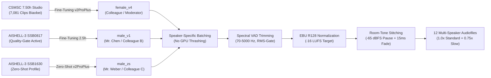

import { Badge, Card, CardGrid, Tabs, TabItem } from '@astrojs/starlight/components';
import DriveAsset from '../../../../../../components/DriveAsset.astro';
import DialoguePlayer from '../../../../../../components/DialoguePlayer.astro';
import LanguageSwitch from '../../../../../../components/LanguageSwitch.astro';
import { CHINESE_DIALOGUES } from '../../../../../../data/chineseDialogues';

# Chinese (Mandarin) <Badge text="Foundation Course & Dialogues" variant="success" size="medium" />

<LanguageSwitch current="en" enHref="/lectures/languages/chinese/en/" deHref="/lectures/languages/chinese/" />

:::note[Copyright & Licensing Notice Regarding Audio Dialogues]
**Precautionary dialogue update:** Due to an unconfirmed copyright/licensing issue regarding the course textbook, the dialogues have been temporarily replaced with newly composed, royalty-free dialogues and re-synthesized using the Voice-ML pipeline. Once publisher confirmation/clearance is obtained, the original textbook dialogues will be restored.
:::

Interactive study and reference vault for the foundation course **Chinese (Mandarin Language Practice I & II)** at the Central Language Laboratory (*ZSL / heiSKILLS*) of Heidelberg University.

This page bundles the complete **multi-speaker audio dialogues** (Lessons 2 to 10 with all 18 dialogues) synthesized with **Voice-ML v4 (GPT-SoVITS v2ProPlus)**, comprehensive guides to the **tonal system (Tone Sandhi)**, systematic 7-part **grammar compendium**, and direct access to the **128 MB dual-audio Anki deck**.

:::tip[✨ Interactive Design Prototype (Argon UX Architecture)]
Want to test the new modular dashboard design featuring 3-zone GrammarCards, Pinyin active-recall modes, and confusable pair comparisons?  
👉 **[Open the interactive Chinese Design Prototype →](/lectures/languages/chinese/en/prototype/)**
:::

---

## 🗺️ Quick Navigation

| Section | Content & Focus | Audio / Materials |
| :--- | :--- | :--- |
| **[Lesson 2: Dialogues](#lesson-2--business-contacts-origins--languages)** | Dialogue 2.1 (Introductions & Singapore) & Dialogue 2.2 (Languages & Translation) | 🎙️ 2 Multi-Speaker Audios (3 Speakers) |
| **[Lesson 3: Dialogues](#lesson-3--exhibition-center-contact-details--addresses)** | Dialogue 3.1 (Exhibition Brochure & Extensions) & Dialogue 3.2 (Studio in Chengdu) | 🎙️ 2 Multi-Speaker Audios (Landline / Addresses) |
| **[Lesson 4: Dialogues](#lesson-4--time-time-zones--calendar)** | Dialogue 4.1 (Zurich Time & Daylight Saving) & Dialogue 4.2 (Dates & Calendar) | 🎙️ 2 Multi-Speaker Audios (Time / Calendar) |
| **[Lesson 5: Dialogues](#lesson-5--office-premises-spatial-orientation--workshop)** | Dialogue 5.1 (Office Floorplans & Inspection) & Dialogue 5.2 (Way to Workshop & Kiosk) | 🎙️ 2 Multi-Speaker Audios (Directions / Distances) |
| **[Lesson 6: Dialogues](#lesson-6--industrial-fair-travel--city-vs-countryside)** | Dialogue 6.1 (Shanghai Fair & Autumn Vacation) & Dialogue 6.2 (Metropolis vs. Rural Dali) | 🎙️ 2 Multi-Speaker Audios (Schedules / Lifestyle) |
| **[Lesson 7: Dialogues](#lesson-7--restaurant-culture-sichuan-cuisine--aa-system)** | Dialogue 7.1 (Sichuan Cuisine & Menu Ordering) & Dialogue 7.2 (Bill & AA Cost-Sharing) | 🎙️ 2 Multi-Speaker Audios (Dishes / Dining Customs) |
| **[Lesson 8: Dialogues](#lesson-8--shopping-electronics--price-bargaining)** | Dialogue 8.1 (Electronics Store & Receipt) & Dialogue 8.2 (Clothing Market & Bargaining) | 🎙️ 2 Multi-Speaker Audios (Shopping / Discounts) |
| **[Lesson 9: Dialogues](#lesson-9--schedules-lunch-invitations--evening-plans)** | Dialogue 9.1 (Weekend Shift & Lunch) & Dialogue 9.2 (After-Hours & Cinema) | 🎙️ 2 Multi-Speaker Audios (Appointments / Leisure) |
| **[Lesson 10: Dialogues](#lesson-10--business-dinner-dining-culture--comparisons)** | Dialogue 10.1 (Menu Advice & Ordering) & Dialogue 10.2 (Drinks, Toast & Bill) | 🎙️ 2 Multi-Speaker Audios (Dining / Banquets) |
| **[Tonal System & Sandhi](#-tonal-system--tone-change-rules-tone-sandhi)** | The 5 Tones, $3+3 \to 2+3$, Half-Third Tone, `不` (*bù*) & `一` (*yī / yāo*) | 📐 Phonetic Rules & Pitch Contours |
| **[Grammar Compendium](#-systematic-grammar-compendium-lessons-210)** | All 26 core rules across Lessons 2–10 (Syntax, Locatives, Aspects, Pivots, Comparisons) | 🧩 Model Sentences & Syntax Patterns |
| **[Course Assets](#️-course-assets)** | 560-Note Master Anki Deck (`.apkg`) & 10 Modular Packs | 🚧 Work In Progress |

---

## 🎙️ Lesson 2 — Business Contacts, Origins & Languages

Lesson 2 introduces the fundamental sentence order of Mandarin, the tonal system, question formation with `吗` (*ma*), and the core verbs `是` (*shì* – to be), `叫` (*jiào* – to be called), and `在` (*zài* – to be located at).

:::note[Key Grammatical Patterns]
* **S-V-O Word Order**: `陈先生现在在上海工作。` ("Mr. Chen is currently working in Shanghai.")
* **Particle Questions with `吗`**: Turns a statement into a Yes/No question without inverting word order: `您是韦伯先生吗？` ("Are you Mr. Weber?")
* **Question Pronouns**: `您贵姓？` ("What is your honorable surname?"), `她叫什么名字？` ("What is her name?")
* **The Possessive Particle `的` (*de*)**: `这是我的名片。` ("This is my business card.")
:::

### Dialogue 2.1: Business Contacts & Origin
Three-party dialogue: Colleague A introduces Mr. Weber (Siemens) and Mr. Chen Ming to each other. Business cards are exchanged, and Mr. Chen's Singaporean background is discussed.

<DialoguePlayer
	dialogue={CHINESE_DIALOGUES[0]}
	lang="en"
/>

---

### Dialogue 2.2: Language Skills & Translation
Three colleagues discuss German, English, and Chinese language proficiencies, translation assignments for the Siemens delegation, and native accents.

<DialoguePlayer
	dialogue={CHINESE_DIALOGUES[1]}
	lang="en"
/>

---

## 🎙️ Lesson 3 — Exhibition Center, Contact Details & Addresses

Lesson 3 focuses on giving phone numbers (using `yāo` for 1), expressing email addresses, spatial prepositions, and searching for contact details.

:::note[Key Grammatical Patterns]
* **Pronunciation of 1 in numbers**: The numeral `一` (*yī*) is spoken as **`yāo`** in telephone numbers, room numbers, and extensions to prevent acoustic confusion with `七` (*qī* – 7).
* **Existential Location with `在` (*zài*)**: `宣传册在桌子上。` ("The brochure is on the table.")
* **Wh-Questions with `哪儿 / 哪里` (*nǎr / nǎli*)**: `宣传册放在哪儿了？` ("Where was the brochure placed?")
* **Large Numbers & Quantities**: Extension numbers with `分机号是多少？` ("What is the extension number?")
:::

### Dialogue 3.1: Exhibition Center & Phone Numbers
Colleagues prepare exhibition materials for the Shanghai Fair, search for the brochure, and note down phone and extension numbers.

<DialoguePlayer
	dialogue={CHINESE_DIALOGUES[2]}
	lang="en"
/>

---

### Dialogue 3.2: Contact Details & Studio in Chengdu
Discussion of company contact details, branch addresses, email exchanges, and Mr. Weber's photography studio in Chengdu.

<DialoguePlayer
	dialogue={CHINESE_DIALOGUES[3]}
	lang="en"
/>

---

## 🎙️ Lesson 4 — Time, Time Zones & Calendar

Lesson 4 covers telling the time (`点`, `分`, `刻`, `半`), calendar dates (year-month-day hierarchy), weekdays, and time zone differences between Germany/Switzerland (CET/CEST) and Beijing (CST, UTC+8).

:::note[Key Grammatical Patterns]
* **Time from Largest to Smallest**: `二〇二六年十月二十四日下午三点一刻` (Year $\to$ Month $\to$ Day $\to$ Time of day $\to$ Hour $\to$ Minute).
* **Time as Adverbial Modifier**: Placed **before** the main verb: `我们明天上午九点开会。` ("We hold our meeting tomorrow morning at 9:00 AM.")
* **Time Zones**: `瑞士现在比北京慢六个小时。` ("Switzerland is currently six hours behind Beijing.")
* **Alternative Questions with `还是` (*háishi*)**: `今天是星期二还是星期三？` ("Is today Tuesday or Wednesday?")
:::

### Dialogue 4.1: Time & Zurich Time Zones
Colleagues check local time in Shanghai vs. Zurich headquarters, discuss daylight saving time, and schedule an international conference call.

<DialoguePlayer
	dialogue={CHINESE_DIALOGUES[4]}
	lang="en"
/>

---

### Dialogue 4.2: Date, Weekday & Calendar
Scheduling coordination: Checking dates on the calendar, weekdays, upcoming project milestones, and flight departures.

<DialoguePlayer
	dialogue={CHINESE_DIALOGUES[5]}
	lang="en"
/>

---

## 🎙️ Lesson 5 — Office Premises, Spatial Orientation & Workshop

Lesson 5 covers directional locatives (方位词: `前边`, `后边`, `左边`, `右边`, `对面`), office floorplans, building levels, and distance descriptions.

:::note[Key Grammatical Patterns]
* **Locative Nouns**: `在 + [Noun] + [Position]` (e.g., `在电脑旁边` – next to the computer, `在二楼` – on the 2nd floor).
* **Chinese Floor Numbering**: Ground floor is **一楼 (*yī lóu*)**! The European 1st upper floor is therefore **二楼 (*èr lóu*)** in Chinese!
* **Existential `有` (*yǒu*) vs. Positional `在` (*zài*)**:
  * `桌子上有一台笔记本电脑。` ("On the desk there is a laptop.")
  * `笔记本电脑在桌子上。` ("The laptop is on the desk.")
:::

### Dialogue 5.1: Office Premises & Workshop Inspection
The team reviews room plans for the new office building, searches for technical documents, and prepares an inspection of Workshop 2.

<DialoguePlayer
	dialogue={CHINESE_DIALOGUES[6]}
	lang="en"
/>

---

### Dialogue 5.2: Direction to the Production Workshop
Colleagues walk across the industrial park, ask for directions to the production workshop, and stop by the company cafeteria.

<DialoguePlayer
	dialogue={CHINESE_DIALOGUES[7]}
	lang="en"
/>

---

## 🎙️ Lesson 6 — Industrial Fair, Travel & City vs. Countryside

Lesson 6 explores business travel to Shanghai, vacation planning, duration expressions (how long vs. when), modal verbs `要` (*yào*) and `想` (*xiǎng*), and comparative living preferences.

:::note[Key Grammatical Patterns]
* **Duration vs. Point of Time**: Point of time precedes the verb (`明天下午到`), duration follows the verb (`待四个星期`).
* **Modal Verbs**: `想` (*xiǎng* – would like to) vs. `要` (*yào* – intend to / will). Both negated by **不想 (*bù xiǎng*)**!
* **Purpose Sentences with `去` (*qù*)**: `去慕尼黑参观工业展` ("go to Munich to visit the industrial exhibition").
* **Measure Words**: The universal measure word `个` (*ge*), except for `天` (*tiān*) and `年` (*nián*) which never take `个`!
:::

### Dialogue 6.1: Shanghai Industrial Fair & Travel Plans
Colleagues coordinate their participation in the Shanghai Autumn Technology Fair, hotel stays, and subsequent vacation plans in Yunnan.

<DialoguePlayer
	dialogue={CHINESE_DIALOGUES[8]}
	lang="en"
/>

---

### Dialogue 6.2: Metropolis Dynamics vs. Countryside in Dali
Three colleagues debate living in bustling metropolises (Shanghai, Munich) versus relaxing rural towns like Dali in Yunnan.

<DialoguePlayer
	dialogue={CHINESE_DIALOGUES[9]}
	lang="en"
/>

---

## 🎙️ Lesson 7 — Restaurant Culture, Sichuan Cuisine & AA System

Lesson 7 immerses into Chinese culinary culture, ordering authentic Sichuan dishes, understanding spice levels, toasting etiquette, and the AA bill-splitting convention (*AA制*).

:::note[Key Grammatical Patterns]
* **Serial Verb Construction for Transport**: `坐地铁去饭店` ("take the subway to the restaurant").
* **Directional Vectors with `往` (*wǎng*)**: `往右拐` ("turn right"), `往前走` ("go straight forward").
* **Distance with `离` (*lí*)**: `饭店离这里不远` ("The restaurant is not far from here").
* **AA System**: `咱们AA制吧！` ("Let's split the bill evenly / go Dutch!")
:::

### Dialogue 7.1: Sichuan Restaurant & Ordering Dishes
Colleagues visit a traditional Sichuan restaurant, consult the waiter on signature dishes (Kung Pao Chicken, Mapo Tofu), and adjust the spice levels.

<DialoguePlayer
	dialogue={CHINESE_DIALOGUES[10]}
	lang="en"
/>

---

### Dialogue 7.2: Settling the Bill & AA Split (Go Dutch)
After dinner, the host offers to treat the table, but her colleagues politely insist on splitting the bill equally according to the AA system.

<DialoguePlayer
	dialogue={CHINESE_DIALOGUES[11]}
	lang="en"
/>

---

## 🎙️ Lesson 8 — Shopping, Electronics & Price Bargaining

Lesson 8 focuses on retail purchasing conversations, measure words with demonstratives, the Chinese discount system (*dǎzhé*), verb reduplication, and evening market bargaining.

:::note[Key Grammatical Patterns]
* **Verb Reduplication (`V-V` / `V-yī-V`)**: Lightens an action into an informal or tentative trial: `看（一）看` (take a brief look), `试一下` (try it on for a second).
* **The Chinese Discount Formula (`打 x 折` *dǎ x zhé*)**: Expresses the **remaining payment fraction** in tenths! `打八折` means the customer pays 80%, receiving a **20% discount**! `打八五折` = 15% off.
* **Large Numbers**: `百` (*bǎi* – 100), `千` (*qiān* – 1,000), `万` (*wàn* – 10,000). The digit zero (`零` *líng*) is vocalized exactly once across internal zero intervals.
* **Demonstrative Pattern**: `这种优盘多少钱？` ("How much is this type of USB flash drive?").
:::

### Dialogue 8.1: Electronics in the Department Store & Official Invoice
Two colleagues (A and C) purchase USB drives, optical discs, a mobile phone recharge card, and camera batteries from a sales assistant (B) ahead of a conference and request an official corporate invoice (*Fāpiào*).

<DialoguePlayer
	dialogue={CHINESE_DIALOGUES[12]}
	lang="en"
/>

---

### Dialogue 8.2: Clothing, Colors & Bargaining at the Night Market
Two colleagues (A and C) stroll through an evening apparel market, browse silk neckties and a dark blue dress shirt with a merchant (B), and negotiate discount percentages (*dǎzhé*).

<DialoguePlayer
	dialogue={CHINESE_DIALOGUES[13]}
	lang="en"
/>

---

## 🎙️ Lesson 9 — Schedules, Lunch Invitations & Evening Plans

Lesson 9 covers weekend duty rosters, shift schedules, Sunday dining invitations, pivotal (telescoped) sentences with `请` (*qǐng*), and the progressive aspect with `（正）在` (*[zhèng]zài*).

:::note[Key Grammatical Patterns]
* **Pivotal Sentences (兼语句 / Telescoped Structure)**: `S + 请 / 让 / 要 + [Pivot Object] + [Second Predicate]`: The direct object of the first verb serves simultaneously as the subject of the second action! (`我想请你去吃午饭` – "I would like to invite you to have lunch").
* **Progressive Aspect**: `（正）在 + Verb`: Indicates an action actively unfolding at the moment of speech (`我正在看电影` – "I am currently watching a movie").
* **Cooperation**: `跟 / 和 + [Person] + 一起 + Verb` (e.g., `跟他一起去` – go together with him).
* **Shift Phases**: `上班` (*shàng bān* – begin work shift) ↔ `下班` (*xià bān* – finish work shift).
:::

### Dialogue 9.1: Weekend Duty Shift & Sunday Lunch Invitation
Speaker A invites colleagues B and C to a Saturday Sichuan lunch. Because colleague B has morning duty until noon and afternoon commitments, they reschedule their gathering to Sunday at 12:00 PM.

<DialoguePlayer
	dialogue={CHINESE_DIALOGUES[14]}
	lang="en"
/>

---

### Dialogue 9.2: Evening Schedules & Movie Outing
Following Chinese class, Speaker A inquires about what colleagues B and C are currently engaged with and joins them for the evening screening of the newly released Jackie Chan feature.

<DialoguePlayer
	dialogue={CHINESE_DIALOGUES[15]}
	lang="en"
/>

---

## 🎙️ Lesson 10 — Business Dinner, Dining Culture & Comparisons

Lesson 10 covers restaurant hospitality, ordering Chinese culinary specialties, perceptual potential complements (*kàndedǒng*), comparative sentences with `比` (*bǐ*), and customary banqueting etiquette (*gānbēi*, *mǎidān*).

:::note[Key Grammatical Patterns]
* **Comparative Construction with `比`**: `A + 比 + B + Adjective` (e.g., `这儿比那边安静` – "Here is quieter than over there").
* **Potential Complement of Comprehension**: `Verb + 得 / 不 + 懂` (`看得懂` – able to read and understand ↔ `看不懂` – unable to decipher/comprehend).
* **Experiential Aspect Particle `过` (*guo*)**: Marks that an event has occurred at least once in past experience (`吃过一次` – have eaten it once before).
* **Hospitality Conventions**: `来……` for ordering dishes (`来一个宫保鸡丁` – "Bring us a Kung Pao chicken"), `干杯` (*gānbēi* – "Bottoms up! / Cheers!"), `买单` (*mǎidān* – "Check, please!").
:::

### Dialogue 10.1: Table Selection, Menu Consultation & Ordering
Two colleagues (A and B) choose a quiet window table for lunch. Because colleague B cannot fully read the handwritten culinary board, they consult the waiter (C) for vegetarian recommendations, mild hot-and-sour soup, and Sichuan Dandan noodles.

<DialoguePlayer
	dialogue={CHINESE_DIALOGUES[16]}
	lang="en"
/>

---

### Dialogue 10.2: Beverage Pairing, Maotai Toast & Settling the Bill
Following dinner, the three colleagues discuss Tsingtao beer, dry red wine, and premium Maotai liquor, toast to successful cooperation and good health, and settle the invoice (*mǎidān*).

<DialoguePlayer
	dialogue={CHINESE_DIALOGUES[17]}
	lang="en"
/>

---

## 🇨🇳 Tonal System & Tone Change Rules (Tone Sandhi)

Mandarin Chinese is a tonal language. The exact same syllable spoken with a different pitch contour conveys an entirely different lexical meaning.

### 1. The Four Basic Tones & the Neutral Tone

| Tone | English Name | Pitch Contour (Chao) | Symbol | Example | Meaning |
| :--- | :--- | :--- | :--- | :--- | :--- |
| **1st Tone** | High Level | $55$ (consistently high) | $\bar{a}$ | 妈 (*mā*) | Mother |
| **2nd Tone** | Rising | $35$ (mid to high) | $\acute{a}$ | 麻 (*má*) | Hemp |
| **3rd Tone** | Dipping | $214$ (mid-low $\to$ low $\to$ mid-high) | $\check{a}$ | 马 (*mǎ*) | Horse |
| **4th Tone** | Falling | $51$ (high to low) | $\grave{a}$ | 骂 (*mà*) | To scold |
| **Neutral** | Light Tone | — (short, unstressed, adapts to prior tone) | $a$ | 吗 (*ma*) | Question particle |

---

### 2. Tone Sandhi: Essential Tone Change Rules

In natural spoken speech, tones shift systematically in specific phonetic environments according to established rules:

#### Rule 1: Two Consecutive 3rd Tones ($3 + 3 \to 2 + 3$)
When two 3rd-tone syllables occur in succession, the first syllable is pronounced as a **2nd tone** (while retaining its 3rd-tone mark in standard dictionary Pinyin):
* `你好` (*nǐ + hǎo*) $\to$ pronounced as **`ní hǎo`**
* `可以` (*kě + yǐ*) $\to$ pronounced as **`ké yǐ`**
* `手表` (*shǒu + biǎo*) $\to$ pronounced as **`shóu biǎo`**

#### Rule 2: Half-Third Tone ($214 \to 21$)
When a 3rd-tone syllable is followed by any syllable in the 1st, 2nd, 4th, or neutral tone, the 3rd tone **only descends ($21$)** without rising at the end. It sounds like a steady, low bass tone:
* `北京` (*Běijīng*): `Běi` (Tone 3) before `jīng` (Tone 1) $\to$ low $21$.
* `很忙` (*hěnmáng*): `hěn` (Tone 3) before `máng` (Tone 2) $\to$ low $21$.
* `好看` (*hǎokàn*): `hǎo` (Tone 3) before `kàn` (Tone 4) $\to$ low $21$.

#### Rule 3: Tone Changes of the Negative Particle `不` (*bù*)
* Base tone: **4th tone** before 1st, 2nd, and 3rd tones:
  * `不高` (*bù gāo* – not high)
  * `不来` (*bù lái* – not coming)
  * `不好` (*bù hǎo* – not good)
* Before another **4th tone**, `不` shifts to the **2nd tone (*bú*)**:
  * `不是` (*bú shì* – is not)
  * `不对` (*bú duì* – incorrect)
  * `不太` (*bú tài* – not very)

#### Rule 4: Tone Changes of the Numeral `一` (*yī*)
* **1st Tone (*yī*)**: In counting, ordinal numbers, or standalone at the end of a word:
  * `第一` (*dì-yī* – first)
  * `一月` (*yī yuè* – January)
* Before a **4th tone**, `一` shifts to the **2nd tone (*yí*)**:
  * `一共` (*yí gòng* – altogether)
  * `一下` (*yí xià* – briefly / once)
  * `一块` (*yí kuài* – together / one Yuan)
* Before a **1st, 2nd, or 3rd tone**, `一` shifts to the **4th tone (*yì*)**:
  * `一天` (*yì tiān* – one day, before Tone 1)
  * `一年` (*yì nián* – one year, before Tone 2)
  * `一起` (*yì qǐ* – together, before Tone 3)
* **Special Case: Phone Numbers (`yāo`)**:
  * In telephone, fax, room, and flight numbers, `一` is spoken as **`yāo`** to avoid acoustic confusion with `七` (*qī*) over noisy audio channels.

---

## 📐 Systematic Grammar Compendium (Lessons 2–10)

Mandarin Chinese grammar is characterized by an absence of morphological inflections (no verb conjugations, no grammatical cases, and no grammatical gender). Its expressive clarity relies strictly on **canonical word order (syntax)**, **functional function words**, and **aspectual particles**.

---

### Part I: Fundamental Syntax & Sentence Structures (Lessons 2–4)

#### 1. Canonical Sentence Order (The S-T-P-V-O Rule)
In Mandarin Chinese, just as in English, the predicate verb precedes its object (**SVO**). However, modifying expressions of time and location **must strictly precede the predicate verb**:

$$
\text{Subject} + \text{Time} + \text{Location} + [\text{Modal / Negation}] + \text{Verb} + \text{Object}
$$

* *Example from Dialogue 2.1*:  
  `陈先生` (Subject) + `现在` (Time) + `在上海` (Location) + `工作` (Verb) 。  
  *("Mr. Chen is currently working in Shanghai.")*

#### 2. The Four Question Types in Mandarin

<Tabs>
  <TabItem label="1. Particle Questions (吗 / 呢)">
    **Yes/No Questions with `吗` (*ma*)**: Formed by affixing `吗` to the end of any declarative sentence:
    * Declarative: `你是学生。` (*Nǐ shì xuésheng.* – You are a student.)
    * Question: `你是学生吗？` (*Nǐ shì xuésheng ma?* – Are you a student?)

    **Elliptical Questions with `呢` (*ne*)**: "And what about...?"
    * `看名字，她是日本人还是中国人呢？` (*Kàn míngzi, tā shì Rìběnrén háishi Zhōngguórén ne?* – Judging from her name, is she Japanese or Chinese?)
  </TabItem>

  <TabItem label="2. Question Pronouns">
    In Chinese wh-questions, **sentence word order is never inverted**! The question word replaces the exact syntactical position where the answer belongs:
    * `她叫什么？` (*Tā jiào shénme?* – She is named what?)
    * `您的家乡在哪里？` (*Nín de jiāxiāng zài nǎli?* – Where is your hometown located?)
    * `宣传册放在哪儿了？` (*Xuānchuáncè fàng zài nǎr le?* – Where was the brochure placed?)
    * `咱们这边目前是几点钟？` (*Zánmen zhèbiān mùqián shì jǐ diǎn zhōng?* – What time is it on our side right now?)
    * `分机号是多少？` (*Fēnjī hào shì duōshao?* – What is the extension number?)
    * `今天这一桌一共是多少钱？` (*Jīntiān zhè yì zhuō yígòng shì duōshao qián?* – How much does this table come to in total?)
  </TabItem>

  <TabItem label="3. A-not-A Questions">
    Formed by juxtaposing affirmative and negative verb forms without needing a question particle:
    * `你找过抽屉里边没有？` (*Nǐ zhǎoguo chōuti lǐbian méiyǒu?* – Have you checked inside the drawer [or not]?)
    * `大家想不想一起去周围的南方城市看看？` (*Dàjiā xiǎng bu xiǎng...* – Would everyone like [or not] to visit nearby southern cities?)
  </TabItem>

  <TabItem label="4. Alternative Questions (还是)">
    Connects two choices in a question using `还是` (*háishi* = or):
    * `喝的大家想要茶水还是鲜榨果汁？` (*...xiǎng yào cháshuǐ háishi xiānzhà guǒzhī?* – For drinks, would you like tea or freshly squeezed juice?)
    * `更喜欢在大城市工作，还是更向往安静的农村生活？` (*...háishi gèng xiàngwǎng...* – Do you prefer working in the big city, or rather countryside living?)
  </TabItem>
</Tabs>

---

### Part II: Spatial Positions, Locative Syntax & Buildings (Lesson 5)

#### 1. The Question Pronoun 什么 (*shénme*) — Standalone and as Attribute
* **Standalone after the verb:** Directly inquires about an unknown entity or concept ("what?").
* **Directly before a noun (without 的):** Inquires about the category or kind ("what kind of ... / which ...?").
  * *Example 1:* 你在抽屉里找**什么**？ (*Nǐ zài chōuti lǐ zhǎo **shénme**?*) — **What** are you searching for in the drawer?
  * *Example 2:* 书架上那本是**什么杂志**？ (*Shūjià shàng nà běn shì **shénme zázhì**?*) — **What kind of magazine** is that on the bookshelf?

#### 2. Syntax of Chinese Locative Words (方位词)
In Mandarin Chinese, words like 上边 (top/above), 下边 (under/below), 前边 (front), or 里边 (inside) function syntactically as **nouns**, not prepositions. This yields three fundamental structural patterns:
1. **Postposed behind a reference noun (`在 + [Reference Noun] + [Locative Word]`):**
   The reference object is stated first, followed by the spatial coordinate *(literally: "at desk-top")*.
   * *Example:* 合同在**电脑旁边**。 (*Hétong zài **diànnǎo pángbiān**.*) — The contract is **next to the computer**.
   * *Shortened Form:* With 上 and 下, the second syllable 边 is frequently dropped; with 桌子, 子 is dropped: 在**桌上** (*zài zhuō shàng* – on the table), 在**书下** (*zài shū xià* – under the book).
2. **Standalone after 在 or sentence-initially:**
   * *Example:* 二号车间就在**后边**。 / **后边**有很多工程师。 (*Èr hào chējiān jiù zài **hòubiān**. / **Hòubiān** yǒu hěnduō gōngchéngshī.*) — Workshop No. 2 is right **in the back**. / **Back there** are many engineers.
3. **As an attribute before a noun (`[Locative Word] + 的 + [Noun]`):**
   * *Example:* **左边**的办公室是会议室。 (***Zuǒbiān** de bàngōngshì shì huìyìshì.*) — The office on the **left** is the conference room.

#### 3. Locative Existence Sentences: 在 (*zài*) vs. 有 (*yǒu*)
Both verbs indicate location, but serve opposite **information structures (Known vs. New Information)**:
* **Pattern A with 在 (`[Known Object] + 在 + [Location]`):** The entity is already identified; its location is newly provided.
  * *Example:* 你的手机**在**沙发上边。 (*Nǐ de shǒujī **zài** shāfā shàngbiān.*) — Your mobile phone **is on** the sofa.
  * *Negation / Question:* 手机**不在**沙发上。 / 手机**在不在**沙发上？
* **Pattern B with 有 (`[Location] + 有 + [Indefinite Object]`):** The location is stated first (without 在!), introducing an unfamiliar entity present there ("There is/are Y at X").
  * *Example:* 沙发上边**有**一部手机。 (*Shāfā shàngbiān **yǒu** yī bù shǒujī.*) — On the sofa **there is** a mobile phone.
  * *Negation / Question:* 沙发上**没有**手机。 / 沙发上**有没有**手机？

#### 4. Directional Verb 去 (*qù*) + Destination
The destination of motion follows 去 directly without requiring any additional preposition:
* *Example:* 林秘书下星期三**去慕尼黑**。 (*Lín mìshū xià xīngqīsān **qù Mùníhēi**.*) — Secretary Lin travels **to Munich** next Wednesday.

#### 5. Possessive Inquiries with 谁的 (*shéi de* — whose)
Sentence structure remains strictly declarative: 谁的 replaces the possessor immediately preceding the noun:
* *Example:* 这是**谁的**工作证？ — 这是**韦伯先生的**工作证。 (*Zhè shì **shéi de** gōngzuòzhèng? — Zhè shì **Wéibó xiānsheng de** gōngzuòzhèng.*) — **Whose** badge is this? — This is **Mr. Weber's** badge.

#### 6. Country, Language, and Medium Attributes: 国 vs. 文 vs. 语
* **Country + 国 (*-guó*):** Refers to national origin (e.g. of an enterprise or person): 德国企业 (*Déguó qǐyè* – a German company).
* **Language + 文 (*-wén*):** Refers to the written medium of published text or documents ("-language"): 德文报纸 (*Déwén bàozhǐ* – a German-language newspaper), 英文地图 (*Yīngwén dìtú* – an English-language map).
* **Language + 语 (*-yǔ*):** Refers to spoken idiom or language textbooks: 德语书 (*Déyǔ shū* – a German textbook).

#### 7. Degree Inquiries with 多 (*duō* + Adjective)
To ask about exact measurements (distance, height, length), 多 directly precedes the adjective:
* *Example:* 新办公楼有**多高**？ — 大概五十米高。 (*Xīn bàngōnglóu yǒu **duō gāo**? — Dàgài wǔshí mǐ gāo.*) — **How tall** is the new office building? — Approximately 50 meters tall.

#### 8. Monosyllabic Adjectives without 的 (*de*) & Brevity with 一下 (*yīxià*)
* Monosyllabic adjectives fuse directly with nouns without needing 的: 高楼 (*gāo lóu* – high-rise), 新书 (*xīn shū* – new book), 大沙发 (*dà shāfā* – large sofa).
* 一下 directly postposed after a verb conveys a relaxed, brief trial action ("for a moment / a bit"): 我看**一下**日程表。 (*Wǒ kàn **yīxià** rìchéngbiǎo.* – I'll take a **quick look** at the schedule.)

#### 9. Building Numbers vs. Floors: 号楼 (*hào lóu*) vs. 楼 (*lóu*)
* **Numeral + 号楼 (*hào lóu*)** = Building Number X: 八号楼 (*bā hào lóu* – Building No. 8).
* **Numeral + 楼 (*lóu*)** = Floor / Story X (Note: In China, the ground floor is **一楼 `yī lóu`**! The European 1st upper floor is therefore **二楼 `èr lóu`** in Chinese):
  * *Example:* 设计部在**八号楼四楼**。 (*Shèjì bù zài **bā hào lóu sì lóu**.*) — The design department is in **Building 8 on the 4th floor** (European: 3rd upper floor).

---

### Part III: Travel, Durations & Modal Verbs (Lesson 6)

#### 1. Sentence Placement of 为什么 (*wèishénme* — why)
为什么 normally occurs between subject and predicate, but can be fronted to the very beginning of the sentence for emphasis:
* *Example:* 你们**为什么**不一起去会展中心？ / **为什么**你们不一起去？ (*Nǐmen **wèishénme** bù yīqǐ qù huìzhǎn zhōngxīn?*) — **Why** don't you travel together to the exhibition center?

#### 2. Modal Verbs 要 (*yào* — to want / will) and 想 (*xiǎng* — would like) and their Negation
* **要** expresses firm resolve, intention, or future plans ("to want, will").
* **想** expresses inclination, wish, or desire ("would like to, feel like").
* **Crucial Negation Rule:** In the sense of "do not want / do not feel like", **both** verbs are negated by **不想 (*bù xiǎng*)** (because 不要 *bù yào* functions as a prohibitive imperative: "Don't do that!"):
  * *Example:* 我今年夏天**要**去哈尔滨，**不想**去广州。 (*Wǒ jīnnián xiàtiān **yào** qù Hā'ěrbīn, **bù xiǎng** qù Guǎngzhōu.*) — This summer I **want** to go to Harbin, and **do not want** to go to Guangzhou.

#### 3. Purpose Clauses with 去 (*qù*) + Second Verb & the Planning Verb 打算 (*dǎsuàn*)
* When 去 (+ Place) is followed by a second action verb, it expresses the purpose of the trip ("go in order to ..."):
  * *Example:* 我们下星期去慕尼黑**参观工业展**。 (*Wǒmen xià xīngqī qù Mùníhēi **cānguān gōngyèzhǎn**.*) — Next week we travel to Munich **to visit the industrial exhibition**.
* The verb **打算** (*dǎsuàn* – to plan / intend) always requires a following verbal complement, even when negated with 不:
  * *Example:* 她今年冬天**不打算休假**。 (*Tā jīnnián dōngtiān **bù dǎsuàn xiūjià**.*) — She **does not plan to take vacation** this winter.

#### 4. Inquiring Quantities: 几 (*jǐ*) vs. 多少 (*duōshǎo*)
| Feature | 几 (*jǐ*) | 多少 (*duōshǎo*) |
| :--- | :--- | :--- |
| **Expected Range** | Small number (typically **2 to 9**) | Open-ended or larger quantity (**10 and above**) |
| **Measure Word (MW)** | **Mandatory** (`几 + MW + Noun`) | **Optional** (`多少 + (MW) + Noun`) |
| **Example** | 你们部门有**几个**德国同事？ (*How many German colleagues [approx. 2–9] are in your department?*) | 展览会一共有**多少（个）**翻译？ (*How many interpreters are at the exhibition in total?*) |

#### 5. The Universal Measure Word 个 (*ge*) and Exceptions for 天 (*tiān*) & 年 (*nián*)
Between a number / demonstrative pronoun (*zhè, nà*) / question word (*nǎ, jǐ*) and a noun, Chinese strictly requires a measure word — most commonly **个 (*ge*)**:
* *Examples:* 这**个**负责人 (this project lead), 那三**个**城市 (those three cities), 几**个**星期 (several weeks), 两**个**月 (two months).
* **Exception:** The temporal units **天 (*tiān* – day)** and **年 (*nián* – year)** are inherent measure words themselves and **must never** take 个!
  * *Correct:* 待**三天** (*dāi sān tiān* – stay for 3 days), 工作**两年** (*gōngzuò liǎng nián* – work for 2 years).

#### 6. The Number Two: 两 (*liǎng*) vs. 二 (*èr*)
* Before measure words and before 天 and 年, "two" is always **两 (*liǎng*)**: 两个同事 (*liǎng ge tóngshì*), 两天 (*liǎng tiān*), 两个半小时 (*liǎng ge bàn xiǎoshí*).
* In pure counting, telephone/room numbers, fractions, and ordinal numbers, **二 (*èr*)** is used: 第二层 (*dì-èr céng* – 2nd level), 二楼 (*èr lóu* – 2nd floor), 十二点 (*shí'èr diǎn* – 12 o'clock).

#### 7. Golden Word Order Rule: Point of Time BEFORE the Verb — Duration AFTER the Verb
* **Point of Time (When? → precedes the verb):**
  * *Example:* 顾问**明天下午**到上海。 (*Gùwèn **míngtiān xiàwǔ** dào Shànghǎi.*) — The consultant arrives in Shanghai **tomorrow afternoon**.
* **Duration (How long? → follows the verb):**
  * *Example:* 顾问在上海待**四个星期**。 (*Gùwèn zài Shànghǎi dāi **sì ge xīngqī**.*) — The consultant stays in Shanghai **for four weeks**.

#### 8. Approximate Figures: 大概 (*dàgài*) vs. 左右 (*zuǒyòu*)
* **大概** precedes the numeral/time expression: **大概**三百米 (*dàgài sānbǎi mǐ* – approximately 300 meters).
* **左右** follows the numeral/time expression: 三百米**左右** (*sānbǎi mǐ zuǒyòu* – around 300 meters), 四点半**左右** (*sì diǎn bàn zuǒyòu* – around half past four).

#### 9. To Inform vs. To Say: 告诉 (*gàosù*) vs. 说 (*shuō*)
* **告诉** must be followed by the **addressed person** (`告诉 + Person + Clause`):
  * *Example:* 林秘书**告诉我**会议改到后天了。 (*Lín mìshū **gàosù wǒ** huìyì gǎi dào hòutiān le.*) — Secretary Lin **informed me** that the meeting was postponed to the day after tomorrow.
* **说** is followed directly by the **statement content** (`说 + Clause`):
  * *Example:* 林秘书**说**会议改到后天了。 (*Lín mìshū **shuō** huìyì gǎi dào hòutiān le.*) — Secretary Lin **said** that the meeting was postponed to the day after tomorrow.

---

### Part IV: Urban Transit, Movement & Routes (Lesson 7)

#### 1. Selective Questions with 哪 (*nǎ* — which singular) vs. 哪些 (*nǎxiē* — which plural)
* **Singular / Specific Count:** `哪 + Measure Word (+ Noun)` or `哪 + 几 + Measure Word (+ Noun)`:
  * *Example:* 你明天坐**哪趟**火车去法兰克福？ (*Nǐ míngtiān zuò **nǎ tàng** huǒchē qù Fǎlánkèfú?*) — **Which** train are you taking tomorrow to Frankfurt?
* **Plural without Measure Word:** `哪些 + Noun`:
  * *Example:* **哪些**同事下午去三楼开会？ (***Nǎxiē** tóngshì xiàwǔ qù sān lóu kāi huì?*) — **Which** colleagues are attending the afternoon meeting on the 3rd floor?

#### 2. Transport Construction: `坐 / 开 / 骑 + [Vehicle] + 去 / 来 + [Destination]`
In Mandarin Chinese, the mode of transport **precedes** the directional verb 去 or 来 (serial verb construction):
* *Example:* 韦伯先生每天**骑自行车去**工业园区。 (*Wéibó xiānsheng měitiān **qí zìxíngchē qù** gōngyè yuánqū.*) — Mr. Weber **rides a bicycle to** the industrial park every day.

#### 3. The Return Verb 回 (*huí*) and Directional Complements 回来 / 回去
回 can never stand alone at the end of a sentence. It requires either the **destination noun** (`回 + Place`) or a deictic perspective complement (`回来` = return here toward the speaker vs. `回去` = return there away from the speaker):
* *Examples:*
  * 他下个月**回国**。 (*Tā xià ge yuè **huí guó**.*) — He returns **to his home country** next month.
  * 经理什么时候**回来**？ (*Jīnglǐ shénme shíhou **huílái**?*) — When will the manager **come back (here to the office)**?

#### 4. Expressing Possibility with 可以 (*kěyǐ*) and Negation with 不能 (*bù néng*)
To express that an action is possible under the given circumstances, use **可以**. However, the negation of this possibility is expressed with **不能 (*bù néng*)**:
* *Example:* 这里**可以**停车吗？ — 抱歉，路口附近**不能**停车。 (*Zhèlǐ **kěyǐ** tíng chē ma? — Bàoqiàn, lùkǒu fùjìn **bù néng** tíng chē.*) — **Can** one park here? — Sorry, near the intersection one **cannot / is not permitted to** park.

#### 5. Distance Structure with 离 (*lí*) vs. Route Span with 从 … 到 … (*cóng … dào …*)
* **Static distance between two locations (`A + 离 + B + 远 / 近 / [Distance]`):**
  * *Example:* 国际机场**离**市中心**很远**，大概四十公里。 (*Guójì jīchǎng **lí** shìzhōngxīn **hěn yuǎn**, dàgài sìshí gōnglǐ.*) — The international airport **is far from** the city center, roughly 40 km.
* **Route span from origin to destination (`从 + A + 到 + B + 要 + [Duration]`):**
  * *Example:* **从**酒店**到**地铁站走过去**要**十分钟。 (***Cóng** jiǔdiàn **dào** dìtiězhàn zǒu guòqù **yào** shí fēnzhōng.*) — Walking **from** the hotel **to** the subway station **takes** ten minutes.

#### 6. Directional Preposition 往 (*wǎng*) + Direction + Movement Verb
往 specifies the vector of motion (`往 + 前/后/左/右/东/西 + 走/开/拐`):
* *Example:* 过地下通道以后请**往右拐**，再**往前走**五十米。 (*Guò dìxià tōngdào yǐhòu qǐng **wǎng yòu guǎi**, zài **wǎng qián zǒu** wǔshí mǐ.*) — After crossing the underpass, please **turn right**, then **proceed forward** for 50 meters.

#### 7. Precision with 就 (*jiù*) and Comparison with 比较 (*bǐjiào*)
* **就 (*jiù* – precisely, right):** Precedes the verb (typically `就在` or `就是`) to emphasize that something is located right there:
  * *Example:* 地铁站**就在**百货公司前边。 (*Dìtiězhàn **jiù zài** bǎihuò gōngsī qiánbiān.*) — The subway station is **right** in front of the department store.
* **比较 (*bǐjiào* – relatively / comparatively):** Precedes adjectives:
  * *Example:* 下班时间坐地铁**比较快**。 (*Xià bān shíjiān zuò dìtiě **bǐjiào kuài**.*) — During rush hour, taking the subway is **comparatively faster**.

---

### Part V: Commerce, Numbers & Discounts (Lesson 8)

#### 1. Verb Reduplication (`V-V`) for Brief, Casual Actions
Reduplicating a monosyllabic verb (with the second syllable softened into the neutral tone) renders the tone casual, polite, and expresses a brief tentative trial ("take a quick look", "try out a bit"):
* **看看 (*kànkan*):** 我先在商店里**看看**。 (*I'll just take a brief look around the shop first.*)
* **问问 (*wènwen*):** 你可以去服务台**问问**。 (*You can ask briefly at the information desk.*)
* **试试 (*shìshi*):** 这件夹克我可以**试试**吗？ (*May I try on this jacket for a moment?*)

#### 2. Double Measure Word Structure for `Count + 这种/那种 + Noun`
When expressing "two of this type of batteries", both the count (两个) and the demonstrative pronoun (这种) carry measure words:
* **Pattern A (`Count + MW + 这种 + Noun`):** 我要买**两个这种**优盘。 (*Wǒ yào mǎi **liǎng ge zhè zhǒng** yōupán.* – I want to buy **two of this type of** USB drive.)
* **Pattern B (`这 + Count + 种 + Noun`):** **这两种**优盘都很不错。 (***Zhè liǎng zhǒng** yōupán dōu hěn bùcuò.* – **Both of these two types of** USB drives are very good.)

#### 3. The Chinese Discount System: 打 x 折 (*dǎ x zhé*)
**Note:** In Chinese, the numeral before 折 does **not** signify how much is discounted, but rather **what fraction in tenths of the original price remains to be paid**!
* **打八折 (*dǎ bā zhé*):** The customer pays **8/10 = 80%** of the price $\to$ equivalent to a **20% discount**!
* **打五折 (*dǎ wǔ zhé*):** The customer pays **5/10 = 50%** $\to$ equivalent to **50% off**!
* **打七五折 (*dǎ qīwǔ zhé*):** The customer pays **75%** $\to$ equivalent to a **25% discount**!

#### 4. Numbers from 100 to 9,999 and the Zero Rule (零 *líng*)
* Before 百 (*bǎi* – 100) and 千 (*qiān* – 1,000), place the multiplier 1–9: 一百 (100), 二百 / 两百 (200), 三百六十五 (365).
* When a multi-digit number contains an **internal zero in the tens place** (e.g. 408), this vacancy **must** be articulated as **零 (*líng*)**:
  * **408** = 四百**零**八 (*sìbǎi **líng** bā*) | **902** = 九百**零**二 (*jiǔbǎi **líng** èr*).
* Colloquial truncation: When only an even tens unit follows a hundred (e.g. 170), spoken Chinese often omits the final 十: 一百七 (*yībǎi qī* = 170).

#### 5. Emphatic 了 (*le*), Suggestive 吧 (*ba*) & 挺 … 的 (*tǐng … de*)
* **太 + Adjective + 了 (`太贵了！` *Tài guì le!*):** Expresses an emphatic exclamation ("Far too expensive!").
* **挺 + Adjective + 的 (`挺合适的` *tǐng héshì de*):** A popular conversational frame meaning "quite / pretty ...".
* **Sentence-final Particle 吧 (*ba*):** Softens a statement into a gentle suggestion or invitation: 我们走**吧**！ (*Wǒmen zǒu **ba**!* – Let's get going!)

---

### Part VI: Schedules, Pivotal Sentences & Aspects (Lesson 9)

#### 1. Action Verbs 上 (*shàng* — begin/attend) and 下 (*xià* — end/finish)
Beyond their spatial senses ("up / down"), 上 and 下 describe entering or finishing scheduled shifts, classes, or duty periods:
* **上班 / 下班:** 早上八点**上班**，下午五点**下班**。 (*Start work at 8:00 AM, finish work at 5:00 PM.*)
* If the reference (e.g. 班) was established in preceding context, 上 may precede a time phrase alone: 我今天**上**到下午一点。 (*I work until 1:00 PM today.*)

#### 2. The Pivotal Sentence (兼语句 / Telescoped Construction) with 请 (*qǐng*), 让 (*ràng*) and 要 (*yào*)
In a pivotal construction, two clauses fuse such that the **object of the first verb serves simultaneously as the acting subject of the second verb** (the "pivot"):
* **Formula:** `Subject 1 + Verb 1 (请/让/要) + [Pivot Object/Subject] + Verb 2 + Object 2`
* *Example 1:* 韦伯先生**请我们**去剧院看京剧。 (*Wéibó xiānsheng **qǐng wǒmen** qù jùyuàn kàn jīngjù.*) — Mr. Weber **invited us** to go to the theater to watch Peking opera. *(Clause 1: Mr. Weber invites **us** + Clause 2: **We** go to the theater.)*
* *Example 2:* 经理**要我**马上告诉大家这个消息。 (*Jīnglǐ **yào wǒ** mǎshàng gàosù dàjiā zhè ge xiāoxi.*) — The manager **asked me** to notify everyone of this news immediately.

#### 3. The Progressive Aspect with （正）在 (*[zhèng]zài*)
Placing **正在** or **在** immediately before an action verb (frequently reinforced by sentence-final **呢**) denotes that an action is **actively unfolding at the reference time**:
* *Present:* 陈先生**正在**会议室开会（呢）。 (*Chén xiānsheng **zhèngzài** huìyìshì kāi huì [ne].*) — Mr. Chen **is currently** attending a meeting in the conference room.
* *Past:* 昨天晚上八点你**在**做什么？ — 我**在**看话剧。 (*What **were** you doing yesterday at 8:00 PM? — I **was** watching a play.*)
* *Negation:* Negated in the present with **不在**: 他现在**不在**看电视，他**在**写信。 (*He is not watching TV right now; he is writing a letter.*)

#### 4. Acting Together: `跟 / 和 + [Person] + 一起 + Verb`
To express doing an action together with someone, the companion is placed between 跟 (or 和) and 一起 **before** the main verb. Negation with 不 also precedes 跟/和:
* *Example:* 我明天**不跟他们一起**去深圳。 (*Wǒ míngtiān **bù gēn tāmen yīqǐ** qù Shēnzhèn.*) — Tomorrow I am **not going together with them** to Shenzhen.

#### 5. Clock Times as Attributes Before Nouns (`几点的 + Noun`)
Time phrases and clock questions can function directly as attributes before events or transit vehicles via 的:
* **几点的电影？** (*Jǐ diǎn de diànyǐng?* — lit.: "a what-time movie?" $\to$ *What time is the movie?*)
* **下午三点的飞机** (*xiàwǔ sān diǎn de fēijī* — *the 3:00 PM flight*).

---

### Part VII: Restaurant, Dining Culture & Comparisons (Lesson 10)

#### 1. The Comparative Sentence with 比 (*bǐ* — compared to / than)
In Mandarin Chinese, adjectives do not take morphological suffixes (such as "-er"). Instead, the two comparators are joined by **比**, followed by the bare adjective predicate:
* **Formula:** `A + 比 + B + Adjective`
* *Example 1:* 坐高铁**比**坐公共汽车**快**。 (*Zuò gāotiě **bǐ** zuò gōnggòng qìchē **kuài**.*) — Taking high-speed rail is **faster than** taking the bus.
* *Example 2:* 这家四川饭店的菜**比**那家**便宜**。 (*Zhè jiā Sìchuān fàndiàn de cài **bǐ** nà jiā **piányi**.*) — The dishes at this Sichuan restaurant are **cheaper than** at that one.

#### 2. Potential Complement of Comprehension: `Verb + 得 / 不 + 懂`
To convey whether one can comprehend the content when reading (看) or listening (听), insert **得 (*de* = capable)** or **不 (*bù* = incapable)** between the perception verb and 懂:
* **看得懂 ↔ 看不懂 (*kàn de dǒng ↔ kàn bù dǒng*):** able to read and understand ↔ unable to decipher/read.
* **听得懂 ↔ 听不懂 (*tīng de dǒng ↔ tīng bù dǒng*):** able to understand aurally ↔ unable to understand aurally.
  * *Example:* 他说得太快，我**听不懂**他的上海话，但是我**看得懂**他的中文信。 (*Tā shuō de tài kuài, wǒ **tīng bù dǒng** tā de Shànghǎihuà, dànshì wǒ **kàn de dǒng** tā de Zhōngwén xìn.*) — He speaks too fast; I **cannot understand** his Shanghainese dialect, but I **can read** his Chinese letter.

#### 3. Experiential Aspect Particle 过 (*guo* — having experienced before)
When the unstressed particle **过 (*guo*)** immediately follows a verb, it denotes that the action has been experienced **at least once in the past**:
* **Affirmative (`Verb + 过`):** 我去**过**颐和园。 (*Wǒ qù **guo** Yíhéyuán.* – I have **been to** the Summer Palace before.)
* **Negative (`没[有] + Verb + 过` – 过 is retained!):** 我**没尝过**北京烤鸭。 (*Wǒ **méi cháng guo** Běijīng kǎoyā.* – I have **never tasted** Peking duck.)
* **Question (`… Verb + 过 … 吗 / 没有？`):** 你看**过**中国京剧**没有**？ (*Nǐ kàn **guo** Zhōngguó jīngjù **méiyǒu**?* – Have you **ever watched** a Chinese Peking opera?)

#### 4. Object Topicalization (Fronting for Emphasis)
To emphasize a specific object (e.g. a particular dish or city), it is fronted ahead of the verb — either to the very beginning of the sentence (`Object + Subject + Verb`) or directly behind the subject (`Subject + Object + Verb`):
* *Examples:* **四川担担面**你尝过吗？ / 你**四川担担面**尝过吗？ — **担担面**我还没尝过。 (***Sìchuān dàndànmiàn** nǐ cháng guo ma? — **Dàndànmiàn** wǒ hái méi cháng guo.* — **Sichuan Dandan noodles**, have you tried them? — **Dandan noodles**, I haven't tried yet.)

#### 5. Relative Intensifier 更 (*gèng* — even more) and Superlative 最 (*zuì* — most)
Both adverbs precede adjectives and psychological verbs (*喜欢 xǐhuān, 爱 ài, 想 xiǎng*):
* **更 (*gèng*):** 绿茶很好喝，但是她**更喜欢**喝咖啡。 (*Green tea is very nice, but she **prefers** coffee even more.*)
* **最 (*zuì*):** 这是我们城市**最有名**的素菜馆。 (*This is our city's **most famous** vegetarian restaurant.*)

#### 6. Restaurant Usage of 来 (*lái*) & Chinese Banquet Etiquette
* In restaurant settings, **来 (*lái*)** at the beginning of a clause replaces the verb "order / bring us": 再**来**一瓶矿泉水！ (*Zài **lái** yī píng kuàngquánshuǐ!* – Please bring us another bottle of mineral water!)
* As a host opening a banquet in China, one invites guests with **请，来吃吧！** (*Qǐng, lái chī ba!* – Please help yourselves!), **多吃点！** (*Duō chī diǎn!* – Please eat plenty!), or **慢慢吃！** (*Mànman chī!* – Enjoy your meal at your own pace!).

---

## 🗂️ Course Assets

Synchronized course materials and the complete vocabulary deck are packaged for Anki spaced repetition:

<CardGrid>
	<Card title="Anki Spaced Repetition Deck" icon="document">
		**Chinese Vocabulary (Lessons 1–10) — Dual-Audio v4**
		
		128 MB `.apkg` Master Package containing all **560 vocabulary entries** across Lessons 1–10, in-context example sentences, tonal color coding, and dual audio speeds (1.0x normal + 0.65x learning mode).
		
		<DriveAsset
			title="Chinese Vocabulary (Lessons 1–10) — Master Deck (128 MB)"
			type="anki"
			description="Staging and audio verification in progress"
			wip={true}
			wipLabel="Work In Progress"
		/>
	</Card>
</CardGrid>

---

## 🎙️ Technical Synthesis Architecture (Voice-ML v4)

The dialogues embedded throughout this page were synthesized using our custom **Voice-ML Pipeline v4 (GPT-SoVITS v2ProPlus)**:

* **Voice Profiles (Milestone D / v4)**:
  * `female_v4`: Fine-tuned on **7.50 hours (7,081 audio clips)** of curated studio recordings from CSMSC (BZNSYP). Eliminates synthetic artifacts while maintaining an exceptionally low Character Error Rate ($\\text{CER} = 5.70\%$ on Whisper `large-v3` without hallucination spikes).
  * `male_v1`: 2.5 hours of fine-tuning on the most acoustically pristine male speaker (SSB0817 from AISHELL-3). Preserved under Claude's Quality-Preservation-Gate to prevent overfitting.
  * `male_zs`: Zero-shot speaker profile (SSB1630) for third speakers in multi-party dialogues.
* **Audio Engineering & Features**:
  * Audio cleaned via spectral Voice Activity Detection (VAD) with bandpass filtering ($70\\text{--}5000\\text{ Hz}$).
  * Loudness matched across all speakers to **$-16\\text{ LUFS}$** following ITU-R BS.1770 / EBU R128.
  * Natural room-tone pauses ($520\\text{ ms}$ after statements, $620\\text{ ms}$ after questions) with $15\\text{ ms}$ raised-cosine crossfades.
  * Dual-speed delivery: 1.0x standard pace and 0.75x slow learning pace for intensive sentence shadowing.
* **Copyright & Originality Compliance (Milestone D)**:
  * 100% newly written dialogues (0% verbatim textbook overlap), documented in the originality report (`reports/v4_dialogue_originality.md`).
  * 12 multi-speaker dialogues spanning 6 lessons (108 turns) providing continuous, realistic language practice.
