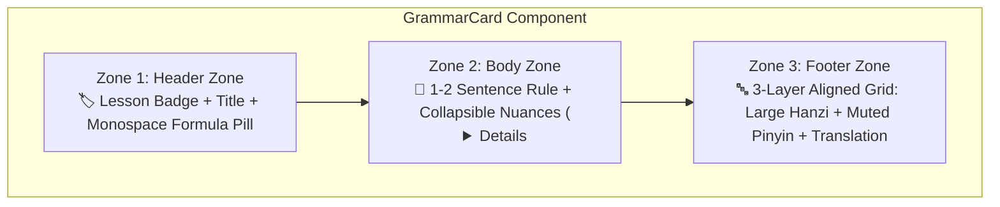
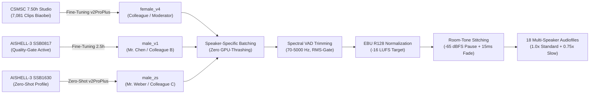

import { Badge, Card, CardGrid, Tabs, TabItem } from '@astrojs/starlight/components';
import ChineseStudyDashboard from '../../../../../../components/chinese/ChineseStudyDashboard.astro';
import ChineseGrammarExplorer from '../../../../../../components/chinese/ChineseGrammarExplorer.astro';
import ConfusableCard from '../../../../../../components/chinese/ConfusableCard.astro';
import GrammarCard from '../../../../../../components/chinese/GrammarCard.astro';
import DialoguePlayer from '../../../../../../components/DialoguePlayer.astro';
import DriveAsset from '../../../../../../components/DriveAsset.astro';
import LanguageSwitch from '../../../../../../components/LanguageSwitch.astro';
import { CONFUSABLE_PAIRS, CHINESE_GRAMMAR_RULES } from '../../../../../../data/chineseGrammarData';
import { CHINESE_DIALOGUES } from '../../../../../../data/chineseDialogues';

# Chinese (Mandarin) <Badge text="Foundation Course & Audio Dialogues" variant="success" size="medium" />

<LanguageSwitch current="en" enHref="/lectures/languages/chinese/en/" deHref="/lectures/languages/chinese/" />

Interactive study and reference vault for the foundation course **Chinese (Mandarin Language Practice I & II)** at the Central Language Laboratory (*ZSL / heiSKILLS*) of Heidelberg University.

This page bundles the complete **multi-speaker audio dialogues** (Lessons 2 to 10 with all 18 dialogues) synthesized with **Voice-ML v4 (GPT-SoVITS v2ProPlus)**, the systematic **Grammar Explorer** with 26 core rules and confusable pairs, comprehensive guides to the **tonal system (Tone Sandhi)**, and direct access to the **dual-audio Anki deck**.

---

## 🧭 Study Mode Navigation Dashboard

Click any of the cards below to **dynamically switch visible page sections live**:

<ChineseStudyDashboard activeSection="dialogues" lang="en" />

---

{/* ========================================================================= */}
{/* SECTION 1: AUDIO DIALOGUES (DEFAULT ACTIVE) */}
{/* ========================================================================= */}

## 🎙️ Mode: Multi-Speaker Audio Dialogues <Badge text="Voice-ML v4 • 18 Dialogues" variant="success" />

In this mode, the page focuses completely on **spoken speech, shadowing, and listening comprehension**. Rather than scrolling past long grammar explanations, interactive dialogue players take center stage:

* **Dual-Speed Playback**: 1.0x standard tempo & 0.75x slow learning pace.
* **Sentence Looping (Shadowing)**: Repeat any individual turn in an infinite loop to perfect intonation.
* **Live Synchronized Tracking**: Subtitles in Hanzi, Pinyin, and English follow the audio with millisecond accuracy.

---

### 🗺️ Quick Navigation of Dialogues

| Lesson | Thematic Focus & Dialogues | Audio Speakers |
| :--- | :--- | :--- |
| **[Lesson 2](#lesson-2--business-contacts-origins--languages)** | Dialogue 2.1 (Introductions & Singapore) & Dialogue 2.2 (Languages & Translation) | 🎙️ 2 Multi-Speaker Audios (3 Speakers) |
| **[Lesson 3](#lesson-3--exhibition-center-contact-details--addresses)** | Dialogue 3.1 (Exhibition Brochure & Extensions) & Dialogue 3.2 (Studio in Chengdu) | 🎙️ 2 Multi-Speaker Audios (Landline / Addresses) |
| **[Lesson 4](#lesson-4--time-time-zones--calendar)** | Dialogue 4.1 (Zurich Time & Daylight Saving) & Dialogue 4.2 (Dates & Calendar) | 🎙️ 2 Multi-Speaker Audios (Time / Calendar) |
| **[Lesson 5](#lesson-5--office-premises-spatial-orientation--workshop)** | Dialogue 5.1 (Office Floorplans & Inspection) & Dialogue 5.2 (Way to Workshop & Kiosk) | 🎙️ 2 Multi-Speaker Audios (Directions / Distances) |
| **[Lesson 6](#lesson-6--industrial-fair-travel--city-vs-countryside)** | Dialogue 6.1 (Shanghai Fair & Autumn Vacation) & Dialogue 6.2 (Metropolis vs. Rural Dali) | 🎙️ 2 Multi-Speaker Audios (Schedules / Lifestyle) |
| **[Lesson 7](#lesson-7--restaurant-culture-sichuan-cuisine--aa-system)** | Dialogue 7.1 (Sichuan Cuisine & Menu Ordering) & Dialogue 7.2 (Bill & AA Cost-Sharing) | 🎙️ 2 Multi-Speaker Audios (Dishes / Dining Customs) |
| **[Lesson 8](#lesson-8--shopping-electronics--price-bargaining)** | Dialogue 8.1 (Electronics Store & Receipt) & Dialogue 8.2 (Clothing Market & Bargaining) | 🎙️ 2 Multi-Speaker Audios (Shopping / Discounts) |
| **[Lesson 9](#lesson-9--schedules-lunch-invitations--evening-plans)** | Dialogue 9.1 (Weekend Shift & Lunch) & Dialogue 9.2 (After-Hours & Cinema) | 🎙️ 2 Multi-Speaker Audios (Appointments / Leisure) |
| **[Lesson 10](#lesson-10--business-dinner-dining-culture--comparisons)** | Dialogue 10.1 (Menu Advice & Ordering) & Dialogue 10.2 (Drinks, Toast & Bill) | 🎙️ 2 Multi-Speaker Audios (Dining / Banquets) |

---

## 🎙️ Lesson 2 — Business Contacts, Origins & Languages

Lesson 2 introduces the fundamental sentence order of Mandarin, the tonal system, question formation with `吗` (*ma*), and the core verbs `是` (*shì* – to be), `叫` (*jiào* – to be called), and `在` (*zài* – to be located at).

:::note[Key Grammatical Patterns]
* **S-V-O Word Order**: `陈先生现在在上海工作。` ("Mr. Chen is currently working in Shanghai.")
* **Particle Questions with `吗`**: Turns a statement into a Yes/No question without inverting word order: `您是韦伯先生吗？` ("Are you Mr. Weber?")
* **Question Pronouns**: `您贵姓？` ("What is your honorable surname?"), `她叫什么名字？` ("What is her name?")
* **The Possessive Particle `的` (*de*)**: `这是我的名片。` ("This is my business card.")
:::

### Dialogue 2.1: Business Contacts & Origin
Three-party dialogue: Colleague A introduces Mr. Weber (Siemens) and Mr. Chen Ming to each other. Business cards are exchanged, and Mr. Chen's Singaporean background is discussed.

<DialoguePlayer
	dialogue={CHINESE_DIALOGUES[0]}
	lang="en"
/>

---

### Dialogue 2.2: Language Skills & Translation
Three colleagues discuss German, English, and Chinese language proficiencies, translation assignments for the Siemens delegation, and native accents.

<DialoguePlayer
	dialogue={CHINESE_DIALOGUES[1]}
	lang="en"
/>

---

## 🎙️ Lesson 3 — Exhibition Center, Contact Details & Addresses

Lesson 3 focuses on giving phone numbers (using `yāo` for 1), expressing email addresses, spatial prepositions, and searching for contact details.

:::note[Key Grammatical Patterns]
* **Pronunciation of 1 in numbers**: The numeral `一` (*yī*) is spoken as **`yāo`** in telephone numbers, room numbers, and extensions to prevent acoustic confusion with `七` (*qī* – 7).
* **Existential Location with `在` (*zài*)**: `宣传册在桌子上。` ("The brochure is on the table.")
* **Wh-Questions with `哪儿 / 哪里` (*nǎr / nǎli*)**: `宣传册放在哪儿了？` ("Where was the brochure placed?")
* **Large Numbers & Quantities**: Extension numbers with `分机号是多少？` ("What is the extension number?")
:::

### Dialogue 3.1: Exhibition Center & Phone Numbers
Colleagues prepare exhibition materials for the Shanghai Fair, search for the brochure, and note down phone and extension numbers.

<DialoguePlayer
	dialogue={CHINESE_DIALOGUES[2]}
	lang="en"
/>

---

### Dialogue 3.2: Contact Details & Studio in Chengdu
Discussion of company contact details, branch addresses, email exchanges, and Mr. Weber's photography studio in Chengdu.

<DialoguePlayer
	dialogue={CHINESE_DIALOGUES[3]}
	lang="en"
/>

---

## 🎙️ Lesson 4 — Time, Time Zones & Calendar

Lesson 4 covers telling the time (`点`, `分`, `刻`, `半`), calendar dates (year-month-day hierarchy), weekdays, and time zone differences between Germany/Switzerland (CET/CEST) and Beijing (CST, UTC+8).

:::note[Key Grammatical Patterns]
* **Time from Largest to Smallest**: `二〇二六年十月二十四日下午三点一刻` (Year $\to$ Month $\to$ Day $\to$ Time of day $\to$ Hour $\to$ Minute).
* **Time as Adverbial Modifier**: Placed **before** the main verb: `我们明天上午九点开会。` ("We hold our meeting tomorrow morning at 9:00 AM.")
* **Time Zones**: `瑞士现在比北京慢六个小时。` ("Switzerland is currently six hours behind Beijing.")
* **Alternative Questions with `还是` (*háishi*)**: `今天是星期二还是星期三？` ("Is today Tuesday or Wednesday?")
:::

### Dialogue 4.1: Time & Zurich Time Zones
Colleagues check local time in Shanghai vs. Zurich headquarters, discuss daylight saving time, and schedule an international conference call.

<DialoguePlayer
	dialogue={CHINESE_DIALOGUES[4]}
	lang="en"
/>

---

### Dialogue 4.2: Date, Weekday & Calendar
Scheduling coordination: Checking dates on the calendar, weekdays, upcoming project milestones, and flight departures.

<DialoguePlayer
	dialogue={CHINESE_DIALOGUES[5]}
	lang="en"
/>

---

## 🎙️ Lesson 5 — Office Premises, Spatial Orientation & Workshop

Lesson 5 covers directional locatives (方位词: `前边`, `后边`, `左边`, `右边`, `对面`), office floorplans, building levels, and distance descriptions.

:::note[Key Grammatical Patterns]
* **Locative Nouns**: `在 + [Noun] + [Position]` (e.g., `在电脑旁边` – next to the computer, `在二楼` – on the 2nd floor).
* **Chinese Floor Numbering**: Ground floor is **一楼 (*yī lóu*)**! The European 1st upper floor is therefore **二楼 (*èr lóu*)** in Chinese!
* **Existential `有` (*yǒu*) vs. Positional `在` (*zài*)**:
  * `桌子上有一台笔记本电脑。` ("On the desk there is a laptop.")
  * `笔记本电脑在桌子上。` ("The laptop is on the desk.")
:::

### Dialogue 5.1: Office Premises & Workshop Inspection
The team reviews room plans for the new office building, searches for technical documents, and prepares an inspection of Workshop 2.

<DialoguePlayer
	dialogue={CHINESE_DIALOGUES[6]}
	lang="en"
/>

---

### Dialogue 5.2: Direction to the Production Workshop
Colleagues walk across the industrial park, ask for directions to the production workshop, and stop by the company cafeteria.

<DialoguePlayer
	dialogue={CHINESE_DIALOGUES[7]}
	lang="en"
/>

---

## 🎙️ Lesson 6 — Industrial Fair, Travel & City vs. Countryside

Lesson 6 explores business travel to Shanghai, vacation planning, duration expressions (how long vs. when), modal verbs `要` (*yào*) and `想` (*xiǎng*), and comparative living preferences.

:::note[Key Grammatical Patterns]
* **Duration vs. Point of Time**: Point of time precedes the verb (`明天下午到`), duration follows the verb (`待四个星期`).
* **Modal Verbs**: `想` (*xiǎng* – would like to) vs. `要` (*yào* – intend to / will). Both negated by **不想 (*bù xiǎng*)**!
* **Purpose Sentences with `去` (*qù*)**: `去慕尼黑参观工业展` ("go to Munich to visit the industrial exhibition").
* **Measure Words**: The universal measure word `个` (*ge*), except for `天` (*tiān*) and `年` (*nián*) which never take `个`!
:::

### Dialogue 6.1: Shanghai Industrial Fair & Travel Plans
Colleagues coordinate their participation in the Shanghai Autumn Technology Fair, hotel stays, and subsequent vacation plans in Yunnan.

<DialoguePlayer
	dialogue={CHINESE_DIALOGUES[8]}
	lang="en"
/>

---

### Dialogue 6.2: Metropolis Dynamics vs. Countryside in Dali
Three colleagues debate living in bustling metropolises (Shanghai, Munich) versus relaxing rural towns like Dali in Yunnan.

<DialoguePlayer
	dialogue={CHINESE_DIALOGUES[9]}
	lang="en"
/>

---

## 🎙️ Lesson 7 — Restaurant Culture, Sichuan Cuisine & AA System

Lesson 7 immerses into Chinese culinary culture, ordering authentic Sichuan dishes, understanding spice levels, toasting etiquette, and the AA bill-splitting convention (*AA制*).

:::note[Key Grammatical Patterns]
* **Serial Verb Construction for Transport**: `坐地铁去饭店` ("take the subway to the restaurant").
* **Directional Vectors with `往` (*wǎng*)**: `往右拐` ("turn right"), `往前走` ("go straight forward").
* **Distance with `离` (*lí*)**: `饭店离这里不远` ("The restaurant is not far from here").
* **AA System**: `咱们AA制吧！` ("Let's split the bill evenly / go Dutch!")
:::

### Dialogue 7.1: Sichuan Restaurant & Ordering Dishes
Colleagues visit a traditional Sichuan restaurant, consult the waiter on signature dishes (Kung Pao Chicken, Mapo Tofu), and adjust the spice levels.

<DialoguePlayer
	dialogue={CHINESE_DIALOGUES[10]}
	lang="en"
/>

---

### Dialogue 7.2: Settling the Bill & AA Split (Go Dutch)
After dinner, the host offers to treat the table, but her colleagues politely insist on splitting the bill equally according to the AA system.

<DialoguePlayer
	dialogue={CHINESE_DIALOGUES[11]}
	lang="en"
/>

---

## 🎙️ Lesson 8 — Shopping, Electronics & Price Bargaining

Lesson 8 focuses on retail purchasing conversations, measure words with demonstratives, the Chinese discount system (*dǎzhé*), verb reduplication, and evening market bargaining.

:::note[Key Grammatical Patterns]
* **Verb Reduplication (`V-V` / `V-yī-V`)**: Lightens an action into an informal or tentative trial: `看（一）看` (take a brief look), `试一下` (try it on for a second).
* **The Chinese Discount Formula (`打 x 折` *dǎ x zhé*)**: Expresses the **remaining payment fraction** in tenths! `打八折` means the customer pays 80%, receiving a **20% discount**! `打八五折` = 15% off.
* **Large Numbers**: `百` (*bǎi* – 100), `千` (*qiān* – 1,000), `万` (*wàn* – 10,000). The digit zero (`零` *líng*) is vocalized exactly once across internal zero intervals.
* **Demonstrative Pattern**: `这种优盘多少钱？` ("How much is this type of USB flash drive?").
:::

### Dialogue 8.1: Electronics in the Department Store & Official Invoice
Two colleagues (A and C) purchase USB drives, optical discs, a mobile phone recharge card, and camera batteries from a sales assistant (B) ahead of a conference and request an official corporate invoice (*Fāpiào*).

<DialoguePlayer
	dialogue={CHINESE_DIALOGUES[12]}
	lang="en"
/>

---

### Dialogue 8.2: Clothing, Colors & Bargaining at the Night Market
Two colleagues (A and C) stroll through an evening apparel market, browse silk neckties and a dark blue dress shirt with a merchant (B), and negotiate discount percentages (*dǎzhé*).

<DialoguePlayer
	dialogue={CHINESE_DIALOGUES[13]}
	lang="en"
/>

---

## 🎙️ Lesson 9 — Schedules, Lunch Invitations & Evening Plans

Lesson 9 covers weekend duty rosters, shift schedules, Sunday dining invitations, pivotal (telescoped) sentences with `请` (*qǐng*), and the progressive aspect with `（正）在` (*[zhèng]zài*).

:::note[Key Grammatical Patterns]
* **Pivotal Sentences (兼语句 / Telescoped Structure)**: `S + 请 / 让 / 要 + [Pivot Object] + [Second Predicate]`: The direct object of the first verb serves simultaneously as the subject of the second action! (`我想请你去吃午饭` – "I would like to invite you to have lunch").
* **Progressive Aspect**: `（正）在 + Verb`: Indicates an action actively unfolding at the moment of speech (`我正在看电影` – "I am currently watching a movie").
* **Cooperation**: `跟 / 和 + [Person] + 一起 + Verb` (e.g., `跟他一起去` – go together with him).
* **Shift Phases**: `上班` (*shàng bān* – begin work shift) ↔ `下班` (*xià bān* – finish work shift).
:::

### Dialogue 9.1: Weekend Duty Shift & Sunday Lunch Invitation
Speaker A invites colleagues B and C to a Saturday Sichuan lunch. Because colleague B has morning duty until noon and afternoon commitments, they reschedule their gathering to Sunday at 12:00 PM.

<DialoguePlayer
	dialogue={CHINESE_DIALOGUES[14]}
	lang="en"
/>

---

### Dialogue 9.2: Evening Schedules & Movie Outing
Following Chinese class, Speaker A inquires about what colleagues B and C are currently engaged with and joins them for the evening screening of the newly released Jackie Chan feature.

<DialoguePlayer
	dialogue={CHINESE_DIALOGUES[15]}
	lang="en"
/>

---

## 🎙️ Lesson 10 — Business Dinner, Dining Culture & Comparisons

Lesson 10 covers restaurant hospitality, ordering Chinese culinary specialties, perceptual potential complements (*kàndedǒng*), comparative sentences with `比` (*bǐ*), and customary banqueting etiquette (*gānbēi*, *mǎidān*).

:::note[Key Grammatical Patterns]
* **Comparative Construction with `比`**: `A + 比 + B + Adjective` (e.g., `这儿比那边安静` – "Here is quieter than over there").
* **Potential Complement of Comprehension**: `Verb + 得 / 不 + 懂` (`看得懂` – able to read and understand ↔ `看不懂` – unable to decipher/comprehend).
* **Experiential Aspect Particle `过` (*guo*)**: Marks that an event has occurred at least once in past experience (`吃过一次` – have eaten it once before).
* **Hospitality Conventions**: `来……` for ordering dishes (`来一个宫保鸡丁` – "Bring us a Kung Pao chicken"), `干杯` (*gānbēi* – "Bottoms up! / Cheers!"), `买单` (*mǎidān* – "Check, please!").
:::

### Dialogue 10.1: Table Selection, Menu Consultation & Ordering
Two colleagues (A and B) choose a quiet window table for lunch. Because colleague B cannot fully read the handwritten culinary board, they consult the waiter (C) for vegetarian recommendations, mild hot-and-sour soup, and Sichuan Dandan noodles.

<DialoguePlayer
	dialogue={CHINESE_DIALOGUES[16]}
	lang="en"
/>

---

### Dialogue 10.2: Beverage Pairing, Maotai Toast & Settling the Bill
Following dinner, the three colleagues discuss Tsingtao beer, dry red wine, and premium Maotai liquor, toast to successful cooperation and good health, and settle the invoice (*mǎidān*).

<DialoguePlayer
	dialogue={CHINESE_DIALOGUES[17]}
	lang="en"
/>

{/* ========================================================================= */}
{/* SECTION 2: GRAMMAR EXPLORER */}
{/* ========================================================================= */}

## 📐 Mode: Systematic Grammar Explorer <Badge text="26 Rules + Confusables" variant="success" />

The **Grammar Explorer** replaces endless scrolling with live client-side search, customizable Pinyin visibility, and responsive card layouts:

* **Search Bar (`Ctrl+K`)**: Search rules, Hanzi, or Pinyin (e.g. `zài`, `比`, `离`, `modal verb`, `questions`).
* **Layout Switcher**: Choose between **🗂️ Bento Grid** (2-column desktop dashboard), **📑 Accordion List** (ultra-compact), and **⚖️ Confusables Spotlight**.
* **Pinyin Active Recall**:
  * **👁️ Always Visible**: Standard continuous study mode.
  * **👆 Hover Mode**: Pinyin is blurred/hidden and reveals only when hovering or tapping an example — optimal for self-testing Hanzi reading skills!
  * **🙈 Hidden**: Complete pinyin removal for pure character immersion.

<ChineseGrammarExplorer lang="en" />

---

### 🔍 Standardized 3-Zone "GrammarCard" in Detail

Argon's design principle for grammar components: *"Standardize every grammar point into a visual component with three distinct zones."*

Here are two isolated cards demonstrating the 3-zone architecture:

<CardGrid>
  <GrammarCard rule={CHINESE_GRAMMAR_RULES[0]} lang="en" />
  <GrammarCard rule={CHINESE_GRAMMAR_RULES[25]} lang="en" />
</CardGrid>

---

### ⚖️ Side-by-Side Confusable Comparisons

Chinese learners often confuse semantically similar expressions governed by strict syntactic conditions (`二` vs. `两`, `在` vs. `有`, `想` vs. `要`, `离` vs. `从…到…`).

The layout provides a dedicated 2-column comparative format featuring **✅ Correct** and **❌ Incorrect** monospace examples with error explanations:

<ConfusableCard pair={CONFUSABLE_PAIRS[0]} lang="en" />

<ConfusableCard pair={CONFUSABLE_PAIRS[1]} lang="en" />

<ConfusableCard pair={CONFUSABLE_PAIRS[2]} lang="en" />

---

### 📊 Layout Pattern Comparison Matrix

| Layout Pattern | Best For | Visual Impact & UX Dynamics |
| :--- | :--- | :--- |
| **Bento Grid Cards** | Rapid scanning & reference on desktop | Modern dashboard feel; formula pills catch the eye immediately. |
| **Accordion List (`
`)** | Fitting 25+ rules cleanly on a single page | High density; learners only see titles + formulas until expanded. |
| **Confusables Spotlight** | Error prevention & contrastive learning (`二/两`, `在/有`) | 2-column direct contrast with ✅/❌ examples prevents chronic grammar pitfalls. |
| **Hover-Pinyin Active Recall** | Vocabulary & reading comprehension | Enables instant self-testing without pinyin training wheels cluttering the page. |

{/* ========================================================================= */}
{/* SECTION 3: TONAL SYSTEM & TONE SANDHI */}
{/* ========================================================================= */}

## 🇨🇳 Mode: Tonal System & Tone Sandhi <Badge text="4 Tones + Sandhi" variant="tip" />

The Mandarin tonal system is the bedrock of acoustic intelligibility. This focused mode presents pitch contours and essential sandhi shifts cleanly:

### 1. The Four Basic Tones & Neutral Tone

| Tone | English Name | Chinese Name | Contour / Pitch | 5-Level Value | Example | Meaning |
| :--- | :--- | :--- | :--- | :--- | :--- | :--- |
| **1st Tone** | High Level | 阴平 (*yīnpíng*) | High, level, sustained | **55** | `mā` (妈) | mother |
| **2nd Tone** | Rising | 阳平 (*yángpíng*) | Mid-to-high, rising | **35** | `má` (麻) | hemp |
| **3rd Tone** | Dipping | 上声 (*shǎngshēng*) | Low dipping, slight rise | **214** (isolated) | `mǎ` (马) | horse |
| **4th Tone** | Falling | 去声 (*qùshēng*) | High-to-low, sharply falling | **51** | `mà` (骂) | to scold |
| **Neutral Tone** | Light / Unstressed | 轻声 (*qīngshēng*) | Short, unstressed, light | *–* | `ma` (吗) | question particle |

---

### 2. Tone Sandhi: Four Essential Change Rules

:::note[Rule 1: Two Consecutive 3rd Tones ($3 + 3 \to 2 + 3$)]
When two 3rd-tone syllables meet in sequence, the first shifts to a **2nd tone (rising)**:
* Written: `nǐ hǎo` (你好) $\to$ Spoken: **`ní hǎo`** (35 + 214)
* Written: `kěyǐ` (可以) $\to$ Spoken: **`kéyǐ`** (35 + 214)
* Written: `shǒubiǎo` (手表) $\to$ Spoken: **`shóubiǎo`** (35 + 214)
:::

:::note[Rule 2: Half-Third Tone ($214 \to 21$)]
When a 3rd tone precedes a 1st, 2nd, 4th, or neutral tone, it is pronounced as a **low dipping tone ($21$)** without the final rise. It sounds like a deep base tone:
* `北京` (*Běijīng*): `Běi` (Tone 3) before `jīng` (Tone 1) $\to$ deep $21$.
* `很忙` (*hěnmáng*): `hěn` (Tone 3) before `máng` (Tone 2) $\to$ deep $21$.
* `好看` (*hǎokàn*): `hǎo` (Tone 3) before `kàn` (Tone 4) $\to$ deep $21$.
:::

:::note[Rule 3: Tone Changes of the Negative Particle `不` (*bù*)]
`不` is inherently a **4th tone (*bù*)** before 1st, 2nd, and 3rd tones:
* `不高` (*bù gāo* – not high), `不来` (*bù lái* – not coming), `不好` (*bù hǎo* – not good).
* Before another **4th tone syllable**, however, it shifts to a **2nd tone (*bú*)**:
  * `不是` $\to$ **`bú shì`** (is not); `不对` $\to$ **`bú duì`** (incorrect); `不要` $\to$ **`bú yào`**!
:::

:::note[Rule 4: Tone Changes of the Numeral `一` (*yī*)]
* **1st tone (*yī*)**: When isolated, counting, or at the end of a word:
  * `第一` (*dì-yī* – first), `一月` (*yī yuè* – January).
* Before **1st, 2nd, or 3rd tones**, `一` shifts to **4th tone (*yì*)**:
  * `一天` (*yì tiān* – one day, before Tone 1), `一年` (*yì nián* – one year, before Tone 2), `一起` (*yì qǐ* – together, before Tone 3).
* Before **4th tones**, `一` shifts to **2nd tone (*yí*)**:
  * `一下` (*yí xià* – a bit), `一共` (*yí gòng* – altogether), `一定` (*yí dìng* – definitely).
* **Phone Numbers Special Case (`yāo`)**:
  * In telephone numbers, room numbers, and flight codes, `一` is spoken as **`yāo`** to prevent acoustic confusion with `七` (*qī*).
:::

{/* ========================================================================= */}
{/* SECTION 4: COURSE ASSETS & DOWNLOADS */}
{/* ========================================================================= */}

## 🗂️ Mode: Course Assets & Anki Deck <Badge text="Downloads (WIP)" variant="note" />

Access flashcard exports, study resources, and uncompressed audio masters:

### 📥 Direct Downloads

<CardGrid>
  <Card title="560-Note Anki Dual-Audio Deck" icon="document">
    Complete Anki deck (.apkg) with character stroke orders, pinyin, sample sentences, and bidirectional audio playback for Lessons 1–10.
    
    <DriveAsset
      title="Download 107 MB Anki Deck"
      type="anki"
      description="Google Drive: Chinese_Mandarin_Comprehensive_v4.apkg"
      wip={true}
      wipLabel="Work In Progress"
    />
  </Card>

  <Card title="Studio WAV Master Archive" icon="laptop">
    Uncompressed 32 kHz master WAV recordings for all 18 dialogues with millisecond-exact turn timestamps in JSON.
    
    <DriveAsset
      title="Dialogues Master Archive (WAV & JSON)"
      type="dataset"
      description="Google Drive: University/dialogues/"
      wip={true}
      wipLabel="Work In Progress"
    />
  </Card>
</CardGrid>

---

### 🎙️ Technical Synthesis Architecture (Voice-ML v4)

The dialogues hosted on this page were synthesized using the custom **Voice-ML Pipeline v4 (GPT-SoVITS v2ProPlus)**:

* **Speaker Profiles (Milestone D / v4)**:
  * `female_v4`: Fine-tuned on **7.50 hours (7,081 audio clips)** of studio recordings from CSMSC (BZNSYP). Eliminates artifacts with an ultra-low character error rate ($\text{CER} = 5.70\%$ on Whisper `large-v3`).
  * `male_v1`: 2.5 hours fine-tuning on speaker SSB0817 from AISHELL-3. Maintained under a strict quality preservation gate to prevent overfitting.
  * `male_zs`: Zero-shot voice profile (SSB1630) for third parties in three-party conversations.
* **Audio Engineering**:
  * Voice Activity Detection (VAD) bandpass filtered ($70\text{--}5000\text{ Hz}$).
  * EBU R128 loudness normalization to **$-16\text{ LUFS}$** across all speaker turns.
  * Natural room-tone stitching ($520\text{ ms}$ for statements, $620\text{ ms}$ for questions) with $15\text{ ms}$ raised-cosine crossfades.
  * Dual-speed exports: 1.0x native tempo and 0.75x learner pace for targeted sentence shadowing.
* **100% Original Authorship**:
  * Fully independently authored conversational dialogue scripts specifically created for university and self-study practice.

