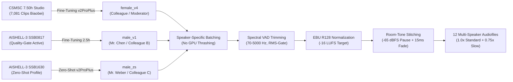

import { Badge, Card, CardGrid, Tabs, TabItem } from '@astrojs/starlight/components';
import DriveAsset from '../../../../../../components/DriveAsset.astro';
import DialoguePlayer from '../../../../../../components/DialoguePlayer.astro';
import LanguageSwitch from '../../../../../../components/LanguageSwitch.astro';
import { CHINESE_DIALOGUES } from '../../../../../../data/chineseDialogues';

# Chinese (Mandarin) <Badge text="Foundation Course & Dialogues" variant="success" size="medium" />

<LanguageSwitch current="en" enHref="/lectures/languages/chinese/en/" deHref="/lectures/languages/chinese/" />

:::note[Copyright & Licensing Notice Regarding Audio Dialogues]
**Precautionary dialogue update:** Due to an unconfirmed copyright/licensing issue regarding the course textbook, the dialogues have been temporarily replaced with newly composed, royalty-free dialogues and re-synthesized using the Voice-ML pipeline. Once publisher confirmation/clearance is obtained, the original textbook dialogues will be restored.
:::

Interactive study and reference vault for the foundation course **Chinese (Mandarin Language Practice I & II)** at the Central Language Laboratory (*ZSL / heiSKILLS*) of Heidelberg University.

This page bundles the complete **multi-speaker audio dialogues** (Lessons 2 to 7) synthesized with **Voice-ML v4 (GPT-SoVITS v2ProPlus)**, comprehensive guides to the **tonal system (Tone Sandhi)**, core grammatical sentence structures, and direct access to the **107 MB dual-audio Anki deck**.

---

## 🗺️ Quick Navigation

| Section | Content & Focus | Audio / Materials |
| :--- | :--- | :--- |
| **[Lesson 2: Dialogues](#lesson-2--business-contacts-origins--languages)** | Dialogue 2.1 (Introductions & Singapore) & Dialogue 2.2 (Languages & Translation) | 🎙️ 2 Multi-Speaker Audios (3 Speakers) |
| **[Lesson 3: Dialogues](#lesson-3--exhibition-center-contact-details--addresses)** | Dialogue 3.1 (Exhibition Brochure & Extensions) & Dialogue 3.2 (Studio in Chengdu) | 🎙️ 2 Multi-Speaker Audios (Landline / Addresses) |
| **[Lesson 4: Dialogues](#lesson-4--time-time-zones--calendar)** | Dialogue 4.1 (Zurich Time & Daylight Saving) & Dialogue 4.2 (Dates & Calendar) | 🎙️ 2 Multi-Speaker Audios (Time / Calendar) |
| **[Lesson 5: Dialogues](#lesson-5--office-premises-spatial-orientation--workshop)** | Dialogue 5.1 (Office Floorplans & Inspection) & Dialogue 5.2 (Way to Workshop & Kiosk) | 🎙️ 2 Multi-Speaker Audios (Directions / Distances) |
| **[Lesson 6: Dialogues](#lesson-6--industrial-fair-travel--city-vs-countryside)** | Dialogue 6.1 (Shanghai Fair & Autumn Vacation) & Dialogue 6.2 (Metropolis vs. Rural Dali) | 🎙️ 2 Multi-Speaker Audios (Schedules / Lifestyle) |
| **[Lesson 7: Dialogues](#lesson-7--restaurant-culture-sichuan-cuisine--aa-system)** | Dialogue 7.1 (Sichuan Cuisine & Menu Ordering) & Dialogue 7.2 (Bill & AA Cost-Sharing) | 🎙️ 2 Multi-Speaker Audios (Dishes / Dining Customs) |
| **[Tonal System & Sandhi](#-tonal-system--tone-change-rules-tone-sandhi)** | The 5 Tones, $3+3 \to 2+3$, Half-Third Tone, `不` (*bù*) & `一` (*yī / yāo*) | 📐 Phonetic Rules & Pitch Contours |
| **[Grammar Structures](#-core-grammatical-structures-of-the-dialogues)** | S-T-P-V-O Rules, Alternative Questions (`还是`), 4 Question Types, Time Expressions | 🧩 Model Sentences & Syntax Patterns |
| **[Course Assets](#️-course-assets)** | 107 MB Anki Deck (`.apkg`) | 🚧 Work In Progress |

---

## 🎙️ Lesson 2 — Business Contacts, Origins & Languages

Lesson 2 centers on formally introducing business partners, asking about backgrounds and hometowns, and discussing multilingual capabilities.

:::note[Key Grammatical Patterns]
* **Introducing with `介绍`**: `各位好，我来给二位介绍一下，这位是……` (*...zhè wèi shì...* – "Hello everyone, let me introduce you two: This is...")
* **Surname vs. Given Name**: `我姓陈，名字叫陈明。` (*Wǒ xìng Chén, míngzi jiào Chén Míng.* – "My surname is Chen, and my name is Chen Ming.")
* **Polite Greeting**: `幸会，认识您非常高兴！` (*Xìnghuì, rènshi nín fēicháng gāoxìng!* – "A pleasure to meet you, very glad to make your acquaintance!")
* **Expressing Origin with `出生在`**: `陈先生出生在新加坡，现在在上海工作。` (*Chén xiānsheng chūshēng zài Xīnjiāpō...* – "Mr. Chen was born in Singapore and currently works in Shanghai.")
* **Alternative Questions with `还是` (*háishi*)**: `她是日本人还是中国人呢？` ("Is she Japanese or Chinese?")
* **Confirmation Particle `吧` (*ba*)**: `从上周起已经开始实行夏令时了吧？` ("...right? / isn't it?")
:::

### Dialogue 2.1: Business Contacts & Origin
*Three-person dialogue*: A colleague introduces Mr. Weber from Siemens and Mr. Chen Ming to each other. Business cards are exchanged and Mr. Chen's Singaporean background is discussed.

<DialoguePlayer
	dialogue={CHINESE_DIALOGUES[0]}
	lang="en"
/>

---

### Dialogue 2.2: Language Skills & Translation
*Two-person dialogue*: Two colleagues discuss Tanaka Yahui (田中雅慧), a translator in the international trade department with a Japanese father from Tokyo and a Chinese mother from Beijing, who commands fluent Chinese, German, and Japanese.

<DialoguePlayer
	dialogue={CHINESE_DIALOGUES[1]}
	lang="en"
/>

---

## 🎙️ Lesson 3 — Exhibition Center, Contact Details & Addresses

Lesson 3 covers spatial office orientation, asking for landlines and extensions, and recording residential and business addresses across China.

:::note[Key Grammatical Patterns]
* **Location Queries with `在` & `哪儿`**: `宣传册放在哪儿了？` (*...fàng zài nǎr le?* – "Where was the brochure placed?")
* **Locative Combinations**: `在电脑旁边的那本文件夹里` ("In the folder next to the computer").
* **Landline vs. Extension**: `座机号码` (*zuòjī hàomǎ* – landline number) vs. `分机号` (*fēnjī hào* – extension number).
* **Pronunciation of `一` in Phone Numbers**: The digit `1` is pronounced as **`yāo`** (幺) rather than `yī` in telephone numbers to prevent acoustic confusion with `7` (*qī*)!
* **A-not-A Question Pattern**: `他的私人手机号码你存了没有？` (*...nǐ cún le méiyǒu?* – "Have you saved his mobile number [or not]?")
* **Hierarchical Address Order (Broad to Specific)**: *City $\to$ District $\to$ Street $\to$ Building/Number*: `青羊区春熙路六十八号` (*Qīngyáng Qū Chūnxī Lù liùshíbā hào* – Qingyang District, Chunxi Road No. 68).
:::

### Dialogue 3.1: Exhibition Center & Phone Numbers
Two colleagues search the office for the brochure of the new Business Exhibition Center to find the central switchboard number and the marketing department extension.

<DialoguePlayer
	dialogue={CHINESE_DIALOGUES[2]}
	lang="en"
/>

---

### Dialogue 3.2: Contact Details & Studio in Chengdu
Conversation regarding former TUM classmate Zhou Wenqiang (Zhou Ming), who has established a consulting studio in Chengdu's Qingyang District.

<DialoguePlayer
	dialogue={CHINESE_DIALOGUES[3]}
	lang="en"
/>

---

## 🎙️ Lesson 4 — Time, Time Zones & Calendar

Lesson 4 deepens exact time expressions, time differences between China (CST, UTC+8) and Central Europe (Switzerland/Germany), and calendar alignment.

:::note[Key Grammatical Patterns]
* **Telling Time**: `点` (*diǎn* – hour/o'clock), `刻` (*kè* – quarter hour, 15 min), `半` (*bàn* – half hour, 30 min).
* **Comparative Construction with `比`**: `北京时间比瑞士快六个小时` ("Beijing time is six hours ahead of Switzerland").
* **Time-of-Day Prefixes**: Placed *before* the clock time: `早晨` (*zǎochen* – early morning), `上午` (*shàngwǔ* – late morning), `凌晨` (*língchén* – overnight/dawn), `下午` (*xiàwǔ* – afternoon).
* **Date Sequence**: Always hierarchical *Month $\to$ Day $\to$ Weekday*: `五月二十六日星期日` (Sunday, May 26th).
* **Days of the Week**: `周几` (*zhōu jǐ*) or `星期几` (*xīngqī jǐ*) to inquire about the day; responses: `周四` (Thursday), `周六` (Saturday), `周日` (Sunday).
* **Relative Time Words**: `前天` (*qiántiān* – day before yesterday), `昨天` (*zuótiān* – yesterday), `今天` (*jīntiān* – today), `后天` (*hòutiān* – day after tomorrow).
:::

### Dialogue 4.1: Time & Zurich Time Zones
Two colleagues compare the current time in China (10:15 AM) with Zurich taking European Summer Time into account (5-hour difference) to properly schedule a team conference.

<DialoguePlayer
	dialogue={CHINESE_DIALOGUES[4]}
	lang="en"
/>

---

### Dialogue 4.2: Date, Weekday & Calendar
Director Zhao and a colleague check today's date. A misunderstanding is resolved when they discover the wall calendar was still turned to the previous month.

<DialoguePlayer
	dialogue={CHINESE_DIALOGUES[5]}
	lang="en"
/>

---

## 🎙️ Lesson 5 — Office Premises, Spatial Orientation & Workshop

Lesson 5 expands vocabulary for navigating office and facility grounds, directional phrases, distance estimations, and preparing for business factory walkthroughs.

:::note[Key Grammatical Patterns]
* **Locative Nouns (Positions)**: `上面` (*shàngmiàn* – above/on), `下边` (*xiàbian* – below/under), `里边` (*lǐbian* – inside), `后边` (*hòubiān* – behind), `前边` (*qiánbiān* – in front), `旁边` (*pángbiān* – beside), `中间` (*zhōngjiān* – middle/between).
* **Preposition `在` with Locatives**: `在门后边的墙上` ("On the wall behind the door"), `在书架第二层` ("On the second shelf of the bookcase").
* **Inquiring Distance with `从...到...有多远`**: `从咱们办公楼到一号生产车间大概有多远？` ("Roughly how far is it from our office building to Production Workshop No. 1?")
* **Stating Distance**: `走过去大概只有两百米，非常近。` (*...zhǐ yǒu liǎngbǎi mǐ...* – "Walking over takes only about 200 meters, very close.")
* **Directional Movement with `穿过`**: `穿过中间的小花园` (*chuānguò...* – "cross through the central garden").
* **Polite Conversational Etiquette**: `顺便问一下` (*shùnbiàn wèn yíxià* – "By the way, may I ask..."), `多谢二位` ("Thank you both very much"), `辛苦大家了` ("Thank you all for your hard work!").
:::

### Dialogue 5.1: Office Premises & Workshop Inspection
*Three-person dialogue*: Three colleagues search for the architectural plans of the office building, check the air conditioning and heating panels, and prepare for Manager Zhang's inspection.

<DialoguePlayer
	dialogue={CHINESE_DIALOGUES[6]}
	lang="en"
/>

---

### Dialogue 5.2: Direction to the Production Workshop
*Three-person dialogue*: The colleagues discuss the short walk to Production Workshop No. 1 through the garden courtyard and decide to take a short walk for fresh air and water at the kiosk.

<DialoguePlayer
	dialogue={CHINESE_DIALOGUES[7]}
	lang="en"
/>

---

## 🎙️ Lesson 6 — Industrial Fair, Travel & City vs. Countryside

Lesson 6 covers business travel to the Shanghai Industrial Fair, trip duration, seasons, climate perks, and an engaging debate on living in fast-paced metropolises versus the quietude of small towns like Dali.

:::note[Key Grammatical Patterns]
* **Duration of Stay with `待 + Duration`**: `咱们部门这次打算在上海待几天左右？` (*...dāi jǐ tiān...* – "Roughly how many days does our department plan to stay in Shanghai this time?")
* **Planning & Intent with `打算` / `计划`**: `我们计划先在展厅待四天` ("We plan to spend the first four days in the exhibition hall").
* **Causal Clause with `为什么...？因为...`**: `为什么选秋天呢？因为那边的秋天景色很美...` ("Why choose autumn? Because the autumn scenery there is breathtaking...").
* **Affirmative-Negative Pattern with `想不想`**: `大家想不想一起去周围的南方城市看看？` ("Would everyone like [or not] to visit nearby southern cities together?")
* **Expressing Preferences**: `更喜欢在大城市工作，还是更向往安静的农村生活？` ("Do you prefer working in the big city, or do you yearn for quiet countryside living?")
* **Concessive `不过` (*búguò*)**: `不过大城市也有烦恼...` ("However, big cities also bring their own headaches...").
* **Comparative Degree with `比...得多`**: `生活节奏也比东部沿海慢得多` ("The pace of life is also much slower than along the eastern coast").
:::

### Dialogue 6.1: Shanghai Industrial Fair & Travel Plans
*Three-person dialogue*: Three colleagues coordinate the arrival of the project lead for the Shanghai Industrial Fair and plan a scenic autumn excursion to Shaoxing and Hangzhou afterward.

<DialoguePlayer
	dialogue={CHINESE_DIALOGUES[8]}
	lang="en"
/>

---

### Dialogue 6.2: Metropolis Dynamics vs. Countryside in Dali
*Three-person dialogue*: A lively exchange on the trade-offs between big cities (career opportunities, heavy traffic jams) and a relaxed, scenic lifestyle in Dali, Yunnan.

<DialoguePlayer
	dialogue={CHINESE_DIALOGUES[9]}
	lang="en"
/>

---

## 🎙️ Lesson 7 — Restaurant Culture, Sichuan Cuisine & AA System

Lesson 7 explores authentic dining culture in China: ordering signature dishes, asking about spice levels and dietary restrictions, and navigation of payment customs (treating vs. splitting the bill).

:::note[Key Grammatical Patterns]
* **Measure Words (Classifiers) for Food & Drinks**: `一份菜单` (*yí fèn càidān* – one menu), `一壶热茶` (*yì hú rè chá* – one pot of hot tea), `三碗香米饭` (*sān wǎn xiāngmǐfàn* – three bowls of fragrant rice), `一瓶矿泉水` (*yì píng kuàngquánshuǐ* – one bottle of mineral water).
* **Preferences & Dietary Restrictions**: `你们有什么忌口的吗？` (*...jìkǒu de ma?* – "Do you have any dietary restrictions/foods you avoid?"), `我不太能吃特别辣的菜` ("I can't handle very spicy food well").
* **Correlative Conjunction `既...又...`**: `既解油腻，又能放松身心` ("Both cuts through grease and relaxes body and mind"), `既保留了传统风味，又融合了创新烹饪` ("Both preserves traditional flavor and incorporates modern culinary innovation").
* **Resultative Directional Complement `下来`**: `把这几道菜定下来` ("Finalize/settle on these dishes").
* **Payment Culture & The Check**: `买单` (*mǎidān* – pay the bill), `我来请客，大家千万不要争` ("This meal is on me, please don't argue!").
* **Cost Sharing / AA Principle**: `平摊餐费` (*píngtān cānfèi* – split dining expenses evenly) and **`AA制`** (*AA-zhì* – splitting the bill / going Dutch).
:::

### Dialogue 7.1: Sichuan Restaurant & Ordering Dishes
*Three-person dialogue*: After work, three colleagues browse the menu at a Sichuan restaurant and order: steamed sea bass, tomato scrambled eggs, Kung Pao chicken, and Longjing tea.

<DialoguePlayer
	dialogue={CHINESE_DIALOGUES[10]}
	lang="en"
/>

---

### Dialogue 7.2: Settling the Bill & AA Split (Go Dutch)
*Three-person dialogue*: Following the meal, the colleagues praise the food and handle payment: the host offers to treat the table, but her colleagues insist on splitting the bill equally according to the AA system.

<DialoguePlayer
	dialogue={CHINESE_DIALOGUES[11]}
	lang="en"
/>

---

## 🇨🇳 Tonal System & Tone Change Rules (Tone Sandhi)

Mandarin Chinese is a tonal language. The exact same syllable spoken with a different pitch contour conveys an entirely different lexical meaning.

### 1. The Four Basic Tones & the Neutral Tone

| Tone | English Name | Pitch Contour (Chao) | Symbol | Example | Meaning |
| :--- | :--- | :--- | :--- | :--- | :--- |
| **1st Tone** | High Level | $55$ (consistently high) | $\bar{a}$ | 妈 (*mā*) | Mother |
| **2nd Tone** | Rising | $35$ (mid to high) | $\acute{a}$ | 麻 (*má*) | Hemp |
| **3rd Tone** | Dipping | $214$ (mid-low $\to$ low $\to$ mid-high) | $\check{a}$ | 马 (*mǎ*) | Horse |
| **4th Tone** | Falling | $51$ (high to low) | $\grave{a}$ | 骂 (*mà*) | To scold |
| **Neutral** | Light Tone | — (short, unstressed, adapts to prior tone) | $a$ | 吗 (*ma*) | Question particle |

---

### 2. Tone Sandhi: Essential Tone Change Rules

In natural spoken speech, tones shift systematically in specific phonetic environments according to established rules:

#### Rule 1: Two Consecutive 3rd Tones ($3 + 3 \to 2 + 3$)
When two 3rd-tone syllables occur in succession, the first syllable is pronounced as a **2nd tone** (while retaining its 3rd-tone mark in standard dictionary Pinyin):
* `你好` (*nǐ + hǎo*) $\to$ pronounced as **`ní hǎo`**
* `可以` (*kě + yǐ*) $\to$ pronounced as **`ké yǐ`**
* `手表` (*shǒu + biǎo*) $\to$ pronounced as **`shóu biǎo`**

#### Rule 2: Half-Third Tone ($214 \to 21$)
When a 3rd-tone syllable is followed by any syllable in the 1st, 2nd, 4th, or neutral tone, the 3rd tone **only descends ($21$)** without rising at the end. It sounds like a steady, low bass tone:
* `北京` (*Běijīng*): `Běi` (Tone 3) before `jīng` (Tone 1) $\to$ low $21$.
* `很忙` (*hěnmáng*): `hěn` (Tone 3) before `máng` (Tone 2) $\to$ low $21$.
* `好看` (*hǎokàn*): `hǎo` (Tone 3) before `kàn` (Tone 4) $\to$ low $21$.

#### Rule 3: Tone Changes of the Negative Particle `不` (*bù*)
* Base tone: **4th tone** before 1st, 2nd, and 3rd tones:
  * `不高` (*bù gāo* – not high)
  * `不来` (*bù lái* – not coming)
  * `不好` (*bù hǎo* – not good)
* Before another **4th tone**, `不` shifts to the **2nd tone (*bú*)**:
  * `不是` (*bú shì* – is not)
  * `不对` (*bú duì* – incorrect)
  * `不太` (*bú tài* – not very)

#### Rule 4: Tone Changes of the Numeral `一` (*yī*)
* **1st Tone (*yī*)**: In counting, ordinal numbers, or standalone at the end of a word:
  * `第一` (*dì-yī* – first)
  * `一月` (*yī yuè* – January)
* Before a **4th tone**, `一` shifts to the **2nd tone (*yí*)**:
  * `一共` (*yí gòng* – altogether)
  * `一下` (*yí xià* – briefly / once)
  * `一块` (*yí kuài* – together / one Yuan)
* Before a **1st, 2nd, or 3rd tone**, `一` shifts to the **4th tone (*yì*)**:
  * `一天` (*yì tiān* – one day, before Tone 1)
  * `一年` (*yì nián* – one year, before Tone 2)
  * `一起` (*yì qǐ* – together, before Tone 3)
* **Special Case: Phone Numbers (`yāo`)**:
  * In telephone, fax, room, and flight numbers, `一` is spoken as **`yāo`** to avoid acoustic confusion with `七` (*qī*) over noisy audio channels.

---

## 📐 Core Grammatical Structures of the Dialogues

### 1. Basic Sentence Order (The S-T-P-V-O Rule)
In Mandarin Chinese, the verb precedes the object (**SVO**) just like in English. However, modifying expressions of time and place **must always appear before the predicate verb**:

$$
\text{Subject} + \text{Time} + \text{Place} + [\text{Modal / Negation}] + \text{Verb} + \text{Object}
$$

* *Example from Dialogue 2.1*:  
  `陈先生` (Subject) + `现在` (Time) + `在上海` (Place) + `工作` (Verb) 。  
  *("Mr. Chen is currently working in Shanghai.")*

---

### 2. The Four Question Types in Mandarin

<Tabs>
  <TabItem label="1. Particle Questions (吗 / 呢)">
    **Yes/No Questions with `吗` (*ma*)**: Simply appended to the end of a declarative sentence:
    * Declarative: `你是学生。` (*Nǐ shì xuésheng.* – You are a student.)
    * Question: `你是学生吗？` (*Nǐ shì xuésheng ma?* – Are you a student?)

    **Elliptical Follow-up with `呢` (*ne*)**: "And what about...?"
    * `看名字，她是日本人还是中国人呢？` (*Kàn míngzi, tā shì Rìběnrén háishi Zhōngguórén ne?* – Judging from her name, is she Japanese or Chinese?)
  </TabItem>

  <TabItem label="2. Question Pronouns">
    In Chinese wh-questions, **sentence word order is never inverted**! The question word replaces the exact position where the answer belongs:
    * `她叫什么？` (*Tā jiào shénme?* – She is named what?)
    * `您的家乡在哪里？` (*Nín de jiāxiāng zài nǎli?* – Your hometown is located where?)
    * `宣传册放在哪儿了？` (*Xuānchuáncè fàng zài nǎr le?* – Where was the brochure placed?)
    * `咱们这边目前是几点钟？` (*Zánmen zhèbiān mùqián shì jǐ diǎn zhōng?* – What time is it on our side right now?)
    * `分机号是多少？` (*Fēnjī hào shì duōshao?* – What is the extension number?)
    * `今天这一桌一共是多少钱？` (*Jīntiān zhè yì zhuō yígòng shì duōshao qián?* – How much does this table come to in total?)
  </TabItem>

  <TabItem label="3. A-not-A (Verb-Negation Questions)">
    Formed by juxtaposing affirmative and negative verb forms without needing a question particle:
    * `你找过抽屉里边没有？` (*Nǐ zhǎoguo chōuti lǐbian méiyǒu?* – Have you checked inside the drawer [or not]?)
    * `大家想不想一起去周围的南方城市看看？` (*Dàjiā xiǎng bu xiǎng...* – Would everyone like [or not] to visit nearby southern cities?)
  </TabItem>

  <TabItem label="4. Alternative Questions (还是)">
    Connects two choices in a question using `还是` (*háishi* = or):
    * `喝的大家想要茶水还是鲜榨果汁？` (*...xiǎng yào cháshuǐ háishi xiānzhà guǒzhī?* – For drinks, would you like tea or freshly squeezed juice?)
    * `更喜欢在大城市工作，还是更向往安静的农村生活？` (*...háishi gèng xiàngwǎng...* – Do you prefer working in the big city, or rather countryside living?)
  </TabItem>
</Tabs>

---

## 🗂️ Course Assets

Synchronized course materials and the complete vocabulary deck are packaged for Anki spaced repetition:

<CardGrid>
	<Card title="Anki Spaced Repetition Deck" icon="document">
		**Chinese Vocabulary (All Lessons) — Dual-Audio v4**
		
		107 MB `.apkg` package containing all 345 vocabulary entries, in-context example sentences, tonal color coding, and dual audio speeds (1.0x normal + 0.65x learning mode).
		
		<DriveAsset
			title="Chinese Vocabulary (All Lessons) — Anki Deck (107 MB)"
			type="anki"
			description="Staging and audio verification in progress"
			wip={true}
			wipLabel="Work In Progress"
		/>
	</Card>
</CardGrid>

---

## 🎙️ Technical Synthesis Architecture (Voice-ML v4)

The dialogues embedded throughout this page were synthesized using our custom **Voice-ML Pipeline v4 (GPT-SoVITS v2ProPlus)**:

* **Voice Profiles (Milestone D / v4)**:
  * `female_v4`: Fine-tuned on **7.50 hours (7,081 audio clips)** of curated studio recordings from CSMSC (BZNSYP). Eliminates synthetic artifacts while maintaining an exceptionally low Character Error Rate ($	ext{CER} = 5.70\%$ on Whisper `large-v3` without hallucination spikes).
  * `male_v1`: 2.5 hours of fine-tuning on the most acoustically pristine male speaker (SSB0817 from AISHELL-3). Preserved under Claude's Quality-Preservation-Gate to prevent overfitting.
  * `male_zs`: Zero-shot speaker profile (SSB1630) for third speakers in multi-party dialogues.
* **Audio Engineering & Features**:
  * Audio cleaned via spectral Voice Activity Detection (VAD) with bandpass filtering ($70	ext{--}5000	ext{ Hz}$).
  * Loudness matched across all speakers to **$-16	ext{ LUFS}$** following ITU-R BS.1770 / EBU R128.
  * Natural room-tone pauses ($520	ext{ ms}$ after statements, $620	ext{ ms}$ after questions) with $15	ext{ ms}$ raised-cosine crossfades.
  * Dual-speed delivery: 1.0x standard pace and 0.75x slow learning pace for intensive sentence shadowing.
* **Copyright & Originality Compliance (Milestone D)**:
  * 100% newly written dialogues (0% verbatim textbook overlap), documented in the originality report (`reports/v4_dialogue_originality.md`).
  * 12 multi-speaker dialogues spanning 6 lessons (108 turns) providing continuous, realistic language practice.
