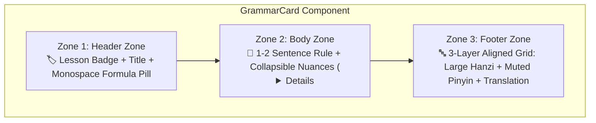

import { Badge, Card, CardGrid, Tabs, TabItem } from '@astrojs/starlight/components';
import ChineseStudyDashboard from '../../../../../../components/chinese/ChineseStudyDashboard.astro';
import ChineseGrammarExplorer from '../../../../../../components/chinese/ChineseGrammarExplorer.astro';
import ConfusableCard from '../../../../../../components/chinese/ConfusableCard.astro';
import GrammarCard from '../../../../../../components/chinese/GrammarCard.astro';
import DialoguePlayer from '../../../../../../components/DialoguePlayer.astro';
import DriveAsset from '../../../../../../components/DriveAsset.astro';
import { CONFUSABLE_PAIRS, CHINESE_GRAMMAR_RULES } from '../../../../../../data/chineseGrammarData';
import { CHINESE_DIALOGUES } from '../../../../../../data/chineseDialogues';

# 🇨🇳 Chinese Design Prototype <Badge text="Argon UX Architecture" variant="tip" size="medium" />

Interactive prototypes based on the architectural recommendations from the Gemini design consultation (**Argon**) for the Chinese section on `nikku.tech`.

:::tip[Argon's Diagnosis & Core Solution]
* **Problem**: Chinese language study materials naturally suffer from extreme visual clutter because every single example carries three distinct data layers (**Hanzi**, **Pinyin**, and **Translation**), flanked by tone accents and syntactic formulas. Expanding the curriculum to 18 multi-speaker audio dialogues and 26 grammar rules swelled the page into a 740+ line linear document.
* **Argon's Solution**: Transitioning from a linear document layout to a **modular documentation dashboard** with dedicated study focus modes (**Study Modes**), standardized **3-zone GrammarCards**, **Pinyin active-recall controls**, and **side-by-side confusable comparisons**.
:::

---

## 🧭 Study Mode Navigation Dashboard

Click any of the cards below to **dynamically switch visible page sections live**:

<ChineseStudyDashboard activeSection="dialogues" lang="en" />

---

{/* ========================================================================= */}
{/* SECTION 1: AUDIO DIALOGUES (DEFAULT ACTIVE) */}
{/* ========================================================================= */}

## 🎙️ Mode: Multi-Speaker Audio Dialogues <Badge text="Voice-ML v4 • 18 Dialogues" variant="success" />

In this mode, the page focuses completely on **spoken speech, shadowing, and listening comprehension**. Rather than scrolling past long grammar explanations, interactive dialogue players take center stage:

* **Dual-Speed Playback**: 1.0x standard tempo & 0.75x slow learning pace.
* **Sentence Looping (Shadowing)**: Repeat any individual turn in an infinite loop to perfect intonation.
* **Live Synchronized Tracking**: Subtitles in Hanzi, Pinyin, and English follow the audio with millisecond accuracy.

### Sample Players from Lesson 2 & Lesson 8:

<DialoguePlayer
  dialogue={CHINESE_DIALOGUES[0]}
  driveFolderHref="https://drive.google.com"
/>

<DialoguePlayer
  dialogue={CHINESE_DIALOGUES[1]}
  driveFolderHref="https://drive.google.com"
/>

<DialoguePlayer
  dialogue={CHINESE_DIALOGUES[12]}
  driveFolderHref="https://drive.google.com"
/>

:::tip[Complete Curriculum Vault]
All **18 synthesized dialogues** across Lessons 2 through 10 are available with full multi-speaker profiles (CSMSC Studio Female v4, AISHELL-3 Male v1 & Zero-Shot SSB1630).
:::

{/* ========================================================================= */}
{/* SECTION 2: GRAMMAR EXPLORER */}
{/* ========================================================================= */}

## 📐 Mode: Systematic Grammar Explorer <Badge text="26 Rules + Confusables" variant="success" />

The **Grammar Explorer** replaces endless scrolling with live client-side search, customizable Pinyin visibility, and responsive card layouts:

* **Search Bar (`Ctrl+K`)**: Search rules, Hanzi, or Pinyin (e.g. `zài`, `比`, `离`, `modal verb`, `questions`).
* **Layout Switcher**: Choose between **🗂️ Bento Grid** (2-column desktop dashboard), **📑 Accordion List** (ultra-compact), and **⚖️ Confusables Spotlight**.
* **Pinyin Active Recall**:
  * **👁️ Always Visible**: Standard continuous study mode.
  * **👆 Hover Mode**: Pinyin is blurred/hidden and reveals only when hovering or tapping an example — optimal for self-testing Hanzi reading skills!
  * **🙈 Hidden**: Complete pinyin removal for pure character immersion.

<ChineseGrammarExplorer lang="en" />

---

### 🔍 Argon's Standardized 3-Zone "GrammarCard" in Detail

Argon's design principle for grammar components: *"Standardize every grammar point into a visual component with three distinct zones."*

Here are two isolated cards demonstrating the 3-zone architecture:

<CardGrid>
  <GrammarCard rule={CHINESE_GRAMMAR_RULES[0]} lang="en" />
  <GrammarCard rule={CHINESE_GRAMMAR_RULES[25]} lang="en" />
</CardGrid>

---

### ⚖️ Side-by-Side Confusable Comparisons

Chinese learners often confuse semantically similar expressions governed by strict syntactic conditions (`二` vs. `两`, `在` vs. `有`, `想` vs. `要`, `离` vs. `从…到…`).

The prototype provides a dedicated 2-column comparative layout featuring **✅ Correct** and **❌ Incorrect** monospace examples with error explanations:

<ConfusableCard pair={CONFUSABLE_PAIRS[0]} lang="en" />

<ConfusableCard pair={CONFUSABLE_PAIRS[1]} lang="en" />

<ConfusableCard pair={CONFUSABLE_PAIRS[2]} lang="en" />

---

### 📊 Layout Pattern Comparison Matrix (Argon's Guide)

| Layout Pattern | Best For | Visual Impact & UX Dynamics |
| :--- | :--- | :--- |
| **Bento Grid Cards** | Rapid scanning & reference on desktop | Modern dashboard feel; formula pills catch the eye immediately. |
| **Accordion List (`
`)** | Fitting 25+ rules cleanly on a single page | High density; learners only see titles + formulas until expanded. |
| **Confusables Spotlight** | Error prevention & contrastive learning (`二/两`, `在/有`) | 2-column direct contrast with ✅/❌ examples prevents chronic grammar pitfalls. |
| **Hover-Pinyin Active Recall** | Vocabulary & reading comprehension | Enables instant self-testing without pinyin training wheels cluttering the page. |

{/* ========================================================================= */}
{/* SECTION 3: TONAL SYSTEM & TONE SANDHI */}
{/* ========================================================================= */}

## 🇨🇳 Mode: Tonal System & Tone Sandhi <Badge text="4 Tones + Sandhi" variant="tip" />

The Mandarin tonal system is the bedrock of acoustic intelligibility. This focused mode presents pitch contours and essential sandhi shifts cleanly:

### 1. The Four Basic Tones & Neutral Tone

| Tone | Chinese Name | Contour / Pitch | 5-Level Value | Example | Meaning |
| :--- | :--- | :--- | :--- | :--- | :--- |
| **1st Tone** | 阴平 (*yīnpíng*) | High, level, sustained | **55** | `mā` (妈) | mother |
| **2nd Tone** | 阳平 (*yángpíng*) | Mid-to-high, rising | **35** | `má` (麻) | hemp |
| **3rd Tone** | 上声 (*shǎngshēng*) | Low dipping, slight rise | **214** (isolated) | `mǎ` (马) | horse |
| **4th Tone** | 去声 (*qùshēng*) | High-to-low, sharply falling | **51** | `mà` (骂) | to scold |
| **Neutral Tone** | 轻声 (*qīngshēng*) | Short, unstressed, light | *–* | `ma` (吗) | question particle |

---

### 2. Tone Sandhi: Four Essential Change Rules

:::note[Rule 1: Two Consecutive 3rd Tones ($3 + 3 \to 2 + 3$)]
When two 3rd-tone syllables meet in sequence, the first shifts to a **2nd tone (rising)**:
* Written: `nǐ hǎo` (你好) $\to$ Spoken: **`ní hǎo`** (35 + 214)
* Written: `kěyǐ` (可以) $\to$ Spoken: **`kéyǐ`** (35 + 214)
:::

:::note[Rule 2: Tone Changes of the Negative Particle `不` (*bù*)]
`不` is inherently a 4th tone (*bù*). Before another **4th tone syllable**, however, it shifts to a **2nd tone (*bú*)**:
* Before 1st, 2nd, or 3rd tones it stays 4th tone: `不喝` (*bù hē*), `不来` (*bù lái*), `不好` (*bù hǎo*).
* Before 4th tones it becomes 2nd tone: `不是` $\to$ **`bú shì`**; `不要` $\to$ **`bú yào`**!
:::

:::note[Rule 3: Tone Changes of the Numeral `一` (*yī*)]
When isolated or counting, `一` is 1st tone (*yī*).
* Before **1st, 2nd, or 3rd tones**, `一` shifts to **4th tone (*yì*)**: `一天` (*yì tiān*), `一年` (*yì nián*), `一起` (*yì qǐ*).
* Before **4th tones**, `一` shifts to **2nd tone (*yí*)**: `一下` (*yí xià*), `一共` (*yí gòng*), `一定` (*yí dìng*).
:::

{/* ========================================================================= */}
{/* SECTION 4: COURSE ASSETS & DOWNLOADS */}
{/* ========================================================================= */}

## 🗂️ Mode: Course Assets & Anki Deck <Badge text="Downloads (WIP)" variant="note" />

Access flashcard exports, study resources, and uncompressed audio masters:

### 📥 Direct Downloads

<CardGrid>
  <Card title="560-Note Anki Dual-Audio Deck" icon="document">
    Complete Anki deck (.apkg) with character stroke orders, pinyin, sample sentences, and bidirectional audio playback.
    
    <DriveAsset
      title="Download 107 MB Anki Deck"
      type="anki"
      description="Google Drive: Chinese_Mandarin_Comprehensive_v4.apkg"
      wip={true}
      wipLabel="Work In Progress"
    />
  </Card>

  <Card title="Studio WAV Master Archive" icon="laptop">
    Uncompressed 32 kHz master WAV recordings for all 18 dialogues with millisecond-exact turn timestamps in JSON.
    
    <DriveAsset
      title="Dialogues Master Archive (WAV & JSON)"
      type="dataset"
      description="Google Drive: University/dialogues/"
      wip={true}
      wipLabel="Work In Progress"
    />
  </Card>
</CardGrid>

