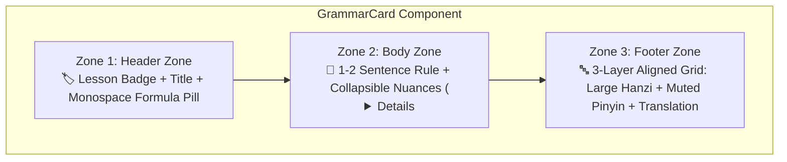

import { Badge, Card, CardGrid, Tabs, TabItem } from '@astrojs/starlight/components';
import ChineseStudyDashboard from '../../../../../../components/chinese/ChineseStudyDashboard.astro';
import ChineseGrammarExplorer from '../../../../../../components/chinese/ChineseGrammarExplorer.astro';
import ConfusableCard from '../../../../../../components/chinese/ConfusableCard.astro';
import GrammarCard from '../../../../../../components/chinese/GrammarCard.astro';
import { CONFUSABLE_PAIRS, CHINESE_GRAMMAR_RULES } from '../../../../../../data/chineseGrammarData';

# 🇨🇳 Chinese Design Prototypes <Badge text="Argon UX Showcase" variant="tip" size="medium" />

This showcase demonstrates the **interactive design prototypes** built on top of the architectural guidelines proposed during the Gemini design consultation (**Argon**) for the Chinese section on `nikku.tech`.

:::tip[Core Problem of the Previous Layout & Solution]
* **Problem**: Chinese language study materials naturally suffer from extreme visual clutter because every single example carries three distinct data layers (**Hanzi**, **Pinyin**, and **Translation**), flanked by tone accents and syntactic formulas. Expanding the curriculum to 18 multi-speaker audio dialogues and 26 grammar rules swelled the page into a 740+ line linear document.
* **Argon's Solution**: Transitioning from a linear document layout to a **documentation-style dashboard** with top-level study modes, standardized **3-zone GrammarCards**, **Pinyin active-recall controls**, and **side-by-side confusable comparisons**.
:::

---

## 🧭 Prototype 1: Study Mode Dashboard (Page Architecture by Study Mode)

Rather than stacking dialogues, grammar rules, and phonetics in an endless linear scroll, the **Study Mode Dashboard** partitions the curriculum into four focused work zones:

<ChineseStudyDashboard activeSection="grammar" lang="en" />

---

## 📐 Prototype 2: The Interactive Grammar Explorer

Below is the fully functional prototype of the **Grammar Explorer**. Try out the interactive features directly:

1. **Search Bar (`Ctrl+K`)**: Search by rule name, Hanzi character, or Pinyin (e.g. `zài`, `比`, `离`, `modal verb`, or `question`).
2. **Layout Mode Switcher**:
   * 🗂️ **Bento Grid**: 2-column responsive cards for fast visual scanning on desktop monitors.
   * 📑 **Accordion List**: Ultra-compact view displaying only titles and monospace formula pills until clicked.
   * ⚖️ **Confusables Spotlight**: Direct filter focusing on frequent problem pairs.
3. **Pinyin Active Recall Mode**:
   * **👁️ Always Visible**: Standard study mode with continuous pinyin annotations.
   * **👆 Hover Mode**: Pinyin is blurred/hidden and reveals only when hovering or tapping an example — optimal for self-testing Hanzi reading skills!
   * **🙈 Hidden**: Complete pinyin removal for pure character immersion.
4. **Category & Lesson Filter Pills**: Instant client-side filtering by linguistic topic and course lesson tier.

<ChineseGrammarExplorer lang="en" />

---

## 🔍 Prototype 3: Standardized 3-Zone "GrammarCard" Component

Argon's design rule for clean grammar presentation: *"Standardize every grammar point into a visual component with three distinct zones."*

Here are two isolated cards demonstrating the 3-zone architecture:

<CardGrid>
  <GrammarCard rule={CHINESE_GRAMMAR_RULES[0]} lang="en" />
  <GrammarCard rule={CHINESE_GRAMMAR_RULES[25]} lang="en" />
</CardGrid>

---

## ⚖️ Prototype 4: Side-by-Side Confusable Comparisons

Chinese learners often confuse semantically similar expressions governed by strict syntactic conditions (`二` vs. `两`, `在` vs. `有`, `想` vs. `要`, `离` vs. `从…到…`).

The prototype provides a dedicated 2-column comparative layout featuring **✅ Correct** and **❌ Incorrect** monospace examples with error explanations:

<ConfusableCard pair={CONFUSABLE_PAIRS[0]} lang="en" />

<ConfusableCard pair={CONFUSABLE_PAIRS[1]} lang="en" />

<ConfusableCard pair={CONFUSABLE_PAIRS[2]} lang="en" />

---

## 📊 Layout Pattern Comparison Matrix (Argon's Design Guide)

| Layout Pattern | Best For | Visual Impact & UX Dynamics |
| :--- | :--- | :--- |
| **Bento Grid Cards** | Rapid scanning & reference on desktop | Modern dashboard feel; formula pills catch the eye immediately. |
| **Accordion List (`
`)** | Fitting 25+ rules cleanly on a single page | High density; learners only see titles + formulas until expanded. |
| **Confusables Spotlight** | Error prevention & contrastive learning (`二/两`, `在/有`) | 2-column direct contrast with ✅/❌ examples prevents chronic grammar pitfalls. |
| **Hover-Pinyin Active Recall** | Vocabulary & reading comprehension | Enables instant self-testing without pinyin training wheels cluttering the page. |
