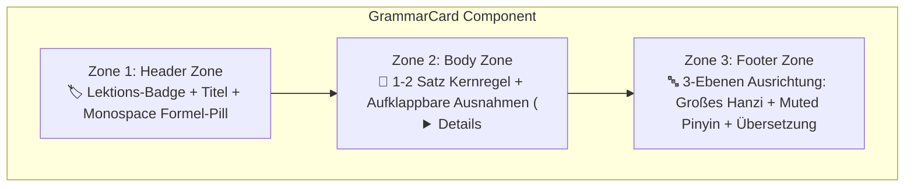

import { Badge, Card, CardGrid, Tabs, TabItem } from '@astrojs/starlight/components';
import ChineseStudyDashboard from '../../../../../components/chinese/ChineseStudyDashboard.astro';
import ChineseGrammarExplorer from '../../../../../components/chinese/ChineseGrammarExplorer.astro';
import ConfusableCard from '../../../../../components/chinese/ConfusableCard.astro';
import GrammarCard from '../../../../../components/chinese/GrammarCard.astro';
import DialoguePlayer from '../../../../../components/DialoguePlayer.astro';
import DriveAsset from '../../../../../components/DriveAsset.astro';
import LanguageSwitch from '../../../../../components/LanguageSwitch.astro';
import ChineseVocabVault from '../../../../../components/chinese/ChineseVocabVault.astro';
import StrokeOrderGuide from '../../../../../components/strokes/StrokeOrderGuide.astro';
import { CONFUSABLE_PAIRS, CHINESE_GRAMMAR_RULES } from '../../../../../data/chineseGrammarData';
import { CHINESE_DIALOGUES } from '../../../../../data/chineseDialogues';

# Chinesisch (Mandarin) <Badge text="Grundkurs & Audio-Dialoge" variant="success" size="medium" />

<LanguageSwitch current="de" enHref="/lectures/languages/chinese/en/" deHref="/lectures/languages/chinese/" />

Interaktives Studien- und Nachschlagewerk für den Grundkurs **Chinesisch (Mandarin Sprachpraxis I & II)** am Zentralen Sprachlabor (*ZSL / heiSKILLS*) der Universität Heidelberg.

Diese Seite bündelt die vollständigen, mit **Voice-ML v4 (GPT-SoVITS v2ProPlus)** synthetisierten **Multi-Speaker Audio-Dialoge** (Lektionen 2 bis 10 mit allen 18 Dialogen), den systematischen **Grammatik-Explorer** mit 26 Kernregeln und Confusables, fundierte Übersichten zum **Tonsystem (Tone Sandhi)** sowie den Zugang zum **Dual-Audio Anki-Deck**.

---

## 🧭 Lernmodus-Dashboard (Study Mode Navigation)

Klicke auf eine der Kacheln unten, um den **sichtbaren Inhalt der Seite live umzuschalten**:

<ChineseStudyDashboard activeSection="dialogues" lang="de" />

---

{/* ========================================================================= */}
{/* SECTION 1: AUDIO-DIALOGE (DEFAULT ACTIVE) */}
{/* ========================================================================= */}

## 🎙️ Modus: Multi-Speaker Audio-Dialoge <Badge text="Voice-ML v4 • 18 Dialoge" variant="success" />

In diesem Modus konzentriert sich die Seite vollständig auf die **gesprochene Sprache**, Satz-Shadowing und das Hörverständnis. Statt zwischen Grammatikregeln hin und her zu scrollen, stehen die interaktiven Player im Zentrum:

* **Dual-Speed Bereitstellung**: 1.0x Standardtempo & 0.75x verlangsamtes Lerntempo.
* **Satz-Looping (Shadowing)**: Wiederhole jeden beliebigen Turn in Endlosschleife, bis Intonation und Rhythmus sitzen.
* **Live Untertitel-Tracking**: Hanzi, Pinyin und deutsche Übersetzung springen synchron zum Audio weiter.

---

### 🗺️ Schnellnavigation der Dialoge

| Lektion | Thematischer Fokus & Dialoge | Audio-Sprecher |
| :--- | :--- | :--- |
| **[Lektion 2](#lektion-2--geschäftskontakte-herkunft--sprachen)** | Dialog 2.1 (Vorstellung & Singapur) & Dialog 2.2 (Sprachen & Übersetzung) | 🎙️ 2 Multi-Speaker Audios (3 Sprecher) |
| **[Lektion 3](#lektion-3--messezentrum-kontaktdaten--adressen)** | Dialog 3.1 (Messebroschüre & Durchwahlen) & Dialog 3.2 (Studio in Chengdu) | 🎙️ 2 Multi-Speaker Audios (Festnetz / Adressen) |
| **[Lektion 4](#lektion-4--uhrzeit-zeitzonen--kalender)** | Dialog 4.1 (Uhrzeit Zürich & Sommerzeit) & Dialog 4.2 (Datum & Kalender) | 🎙️ 2 Multi-Speaker Audios (Zeit / Kalender) |
| **[Lektion 5](#lektion-5--büroumgebung-raumorientierung--werkstatt)** | Dialog 5.1 (Büroräume & Baupläne) & Dialog 5.2 (Weg zur Werkstatt & Kiosk) | 🎙️ 2 Multi-Speaker Audios (Orientierung / Distanzen) |
| **[Lektion 6](#lektion-6--industriemesse-reisen--stadt-vs-land)** | Dialog 6.1 (Messe Shanghai & Herbstferien) & Dialog 6.2 (Großstadt vs. Landleben Dali) | 🎙️ 2 Multi-Speaker Audios (Termine / Lebensstil) |
| **[Lektion 7](#lektion-7--restaurantkultur-sichuan-küche--aa-system)** | Dialog 7.1 (Sichuan-Küche & Menüwahl) & Dialog 7.2 (Rechnung & AA-Kostenteilung) | 🎙️ 2 Multi-Speaker Audios (Speisen / Bezahlkultur) |
| **[Lektion 8](#lektion-8--einkauf-elektronikzubehör--preisverhandlung)** | Dialog 8.1 (Elektronik & Quittung) & Dialog 8.2 (Kleidung & Feilschen) | 🎙️ 2 Multi-Speaker Audios (Kaufhaus / Rabatte) |
| **[Lektion 9](#lektion-9--termine-essenseinladungen--abendprogramm)** | Dialog 9.1 (Wochenendschicht & Lunch) & Dialog 9.2 (Feierabend & Kino) | 🎙️ 2 Multi-Speaker Audios (Dienstplan / Freizeit) |
| **[Lektion 10](#lektion-10--geschäftsessen-kulinarik--vergleiche)** | Dialog 10.1 (Speisekarte & Bestellung) & Dialog 10.2 (Getränke, Toast & Rechnung) | 🎙️ 2 Multi-Speaker Audios (Kulinarik / Gastronomie) |

---

## 🎙️ Lektion 2 — Geschäftskontakte, Herkunft & Sprachen

In Lektion 2 stehen das förmliche Vorstellen von Geschäftspartnern, das Erfragen von Herkunft und Heimatstadt sowie multilinguale Kompetenzen im Mittelpunkt.

:::note[Grammatische Schlüsselmuster]
* **Vorstellen mit `介绍`**: `各位好，我来给二位介绍一下，这位是……` (*...zhè wèi shì...* – „Guten Tag allerseits, ich möchte Ihnen beiden einander vorstellen: Das ist...“)
* **Familienname vs. Vorname**: `我姓陈，名字叫陈明。` (*Wǒ xìng Chén, míngzi jiào Chén Míng.* – „Mein Nachname ist Chen, mein Name ist Chen Ming.“)
* **Höflichkeitsform**: `幸会，认识您非常高兴！` (*Xìnghuì, rènshi nín fēicháng gāoxìng!* – „Sehr erfreut, Sie kennenzulernen!“)
* **Herkunftsangabe mit `出生在`**: `陈先生出生在新加坡，现在在上海工作。` (*Chén xiānsheng chūshēng zài Xīnjiāpō...* – „Herr Chen ist in Singapur geboren...“)
* **Auswahlsatz mit `还是` (*háishi*)**: `她是日本人还是中国人呢？` („Ist sie Japanerin oder Chinesin?“)
* **Rückbestätigungspartikel `吧` (*ba*)**: `从上周起已经开始实行夏令时了吧？` („...oder? / nicht wahr?“)
:::

### Dialog 2.1: Geschäftskontakte & Herkunft
*Drei-Personen-Gespräch*: Eine Kollegin stellt Herrn Weber von der Firma Siemens und Herrn Chen Ming einander vor. Visitenkarten werden ausgetauscht und die Herkunft aus Singapur geklärt.

<DialoguePlayer
	dialogue={CHINESE_DIALOGUES[0]}
/>

---

### Dialog 2.2: Sprachkenntnisse & Übersetzung
*Zwei-Personen-Gespräch*: Zwei Kollegen sprechen über Tanaka Yahui (田中雅慧), Übersetzerin der Außenwirtschaftsabteilung mit japanischem Vater aus Tokio und chinesischer Mutter aus Peking, die Chinesisch, Deutsch und Japanisch beherrscht.

<DialoguePlayer
	dialogue={CHINESE_DIALOGUES[1]}
/>

---

## 🎙️ Lektion 3 — Messezentrum, Kontaktdaten & Adressen

Lektion 3 behandelt räumliche Orientierung im Büro, das Erfragen von Festnetznummern und Durchwahlen sowie das genaue Notieren von Wohn- und Geschäftsadressen in China.

:::note[Grammatische Schlüsselmuster]
* **Ortsabfrage mit `在` & `哪儿`**: `宣传册放在哪儿了？` (*...fàng zài nǎr le?* – „Wo ist die Broschüre abgelegt?“)
* **Lokativ-Kombinationen**: `在电脑旁边的那本文件夹里` („In dem Aktenordner neben dem Computer“).
* **Festnetz vs. Durchwahl**: `座机号码` (*zuòjī hàomǎ* – Festnetznummer) vs. `分机号` (*fēnjī hào* – Durchwahlnummer).
* **Ziffer `一` bei Rufnummern**: In Telefonnummern wird die Ziffer `1` als **`yāo`** (幺) gesprochen, um akustische Verwechslungen mit `7` (*qī*) zu verhindern!
* **A-not-A Fragemuster**: `他的私人手机号码你存了没有？` (*...nǐ cún le méiyǒu?* – „Hast du seine Handynummer abgespeichert [oder nicht]?“)
* **Adressfolge vom Großen zum Kleinen**: *Stadt $\to$ Bezirk $\to$ Straße $\to$ Hausnummer*: `青羊区春熙路六十八号` (*Qīngyáng Qū Chūnxī Lù liùshíbā hào* – Qingyang-Bezirk, Chunxi-Straße Nr. 68).
:::

### Dialog 3.1: Messezentrum & Telefonnummern
Zwei Kollegen suchen im Büro nach der Broschüre des neuen Business-Messezentrums, um die Telefonnummer der Zentrale und die Durchwahl der Marketingabteilung herauszusuchen.

<DialoguePlayer
	dialogue={CHINESE_DIALOGUES[2]}
/>

---

### Dialog 3.2: Kontaktdaten & Studio in Chengdu
Gespräch über den ehemaligen TUM-Kommilitonen Zhou Wenqiang (Zhou Ming), der in Chengdu im Stadtbezirk Qingyang ein Beratungsstudio eröffnet hat.

<DialoguePlayer
	dialogue={CHINESE_DIALOGUES[3]}
/>

---

## 🎙️ Lektion 4 — Uhrzeit, Zeitzonen & Kalender

Lektion 4 vertieft exakte Uhrzeitangaben, Zeitverschiebungen zwischen China (CST, UTC+8) und Zentraleuropa (Schweiz/Deutschland) sowie Kalenderabgleiche.

:::note[Grammatische Schlüsselmuster]
* **Uhrzeitangabe**: `点` (*diǎn* – Stunde), `刻` (*kè* – Viertelstunde, 15 Min.), `半` (*bàn* – halbe Stunde, 30 Min.).
* **Vergleichskonstruktion mit `比`**: `北京时间比瑞士快六个小时` („Peking-Zeit ist der Schweiz sechs Stunden voraus“).
* **Tageszeitpräfixe**: Werden *vor* die Uhrzeit gesetzt: `早晨` (*zǎochen* – früher Morgen), `上午` (*shàngwǔ* – Vormittag), `凌晨` (*língchén* – nachts/Frühstunden), `下午` (*xiàwǔ* – Nachmittag).
* **Datumsreihenfolge**: Immer hierarchisch *Monat $\to$ Tag $\to$ Wochentag*: `五月二十六日星期日` (Sonntag, 26. Mai).
* **Wochentage**: `周几` (*zhōu jǐ*) oder `星期几` (*xīngqī jǐ*) zur Frage nach dem Wochentag; Antworten: `周四` (Donnerstag), `周六` (Samstag), `周日` (Sonntag).
* **Relative Zeitangaben**: `前天` (*qiántiān* – vorgestern), `昨天` (*zuótiān* – gestern), `今天` (*jīntiān* – heute), `后天` (*hòutiān* – übermorgen).
:::

### Dialog 4.1: Uhrzeit & Zeitzonen Zürich
Zwei Kollegen vergleichen die aktuelle Uhrzeit in China (10:15 Uhr) mit Zürich unter Berücksichtigung der europäischen Sommerzeit (5 Stunden Differenz), um ein Online-Meeting sinnvoll zu terminieren.

<DialoguePlayer
	dialogue={CHINESE_DIALOGUES[4]}
/>

---

### Dialog 4.2: Datum, Wochentag & Kalender
Herr Abteilungsleiter Zhao und eine Kollegin ermitteln das aktuelle Datum. Ein Missverständnis klärt sich auf, als auffällt, dass der Wandkalender noch aus dem Vormonat stammt.

<DialoguePlayer
	dialogue={CHINESE_DIALOGUES[5]}
/>

---

## 🎙️ Lektion 5 — Büroumgebung, Raumorientierung & Werkstatt

Lektion 5 erweitert den Wortschatz um räumliche Orientierung im Büro- und Werksgelände, Richtungsangaben und Distanzen sowie die Vorbereitung geschäftlicher Betriebsbesichtigungen.

:::note[Grammatische Schlüsselmuster]
* **Lokativ-Nomen (Positionen)**: `上面` (*shàngmiàn* – oben/auf), `下边` (*xiàbian* – unten/darunter), `里边` (*lǐbian* – innen/in), `后边` (*hòubiān* – hinter), `前边` (*qiánbiān* – vor), `旁边` (*pángbiān* – neben), `中间` (*zhōngjiān* – Mitte/zwischen).
* **Ortspräposition `在` mit Lokativ**: `在门后边的墙上` („An der Wand hinter der Tür“), `在书架第二层` („Im zweiten Fach des Bücherregals“).
* **Entfernungsangabe mit `从...到...有多远`**: `从咱们办公楼到一号生产车间大概有多远？` („Wie weit ist es ungefähr vom Bürogebäude zur Werkstatt 1?“)
* **Distanzangabe**: `走过去大概只有两百米，非常近。` (*...zhǐ yǒu liǎngbǎi mǐ...* – „Zu Fuß sind es nur ca. 200 Meter, sehr nah.“)
* **Bewegungsverben mit `穿过`**: `穿过中间的小花园` (*chuānguò...* – „durch den kleinen Garten hindurchgehen“).
* **Höfliche Gesprächsführung**: `顺便问一下` (*shùnbiàn wèn yíxià* – „Darf ich bei der Gelegenheit fragen...“), `多谢二位` („Vielen Dank euch beiden“), `辛苦大家了` („Danke für euren Einsatz!“).
:::

### Dialog 5.1: Büroräume & Werkstattvorbereitung
*Drei-Personen-Gespräch*: Drei Kollegen suchen nach den Bauplänen des Bürogebäudes, prüfen Klimaanlage, Heizung und Büromöbel und bereiten sich auf den Kontrollbesuch von Manager Zhang vor.

<DialoguePlayer
	dialogue={CHINESE_DIALOGUES[6]}
/>

---

### Dialog 5.2: Orientierung zur Produktionswerkstatt
*Drei-Personen-Gespräch*: Die Kollegen besprechen den kurzen Fußweg zur Produktionswerkstatt 1 durch den Garten und verabreden sich zu einem kurzen Gang an die frische Luft und zum Werkskiosk.

<DialoguePlayer
	dialogue={CHINESE_DIALOGUES[7]}
/>

---

## 🎙️ Lektion 6 — Industriemesse, Reisen & Stadt vs. Land

Lektion 6 behandelt Geschäftsreisen zur Industriemesse Shanghai, Reisedauer, Jahreszeiten und Klimavorzüge sowie eine lebhafte Diskussion über das Leben in dynamischen Metropolen gegenüber der Ruhe kleinerer Städte wie Dali.

:::note[Grammatische Schlüsselmuster]
* **Zeitdauer mit `待 + Dauer`**: `咱们部门这次打算在上海待几天左右？` (*...dāi jǐ tiān...* – „Wie viele Tage plant unsere Abteilung in Shanghai zu bleiben?“)
* **Planung & Absicht mit `打算` / `计划`**: `我们计划先在展厅待四天` („Wir planen, zunächst vier Tage in der Messehalle zu verbringen“).
* **Kausalgefüge mit `为什么...？因为...`**: `为什么选秋天呢？因为那边的秋天景色很美...` („Warum im Herbst? Weil die Herbstlandschaft dort wunderschön ist...“).
* **Doppelnegation / Fragemuster mit `想不想`**: `大家想不想一起去周围的南方城市看看？` („Möchtet ihr [oder nicht] umliegende Städte im Süden besuchen?“)
* **Präferenzvergleich**: `更喜欢在大城市工作，还是更向往安静的农村生活？` („Arbeitet ihr lieber in der Großstadt oder zieht ihr das Landleben vor?“)
* **Konzessives `不过` (*búguò*)**: `不过大城市也有烦恼...` („Großstädte bringen jedoch auch Nachteile mit sich...“).
* **Adjektivsteigerung mit `比...得多`**: `生活节奏也比东部沿海慢得多` („Das Lebenstempo ist viel langsamer als an der Ostküste“).
:::

### Dialog 6.1: Industriemesse Shanghai & Reisepläne
*Drei-Personen-Gespräch*: Drei Kollegen koordinieren die Ankunft des Projektleiters für die Industriemesse Shanghai und planen im Anschluss einen herbstlichen Ausflug nach Shaoxing und Hangzhou.

<DialoguePlayer
	dialogue={CHINESE_DIALOGUES[8]}
/>

---

### Dialog 6.2: Großstadt-Dynamik vs. Landleben in Dali
*Drei-Personen-Gespräch*: Angeregte Diskussion über Vor- und Nachteile zwischen Metropolen (Chancen, Verkehrsstau) und dem entschleunigten Leben im südwestchinesischen Dali.

<DialoguePlayer
	dialogue={CHINESE_DIALOGUES[9]}
/>

---

## 🎙️ Lektion 7 — Restaurantkultur, Sichuan-Küche & AA-System

Lektion 7 vermittelt authentische Speise- und Restaurantkultur in China: Bestellen von Gerichten, Nachfragen zu Schärfegraden und Zutaten sowie die gesellschaftlichen Gepflogenheiten beim Bezahlen (Einladen vs. Kostenteilung im Kollegium).

:::note[Grammatische Schlüsselmuster]
* **Zählwörter für Speisen & Getränke**: `一份菜单` (*yí fèn càidān* – eine Speisekarte), `一壶热茶` (*yì hú rè chá* – eine Kanne heißer Tee), `三碗香米饭` (*sān wǎn xiāngmǐfàn* – drei Schalen Duftreis), `一瓶矿泉水` (*yì píng kuàngquánshuǐ* – eine Flasche Mineralwasser).
* **Vorlieben & Unverträglichkeiten**: `你们有什么忌口的吗？` (*...jìkǒu de ma?* – „Gibt es Speisen, die ihr meidet/nicht esst?“), `我不太能吃特别辣的菜` („Ich vertrage sehr scharfes Essen nicht so gut“).
* **Doppelkonjunktion `既...又...`**: `既解油腻，又能放松身心` („Sowohl fettneutralisierend als auch entspannend für Körper und Geist“), `既保留了传统风味，又融合了创新烹饪` („Bewahrt traditionelle Aromen und verbindet moderne Kochkunst“).
* **Ergebnis- & Richtungsanzeige mit `下来`**: `把这几道菜定下来` („Diese Gerichte jetzt festlegen/bestellen“).
* **Bezahlkultur & Rechnung**: `买单` (*mǎidān* – zahlen), `我来请客，大家千万不要争` („Das geht auf mich, protestiert bitte gar nicht erst!“).
* **Kostenteilung / AA-Prinzip**: `平摊餐费` (*píngtān cānfèi* – Mahlzeit gleichmäßig aufteilen) bzw. **`AA制`** (*AA-zhì* – getrennte Rechnung nach dem niederländischen Prinzip).
:::

### Dialog 7.1: Sichuan-Restaurant & Menübestellung
*Drei-Personen-Gespräch*: Drei Kollegen studieren nach Feierabend die Speisekarte eines Sichuan-Restaurants und wählen Gerichte aus: Wolfsbarsch, Tomaten-Rührei, Kung-Pao-Huhn und Longjing-Tee.

<DialoguePlayer
	dialogue={CHINESE_DIALOGUES[10]}
/>

---

### Dialog 7.2: Rechnungsbegleichung & Kostenteilung (AA-System)
*Drei-Personen-Gespräch*: Nach dem Festessen loben die Kollegen die Spezialitäten und klären die Abrechnung – die Gastgeberin möchte einladen, die Kollegen plädieren für faire Kostenteilung (AA-System).

<DialoguePlayer
	dialogue={CHINESE_DIALOGUES[11]}
/>

---

## 🎙️ Lektion 8 — Einkauf, Elektronikzubehör & Preisverhandlung

In Lektion 8 stehen Einkaufsdialoge, Mengenangaben mit Zählwörtern, das chinesische Rabattsystem (*dǎzhé*), Verbverdoppelungen sowie das Verhandeln auf dem Abendmarkt im Mittelpunkt.

:::note[Grammatische Schlüsselmuster]
* **Verbverdoppelung (`V-V` / `V-yī-V`)**: Lockert Handlungen auf und drückt unverbindliches Ausprobieren aus: `看（一）看` (mal kurz schauen), `试一下` (kurz anprobieren).
* **Das chinesische Rabattsystem (`打 x 折` *dǎ x zhé*)**: Nennt den **verbleibenden Zahlungsanteil** in Zehnteln! `打八折` bedeutet: Man zahlt 80 %, erhält also **20 % Rabatt**! `打八五折` = 15 % Rabatt.
* **Große Zahlen**: `百` (*bǎi* – 100), `千` (*qiān* – 1.000), `万` (*wàn* – 10.000). Die Ziffer 0 (`零` *líng*) wird bei inneren Lücken genau einmal gesprochen.
* **Demonstrativ-Zählwort-Muster**: `这种优盘多少钱？` („Wie viel kostet diese Art von USB-Stick?“).
:::

### Dialog 8.1: Elektronikzubehör im Technik-Kaufhaus & Quittung
Zwei Kollegen (A und C) besorgen vor einer Konferenz in der Elektronikabteilung bei einem Verkäufer (B) USB-Sticks, Speicherkarten, eine Handy-Aufladekarte sowie Batterien und lassen sich eine Firmenquittung (*Fāpiào*) ausstellen.

<DialoguePlayer
	dialogue={CHINESE_DIALOGUES[12]}
/>

---

### Dialog 8.2: Kleidung, Farben & Feilschen auf dem Abendmarkt
Zwei Kollegen (A und C) bummeln über einen Bekleidungsmarkt, lassen sich von einem Händler (B) Seidenkrawatten und ein dunkelblaues Hemd zeigen und verhandeln über Rabatte (*dǎzhé*).

<DialoguePlayer
	dialogue={CHINESE_DIALOGUES[13]}
/>

---

## 🎙️ Lektion 9 — Termine, Essenseinladungen & Abendprogramm

Lektion 9 behandelt Dienstpläne, Schichtzeiten, Essenseinladungen am Wochenende, Kupplungssätze (Pivotsätze) mit `请` (*qǐng*) sowie die Verlaufsform mit `（正）在` (*[zhèng]zài*).

:::note[Grammatische Schlüsselmuster]
* **Kupplungssatz (兼语句 / Pivotsatz)**: `S + 请 / 让 / 要 + [Pivot-Objekt] + [Zweitprädikat]`: Das Objekt des ersten Verbs ist zugleich das handelnde Subjekt des zweiten Verbs! (`我想请你去吃午饭` – „Ich möchte dich zum Mittagessen einladen“).
* **Verlaufsform (Progressive Aspect)**: `（正）在 + Verb`: Drückt Handlungen aus, die gerade im Moment des Sprechens ablaufen (`我正在看电影` – „Ich schaue gerade einen Film“).
* **Kooperation**: `跟 / 和 + [Person] + 一起 + Verb` (z. B. `跟他一起去` – mit ihm zusammen hingehen).
* **Aktionsphasen mit `上` / `下`**: `上班` (*shàng bān* – Dienst beginnen) ↔ `下班` (*xià bān* – Feierabend machen).
:::

### Dialog 9.1: Wochenendschicht & Einladung zum Sonntags-Lunch
Sprecherin A möchte ihre beiden Kollegen (B und C) am Samstagmittag ins Sichuan-Restaurant einladen. Da Kollege B am Samstag bis mittags Dienst hat und nachmittags bereits verabredet ist, verlegen sie das Treffen auf Sonntagmittag um 12 Uhr.

<DialoguePlayer
	dialogue={CHINESE_DIALOGUES[14]}
/>

---

### Dialog 9.2: Feierabendpläne & Gemeinsamer Kinobesuch
Nach dem Chinesischkurs fragt Sprecherin A ihre beiden Kollegen (B und C), womit sie gerade beschäftigt sind, und schließt sich ihrem Kinobesuch für den neuen Jackie-Chan-Film an.

<DialoguePlayer
	dialogue={CHINESE_DIALOGUES[15]}
/>

---

## 🎙️ Lektion 10 — Geschäftsessen, Kulinarik & Vergleiche

In Lektion 10 stehen Restaurantbesuche, die Bestellung chinesischer Spezialitäten, Potenzialkomplemente der Wahrnehmung (*kàndedǒng*), Vergleiche mit `比` (*bǐ*) sowie Trink- und Bezahlkonventionen (*gānbēi*, *mǎidān*) im Mittelpunkt.

:::note[Grammatische Schlüsselmuster]
* **Vergleichssatz mit `比`**: `A + 比 + B + Adjektiv` (z. B. `这儿比那边安静` – „Hier ist es ruhiger als drüben“).
* **Potenzialkomplement der Fähigkeit**: `Verb + 得 / 不 + 懂` (`看得懂` – lesen und verstehen können ↔ `看不懂` – nicht verstehen können).
* **Erfahrungspartikel `过` (*guo*)**: Zeigt an, dass eine Handlung mindestens einmal in der Vergangenheit stattgefunden hat (`吃过一次` – schon einmal gegessen haben).
* **Gastronomie-Floskeln**: `来……` zum Bestellen (`来一个宫保鸡丁` – „Bringen Sie uns ein Kung-Pao-Hühnchen“), `干杯` (*gānbēi* – „Leeren Sie das Glas! / Prost!“), `买单` (*mǎidān* – „Die Rechnung bitte!“).
:::

### Dialog 10.1: Platzwahl, Speisekarten-Beratung & Bestellung
Zwei Kollegen (A und B) suchen sich zur Mittagszeit einen ruhigen Tisch am Fenster. Da Kollege B die handgeschriebene Spezialitätenkarte nicht vollständig lesen kann, lassen sie sich vom Kellner (C) vegetarische Gerichte, eine mild gewürzte Sauer-Scharf-Suppe und Sichuan-Dandan-Nudeln empfehlen.

<DialoguePlayer
	dialogue={CHINESE_DIALOGUES[16]}
/>

---

### Dialog 10.2: Getränkeauswahl, Maotai-Toast & Rechnungsbegleichung
Nach dem Essen unterhalten sich die drei Kollegen (A, B und C) über Tsingtao-Bier, Rotwein und Maotai-Schnaps, stoßen auf die Zusammenarbeit und Gesundheit an und klären die Bezahlung der Rechnung (*mǎidān*).

<DialoguePlayer
	dialogue={CHINESE_DIALOGUES[17]}
/>

{/* ========================================================================= */}
{/* SECTION 2: GRAMMATIK-EXPLORER */}
{/* ========================================================================= */}

## 📐 Modus: Systematischer Grammatik-Explorer <Badge text="26 Regeln + Confusables" variant="success" />

Der **Grammatik-Explorer** löst das Problem des endlosen Scrollens durch gezielte Filterung, konfigurierbare Pinyin-Sichtbarkeit und kompakte Kartendarstellung:

* **Suchfeld (`Ctrl+K`)**: Schnelles Nachschlagen nach Regeln, Pinyin oder Hanzi (z. B. `zài`, `比`, `离`, `Modalverb`, `Fragen`).
* **Layout-Umschalter**: Wähle zwischen **🗂️ Bento Grid** (2-spaltiges Dashboard), **📑 Akkordeon-Liste** (kompakt) und **⚖️ Confusables Spotlight**.
* **Pinyin-Modus (Active Recall)**:
  * **👁️ Immer sichtbar**: Standard-Lernmodus.
  * **👆 Hover-Modus**: Pinyin ist unscharf/verborgen und erscheint erst bei Mouseover oder Tap — ideal zur Selbstüberprüfung der Hanzi-Lesekompetenz!
  * **🙈 Verbergen**: Pures Schriftzeichentraining ohne Stützräder.

<ChineseGrammarExplorer lang="de" />

---

### 🔍 Standardisierte 3-Zonen "GrammarCard" im Detail

Leitlinie für die didaktische Grammatikarchitektur: *„Standardisiere jeden Grammatikpunkt in eine visuelle Komponente mit drei klar getrennten Zonen.“*

Hier sind zwei isolierte Einzelkarten zur Demonstration der Zoneneinteilung:

<CardGrid>
  <GrammarCard rule={CHINESE_GRAMMAR_RULES[0]} lang="de" />
  <GrammarCard rule={CHINESE_GRAMMAR_RULES[25]} lang="de" />
</CardGrid>

---

### ⚖️ Confusable-Gegenüberstellungen (Confusable Pairs)

Chinesisch-Lernende verwechseln häufig semantisch ähnliche Wörter mit unterschiedlichen syntaktischen Regeln (`二` vs. `两`, `在` vs. `有`, `想` vs. `要`, `离` vs. `从…到…`). 

Hierfür bieten dedizierte 2-Spalten-Gegenüberstellungen **✅ Richtig-** und **❌ Falsch-Muster** inklusive Begründung:

<ConfusableCard pair={CONFUSABLE_PAIRS[0]} lang="de" />

<ConfusableCard pair={CONFUSABLE_PAIRS[1]} lang="de" />

<ConfusableCard pair={CONFUSABLE_PAIRS[2]} lang="de" />

---

### 📊 Vergleich der Layout-Muster (UX-Matrix)

| Layout-Muster | Geeignet für | Visuelle Wirkung & Interaktion |
| :--- | :--- | :--- |
| **Bento Grid Cards** | Schnelles Scannen & Nachschlagen (Desktop 2–3 Spalten) | Moderner Dashboard-Look; klare Formel-Pills fangen den Blick sofort ein. |
| **Akkordeon-Liste (`
`)** | Kompaktes Kompendium auf einer Seite | Maximale Übersichtlichkeit; User sieht nur Titel + Formel, bis Details aufgeklappt werden. |
| **Confusables Spotlight** | Problemwörter & Fehlerprävention (`二/两`, `在/有`) | 2-Spalten Direktvergleich mit ✅ und ❌ Beispielen verhindert typische Fallstricke. |
| **Hover-Pinyin Active Recall** | Vokabel- & Schriftzeichentraining | Ermöglicht Selbsttests direkt im Fließtext ohne störende Pinyin-Trainingsräder. |

{/* ========================================================================= */}
{/* SECTION: VOKABEL-LEXIKON & ACTIVE RECALL */}
{/* ========================================================================= */}

## 🔤 Modus: Vokabel-Lexikon & Vault <Badge text="579 Vokabeln • Lektionen 1–10" variant="note" />

Vollständiges, durchsuchbares Vokabel-Register des Kurses mit **Pinyin Active Recall** (Hover / Tap) und interaktiver **Strichfolge-Vorschau (Stroke Guide ✍️)** für Schriftzeichen:

<ChineseVocabVault lang="de" />

{/* ========================================================================= */}
{/* SECTION 3: TONSYSTEM & TONE SANDHI */}
{/* ========================================================================= */}

## 🇨🇳 Modus: Tonsystem & Tone Sandhi <Badge text="4 Töne + Sandhi" variant="tip" />

Das Mandarin-Tonsystem ist das Fundament für verständliche Aussprache. In diesem fokussierten Modus werden Tonhöhenverläufe und die unverzichtbaren Sandhi-Regeln übersichtlich dargestellt:

### 1. Die vier Grundtöne & der Neutralton

| Ton | Name | Chinesischer Name | Tonhöhenverlauf (Chao) | Symbol | Beispiel | Bedeutung |
| :--- | :--- | :--- | :--- | :--- | :--- | :--- |
| **1. Ton** | Hoch-eben | 阴平 (*yīnpíng*) | **55** (durchgehend hoch) | $\bar{a}$ | `mā` (妈) | Mutter |
| **2. Ton** | Steigend | 阳平 (*yángpíng*) | **35** (mittel nach hoch) | $\acute{a}$ | `má` (麻) | Hanf |
| **3. Ton** | Fallend-steigend | 上声 (*shǎngshēng*) | **214** (isoliert: tief fallend, leicht ansteigend) | $\check{a}$ | `mǎ` (马) | Pferd |
| **4. Ton** | Fallend | 去声 (*qùshēng*) | **51** (hoch nach tief, scharf abfallend) | $\grave{a}$ | `mà` (骂) | schimpfen |
| **Neutralton** | Kurz / Tonlos | 轻声 (*qīngshēng*) | *–* (kurz, leicht, pegelt sich nach Vortontiefe) | $a$ | `ma` (吗) | Fragepartikel |

---

### 2. Tone Sandhi: Die vier Kernregeln

:::note[Regel 1: Zwei aufeinanderfolgende 3. Töne ($3 + 3 \to 2 + 3$)]
Treffen zwei Silben im 3. Ton aufeinander, wird die erste Silbe als **2. Ton (steigend)** gesprochen (obwohl sie im Wörterbuch und in Pinyin als 3. Ton geschrieben wird):
* `你好` (*nǐ + hǎo*) $\to$ gesprochen als **`ní hǎo`** (35 + 214)
* `可以` (*kě + yǐ*) $\to$ gesprochen als **`ké yǐ`** (35 + 214)
* `手表` (*shǒu + biǎo*) $\to$ gesprochen als **`shóu biǎo`** (35 + 214)
:::

:::note[Regel 2: Halb-dritter Ton (Half Third Tone: $214 \to 21$)]
Folgt auf eine Silbe im 3. Ton ein 1., 2., 4. Ton oder ein Neutralton, wird der 3. Ton **nur abgesenkt ($21$)**, ohne am Ende wieder anzusteigen. Er klingt wie ein tiefer, ebener Bass-Ton:
* `北京` (*Běijīng*): `Běi` (Ton 3) vor `jīng` (Ton 1) $\to$ tiefes $21$.
* `很忙` (*hěnmáng*): `hěn` (Ton 3) vor `máng` (Ton 2) $\to$ tiefes $21$.
* `好看` (*hǎokàn*): `hǎo` (Ton 3) vor `kàn` (Ton 4) $\to$ tiefes $21$.
:::

:::note[Regel 3: Tonwechsel der Verneinungspartikel `不` (*bù*)]
Die Negationspartikel `不` steht regulär im **4. Ton (*bù*)** vor dem 1., 2. und 3. Ton:
* `不高` (*bù gāo* – nicht hoch), `不来` (*bù lái* – nicht kommen), `不好` (*bù hǎo* – nicht gut).
* Vor einem weiteren **4. Ton** wechselt `不` in den **2. Ton (*bú*)**:
  * `不是` $\to$ **`bú shì`** (nicht sein); `不对` $\to$ **`bú duì`** (nicht richtig); `不要` $\to$ **`bú yào`**!
:::

:::note[Regel 4: Tonwechsel des Zahlworts `一` (*yī*)]
* **1. Ton (*yī*)**: Als isolierte Zahl, beim Zählen, in Ordnungszahlen oder am Wortende:
  * `第一` (*dì-yī* – erster), `一月` (*yī yuè* – Januar).
* Vor Silben im **1., 2. oder 3. Ton** wechselt `一` in den **4. Ton (*yì*)**:
  * `一天` (*yì tiān* – ein Tag, vor Ton 1), `一年` (*yì nián* – ein Jahr, vor Ton 2), `一起` (*yì qǐ* – gemeinsam, vor Ton 3).
* Vor einer Silbe im **4. Ton** wechselt `一` in den **2. Ton (*yí*)**:
  * `一下` (*yí xià* – kurz, einmal), `一共` (*yí gòng* – insgesamt), `一定` (*yí dìng* – bestimmt).
* **Sonderfall Telefonnummern (`yāo`)**:
  * In Telefon-, Fax-, Zimmer- und Flugnummern wird `一` als **`yāo`** gesprochen, um akustische Verwechslung mit `七` (*qī*) über Lautsprecher oder Rauschen zu vermeiden.
:::

{/* ========================================================================= */}
{/* SECTION 4: KURS-ASSETS & DOWNLOADS */}
{/* ========================================================================= */}

## 🗂️ Modus: Kurs-Assets & Anki-Deck <Badge text="Downloads (WIP)" variant="note" />

In diesem Modus finden sich alle Download-Ressourcen und Vokabeldecks für den Kurs:

### 📥 Direkte Downloads

<CardGrid>
  <Card title="560-Noten Anki Dual-Audio Deck" icon="document">
    Vollständiges Anki-Deck (.apkg) mit Hanzi-Schreibrichtung, Pinyin, Beispielsätzen und beidseitig abspielbaren Audio-Samples aller Lektionen 1–10.
    
    <DriveAsset
      title="Download 107 MB Anki Deck"
      type="anki"
      description="Google Drive: Chinese_Mandarin_Comprehensive_v4.apkg"
      wip={true}
      wipLabel="Work In Progress"
    />
  </Card>

  <Card title="Studio WAV Master-Archiv" icon="laptop">
    Unkomprimierte 32 kHz Studio-Aufnahmen aller 18 Dialoge inklusive millisekundengenauer Turn-Timestamps im JSON-Format.
    
    <DriveAsset
      title="Dialogues Master Archive (WAV & JSON)"
      type="dataset"
      description="Google Drive: University/dialogues/"
      wip={true}
      wipLabel="Work In Progress"
    />
  </Card>
</CardGrid>

---

### 🎙️ Technische Synthese-Architektur (Voice-ML v4)

Die auf dieser Seite eingebundenen Dialoge wurden mit der eigens entwickelten **Voice-ML Pipeline v4 (GPT-SoVITS v2ProPlus)** synthetisiert:

* **Stimmen-Profile (Milestone D / v4)**:
  * `female_v4`: Fine-Tuning auf **7,50 Stunden (7.081 Audio-Clips)** kuratierten Studioaufnahmen aus CSMSC (BZNSYP). Beseitigt synthetische Artefakte bei identisch niedriger Zeichenfehlerrate ($\text{CER} = 5{,}70\%$ auf Whisper `large-v3` ohne Halluzinationsausreißer).
  * `male_v1`: 2,5 Stunden Fine-Tuning auf dem akustisch reinsten Sprecher (SSB0817 aus AISHELL-3). Unter Claude's Quality-Preservation-Gate intakt gehalten, um Überanpassung zu verhindern.
  * `male_zs`: Zero-Shot Sprecherprofil (SSB1630) für Dritte im Drei-Personen-Dialog.
* **Audio-Aufbereitung & Features**:
  * Bereinigung durch spektrale Voice Activity Detection (VAD) mit Frequenz-Bandpass ($70\text{--}5000\text{ Hz}$).
  * Lautstärke-Angleichung aller Sprecher auf **$-16\text{ LUFS}$** nach ITU-R BS.1770 / EBU R128.
  * Natürliche Room-Tone-Pausen ($520\text{ ms}$ nach Aussagen, $620\text{ ms}$ nach Fragen) mit $15\text{ ms}$ Raised-Cosine-Crossfades.
  * Dual-Speed-Bereitstellung: 1.0x Standardtempo sowie 0.75x Lerntempo für intensives Satz-Shadowing.
* **100% Eigenständige Autorenschaft**:
  * Vollständig neu verfasste, eigenständige Konversationsdialoge für die didaktische Sprachpraxis.

<StrokeOrderGuide lang="de" scriptMode="zh" defaultChar="你" isModalOnly={true} />
