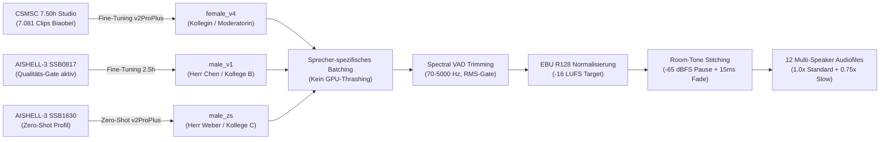

import { Badge, Card, CardGrid, Tabs, TabItem } from '@astrojs/starlight/components';
import DriveAsset from '../../../../../components/DriveAsset.astro';
import DialoguePlayer from '../../../../../components/DialoguePlayer.astro';
import LanguageSwitch from '../../../../../components/LanguageSwitch.astro';
import { CHINESE_DIALOGUES } from '../../../../../data/chineseDialogues';

# Chinesisch (Mandarin) <Badge text="Grundkurs & Dialoge" variant="success" size="medium" />

<LanguageSwitch current="de" enHref="/lectures/languages/chinese/en/" deHref="/lectures/languages/chinese/" />

:::note[Urheberrechtlicher Hinweis zu den Audio-Dialogen]
**Vorsorgliche Anpassung der Dialogtexte:** Aufgrund einer noch ungeklärten lizenzrechtlichen Frage bezüglich des Kurslehrbuchs wurden die Dialoge vorübergehend durch neu verfasste, lizenzfreie Dialoge ersetzt und mit der Voice-ML-Pipeline neu vertont. Sobald eine Bestätigung bzw. Freigabe des Verlags vorliegt, werden die Originaldialoge wieder eingefügt.
:::

Interaktives Studien- und Nachschlagewerk für den Grundkurs **Chinesisch (Mandarin Sprachpraxis I & II)** am Zentralen Sprachlabor (*ZSL / heiSKILLS*) der Universität Heidelberg. 

Diese Seite bündelt die vollständigen, mit **Voice-ML v4 (GPT-SoVITS v2ProPlus)** synthetisierten **Multi-Speaker Audio-Dialoge** (Lektionen 2 bis 10 mit allen 18 Dialogen), fundierte Übersichten zum **Tonsystem (Tone Sandhi)**, grammatische Kernstrukturen sowie den direkten Zugang zum **107 MB Dual-Audio Anki-Deck**.

:::tip[✨ Interaktiver Design-Prototyp (Argon UX Architecture)]
Möchtest du das neue, modulare Dashboard-Design für Grammatik, Pinyin-Hover-Modus und Confusable-Vergleiche ausprobieren?  
👉 **[Zum interaktiven Chinesisch-Design-Prototyp öffnen →](/lectures/languages/chinese/prototype/)**
:::

---

## 🗺️ Schnellnavigation

| Bereich | Inhalt & thematischer Fokus | Audio / Material |
| :--- | :--- | :--- |
| **[Lektion 2: Dialoge](#lektion-2--geschäftskontakte-herkunft--sprachen)** | Dialog 2.1 (Vorstellung & Singapur) & Dialog 2.2 (Sprachen & Übersetzung) | 🎙️ 2 Multi-Speaker Audios (3 Sprecher) |
| **[Lektion 3: Dialoge](#lektion-3--messezentrum-kontaktdaten--adressen)** | Dialog 3.1 (Messebroschüre & Durchwahlen) & Dialog 3.2 (Studio in Chengdu) | 🎙️ 2 Multi-Speaker Audios (Festnetz / Adressen) |
| **[Lektion 4: Dialoge](#lektion-4--uhrzeit-zeitzonen--kalender)** | Dialog 4.1 (Uhrzeit Zürich & Sommerzeit) & Dialog 4.2 (Datum & Kalender) | 🎙️ 2 Multi-Speaker Audios (Zeit / Kalender) |
| **[Lektion 5: Dialoge](#lektion-5--büroumgebung-raumorientierung--werkstatt)** | Dialog 5.1 (Büroräume & Baupläne) & Dialog 5.2 (Weg zur Werkstatt & Kiosk) | 🎙️ 2 Multi-Speaker Audios (Orientierung / Distanzen) |
| **[Lektion 6: Dialoge](#lektion-6--industriemesse-reisen--stadt-vs-land)** | Dialog 6.1 (Messe Shanghai & Herbstferien) & Dialog 6.2 (Großstadt vs. Landleben Dali) | 🎙️ 2 Multi-Speaker Audios (Termine / Lebensstil) |
| **[Lektion 7: Dialoge](#lektion-7--restaurantkultur-sichuan-küche--aa-system)** | Dialog 7.1 (Sichuan-Küche & Menüwahl) & Dialog 7.2 (Rechnung & AA-Kostenteilung) | 🎙️ 2 Multi-Speaker Audios (Speisen / Bezahlkultur) |
| **[Tonsystem & Sandhi](#-tonales-system--tonwechsel-regeln-tone-sandhi)** | Die 5 Töne, $3+3 \to 2+3$, Halb-dritter Ton, `不` (*bù*) & `一` (*yī / yāo*) | 📐 Phonetische Regeln & Tonhöhen |
| **[Grammatik-Strukturen](#-grammatische-kernstrukturen-der-dialoge)** | S-Z-O-V-Regeln, Auswahlsätze mit `还是`, 4 Fragetypen, Zeitangaben | 🧩 Mustersätze & Syntax-Schemata |
| **[Course Assets](#️-course-assets)** | 107 MB Anki-Deck (`.apkg`) | 🚧 Work In Progress |

---

## 🎙️ Lektion 2 — Geschäftskontakte, Herkunft & Sprachen

In Lektion 2 stehen das förmliche Vorstellen von Geschäftspartnern, das Erfragen von Herkunft und Heimatstadt sowie multilinguale Kompetenzen im Mittelpunkt.

:::note[Grammatische Schlüsselmuster]
* **Vorstellen mit `介绍`**: `各位好，我来给二位介绍一下，这位是……` (*...zhè wèi shì...* – „Guten Tag allerseits, ich möchte Ihnen beiden einander vorstellen: Das ist...“)
* **Familienname vs. Vorname**: `我姓陈，名字叫陈明。` (*Wǒ xìng Chén, míngzi jiào Chén Míng.* – „Mein Nachname ist Chen, mein Name ist Chen Ming.“)
* **Höflichkeitsform**: `幸会，认识您非常高兴！` (*Xìnghuì, rènshi nín fēicháng gāoxìng!* – „Sehr erfreut, Sie kennenzulernen!“)
* **Herkunftsangabe mit `出生在`**: `陈先生出生在新加坡，现在在上海工作。` (*Chén xiānsheng chūshēng zài Xīnjiāpō...* – „Herr Chen ist in Singapur geboren...“)
* **Auswahlsatz mit `还是` (*háishi*)**: `她是日本人还是中国人呢？` („Ist sie Japanerin oder Chinesin?“)
* **Rückbestätigungspartikel `吧` (*ba*)**: `从上周起已经开始实行夏令时了吧？` („...oder? / nicht wahr?“)
:::

### Dialog 2.1: Geschäftskontakte & Herkunft
*Drei-Personen-Gespräch*: Eine Kollegin stellt Herrn Weber von der Firma Siemens und Herrn Chen Ming einander vor. Visitenkarten werden ausgetauscht und die Herkunft aus Singapur geklärt.

<DialoguePlayer
	dialogue={CHINESE_DIALOGUES[0]}
/>

---

### Dialog 2.2: Sprachkenntnisse & Übersetzung
*Zwei-Personen-Gespräch*: Zwei Kollegen sprechen über Tanaka Yahui (田中雅慧), Übersetzerin der Außenwirtschaftsabteilung mit japanischem Vater aus Tokio und chinesischer Mutter aus Peking, die Chinesisch, Deutsch und Japanisch beherrscht.

<DialoguePlayer
	dialogue={CHINESE_DIALOGUES[1]}
/>

---

## 🎙️ Lektion 3 — Messezentrum, Kontaktdaten & Adressen

Lektion 3 behandelt räumliche Orientierung im Büro, das Erfragen von Festnetznummern und Durchwahlen sowie das genaue Notieren von Wohn- und Geschäftsadressen in China.

:::note[Grammatische Schlüsselmuster]
* **Ortsabfrage mit `在` & `哪儿`**: `宣传册放在哪儿了？` (*...fàng zài nǎr le?* – „Wo ist die Broschüre abgelegt?“)
* **Lokativ-Kombinationen**: `在电脑旁边的那本文件夹里` („In dem Aktenordner neben dem Computer“).
* **Festnetz vs. Durchwahl**: `座机号码` (*zuòjī hàomǎ* – Festnetznummer) vs. `分机号` (*fēnjī hào* – Durchwahlnummer).
* **Ziffer `一` bei Rufnummern**: In Telefonnummern wird die Ziffer `1` als **`yāo`** (幺) gesprochen, um akustische Verwechslungen mit `7` (*qī*) zu verhindern!
* **A-not-A Fragemuster**: `他的私人手机号码你存了没有？` (*...nǐ cún le méiyǒu?* – „Hast du seine Handynummer abgespeichert [oder nicht]?“)
* **Adressfolge vom Großen zum Kleinen**: *Stadt $\to$ Bezirk $\to$ Straße $\to$ Hausnummer*: `青羊区春熙路六十八号` (*Qīngyáng Qū Chūnxī Lù liùshíbā hào* – Qingyang-Bezirk, Chunxi-Straße Nr. 68).
:::

### Dialog 3.1: Messezentrum & Telefonnummern
Zwei Kollegen suchen im Büro nach der Broschüre des neuen Business-Messezentrums, um die Telefonnummer der Zentrale und die Durchwahl der Marketingabteilung herauszusuchen.

<DialoguePlayer
	dialogue={CHINESE_DIALOGUES[2]}
/>

---

### Dialog 3.2: Kontaktdaten & Studio in Chengdu
Gespräch über den ehemaligen TUM-Kommilitonen Zhou Wenqiang (Zhou Ming), der in Chengdu im Stadtbezirk Qingyang ein Beratungsstudio eröffnet hat.

<DialoguePlayer
	dialogue={CHINESE_DIALOGUES[3]}
/>

---

## 🎙️ Lektion 4 — Uhrzeit, Zeitzonen & Kalender

Lektion 4 vertieft exakte Uhrzeitangaben, Zeitverschiebungen zwischen China (CST, UTC+8) und Zentraleuropa (Schweiz/Deutschland) sowie Kalenderabgleiche.

:::note[Grammatische Schlüsselmuster]
* **Uhrzeitangabe**: `点` (*diǎn* – Stunde), `刻` (*kè* – Viertelstunde, 15 Min.), `半` (*bàn* – halbe Stunde, 30 Min.).
* **Vergleichskonstruktion mit `比`**: `北京时间比瑞士快六个小时` („Peking-Zeit ist der Schweiz sechs Stunden voraus“).
* **Tageszeitpräfixe**: Werden *vor* die Uhrzeit gesetzt: `早晨` (*zǎochen* – früher Morgen), `上午` (*shàngwǔ* – Vormittag), `凌晨` (*língchén* – nachts/Frühstunden), `下午` (*xiàwǔ* – Nachmittag).
* **Datumsreihenfolge**: Immer hierarchisch *Monat $\to$ Tag $\to$ Wochentag*: `五月二十六日星期日` (Sonntag, 26. Mai).
* **Wochentage**: `周几` (*zhōu jǐ*) oder `星期几` (*xīngqī jǐ*) zur Frage nach dem Wochentag; Antworten: `周四` (Donnerstag), `周六` (Samstag), `周日` (Sonntag).
* **Relative Zeitangaben**: `前天` (*qiántiān* – vorgestern), `昨天` (*zuótiān* – gestern), `今天` (*jīntiān* – heute), `后天` (*hòutiān* – übermorgen).
:::

### Dialog 4.1: Uhrzeit & Zeitzonen Zürich
Zwei Kollegen vergleichen die aktuelle Uhrzeit in China (10:15 Uhr) mit Zürich unter Berücksichtigung der europäischen Sommerzeit (5 Stunden Differenz), um ein Online-Meeting sinnvoll zu terminieren.

<DialoguePlayer
	dialogue={CHINESE_DIALOGUES[4]}
/>

---

### Dialog 4.2: Datum, Wochentag & Kalender
Herr Abteilungsleiter Zhao und eine Kollegin ermitteln das aktuelle Datum. Ein Missverständnis klärt sich auf, als auffällt, dass der Wandkalender noch aus dem Vormonat stammt.

<DialoguePlayer
	dialogue={CHINESE_DIALOGUES[5]}
/>

---

## 🎙️ Lektion 5 — Büroumgebung, Raumorientierung & Werkstatt

Lektion 5 erweitert den Wortschatz um räumliche Orientierung im Büro- und Werksgelände, Richtungsangaben und Distanzen sowie die Vorbereitung geschäftlicher Betriebsbesichtigungen.

:::note[Grammatische Schlüsselmuster]
* **Lokativ-Nomen (Positionen)**: `上面` (*shàngmiàn* – oben/auf), `下边` (*xiàbian* – unten/darunter), `里边` (*lǐbian* – innen/in), `后边` (*hòubiān* – hinter), `前边` (*qiánbiān* – vor), `旁边` (*pángbiān* – neben), `中间` (*zhōngjiān* – Mitte/zwischen).
* **Ortspräposition `在` mit Lokativ**: `在门后边的墙上` („An der Wand hinter der Tür“), `在书架第二层` („Im zweiten Fach des Bücherregals“).
* **Entfernungsangabe mit `从...到...有多远`**: `从咱们办公楼到一号生产车间大概有多远？` („Wie weit ist es ungefähr vom Bürogebäude zur Werkstatt 1?“)
* **Distanzangabe**: `走过去大概只有两百米，非常近。` (*...zhǐ yǒu liǎngbǎi mǐ...* – „Zu Fuß sind es nur ca. 200 Meter, sehr nah.“)
* **Bewegungsverben mit `穿过`**: `穿过中间的小花园` (*chuānguò...* – „durch den kleinen Garten hindurchgehen“).
* **Höfliche Gesprächsführung**: `顺便问一下` (*shùnbiàn wèn yíxià* – „Darf ich bei der Gelegenheit fragen...“), `多谢二位` („Vielen Dank euch beiden“), `辛苦大家了` („Danke für euren Einsatz!“).
:::

### Dialog 5.1: Büroräume & Werkstattvorbereitung
*Drei-Personen-Gespräch*: Drei Kollegen suchen nach den Bauplänen des Bürogebäudes, prüfen Klimaanlage, Heizung und Büromöbel und bereiten sich auf den Kontrollbesuch von Manager Zhang vor.

<DialoguePlayer
	dialogue={CHINESE_DIALOGUES[6]}
/>

---

### Dialog 5.2: Orientierung zur Produktionswerkstatt
*Drei-Personen-Gespräch*: Die Kollegen besprechen den kurzen Fußweg zur Produktionswerkstatt 1 durch den Garten und verabreden sich zu einem kurzen Gang an die frische Luft und zum Werkskiosk.

<DialoguePlayer
	dialogue={CHINESE_DIALOGUES[7]}
/>

---

## 🎙️ Lektion 6 — Industriemesse, Reisen & Stadt vs. Land

Lektion 6 behandelt Geschäftsreisen zur Industriemesse Shanghai, Reisedauer, Jahreszeiten und Klimavorzüge sowie eine lebhafte Diskussion über das Leben in dynamischen Metropolen gegenüber der Ruhe kleinerer Städte wie Dali.

:::note[Grammatische Schlüsselmuster]
* **Zeitdauer mit `待 + Dauer`**: `咱们部门这次打算在上海待几天左右？` (*...dāi jǐ tiān...* – „Wie viele Tage plant unsere Abteilung in Shanghai zu bleiben?“)
* **Planung & Absicht mit `打算` / `计划`**: `我们计划先在展厅待四天` („Wir planen, zunächst vier Tage in der Messehalle zu verbringen“).
* **Kausalgefüge mit `为什么...？因为...`**: `为什么选秋天呢？因为那边的秋天景色很美...` („Warum im Herbst? Weil die Herbstlandschaft dort wunderschön ist...“).
* **Doppelnegation / Fragemuster mit `想不想`**: `大家想不想一起去周围的南方城市看看？` („Möchtet ihr [oder nicht] umliegende Städte im Süden besuchen?“)
* **Präferenzvergleich**: `更喜欢在大城市工作，还是更向往安静的农村生活？` („Arbeitet ihr lieber in der Großstadt oder zieht ihr das Landleben vor?“)
* **Konzessives `不过` (*búguò*)**: `不过大城市也有烦恼...` („Großstädte bringen jedoch auch Nachteile mit sich...“).
* **Adjektivsteigerung mit `比...得多`**: `生活节奏也比东部沿海慢得多` („Das Lebenstempo ist viel langsamer als an der Ostküste“).
:::

### Dialog 6.1: Industriemesse Shanghai & Reisepläne
*Drei-Personen-Gespräch*: Drei Kollegen koordinieren die Ankunft des Projektleiters für die Industriemesse Shanghai und planen im Anschluss einen herbstlichen Ausflug nach Shaoxing und Hangzhou.

<DialoguePlayer
	dialogue={CHINESE_DIALOGUES[8]}
/>

---

### Dialog 6.2: Großstadt-Dynamik vs. Landleben in Dali
*Drei-Personen-Gespräch*: Angeregte Diskussion über Vor- und Nachteile zwischen Metropolen (Chancen, Verkehrsstau) und dem entschleunigten Leben im südwestchinesischen Dali.

<DialoguePlayer
	dialogue={CHINESE_DIALOGUES[9]}
/>

---

## 🎙️ Lektion 7 — Restaurantkultur, Sichuan-Küche & AA-System

Lektion 7 vermittelt authentische Speise- und Restaurantkultur in China: Bestellen von Gerichten, Nachfragen zu Schärfegraden und Zutaten sowie die gesellschaftlichen Gepflogenheiten beim Bezahlen (Einladen vs. Kostenteilung im Kollegium).

:::note[Grammatische Schlüsselmuster]
* **Zählwörter für Speisen & Getränke**: `一份菜单` (*yí fèn càidān* – eine Speisekarte), `一壶热茶` (*yì hú rè chá* – eine Kanne heißer Tee), `三碗香米饭` (*sān wǎn xiāngmǐfàn* – drei Schalen Duftreis), `一瓶矿泉水` (*yì píng kuàngquánshuǐ* – eine Flasche Mineralwasser).
* **Vorlieben & Unverträglichkeiten**: `你们有什么忌口的吗？` (*...jìkǒu de ma?* – „Gibt es Speisen, die ihr meidet/nicht esst?“), `我不太能吃特别辣的菜` („Ich vertrage sehr scharfes Essen nicht so gut“).
* **Doppelkonjunktion `既...又...`**: `既解油腻，又能放松身心` („Sowohl fettneutralisierend als auch entspannend für Körper und Geist“), `既保留了传统风味，又融合了创新烹饪` („Bewahrt traditionelle Aromen und verbindet moderne Kochkunst“).
* **Ergebnis- & Richtungsanzeige mit `下来`**: `把这几道菜定下来` („Diese Gerichte jetzt festlegen/bestellen“).
* **Bezahlkultur & Rechnung**: `买单` (*mǎidān* – zahlen), `我来请客，大家千万不要争` („Das geht auf mich, protestiert bitte gar nicht erst!“).
* **Kostenteilung / AA-Prinzip**: `平摊餐费` (*píngtān cānfèi* – Mahlzeit gleichmäßig aufteilen) bzw. **`AA制`** (*AA-zhì* – getrennte Rechnung nach dem niederländischen Prinzip).
:::

### Dialog 7.1: Sichuan-Restaurant & Menübestellung
*Drei-Personen-Gespräch*: Drei Kollegen studieren nach Feierabend die Speisekarte eines Sichuan-Restaurants und wählen Gerichte aus: Wolfsbarsch, Tomaten-Rührei, Kung-Pao-Huhn und Longjing-Tee.

<DialoguePlayer
	dialogue={CHINESE_DIALOGUES[10]}
/>

---

### Dialog 7.2: Rechnungsbegleichung & Kostenteilung (AA-System)
*Drei-Personen-Gespräch*: Nach dem Festessen loben die Kollegen die Spezialitäten und klären die Abrechnung – die Gastgeberin möchte einladen, die Kollegen plädieren für faire Kostenteilung (AA-System).

<DialoguePlayer
	dialogue={CHINESE_DIALOGUES[11]}
/>

---

## 🎙️ Lektion 8 — Einkauf, Elektronikzubehör & Preisverhandlung

In Lektion 8 stehen Einkaufsdialoge, Mengenangaben mit Zählwörtern, das chinesische Rabattsystem (*dǎzhé*), Verbverdoppelungen sowie das Verhandeln auf dem Abendmarkt im Mittelpunkt.

:::note[Grammatische Schlüsselmuster]
* **Verbverdoppelung (`V-V` / `V-yī-V`)**: Lockert Handlungen auf und drückt unverbindliches Ausprobieren aus: `看（一）看` (mal kurz schauen), `试一下` (kurz anprobieren).
* **Das chinesische Rabattsystem (`打 x 折` *dǎ x zhé*)**: Nennt den **verbleibenden Zahlungsanteil** in Zehnteln! `打八折` bedeutet: Man zahlt 80 %, erhält also **20 % Rabatt**! `打八五折` = 15 % Rabatt.
* **Große Zahlen**: `百` (*bǎi* – 100), `千` (*qiān* – 1.000), `万` (*wàn* – 10.000). Die Ziffer 0 (`零` *líng*) wird bei inneren Lücken genau einmal gesprochen.
* **Demonstrativ-Zählwort-Muster**: `这种优盘多少钱？` („Wie viel kostet diese Art von USB-Stick?“).
:::

### Dialog 8.1: Elektronikzubehör im Technik-Kaufhaus & Quittung
Zwei Kollegen (A und C) besorgen vor einer Konferenz in der Elektronikabteilung bei einem Verkäufer (B) USB-Sticks, Speicherkarten, eine Handy-Aufladekarte sowie Batterien und lassen sich eine Firmenquittung (*Fāpiào*) ausstellen.

<DialoguePlayer
	dialogue={CHINESE_DIALOGUES[12]}
/>

---

### Dialog 8.2: Kleidung, Farben & Feilschen auf dem Abendmarkt
Zwei Kollegen (A und C) bummeln über einen Bekleidungsmarkt, lassen sich von einem Händler (B) Seidenkrawatten und ein dunkelblaues Hemd zeigen und verhandeln über Rabatte (*dǎzhé*).

<DialoguePlayer
	dialogue={CHINESE_DIALOGUES[13]}
/>

---

## 🎙️ Lektion 9 — Termine, Essenseinladungen & Abendprogramm

Lektion 9 behandelt Dienstpläne, Schichtzeiten, Essenseinladungen am Wochenende, Kupplungssätze (Pivotsätze) mit `请` (*qǐng*) sowie die Verlaufsform mit `（正）在` (*[zhèng]zài*).

:::note[Grammatische Schlüsselmuster]
* **Kupplungssatz (兼语句 / Pivotsatz)**: `S + 请 / 让 / 要 + [Pivot-Objekt] + [Zweitprädikat]`: Das Objekt des ersten Verbs ist zugleich das handelnde Subjekt des zweiten Verbs! (`我想请你去吃午饭` – „Ich möchte dich zum Mittagessen einladen“).
* **Verlaufsform (Progressive Aspect)**: `（正）在 + Verb`: Drückt Handlungen aus, die gerade im Moment des Sprechens ablaufen (`我正在看电影` – „Ich schaue gerade einen Film“).
* **Kooperation**: `跟 / 和 + [Person] + 一起 + Verb` (z. B. `跟他一起去` – mit ihm zusammen hingehen).
* **Aktionsphasen mit `上` / `下`**: `上班` (*shàng bān* – Dienst beginnen) ↔ `下班` (*xià bān* – Feierabend machen).
:::

### Dialog 9.1: Wochenendschicht & Einladung zum Sonntags-Lunch
Sprecherin A möchte ihre beiden Kollegen (B und C) am Samstagmittag ins Sichuan-Restaurant einladen. Da Kollege B am Samstag bis mittags Dienst hat und nachmittags bereits verabredet ist, verlegen sie das Treffen auf Sonntagmittag um 12 Uhr.

<DialoguePlayer
	dialogue={CHINESE_DIALOGUES[14]}
/>

---

### Dialog 9.2: Feierabendpläne & Gemeinsamer Kinobesuch
Nach dem Chinesischkurs fragt Sprecherin A ihre beiden Kollegen (B und C), womit sie gerade beschäftigt sind, und schließt sich ihrem Kinobesuch für den neuen Jackie-Chan-Film an.

<DialoguePlayer
	dialogue={CHINESE_DIALOGUES[15]}
/>

---

## 🎙️ Lektion 10 — Geschäftsessen, Kulinarik & Vergleiche

In Lektion 10 stehen Restaurantbesuche, die Bestellung chinesischer Spezialitäten, Potenzialkomplemente der Wahrnehmung (*kàndedǒng*), Vergleiche mit `比` (*bǐ*) sowie Trink- und Bezahlkonventionen (*gānbēi*, *mǎidān*) im Mittelpunkt.

:::note[Grammatische Schlüsselmuster]
* **Vergleichssatz mit `比`**: `A + 比 + B + Adjektiv` (z. B. `这儿比那边安静` – „Hier ist es ruhiger als drüben“).
* **Potenzialkomplement der Fähigkeit**: `Verb + 得 / 不 + 懂` (`看得懂` – lesen und verstehen können ↔ `看不懂` – nicht verstehen können).
* **Erfahrungspartikel `过` (*guo*)**: Zeigt an, dass eine Handlung mindestens einmal in der Vergangenheit stattgefunden hat (`吃过一次` – schon einmal gegessen haben).
* **Gastronomie-Floskeln**: `来……` zum Bestellen (`来一个宫保鸡丁` – „Bringen Sie uns ein Kung-Pao-Hühnchen“), `干杯` (*gānbēi* – „Leeren Sie das Glas! / Prost!“), `买单` (*mǎidān* – „Die Rechnung bitte!“).
:::

### Dialog 10.1: Platzwahl, Speisekarten-Beratung & Bestellung
Zwei Kollegen (A und B) suchen sich zur Mittagszeit einen ruhigen Tisch am Fenster. Da Kollege B die handgeschriebene Spezialitätenkarte nicht vollständig lesen kann, lassen sie sich vom Kellner (C) vegetarische Gerichte, eine mild gewürzte Sauer-Scharf-Suppe und Sichuan-Dandan-Nudeln empfehlen.

<DialoguePlayer
	dialogue={CHINESE_DIALOGUES[16]}
/>

---

### Dialog 10.2: Getränkeauswahl, Maotai-Toast & Rechnungsbegleichung
Nach dem Essen unterhalten sich die drei Kollegen (A, B und C) über Tsingtao-Bier, Rotwein und Maotai-Schnaps, stoßen auf die Zusammenarbeit und Gesundheit an und klären die Bezahlung der Rechnung (*mǎidān*).

<DialoguePlayer
	dialogue={CHINESE_DIALOGUES[17]}
/>

---

## 🇨🇳 Tonales System & Tonwechsel-Regeln (Tone Sandhi)

Mandarin-Chinesisch ist eine tonale Sprache. Dieselbe Silbe hat bei unterschiedlicher Tonhöhe eine vollkommen andere lexikalische Bedeutung.

### 1. Die vier Grundtöne & der Neutralton

| Ton | Name | Tonhöhenverlauf (Chao) | Symbol | Beispiel | Bedeutung |
| :--- | :--- | :--- | :--- | :--- | :--- |
| **1. Ton** | Hoch-eben (*High level*) | $55$ (durchgehend hoch) | $\bar{a}$ | 妈 (*mā*) | Mutter |
| **2. Ton** | Steigend (*Rising*) | $35$ (mittel nach hoch) | $\acute{a}$ | 麻 (*má*) | Hanf |
| **3. Ton** | Fallend-steigend (*Dipping*) | $214$ (mittel-tief nach tief nach mittel-hoch) | $\check{a}$ | 马 (*mǎ*) | Pferd |
| **4. Ton** | Fallend (*Falling*) | $51$ (hoch nach tief) | $\grave{a}$ | 骂 (*mà*) | schimpfen |
| **Neutral** | Leichter Ton (*Light tone*) | — (kurz, unbetont, pegelt sich nach Vortontiefe) | $a$ | 吗 (*ma*) | Fragepartikel |

---

### 2. Tone Sandhi: Die unverzichtbaren Tonwechsel-Regeln

In der gesprochenen Sprache verändern sich Töne in bestimmten Wortkombinationen nach festen phonetischen Gesetzen:

#### Regel 1: Zwei aufeinanderfolgende 3. Töne ($3 + 3 \to 2 + 3$)
Treffen zwei Silben im 3. Ton aufeinander, wird die erste Silbe als **2. Ton** gesprochen (obwohl sie im Wörterbuch und in der Standard-Pinyin-Schreibung weiterhin als 3. Ton geschrieben wird):
* `你好` (*nǐ + hǎo*) $\to$ gesprochen als **`ní hǎo`**
* `可以` (*kě + yǐ*) $\to$ gesprochen als **`ké yǐ`**
* `手表` (*shǒu + biǎo*) $\to$ gesprochen als **`shóu biǎo`**

#### Regel 2: Halb-dritter Ton (*Half Third Tone: $214 \to 21$*)
Folgt auf eine Silbe im 3. Ton ein 1., 2., 4. Ton oder ein Neutralton, wird der 3. Ton **nur abgesenkt ($21$)**, ohne am Ende wieder anzusteigen. Er klingt wie ein tiefer, ebener Bass-Ton:
* `北京` (*Běijīng*): `Běi` (Ton 3) vor `jīng` (Ton 1) $\to$ tiefes $21$.
* `很忙` (*hěnmáng*): `hěn` (Ton 3) vor `máng` (Ton 2) $\to$ tiefes $21$.
* `好看` (*hǎokàn*): `hǎo` (Ton 3) vor `kàn` (Ton 4) $\to$ tiefes $21$.

#### Regel 3: Tonwechsel der Verneinungspartikel `不` (*bù*)
* Grundton: **4. Ton** vor dem 1., 2. und 3. Ton:
  * `不高` (*bù gāo* – nicht hoch)
  * `不来` (*bù lái* – nicht kommen)
  * `不好` (*bù hǎo* – nicht gut)
* Vor einem weiteren **4. Ton** wechselt `不` in den **2. Ton (*bú*)**:
  * `不是` (*bú shì* – nicht sein)
  * `不对` (*bú duì* – nicht richtig)
  * `不太` (*bú tài* – nicht sehr)

#### Regel 4: Tonwechsel des Zahlworts `一` (*yī*)
* **1. Ton (*yī*)**: Beim Zählen, in Ordnungszahlen oder am Wortende:
  * `第一` (*dì-yī* – erster)
  * `一月` (*yī yuè* – Januar)
* Vor dem **4. Ton** wechselt `一` in den **2. Ton (*yí*)**:
  * `一共` (*yí gòng* – insgesamt)
  * `一下` (*yí xià* – kurz, einmal)
  * `一块` (*yí kuài* – zusammen / ein Yuan)
* Vor dem **1., 2. und 3. Ton** wechselt `一` in den **4. Ton (*yì*)**:
  * `一天` (*yì tiān* – ein Tag, vor Ton 1)
  * `一年` (*yì nián* – ein Jahr, vor Ton 2)
  * `一起` (*yì qǐ* – gemeinsam, vor Ton 3)
* **Sonderfall Telefonnummern (`yāo`)**:
  * In Telefon-, Fax-, Zimmer- und Flugnummern wird `一` als **`yāo`** gesprochen, um akustische Verwechslung mit `七` (*qī*) über Rauschen zu vermeiden.

---

## 📐 Systematisches Grammatik-Kompendium (Lektionen 2–10)

Die chinesische Grammatik zeichnet sich durch das Fehlen von Flexionen (keine Konjugationen, keine Deklinationen nach Fällen oder Geschlechtern) aus. Ihre Ausdruckskraft beruht auf einer strengen **Wortstellung (Syntax)**, **Funktionswörtern** und **Aspektpartikeln**.

---

### Teil I: Grundlegende Syntax & Satzstrukturen (Lektionen 2–4)

#### 1. Grundlegende Satzstellung (Die S-Z-O-V-Regel)
Im Chinesischen steht das Prädikat (Verb) wie im Englischen vor dem Objekt (**SVO**). Modifizierende Zeit- und Ortsangaben stehen jedoch **immer vor dem Prädikat**:

$$
\text{Subjekt} + \text{Zeitpunkt} + \text{Ort} + [\text{Modalverb / Negation}] + \text{Verb} + \text{Objekt}
$$

* *Beispiel aus Dialog 2.1*:  
  `陈先生` (Subjekt) + `现在` (Zeit) + `在上海` (Ort) + `工作` (Verb) 。  
  *(„Herr Chen arbeitet zurzeit in Shanghai.“)*

#### 2. Die vier Fragetypen im Chinesischen

<Tabs>
  <TabItem label="1. Partikelfragen (吗 / 呢)">
    **Ja/Nein-Frage mit `吗` (*ma*)**: Wird einfach an das Ende eines normalen Aussagesatzes gehängt:
    * Aussagesatz: `你是学生。` (*Nǐ shì xuésheng.* – Du bist Student.)
    * Frage: `你是学生吗？` (*Nǐ shì xuésheng ma?* – Bist du Student?)

    **Elliptische Rückfrage mit `呢` (*ne*)**: „Und was ist mit...?“
    * `看名字，她是日本人还是中国人呢？` (*Kàn míngzi, tā shì Rìběnrén háishi Zhōngguórén ne?* – Dem Namen nach, ist sie Japanerin oder Chinesin?)
  </TabItem>

  <TabItem label="2. Fragepronomen">
    Im Chinesischen wird bei W-Fragen die **normale Satzstellung nicht umgestellt**! Das Fragewort ersetzt exakt die Stelle im Satz, an der die Antwort stehen würde:
    * `她叫什么？` (*Tā jiào shénme?* – Sie heißt wie?)
    * `您的家乡在哪里？` (*Nín de jiāxiāng zài nǎli?* – Ihre Heimatstadt liegt wo?)
    * `宣传册放在哪儿了？` (*Xuānchuáncè fàng zài nǎr le?* – Wo liegt die Broschüre?)
    * `咱们这边目前是几点钟？` (*Zánmen zhèbiān mùqián shì jǐ diǎn zhōng?* – Wie viel Uhr ist es bei uns?)
    * `分机号是多少？` (*Fēnjī hào shì duōshao?* – Die Durchwahlnummer ist wie viel?)
    * `今天这一桌一共是多少钱？` (*Jīntiān zhè yì zhuō yígòng shì duōshao qián?* – Wie viel macht dieser Tisch insgesamt?)
  </TabItem>

  <TabItem label="3. A-not-A (Verb-Negations-Fragen)">
    Fragen ohne Fragepartikel durch Aneinanderreihung von bejahter und verneinter Form:
    * `你找过抽屉里边没有？` (*Nǐ zhǎoguo chōuti lǐbian méiyǒu?* – Hast du in der Schublade nachgesehen [oder nicht]?)
    * `大家想不想一起去周围的南方城市看看？` (*Dàjiā xiǎng bu xiǎng...* – Möchtet ihr [oder nicht] umliegende Städte besuchen?)
  </TabItem>

  <TabItem label="4. Auswahlsatz (还是)">
    Verbindet zwei Alternativen in einer Frage mit `还是` (*háishi* = oder):
    * `喝的大家想要茶水还是鲜榨果汁？` (*...xiǎng yào cháshuǐ háishi xiānzhà guǒzhī?* – Möchtet ihr als Getränk Tee oder frisch gepressten Saft?)
    * `更喜欢在大城市工作，还是更向往安静的农村生活？` (*...háishi gèng xiàngwǎng...* – Lieber Großstadt oder eher Landleben?)
  </TabItem>
</Tabs>

---

### Teil II: Raumpositionen, Lokativ-Syntax & Gebäude (Lektion 5)

### 1. Das Fragepronomen 什么 (*shénme*) – allein und als Attribut
* **Allein nach dem Verb:** Fragt direkt nach einem unbekannten Gegenstand oder Sachverhalt („was?“).
* **Direkt vor einem Nomen (ohne 的):** Fragt nach der Art oder Kategorie („was für ein … / welche Art von …?“).
  * *Beispiel 1:* 你在抽屉里找**什么**？ (*Nǐ zài chōuti lǐ zhǎo **shénme**?*) — **Was** suchst du in der Schublade?
  * *Beispiel 2:* 书架上那本是**什么杂志**？ (*Shūjià shàng nà běn shì **shénme zázhì**?*) — **Was für eine Zeitschrift** ist das dort im Bücherregal?

### 2. Die Syntax der chinesischen Lokativwörter (方位词)
Im Chinesischen sind Wörter wie 上边 (Oberseite), 下边 (Unterseite), 前边 (Vorderseite) oder 里边 (Innenseite) grammatisch gesehen **Nomen**, nicht Präpositionen wie im Deutschen. Daraus ergeben sich drei feste Baumuster:
1. **Als Nachstellung hinter einem Bezugsnomen (`在 + [Bezugsnomen] + [Lokativwort]`):**
   Anders als im Deutschen steht das Bezugsobjekt zuerst und die Position dahinter *(wörtl.: „auf Schreibtisch-Oberseite“)*.
   * *Beispiel:* 合同在**电脑旁边**。 (*Hétong zài **diànnǎo pángbiān**.*) — Der Vertrag liegt **neben dem Computer**.
   * *Kurzform:* Bei 上 und 下 entfällt oft die zweite Silbe 边, und bei 桌子 entfällt oft 子: 在**桌上** (*zài zhuō shàng* – auf dem Tisch), 在**书下** (*zài shū xià* – unter dem Buch).
2. **Selbstständig nach 在 oder direkt am Satzanfang:**
   * *Beispiel:* 二号车间就在**后边**。 / **后边**有很多工程师。 (*Èr hào chējiān jiù zài **hòubiān**. / **Hòubiān** yǒu hěnduō gōngchéngshī.*) — Werkhalle 2 liegt direkt **hinten**. / **Dahinten** stehen viele Ingenieure.
3. **Als Attribut vor einem Nomen (`[Lokativwort] + 的 + [Nomen]`):**
   * *Beispiel:* **左边**的办公室是会议室。 (***Zuǒbiān** de bàngōngshì shì huìyìshì.*) — Das **linke** Büro ist der Konferenzraum.

### 3. Ortsbezogene Existenzsätze: 在 (*zài*) vs. 有 (*yǒu*)
Beide Verben beschreiben, wo sich Dinge oder Personen befinden – entscheidend ist die **Informationsstruktur (Bekannt vs. Unbekannt)**:
* **Muster A mit 在 (`[Bekanntes Objekt] + 在 + [Ort]`):** Man weiß bereits, um welchen Gegenstand es geht, und nennt seinen Standort.
  * *Beispiel:* 你的手机**在**沙发上边。 (*Nǐ de shǒujī **zài** shāfā shàngbiān.*) — Dein Handy **liegt auf** dem Sofa.
  * *Verneinung / Frage:* 手机**不在**沙发上。 / 手机**在不在**沙发上？
* **Muster B mit 有 (`[Ort] + 有 + [Unbestimmtes Objekt]`):** Man nennt zuerst den Ort (ohne 在 am Satzanfang!) und gibt an, was dort vorhanden ist („An Ort X gibt es Y“).
  * *Beispiel:* 沙发上边**有**一部手机。 (*Shāfā shàngbiān **yǒu** yī bù shǒujī.*) — Auf dem Sofa **liegt** ein Handy.
  * *Verneinung / Frage:* 沙发上**没有**手机。 / 沙发上**有没有**手机？

### 4. Richtungsverb 去 (*qù*) + Zielort
Das Ziel einer Bewegung folgt unmittelbar auf 去, ohne dass eine zusätzliche Präposition nötig ist:
* *Beispiel:* 林秘书下星期三**去慕尼黑**。 (*Lín mìshū xià xīngqīsān **qù Mùníhēi**.*) — Sekretärin Lin **fliegt** nächsten Mittwoch **nach München**.

### 5. Besitzfragen mit 谁的 (*shéi de* – wessen)
Im Chinesischen bleibt die Wortstellung im Fragesatz identisch zum Aussagesatz: 谁的 steht exakt vor dem Nomen, dessen Besitzer erfragt wird:
* *Beispiel:* 这是**谁的**工作证？ — 这是**韦伯先生的**工作证。 (*Zhè shì **shéi de** gōngzuòzhèng? — Zhè shì **Wéibó xiānsheng de** gōngzuòzhèng.*) — **Wessen** Werkausweis ist das? — Das ist der Werkausweis **von Herrn Weber**.

### 6. Länder-, Sprach- und Medienattribute: 国 vs. 文 vs. 语
* **Land + 国 (*-guó*):** Bezeichnet die nationale Herkunft (z. B. einer Firma oder Person): 德国企业 (*Déguó qǐyè* – ein deutsches Unternehmen).
* **Sprache + 文 (*-wén*):** Bezeichnet das sprachliche Medium von Druckwerken und Dokumenten („-sprachig“): 德文报纸 (*Déwén bàozhǐ* – eine deutschsprachige Zeitung), 英文地图 (*Yīngwén dìtú* – ein englischsprachiger Stadtplan).
* **Sprache + 语 (*-yǔ*):** Bezeichnet die gesprochene Sprache oder ein Sprachlehrbuch: 德语书 (*Déyǔ shū* – ein Deutsch-Lehrbuch).

### 7. Gradfragen mit 多 (*duō* + Adjektiv)
Um nach dem genauen Maß einer Eigenschaft (Entfernung, Höhe, Länge) zu fragen, steht 多 direkt vor dem Adjektiv:
* *Beispiel:* 新办公楼有**多高**？ — 大概五十米高。 (*Xīn bàngōnglóu yǒu **duō gāo**? — Dàgài wǔshí mǐ gāo.*) — **Wie hoch** ist das neue Bürogebäude? — Ungefähr 50 Meter hoch.

### 8. Einsilbige Adjektive ohne 的 (*de*) & Kurzzeitigkeit mit 一下 (*yīxià*)
* Einsilbige Adjektive verschmelzen oft direkt mit dem Nomen ohne 的: 高楼 (*gāo lóu* – Hochhaus), 新书 (*xīn shū* – neues Buch), 大沙发 (*dà shāfā* – großes Sofa).
* 一下 direkt nach dem Verb lockert eine Handlung auf („mal kurz“): 我看**一下**日程表。 (*Wǒ kàn **yīxià** rìchéngbiǎo.* – Ich schaue **mal kurz** in den Terminplan.)

### 9. Gebäudenummern vs. Stockwerke: 号楼 (*hào lóu*) vs. 楼 (*lóu*)
* **Zahl + 号楼 (*hào lóu*)** = Gebäude Nummer X: 八号楼 (*bā hào lóu* – Gebäude Nr. 8).
* **Zahl + 楼 (*lóu*)** = Stockwerk / Etage X (Achtung: In China zählt das Erdgeschoss als **一楼 `yī lóu`**! Das deutsche 1. Obergeschoss heißt auf Chinesisch also **二楼 `èr lóu`**):
  * *Beispiel:* 设计部在**八号楼四楼**。 (*Shèjì bù zài **bā hào lóu sì lóu**.*) — Die Designabteilung befindet sich in **Gebäude Nr. 8 im 3. Obergeschoss** (chinesisch: 4. Etage).

---

---

### Teil III: Reisen, Zeitdauer & Modalverben (Lektion 6)

### 1. Wortstellung bei 为什么 (*wèishénme* – warum)
为什么 steht in der Regel zwischen Subjekt und Prädikat, kann zur besonderen Hervorhebung aber auch an den Satzanfang treten:
* *Beispiel:* 你们**为什么**不一起去会展中心？ / **为什么**你们不一起去？ (*Nǐmen **wèishénme** bù yīqǐ qù huìzhǎn zhōngxīn?*) — **Warum** fahrt ihr nicht gemeinsam zum Messezentrum?

### 2. Die Modalverben 要 (*yào* – wollen) und 想 (*xiǎng* – möchten) sowie ihre Verneinung
* **要** drückt einen festen Entschluss oder Plan aus („wollen, werden“).
* **想** drückt einen Wunsch oder eine Überlegung aus („möchten, Lust haben“).
* **Wichtige Verneinungsregel:** In der Bedeutung „nicht wollen / nicht möchten“ werden **beide** Verben mit **不想 (*bù xiǎng*)** verneint (da 不要 *bù yào* als Imperativ „Tu das nicht!“ bedeutet):
  * *Beispiel:* 我今年夏天**要**去哈尔滨，**不想**去广州。 (*Wǒ jīnnián xiàtiān **yào** qù Hā'ěrbīn, **bù xiǎng** qù Guǎngzhōu.*) — Ich **will** diesen Sommer nach Harbin reisen und **möchte nicht** nach Guangzhou fahren.

### 3. Finalsätze mit 去 (*qù*) + Zweitverb & das Planungsverb 打算 (*dǎsuàn*)
* Folgt auf 去 (+ Ort) ein weiteres Handlungsverb, drückt dies den Zweck des Hingehens aus („hingehen, um zu …“):
  * *Beispiel:* 我们下星期去慕尼黑**参观工业展**。 (*Wǒmen xià xīngqī qù Mùníhēi **cānguān gōngyèzhǎn**.*) — Wir fahren nächste Woche nach München, **um die Industriemesse zu besuchen**.
* Das Verb **打算** (*dǎsuàn* – vorhaben) verlangt – auch wenn es mit 不 verneint wird – immer ein nachfolgendes Handlungsverb:
  * *Beispiel:* 她今年冬天**不打算休假**。 (*Tā jīnnián dōngtiān **bù dǎsuàn xiūjià**.*) — Sie **hat nicht vor**, diesen Winter **Urlaub zu machen**.

### 4. Mengenerfragung: 几 (*jǐ*) vs. 多少 (*duōshǎo*)
| Merkmal | 几 (*jǐ*) | 多少 (*duōshǎo*) |
| :--- | :--- | :--- |
| **Erwartete Zahl** | Kleine Zahl (meist **2 bis 9**) | Offene Zahl oder größere Menge (**ab 10 aufwärts**) |
| **Zählwort (ZW)** | **Pflicht** (`几 + ZW + Nomen`) | **Optional** (`多少 + (ZW) + Nomen`) |
| **Eigenes Beispiel** | 你们部门有**几个**德国同事？ (*Wie viele deutsche Kollegen [ca. 2–9] hat eure Abteilung?*) | 展览会一共有**多少（个）**翻译？ (*Wie viele Dolmetscher gibt es insgesamt auf der Messe?*) |

### 5. Das Universal-Zählwort 个 (*ge*) und die Ausnahme für 天 (*tiān*) & 年 (*nián*)
Zwischen Zahl / Demonstrativpronomen (*zhè, nà*) / Fragewort (*nǎ, jǐ*) und einem Nomen steht im Chinesischen zwingend ein Zählwort – am häufigsten **个 (*ge*)**:
* *Beispiele:* 这**个**负责人 (dieser Projektleiter), 那三**个**城市 (jene drei Städte), 几**个**星期 (einige Wochen), 两**个**月 (zwei Monate).
* **Ausnahme:** Die Zeiteinheiten **天 (*tiān* – Tag)** und **年 (*nián* – Jahr)** sind selbst bereits Zählwörter und dürfen **niemals** mit 个 kombiniert werden!
  * *Richtig:* 待**三天** (*dāi sān tiān* – 3 Tage bleiben), 工作**两年** (*gōngzuò liǎng nián* – 2 Jahre arbeiten).

### 6. Zweizahl: 两 (*liǎng*) vs. 二 (*èr*)
* Vor einem Zählwort sowie vor 天 und 年 heißt „zwei“ immer **两 (*liǎng*)**: 两个同事 (*liǎng ge tóngshì*), 两天 (*liǎng tiān*), 两个半小时 (*liǎng ge bàn xiǎoshí*).
* Beim reinen Zählen, in Telefon-/Hausnummern, Brüchen und Ordnungszahlen steht **二 (*èr*)**: 第二层 (*dì-èr céng* – 2. Ebene), 二楼 (*èr lóu* – 1. OG), 十二点 (*shí'èr diǎn* – 12 Uhr).

### 7. Goldene Wortstellungsregel: Zeitpunkt VOR dem Verb – Zeitdauer HINTER dem Verb
* **Zeitpunkt (Wann? → vor dem Verb):**
  * *Beispiel:* 顾问**明天下午**到上海。 (*Gùwèn **míngtiān xiàwǔ** dào Shànghǎi.*) — Der Berater trifft **morgen Nachmittag** in Shanghai ein.
* **Zeitdauer (Wie lange? → hinter dem Verb):**
  * *Beispiel:* 顾问在上海待**四个星期**。 (*Gùwèn zài Shànghǎi dāi **sì ge xīngqī**.*) — Der Berater bleibt **vier Wochen lang** in Shanghai.

### 8. Ungefähre Angaben: 大概 (*dàgài*) vs. 左右 (*zuǒyòu*)
* **大概** steht **vor** der Zahl/Zeitangabe: **大概**三百米 (*dàgài sānbǎi mǐ* – ca. 300 Meter).
* **左右** steht **hinter** der Zahl/Zeitangabe: 三百米**左右** (*sānbǎi mǐ zuǒyòu* – rund 300 Meter), 四点半**左右** (*sì diǎn bàn zuǒyòu* – gegen halb fünf).

### 9. Mitteilen vs. Sagen: 告诉 (*gàosù*) vs. 说 (*shuō*)
* Nach **告诉** muss immer zuerst die **angesprochene Person** genannt werden (`告诉 + Person + Satz`):
  * *Beispiel:* 林秘书**告诉我**会议改到后天了。 (*Lín mìshū **gàosù wǒ** huìyì gǎi dào hòutiān le.*) — Sekretärin Lin **hat mir mitgeteilt**, dass das Meeting auf übermorgen verschoben wurde.
* Nach **说** folgt direkt der **Inhalt der Aussage** (`说 + Satz`):
  * *Beispiel:* 林秘书**说**会议改到后天了。 (*Lín mìshū **shuō** huìyì gǎi dào hòutiān le.*) — Sekretärin Lin **sagte**, dass das Meeting auf übermorgen verschoben wurde.

---

---

### Teil IV: Stadtverkehr, Fortbewegung & Routen (Lektion 7)

### 1. Auswahlfragen mit 哪 (*nǎ* – welche/r/s) vs. 哪些 (*nǎxiē* – welche Plural)
* **Singular / gezielte Anzahl:** `哪 + Zählwort (+ Nomen)` oder `哪 + 几 + Zählwort (+ Nomen)`:
  * *Beispiel:* 你明天坐**哪趟**火车去法兰克福？ (*Nǐ míngtiān zuò **nǎ tàng** huǒchē qù Fǎlánkèfú?*) — **Welchen** Zug nimmst du morgen nach Frankfurt?
* **Plural ohne Zählwort:** `哪些 + Nomen`:
  * *Beispiel:* **哪些**同事下午去三楼开会？ (***Nǎxiē** tóngshì xiàwǔ qù sān lóu kāi huì?*) — **Welche** Kollegen gehen heute Nachmittag in den 2. Stock zur Besprechung?

### 2. Fortbewegungskonstruktion: `坐 / 开 / 骑 + [Verkehrsmittel] + 去 / 来 + [Zielort]`
Im Chinesischen steht die Art der Fortbewegung **vor** dem Richtungsverb 去 oder 来 (Serienverbkonstruktion):
* *Beispiel:* 韦伯先生每天**骑自行车去**工业园区。 (*Wéibó xiānsheng měitiān **qí zìxíngchē qù** gōngyè yuánqū.*) — Herr Weber fährt jeden Tag **mit dem Fahrrad in** den Industriepark.

### 3. Das Rückkehrverb 回 (*huí*) und die Richtungskomplemente 回来 / 回去
回 darf niemals allein am Satzende stehen. Entweder folgt direkt das **Zielnomen** (`回 + Ort`) oder die Sprecherperspektive (`回来` = zurück hierher zum Sprecher vs. `回去` = zurück dorthin weg vom Sprecher):
* *Beispiele:*
  * 他下个月**回国**。 (*Tā xià ge yuè **huí guó**.*) — Er kehrt nächsten Monat **in sein Heimatland zurück**.
  * 经理什么时候**回来**？ (*Jīnglǐ shénme shíhou **huílái**?*) — Wann kommt der Manager **(hierher ins Büro) zurück**?

### 4. Möglichkeit ausdrücken mit 可以 (*kěyǐ*) und Verneinung mit 不能 (*bù néng*)
Um auszudrücken, dass etwas aufgrund der Umstände möglich oder machbar ist, nutzt man **可以**. Verneint wird diese Möglichkeit im Chinesischen jedoch mit **不能 (*bù néng*)**:
* *Beispiel:* 这里**可以**停车吗？ — 抱歉，路口附近**不能**停车。 (*Zhèlǐ **kěyǐ** tíng chē ma? — Bàoqiàn, lùkǒu fùjìn **bù néng** tíng chē.*) — **Kann** man hier parken? — Tut mir leid, in der Nähe der Kreuzung **kann/darf man nicht** parken.

### 5. Distanzstruktur mit 离 (*lí*) vs. Streckenstruktur mit 从 … 到 … (*cóng … dào …*)
* **Statischer Abstand zwischen zwei Orten (`A + 离 + B + 远 / 近 / [Meteranzahl]`):**
  * *Beispiel:* 国际机场**离**市中心**很远**，大概四十公里。 (*Guójì jīchǎng **lí** shìzhōngxīn **hěn yuǎn**, dàgài sìshí gōnglǐ.*) — Der internationale Flughafen **ist weit vom** Stadtzentrum **entfernt**, etwa 40 km.
* **Strecke von Startpunkt zu Zielpunkt (`从 + A + 到 + B + 要 + [Zeitdauer]`):**
  * *Beispiel:* **从**酒店**到**地铁站走过去**要**十分钟。 (***Cóng** jiǔdiàn **dào** dìtiězhàn zǒu guòqù **yào** shí fēnzhōng.*) — **Vom** Hotel **bis zur** U-Bahn-Station **braucht man** zu Fuß zehn Minuten.

### 6. Richtungspräposition 往 (*wǎng*) + Richtung + Bewegungsverb
往 gibt die Richtung an, in die eine Bewegung erfolgt (`往 + 前/后/左/右/东/西 + 走/开/拐`):
* *Beispiel:* 过地下通道以后请**往右拐**，再**往前走**五十米。 (*Guò dìxià tōngdào yǐhòu qǐng **wǎng yòu guǎi**, zài **wǎng qián zǒu** wǔshí mǐ.*) — Nach der Unterführung **biegen Sie** bitte **rechts ab** und **gehen** dann noch 50 Meter **geradeaus**.

### 7. Präzisierung mit 就 (*jiù*) und Relativierung mit 比较 (*bǐjiào*)
* **就 (*jiù* – genau, direkt):** Steht vor dem Verb (meist `就在` oder `就是`) und hebt hervor, dass sich etwas unmittelbar am genannten Ort befindet:
  * *Beispiel:* 地铁站**就在**百货公司前边。 (*Dìtiězhàn **jiù zài** bǎihuò gōngsī qiánbiān.*) — Die U-Bahn-Station liegt **genau** vor dem Kaufhaus.
* **比较 (*bǐjiào* – ziemlich / vergleichsweise besser):** Steht vor Adjektiven:
  * *Beispiel:* 下班时间坐地铁**比较快**。 (*Xià bān shíjiān zuò dìtiě **bǐjiào kuài**.*) — Zur Feierabendzeit ist es mit der U-Bahn **vergleichsweise schneller**.

---

---

### Teil V: Handel, Zahlen & Rabatte (Lektion 8)

### 1. Verbverdoppelung (`V-V`) zum Ausdruck kurzer, unverbindlicher Handlungen
Wird ein einsilbiges Verb verdoppelt (die zweite Silbe wird im neutralen Ton gesprochen), wirkt die Aussage lockerer, höflicher und drückt eine kurze Dauer aus („mal kurz …“, „ein bisschen …“):
* **看看 (*kànkan*):** 我先在商店里**看看**。 (*Ich schaue mich erst mal kurz im Laden um.*)
* **问问 (*wènwen*):** 你可以去服务台**问问**。 (*Du kannst mal kurz am Infopoint nachfragen.*)
* **试试 (*shìshi*):** 这件夹克我可以**试试**吗？ (*Darf ich diese Jacke mal kurz anprobieren?*)

### 2. Doppelte Zählwort-Struktur bei `Anzahl + 这种/那种 + Nomen`
Will man „zwei **von dieser Sorte** Batterien“ ausdrücken, benötigt sowohl die Zahl (两个) als auch das Demonstrativpronomen (这种) ein eigenes Zählwort:
* **Muster A (`Zahl + ZW + 这种 + Nomen`):** 我要买**两个这种**优盘。 (*Wǒ yào mǎi **liǎng ge zhè zhǒng** yōupán.* – Ich möchte **zwei Stück von diesem USB-Stick-Typ** kaufen.)
* **Muster B (`这 + Zahl + 种 + Nomen`):** **这两种**优盘都很不错。 (***Zhè liǎng zhǒng** yōupán dōu hěn bùcuò.* – **Diese beiden Sorten** USB-Sticks sind beide sehr gut.)

### 3. Das chinesische Rabattsystem: 打 x 折 (*dǎ x zhé*)
**Achtung:** Im Chinesischen gibt die Zahl vor 折 **nicht** an, wie viel abgezogen wird, sondern **welcher Bruchteil (in Zehnteln) des Originalpreises noch zu bezahlen ist**!
* **打八折 (*dǎ bā zhé*):** Man zahlt **8/10 = 80 %** des Preises → entspricht **20 % Rabatt** im Deutschen!
* **打五折 (*dǎ wǔ zhé*):** Man zahlt **5/10 = 50 %** des Preises → entspricht **50 % Rabatt**!
* **打七五折 (*dǎ qīwǔ zhé*):** Man zahlt **75 %** des Preises → entspricht **25 % Rabatt**!

### 4. Zahlen von 100 bis 9.999 und die Null-Regel (零 *líng*)
* Vor 百 (*bǎi* – 100) und 千 (*qiān* – 1.000) steht der Multiplikator 1–9: 一百 (100), 二百 / 两百 (200), 三百六十五 (365).
* Steht in einer mehrstelligen Zahl eine **Null in der Zehnerstelle** (z. B. 408), **muss** diese Lücke mit **零 (*líng*)** gesprochen werden:
  * **408** = 四百**零**八 (*sìbǎi **líng** bā*) | **902** = 九百**零**二 (*jiǔbǎi **líng** èr*).
* Umgangssprachliche Verkürzung: Steht nach Hundert nur eine glatte Zehnerzahl (z. B. 170), entfällt im gesprochenen Chinesisch oft das abschließende 十: 一百七 (*yībǎi qī* = 170).

### 5. Emphatisches 了 (*le*), vorschlagendes 吧 (*ba*) & 挺 … 的 (*tǐng … de*)
* **太 + Adjektiv + 了 (`太贵了！` *Tài guì le!*):** Drückt einen starken Ausruf („Viel zu teuer!“) aus.
* **挺 + Adjektiv + 的 (`挺合适的` *tǐng héshì de*):** Umgangssprachlich sehr beliebte Rahmenkonstruktion für „ziemlich / recht …“.
* **Satzende-Partikel 吧 (*ba*):** Macht aus einer Aussage einen freundlichen Vorschlag oder eine Einladung: 我们走**吧**！ (*Wǒmen zǒu **ba**!* – Gehen wir doch!)

---

---

### Teil VI: Termine, Pivotsätze & Aspekte (Lektion 9)

### 1. Die Aktionsverben 上 (*shàng* – beginnen/besuchen) und 下 (*xià* – beenden)
Neben ihrer räumlichen Bedeutung („oben / unten“) bezeichnen 上 und 下 in festen Wortverbindungen den Beginn bzw. das Ende regelmäßiger Arbeits- oder Unterrichtseinheiten:
* **上班 / 下班:** 早上八点**上班**，下午五点**下班**。 (*Um 8 Uhr morgens mit der Arbeit beginnen, um 17 Uhr Feierabend machen.*)
* Ist das Bezugswort (z. B. 班) im Satz davor schon gefallen, kann 上 allein vor einer Zeitangabe stehen: 我今天**上**到下午一点。 (*Ich arbeite heute bis 13 Uhr.*)

### 2. Der Kupplungssatz (兼语句 / Pivotsatz) mit 请 (*qǐng*), 让 (*ràng*) und 要 (*yào*)
In einem Kupplungssatz verschmelzen zwei Teilsätze so, dass das **Objekt des ersten Verbs zugleich das handelnde Subjekt des zweiten Verbs** (das „Scharnier“ / Pivot) bildet:
* **Formel:** `Subjekt 1 + Verb 1 (请/让/要) + [Scharnier-Person] + Verb 2 + Objekt 2`
* *Beispiel 1:* 韦伯先生**请我们**去剧院看京剧。 (*Wéibó xiānsheng **qǐng wǒmen** qù jùyuàn kàn jīngjù.*) — Herr Weber **lädt uns ein**, ins Theater zu gehen und die Pekingoper anzuschauen. *(Teilsatz 1: Herr Weber lädt **uns** ein + Teilsatz 2: **Wir** gehen ins Theater.)*
* *Beispiel 2:* 经理**要我**马上告诉大家这个消息。 (*Jīnglǐ **yào wǒ** mǎshàng gàosù dàjiā zhè ge xiāoxi.*) — Der Manager **bat mich**, allen sofort diese Nachricht mitzuteilen.

### 3. Die Verlaufsform (Progressive Aspect) mit （正）在 (*[zhèng]zài*)
Steht **正在** oder **在** direkt vor einem Handlungsverb (oft ergänzt durch die Partikel **呢** am Satzende), drückt dies aus, dass eine Handlung zum genannten Zeitpunkt **gerade im Gange ist**:
* *Gegenwart:* 陈先生**正在**会议室开会（呢）。 (*Chén xiānsheng **zhèngzài** huìyìshì kāi huì [ne].*) — Herr Chen **nimmt gerade** im Konferenzraum an einer Sitzung **teil**.
* *Vergangenheit:* 昨天晚上八点你**在**做什么？ — 我**在**看话剧。 (*Was **hast** du gestern Abend um acht Uhr **gerade** gemacht? — Ich **habe gerade** ein Theaterstück angeschaut.*)
* *Verneinung:* Verneint wird die Verlaufsform im Präsens mit **不在**: 他现在**不在**看电视，他**在**写信。 (*Er schaut gerade nicht fern, sondern schreibt einen Brief.*)

### 4. Gemeinsam handeln: `跟 / 和 + [Person] + 一起 + Verb`
Um auszudrücken, dass man etwas gemeinsam mit jemandem unternimmt, steht die Begleitperson zwischen 跟 (oder 和) und 一起 **vor** dem Hauptverb. Auch eine Verneinung mit 不 steht **vor** 跟/和:
* *Beispiel:* 我明天**不跟他们一起**去深圳。 (*Wǒ míngtiān **bù gēn tāmen yīqǐ** qù Shēnzhèn.*) — Ich fahre morgen **nicht zusammen mit ihnen** nach Shenzhen.

### 5. Uhrzeiten als Attribut vor Nomen (`几点的 + Nomen`)
Im Chinesischen können Zeitangaben und Uhrzeitfragen mit 的 direkt als Attribut vor ein Ereignis oder Verkehrsmittel treten:
* **几点的电影？** (*Jǐ diǎn de diànyǐng?* — wörtl.: „ein Wie-viel-Uhr-Film?“ → *Wann fängt der Film an?*)
* **下午三点的飞机** (*xiàwǔ sān diǎn de fēijī* — *der 15-Uhr-Flug / das Flugzeug um drei Uhr nachmittags*).

---

---

### Teil VII: Restaurant, Kulinarik & Vergleiche (Lektion 10)

### 1. Der Vergleichssatz mit 比 (*bǐ* – verglichen mit / als)
Im Chinesischen hat das Adjektiv keine eigene Komparativ-Endung („-er“). Stattdessen werden die beiden Vergleichspartner mit **比** verbunden, und das Adjektiv folgt am Ende:
* **Formel:** `A + 比 + B + Adjektiv`
* *Beispiel 1:* 坐高铁**比**坐公共汽车**快**。 (*Zuò gāotiě **bǐ** zuò gōnggòng qìchē **kuài**.*) — Mit dem Schnellzug zu fahren ist **schneller als** mit dem Bus.
* *Beispiel 2:* 这家四川饭店的菜**比**那家**便宜**。 (*Zhè jiā Sìchuān fàndiàn de cài **bǐ** nà jiā **piányi**.*) — Die Gerichte in diesem Sichuan-Restaurant sind **günstiger als** in jenem.

### 2. Das Potenzialkomplement der Fähigkeit: `Verb + 得 / 不 + 懂`
Um auszudrücken, ob man beim Lesen (看) oder Zuhören (听) in der Lage ist, den Inhalt sprachlich/inhaltlich zu verstehen (懂), schiebt man **得 (*de* = möglich)** oder **不 (*bù* = nicht möglich)** zwischen Wahrnehmungsverb und Ergebnis:
* **看得懂 ↔ 看不懂 (*kàn de dǒng ↔ kàn bù dǒng*):** (schriftlich) lesen und verstehen können ↔ nicht lesen/entziffern können.
* **听得懂 ↔ 听不懂 (*tīng de dǒng ↔ tīng bù dǒng*):** (akustisch) verstehen können ↔ nicht verstehen können.
  * *Beispiel:* 他说得太快，我**听不懂**他的上海话，但是我**看得懂**他的中文信。 (*Tā shuō de tài kuài, wǒ **tīng bù dǒng** tā de Shànghǎihuà, dànshì wǒ **kàn de dǒng** tā de Zhōngwén xìn.*) — Er spricht zu schnell; ich **verstehe** seinen Shanghaier Dialekt **nicht**, aber ich **kann** seinen chinesischen Brief **lesen**.

### 3. Der Erfahrungspartikel 过 (*guo* – schon einmal erlebt haben)
Steht die unbetonte Partikel **过 (*guo*)** unmittelbar hinter einem Verb, drückt sie aus, dass man eine Handlung irgendwann in der Vergangenheit **schon mindestens einmal gemacht bzw. erlebt hat** (Erfahrungsaspekt):
* **Bejaht (`Verb + 过`):** 我去**过**颐和园。 (*Wǒ qù **guo** Yíhéyuán.* – Ich bin **schon einmal** im Sommerpalast gewesen.)
* **Verneint (`没[有] + Verb + 过` –過 bleibt erhalten!):** 我**没尝过**北京烤鸭。 (*Wǒ **méi cháng guo** Běijīng kǎoyā.* – Ich habe **noch nie** Peking-Ente probiert.)
* **Frage (`… Verb + 过 … 吗 / 没有？`):** 你看**过**中国京剧**没有**？ (*Nǐ kàn **guo** Zhōngguó jīngjù **méiyǒu**?* – Hast du **schon mal** eine chinesische Pekingoper gesehen?)

### 4. Objekt-Topikalisierung (Voranstellung zur Hervorhebung)
Möchte man das Objekt (z. B. eine bestimmte Speise oder Stadt) besonders betonen, zieht man es vor das Verb – entweder ganz an den Satzanfang (`Objekt + Subjekt + Verb`) oder direkt hinter das Subjekt (`Subjekt + Objekt + Verb`):
* *Beispiele:* **四川担担面**你尝过吗？ / 你**四川担担面**尝过吗？ — **担担面**我还没尝过。 (***Sìchuān dàndànmiàn** nǐ cháng guo ma? — **Dàndànmiàn** wǒ hái méi cháng guo.* — **Sichuan-Dandan-Nudeln**, hast du die schon mal probiert? — **Dandan-Nudeln** habe ich noch nicht probiert.)

### 5. Steigerung mit 更 (*gèng* – noch mehr) und Superlativ mit 最 (*zuì* – am meisten)
Beide Adverbien stehen vor Adjektiven sowie vor bestimmten Empfindungsverben (*喜欢 xǐhuān, 爱 ài, 想 xiǎng*):
* **更 (*gèng*):** 绿茶很好喝，但是她**更喜欢**喝咖啡。 (*Grüner Tee schmeckt gut, aber sie trinkt **noch lieber** Kaffee.*)
* **最 (*zuì*):** 这是我们城市**最有名**的素菜馆。 (*Das ist das **berühmteste** vegetarische Restaurant unserer Stadt.*)

### 6. Gastronomie-Gebrauch von 来 (*lái*) & chinesische Tischkultur
* Im Restaurant ersetzt **来 (*lái*)** am Satzanfang das Verb „bestellen / bringen lassen“: 再**来**一瓶矿泉水！ (*Zài **lái** yī píng kuàngquánshuǐ!* – Bringen Sie uns bitte noch eine Flasche Mineralwasser!)
* Als Gastgeber eröffnet man das Essen in China mit **请，来吃吧！** (*Qǐng, lái chī ba!* – Bitte greifen Sie zu!), **多吃点！** (*Duō chī diǎn!* – Nehmen Sie sich reichlich!) oder **慢慢吃！** (*Mànman chī!* – Lassen Sie es sich in Ruhe schmecken!).

---

---

## 🗂️ Course Assets

Die synchronisierten Kursmaterialien und das vollständige Vokabeldeck stehen als Anki Spaced-Repetition-Paket bereit:

<CardGrid>
	<Card title="Anki Spaced Repetition Deck" icon="document">
		**Chinesisch Vokabeln (Alle Lektionen) — Dual-Audio v4**
		
		128 MB `.apkg` Master-Paket mit allen **560 Vokabeln** der Lektionen 1–10, Kontext-Beispielsätzen, Tonfarben und dualem Audio-Tempo (1.0x Normal + 0.65x Lernmodus).
		
		<DriveAsset
			title="Chinesisch Vokabeln (Lektionen 1–10) — Master Deck (128 MB)"
			type="anki"
			description="Bereitstellung & Audio-Verifikation in Bearbeitung"
			wip={true}
			wipLabel="Work In Progress"
		/>
	</Card>
</CardGrid>

---

## 🎙️ Technische Synthese-Architektur (Voice-ML v4)

Die auf dieser Seite eingebundenen Dialoge wurden mit der eigens entwickelten **Voice-ML Pipeline v4 (GPT-SoVITS v2ProPlus)** synthetisiert:

* **Stimmen-Profile (Milestone D / v4)**:
  * `female_v4`: Fine-Tuning auf **7,50 Stunden (7.081 Audio-Clips)** kuratierten Studioaufnahmen aus CSMSC (BZNSYP). Beseitigt synthetische Artefakte bei identisch niedriger Zeichenfehlerrate ($\text{CER} = 5{,}70\%$ auf Whisper `large-v3` ohne Halluzinationsausreißer).
  * `male_v1`: 2,5 Stunden Fine-Tuning auf dem akustisch reinsten Sprecher (SSB0817 aus AISHELL-3). Unter Claude's Quality-Preservation-Gate intakt gehalten, um Überanpassung zu verhindern.
  * `male_zs`: Zero-Shot Sprecherprofil (SSB1630) für Dritte im Drei-Personen-Dialog.
* **Audio-Aufbereitung & Features**:
  * Bereinigung durch spektrale Voice Activity Detection (VAD) mit Frequenz-Bandpass ($70\text{--}5000\text{ Hz}$).
  * Lautstärke-Angleichung aller Sprecher auf **$-16\text{ LUFS}$** nach ITU-R BS.1770 / EBU R128.
  * Natürliche Room-Tone-Pausen ($520\text{ ms}$ nach Aussagen, $620\text{ ms}$ nach Fragen) mit $15\text{ ms}$ Raised-Cosine-Crossfades.
  * Dual-Speed-Bereitstellung: 1.0x Standardtempo sowie 0.75x Lerntempo für intensives Satz-Shadowing.
* **Urheberrechtliche Konformität (Milestone D)**:
  * 100% neu verfasste Dialoge (0% Lehrbuch-Verbatim-Überlappung), dokumentiert im Originalitätsbericht (`reports/v4_dialogue_originality.md`).
  * 12 Dialoge über 6 Lektionen (108 Turns) für eine didaktisch kontinuierliche Sprachpraxis.
