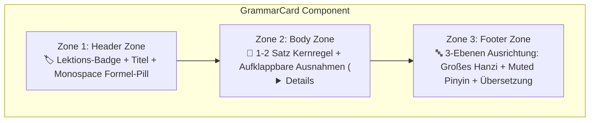

import { Badge, Card, CardGrid, Tabs, TabItem } from '@astrojs/starlight/components';
import ChineseStudyDashboard from '../../../../../components/chinese/ChineseStudyDashboard.astro';
import ChineseGrammarExplorer from '../../../../../components/chinese/ChineseGrammarExplorer.astro';
import ConfusableCard from '../../../../../components/chinese/ConfusableCard.astro';
import GrammarCard from '../../../../../components/chinese/GrammarCard.astro';
import { CONFUSABLE_PAIRS, CHINESE_GRAMMAR_RULES } from '../../../../../data/chineseGrammarData';

# 🇨🇳 Chinesisch Design-Prototyp <Badge text="Argon UX Showcase" variant="tip" size="medium" />

Diese Seite demonstriert die **interaktiven Design-Prototypen**, die auf Basis der architektonischen Empfehlungen aus der Gemini-Designberatung (**Argon**) für den Chinesisch-Bereich auf `nikku.tech` entwickelt wurden.

:::tip[Kernproblem der bisherigen Struktur & Lösung]
* **Problem**: Chinesische Sprachnotizen erzeugen naturgemäß starke visuelle Unruhe, weil jedes einzelne Beispiel drei Datenschichten mitführt (**Hanzi**, **Pinyin**, **Übersetzung**), flankiert von Tonzeichen und syntaktischen Mustern. Durch das Hinzufügen von 18 Multi-Speaker Dialogen und 26 Grammatikregeln wuchs die Hauptseite auf über 740 Zeilen linearen Text an.
* **Argons Lösung**: Übergang von einer linearen Dokumenten-Scrollansicht zu einem **modularen Dokumentations-Dashboard** mit klar getrennten Lernbereichen, standardisierten **3-Zonen GrammarCards**, aktiver **Pinyin-Steuerung (Active Recall)** und **Confusable-Gegenüberstellungen**.
:::

---

## 🧭 Prototyp 1: Lernmodus-Dashboard (Page Architecture by Study Mode)

Statt Audio-Dialoge, Grammatik und Tonsystem linear hintereinander aufzustapeln, gliedert das **Lernmodus-Dashboard** die Seite in vier fokussierte Arbeitsbereiche:

<ChineseStudyDashboard activeSection="grammar" lang="de" />

---

## 📐 Prototyp 2: Der Interaktive Grammatik-Explorer

Hier ist der voll funktionsfähige Prototyp des **Grammatik-Explorers**. Probiere die interaktiven Funktionen direkt aus:

1. **Suchfeld (`Ctrl+K`)**: Tippe z. B. `zài`, `比`, `离`, `Modalverb` oder `Fragen` ein.
2. **Layout-Umschalter**:
   * 🗂️ **Bento Grid**: 2-spaltiges Dashboard für den schnellen visuellen Überblick auf Desktop-Bildschirmen.
   * 📑 **Akkordeon-Liste**: Ultra-kompakte Übersicht, die nur Titel und Formel-Pill anzeigt.
   * ⚖️ **Confusables Spotlight**: Filtert direkt auf die häufigsten Verwechslungspaare.
3. **Pinyin-Modus (Active Recall)**:
   * **👁️ Immer sichtbar**: Standard-Lernmodus.
   * **👆 Hover-Modus**: Pinyin ist unscharf/ausgeblendet und erscheint erst, wenn du mit der Maus über das Beispiel fährst oder es antippst — perfekt zur Überprüfung der eigenen Hanzi-Lesefähigkeit!
   * **🙈 Verbergen**: Pures Hanzi-Lesetraining ohne Stützräder.
4. **Kategorie- & Lektions-Pills**: Sofortige Filterung nach Grammatikthemen und Kurslektionen.

<ChineseGrammarExplorer lang="de" />

---

## 🔍 Prototyp 3: Die 3-Zonen "GrammarCard" im Detail

Argons Leitlinie für saubere Grammatikkomponenten: *„Standardisiere jeden Grammatikpunkt in eine visuelle Komponente mit drei klar getrennten Zonen.“*

Hier sind zwei isolierte Einzelkarten zur Demonstration der Zoneneinteilung:

<CardGrid>
  <GrammarCard rule={CHINESE_GRAMMAR_RULES[0]} lang="de" />
  <GrammarCard rule={CHINESE_GRAMMAR_RULES[25]} lang="de" />
</CardGrid>

---

## ⚖️ Prototyp 4: Confusable-Gegenüberstellungen (Confusable Pairs)

Chinesisch-Lernende verwechseln häufig semantisch ähnliche Wörter mit unterschiedlichen syntaktischen Regeln (`二` vs. `两`, `在` vs. `有`, `想` vs. `要`, `离` vs. `从…到…`). 

Der Prototyp bietet hierfür dedizierte 2-Spalten-Gegenüberstellungen mit **✅ Richtig-** und **❌ Falsch-Mustern** inklusive Begründung:

<ConfusableCard pair={CONFUSABLE_PAIRS[0]} lang="de" />

<ConfusableCard pair={CONFUSABLE_PAIRS[1]} lang="de" />

<ConfusableCard pair={CONFUSABLE_PAIRS[2]} lang="de" />

---

## 📊 Vergleich der Layout-Muster (Argons UX-Matrix)

| Layout-Muster | Geeignet für | Visuelle Wirkung & Interaktion |
| :--- | :--- | :--- |
| **Bento Grid Cards** | Schnelles Scannen & Nachschlagen (Desktop 2–3 Spalten) | Moderner Dashboard-Look; klare Formel-Pills fangen den Blick sofort ein. |
| **Akkordeon-Liste (`
`)** | Kompaktes Kompendium auf einer Seite | Maximale Übersichtlichkeit; User sieht nur Titel + Formel, bis Details aufgeklappt werden. |
| **Confusables Spotlight** | Problemwörter & Fehlerprävention (`二/两`, `在/有`) | 2-Spalten Direktvergleich mit ✅ und ❌ Beispielen verhindert typische Fallstricke. |
| **Hover-Pinyin Active Recall** | Vokabel- & Schriftzeichentraining | Ermöglicht Selbsttests direkt im Fließtext ohne störende Pinyin-Trainingsräder. |

---

## 🚀 Nächste Schritte & Integration

Diese Prototypen sind vollständig kompatibel mit Astro Starlight und können:
1. **Als eigenständige interaktive Nachschlage-Tools** auf `/lectures/languages/chinese/prototype/` bereitstehen.
2. **Direkt in die Hauptseite** [`src/content/docs/lectures/languages/chinese/index.mdx`](file:///d:/.D%20Dokuments/Uni%20Stuff/Website_project/src/content/docs/lectures/languages/chinese/index.mdx) als interaktiver Ersatz für die statische Markdown-Tabelle integriert werden.
