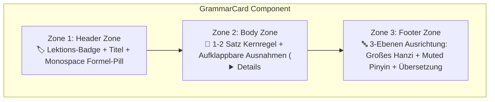

import { Badge, Card, CardGrid, Tabs, TabItem } from '@astrojs/starlight/components';
import ChineseStudyDashboard from '../../../../../components/chinese/ChineseStudyDashboard.astro';
import ChineseGrammarExplorer from '../../../../../components/chinese/ChineseGrammarExplorer.astro';
import ConfusableCard from '../../../../../components/chinese/ConfusableCard.astro';
import GrammarCard from '../../../../../components/chinese/GrammarCard.astro';
import DialoguePlayer from '../../../../../components/DialoguePlayer.astro';
import DriveAsset from '../../../../../components/DriveAsset.astro';
import { CONFUSABLE_PAIRS, CHINESE_GRAMMAR_RULES } from '../../../../../data/chineseGrammarData';
import { CHINESE_DIALOGUES } from '../../../../../data/chineseDialogues';

# 🇨🇳 Chinesisch Design-Prototyp <Badge text="Argon UX Architecture" variant="tip" size="medium" />

Interaktive Prototypen auf Basis der architektonischen Empfehlungen aus der Gemini-Designberatung (**Argon**) für die Chinesisch-Sektion auf `nikku.tech`.

:::tip[Argons Diagnose & Kernlösung]
* **Problem**: Chinesische Lerninhalte erzeugen naturgemäß starke visuelle Unruhe, weil jedes einzelne Beispiel drei Datenschichten mitführt (**Hanzi**, **Pinyin**, **Übersetzung**), flankiert von Tonzeichen und syntaktischen Mustern. Durch das Hinzufügen von 18 Multi-Speaker Dialogen und 26 Grammatikregeln wuchs die Hauptseite auf über 740 Zeilen linearen Text an.
* **Argons Lösung**: Übergang von einer linearen Dokumenten-Scrollansicht zu einem **modularen Dokumentations-Dashboard** mit klar getrennten Lernbereichen (**Study Modes**), standardisierten **3-Zonen GrammarCards**, aktiver **Pinyin-Steuerung (Active Recall)** und **Confusable-Gegenüberstellungen**.
:::

---

## 🧭 Lernmodus-Dashboard (Study Mode Navigation)

Klicke auf eine der Kacheln unten, um den **sichtbaren Inhalt der Seite live umzuschalten**:

<ChineseStudyDashboard activeSection="dialogues" lang="de" />

---

{/* ========================================================================= */}
{/* SECTION 1: AUDIO-DIALOGE (DEFAULT ACTIVE) */}
{/* ========================================================================= */}

## 🎙️ Modus: Multi-Speaker Audio-Dialoge <Badge text="Voice-ML v4 • 18 Dialoge" variant="success" />

In diesem Modus konzentriert sich die Seite vollständig auf die **gesprochene Sprache**, Satz-Shadowing und das Hörverständnis. Statt zwischen Grammatikregeln hin und her zu scrollen, stehen die interaktiven Player im Zentrum:

* **Dual-Speed Bereitstellung**: 1.0x Standardtempo & 0.75x verlangsamtes Lerntempo.
* **Satz-Looping (Shadowing)**: Wiederhole jeden beliebigen Turn in Endlosschleife, bis Intonation und Rhythmus sitzen.
* **Live Untertitel-Tracking**: Hanzi, Pinyin und deutsche Übersetzung springen synchron zum Audio weiter.

### Beispiel-Player aus Lektion 2 & Lektion 8:

<DialoguePlayer
  dialogue={CHINESE_DIALOGUES[0]}
  driveFolderHref="https://drive.google.com"
/>

<DialoguePlayer
  dialogue={CHINESE_DIALOGUES[1]}
  driveFolderHref="https://drive.google.com"
/>

<DialoguePlayer
  dialogue={CHINESE_DIALOGUES[12]}
  driveFolderHref="https://drive.google.com"
/>

:::tip[Vollständige Dialoge]
In diesem Modus stehen alle **18 Dialoge** der Lektionen 2 bis 10 mit vollem Multi-Speaker Audio (CSMSC Studio Female v4, AISHELL-3 Male v1 & Zero-Shot SSB1630) zur Verfügung.
:::

{/* ========================================================================= */}
{/* SECTION 2: GRAMMATIK-EXPLORER */}
{/* ========================================================================= */}

## 📐 Modus: Systematischer Grammatik-Explorer <Badge text="26 Regeln + Confusables" variant="success" />

Der **Grammatik-Explorer** löst das Problem des endlosen Scrollens durch gezielte Filterung, konfigurierbare Pinyin-Sichtbarkeit und kompakte Kartendarstellung:

* **Suchfeld (`Ctrl+K`)**: Schnelles Nachschlagen nach Regeln, Pinyin oder Hanzi (z. B. `zài`, `比`, `离`, `Modalverb`, `Fragen`).
* **Layout-Umschalter**: Wähle zwischen **🗂️ Bento Grid** (2-spaltiges Dashboard), **📑 Akkordeon-Liste** (kompakt) und **⚖️ Confusables Spotlight**.
* **Pinyin-Modus (Active Recall)**:
  * **👁️ Immer sichtbar**: Standard-Lernmodus.
  * **👆 Hover-Modus**: Pinyin ist unscharf/verborgen und erscheint erst bei Mouseover oder Tap — ideal zur Selbstüberprüfung der Hanzi-Lesekompetenz!
  * **🙈 Verbergen**: Pures Schriftzeichentraining ohne Stützräder.

<ChineseGrammarExplorer lang="de" />

---

### 🔍 Argons 3-Zonen "GrammarCard" im Detail

Argons Leitlinie für saubere Grammatikkomponenten: *„Standardisiere jeden Grammatikpunkt in eine visuelle Komponente mit drei klar getrennten Zonen.“*

Hier sind zwei isolierte Einzelkarten zur Demonstration der Zoneneinteilung:

<CardGrid>
  <GrammarCard rule={CHINESE_GRAMMAR_RULES[0]} lang="de" />
  <GrammarCard rule={CHINESE_GRAMMAR_RULES[25]} lang="de" />
</CardGrid>

---

### ⚖️ Confusable-Gegenüberstellungen (Confusable Pairs)

Chinesisch-Lernende verwechseln häufig semantisch ähnliche Wörter mit unterschiedlichen syntaktischen Regeln (`二` vs. `两`, `在` vs. `有`, `想` vs. `要`, `离` vs. `从…到…`). 

Der Prototyp bietet hierfür dedizierte 2-Spalten-Gegenüberstellungen mit **✅ Richtig-** und **❌ Falsch-Mustern** inklusive Begründung:

<ConfusableCard pair={CONFUSABLE_PAIRS[0]} lang="de" />

<ConfusableCard pair={CONFUSABLE_PAIRS[1]} lang="de" />

<ConfusableCard pair={CONFUSABLE_PAIRS[2]} lang="de" />

---

### 📊 Vergleich der Layout-Muster (Argons UX-Matrix)

| Layout-Muster | Geeignet für | Visuelle Wirkung & Interaktion |
| :--- | :--- | :--- |
| **Bento Grid Cards** | Schnelles Scannen & Nachschlagen (Desktop 2–3 Spalten) | Moderner Dashboard-Look; klare Formel-Pills fangen den Blick sofort ein. |
| **Akkordeon-Liste (`
`)** | Kompaktes Kompendium auf einer Seite | Maximale Übersichtlichkeit; User sieht nur Titel + Formel, bis Details aufgeklappt werden. |
| **Confusables Spotlight** | Problemwörter & Fehlerprävention (`二/两`, `在/有`) | 2-Spalten Direktvergleich mit ✅ und ❌ Beispielen verhindert typische Fallstricke. |
| **Hover-Pinyin Active Recall** | Vokabel- & Schriftzeichentraining | Ermöglicht Selbsttests direkt im Fließtext ohne störende Pinyin-Trainingsräder. |

{/* ========================================================================= */}
{/* SECTION 3: TONSYSTEM & TONE SANDHI */}
{/* ========================================================================= */}

## 🇨🇳 Modus: Tonsystem & Tone Sandhi <Badge text="4 Töne + Sandhi" variant="tip" />

Das Mandarin-Tonsystem ist das Fundament für verständliche Aussprache. In diesem fokussierten Modus werden Tonhöhenverläufe und die unverzichtbaren Sandhi-Regeln übersichtlich dargestellt:

### 1. Die vier Grundtöne & der Neutralton

| Ton | Chinesischer Name | Verlauf / Tonkontur | Tonwert (5-Stufen) | Beispiel | Bedeutung |
| :--- | :--- | :--- | :--- | :--- | :--- |
| **1. Ton** | 阴平 (*yīnpíng*) | Hoch, eben, lang gehalten | **55** | `mā` (妈) | Mutter |
| **2. Ton** | 阳平 (*yángpíng*) | Von mittlerer Höhe steil ansteigend | **35** | `má` (麻) | Hanf |
| **3. Ton** | 上声 (*shǎngshēng*) | Tief fallend, leicht ansteigend | **214** (isoliert) | `mǎ` (马) | Pferd |
| **4. Ton** | 去声 (*qùshēng*) | Von höchster Stufe steil abfallend | **51** | `mà` (骂) | schimpfen |
| **Neutralton** | 轻声 (*qīngshēng*) | Kurz, leicht, tonlos (abhängig vom Vor-Ton) | *–* | `ma` (吗) | Fragepartikel |

---

### 2. Tone Sandhi: Die vier Kernregeln

:::note[Regel 1: Zwei 3. Töne hintereinander ($3 + 3 \to 2 + 3$)]
Treffen zwei Silben im 3. Ton aufeinander, wird die erste Silbe wie ein **2. Ton (steigend)** gesprochen:
* Geschrieben: `nǐ hǎo` (你好) $\to$ Gesprochen: **`ní hǎo`** (35 + 214)
* Geschrieben: `kěyǐ` (可以) $\to$ Gesprochen: **`kéyǐ`** (35 + 214)
:::

:::note[Regel 2: Tonwechsel der Verneinung `不` (*bù*)]
Die Negationspartikel `不` steht regulär im 4. Ton (*bù*). Vor einer anderen Silbe im **4. Ton** wechselt sie jedoch in den **2. Ton (*bú*)**:
* Vor 1., 2. und 3. Ton bleibt sie im 4. Ton: `不喝` (*bù hē*), `不来` (*bù lái*), `不好` (*bù hǎo*).
* Vor 4. Ton wechselt sie zu 2. Ton: `不是` $\to$ **`bú shì`**; `不要` $\to$ **`bú yào`**!
:::

:::note[Regel 3: Tonwechsel des Zahlworts `一` (*yī*)]
Als isolierte Zahl oder beim Zählen steht `一` im 1. Ton (*yī*).
* Vor Silben im **1., 2. oder 3. Ton** wechselt `一` in den **4. Ton (*yì*)**: `一天` (*yì tiān*), `一年` (*yì nián*), `一起` (*yì qǐ*).
* Vor einer Silbe im **4. Ton** wechselt `一` in den **2. Ton (*yí*)**: `一下` (*yí xià*), `一共` (*yí gòng*), `一定` (*yí dìng*).
:::

{/* ========================================================================= */}
{/* SECTION 4: KURS-ASSETS & DOWNLOADS */}
{/* ========================================================================= */}

## 🗂️ Modus: Kurs-Assets & Anki-Deck <Badge text="Downloads (WIP)" variant="note" />

In diesem Modus finden sich alle Download-Ressourcen und Vokabeldecks für den Kurs:

### 📥 Direkte Downloads

<CardGrid>
  <Card title="560-Noten Anki Dual-Audio Deck" icon="document">
    Vollständiges Anki-Deck (.apkg) mit Hanzi-Schreibrichtung, Pinyin, Beispielsätzen und beidseitig abspielbaren Audio-Samples.
    
    <DriveAsset
      title="Download 107 MB Anki Deck"
      type="anki"
      description="Google Drive: Chinese_Mandarin_Comprehensive_v4.apkg"
      wip={true}
      wipLabel="Work In Progress"
    />
  </Card>

  <Card title="Studio WAV Master-Archiv" icon="laptop">
    Unkomprimierte 32 kHz Studio-Aufnahmen aller 18 Dialoge inklusive millisekundengenauer Turn-Timestamps im JSON-Format.
    
    <DriveAsset
      title="Dialogues Master Archive (WAV & JSON)"
      type="dataset"
      description="Google Drive: University/dialogues/"
      wip={true}
      wipLabel="Work In Progress"
    />
  </Card>
</CardGrid>

