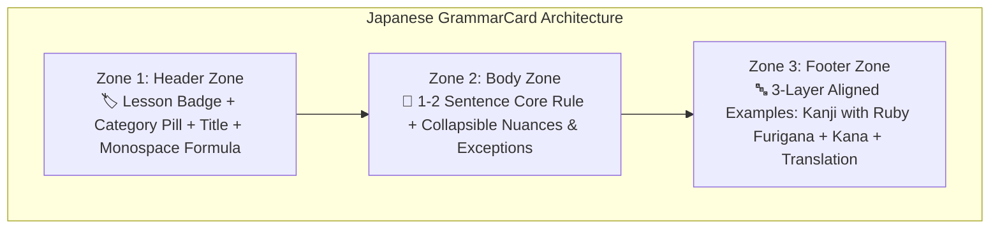

import { Badge, Card, CardGrid, Tabs, TabItem } from '@astrojs/starlight/components';
import JapaneseStudyDashboard from '../../../../../../components/japanese/JapaneseStudyDashboard.astro';
import JapaneseGrammarExplorer from '../../../../../../components/japanese/JapaneseGrammarExplorer.astro';
import JapaneseConfusableCard from '../../../../../../components/japanese/JapaneseConfusableCard.astro';
import JapaneseGrammarCard from '../../../../../../components/japanese/JapaneseGrammarCard.astro';
import JapaneseVocabVault from '../../../../../../components/japanese/JapaneseVocabVault.astro';
import StrokeOrderGuide from '../../../../../../components/strokes/StrokeOrderGuide.astro';
import DriveAsset from '../../../../../../components/DriveAsset.astro';
import LanguageSwitch from '../../../../../../components/LanguageSwitch.astro';
import { JAPANESE_CONFUSABLE_PAIRS, JAPANESE_GRAMMAR_RULES } from '../../../../../../data/japaneseGrammarData';

# 🇯🇵 Japanese B1.1 <Badge text="Minna no Nihongo II • Chapters 26–32" variant="success" size="medium" />

<LanguageSwitch current="en" enHref="/lectures/languages/japanese/b1-1/" deHref="/lectures/languages/japanese/b1-1/de/" />

<JapaneseStudyDashboard activeSection="grammar" lang="en" />

---

{/* ========================================================================= */}
{/* SECTION 1: GRAMMAR EXPLORER (DEFAULT ACTIVE) */}
{/* ========================================================================= */}

## 📐 Mode: Systematic Grammar Explorer <Badge text="26 Rules • Lessons 26–32" variant="success" />

The **Grammar Explorer** eliminates endless scrolling with live client-side search, customizable Furigana visibility, and responsive Bento card layouts:

* **Live Search (`Ctrl+K`)**: Rapidly find rules by grammar pattern, Kanji, or meaning (e.g. `可能形`, `てある`, `見える`, `つもり`, `んです`).
* **Layout Switcher**: Toggle seamlessly between **🗂️ Bento Grid** (desktop dashboard), **📑 Accordion List** (compact reference), and **⚖️ Confusables Spotlight**.
* **Furigana Active Recall**:
  * **👁️ Always Visible**: Standard continuous reference.
  * **👆 Hover Mode**: Furigana is blurred/hidden and reveals on hover or tap — test your Kanji reading retention on the fly!
  * **🙈 Hidden**: Complete removal of reading aids for full character immersion.

<JapaneseGrammarExplorer lang="en" />

---

### 🔍 Standardized 3-Zone "GrammarCard" in Detail

Argon's core principle for linguistic documentation: *"Standardize every grammar point into a visual component with three distinct functional zones."*

Here are two isolated sample cards demonstrating the 3-zone architecture:

<CardGrid>
  <JapaneseGrammarCard rule={JAPANESE_GRAMMAR_RULES[0]} lang="en" />
  <JapaneseGrammarCard rule={JAPANESE_GRAMMAR_RULES[4]} lang="en" />
</CardGrid>

---

### 📊 Layout Pattern Comparison Matrix

| Layout Pattern | Best For | Visual Impact & UX Dynamics |
| :--- | :--- | :--- |
| **Bento Grid Cards** | Rapid scanning & reference on desktop | Modern dashboard feel; formula pills catch the eye immediately. |
| **Accordion List (`
`)** | Fitting 26+ rules cleanly on a single page | High density; learners only see titles + formulas until expanded. |
| **Confusables Spotlight** | Error prevention & contrastive learning (`ている / てある`, `見える / 見られる`) | 2-column direct contrast with ✅/❌ examples prevents chronic grammar pitfalls. |
| **Hover-Furigana Active Recall** | Vocabulary & reading comprehension | Enables instant self-testing without kana training wheels cluttering the page. |

{/* ========================================================================= */}
{/* SECTION 2: CONFUSABLES SPOTLIGHT */}
{/* ========================================================================= */}

## ⚖️ Mode: Confusables Spotlight <Badge text="5 Key Comparative Pairs" variant="tip" />

Intermediate Japanese learners frequently confuse semantically adjacent expressions governed by strict syntactic conditions. Inspect direct side-by-side contrasts with correct usage and common errors below:

<JapaneseConfusableCard pair={JAPANESE_CONFUSABLE_PAIRS[0]} lang="en" />

<JapaneseConfusableCard pair={JAPANESE_CONFUSABLE_PAIRS[1]} lang="en" />

<JapaneseConfusableCard pair={JAPANESE_CONFUSABLE_PAIRS[2]} lang="en" />

<JapaneseConfusableCard pair={JAPANESE_CONFUSABLE_PAIRS[3]} lang="en" />

<JapaneseConfusableCard pair={JAPANESE_CONFUSABLE_PAIRS[4]} lang="en" />

{/* ========================================================================= */}
{/* SECTION 3: VOCABULARY VAULT */}
{/* ========================================================================= */}

## 🔤 Mode: Vocabulary Vault & Furigana Trainer <Badge text="335 Verified Words" variant="note" />

Access the verified vocabulary registers of *Minna no Nihongo Shokyu II* (Lessons 26–32). Use the live filter pills or search bar to inspect individual words, and switch Furigana to **Hover Mode** to test your character recognition!

<JapaneseVocabVault lang="en" />

{/* ========================================================================= */}
{/* SECTION 4: CONJUGATION MATRICES & CHEAT SHEETS */}
{/* ========================================================================= */}

## 🛠️ Mode: Conjugation Matrices & Cheat Sheets <Badge text="B1.1 Master Tables" variant="success" />

Master intermediate verb conjugations and clause attachment rules with these high-density reference tables:

### 1. Potential (`可能形`, L27) vs. Volitional (`意向形`, L31)

| Verb Group | Polite (`ます`-Form) | Dictionary (`辞書形`) | Potential (`可能形`: "can V") | Volitional (`意向形`: "let's / will V") |
| :--- | :--- | :--- | :--- | :--- |
| **Group I (`五段`)** *Potential: `i`-stem → `e`+ます (polite) / `e`+る (plain)* *Volitional: `i`-stem → `o`+う* | 書**き**ます (*kaki-masu*) 話**し**ます (*hanashi-masu*) 買**い**ます (*kai-masu*) 待**ち**ます (*machi-masu*) 飲**み**ます (*nomi-masu*) | 書**く** (*kaku*) 話**す** (*hanasu*) 買**う** (*kau*) 待**つ** (*matsu*) 飲**む** (*nomu*) | 書**け**ます / 書**ける** 話**せ**ます / 話**せる** 買**え**ます / 買**える** 待**て**ます / 待**てる** 飲**め**ます / 飲**める** | 書**こう** (*kakō*) 話**そう** (*hanasō*) 買**おう** (*kaō*) 待**とう** (*matō*) 飲**もう** (*nomō*) |
| **Group II (`一段`)** *Rule: stem + `られます` / `よう`* | 食**べ**ます (*tabe-masu*) 見ます (*mi-masu*) 寝ます (*ne-masu*) | 食**べる** (*taberu*) 見る (*miru*) 寝る (*neru*) | 食べ**られます** / 食べ**られる** 見**られます** / 見**られる** 寝**られます** / 寝**られる** | 食べ**よう** (*tabeyō*) 見**よう** (*miyō*) 寝**よう** (*neyō*) |
| **Group III (Irregular)** | **します** (*shi-masu*) **来[き]ます** (*ki-masu*) | **する** (*suru*) **来[く]る** (*kuru*) | **できます** / **できる** **来[こ]られます** / **来[こ]られる** | **しよう** (*shiyō*) **来[こ]よう** (*koyō*) |

---

### 2. Clause Attachment Matrix (`〜んです`, `〜し`, `〜でしょう`, `〜かもしれません`)

| Word Class | `+ んです` (L26) | `+ し` (L28) | `+ でしょう` (L32) | `+ かもしれません` (L32) |
| :--- | :--- | :--- | :--- | :--- |
| **Verb** (Plain) | 行く / 行った / 行かない / 行かなかった **+ んです** | Plain form **+ し** | Plain form **+ でしょう** | Plain form **+ かもしれません** |
| **い-Adjective** | 高い / 高かった / 高くない / 高くなかった **+ んです** | Plain form **+ し** | Plain form **+ でしょう** | Plain form **+ かもしれません** |
| **な-Adjective** | 暇**なんです** / 暇だったんです / 暇じゃないんです / 暇じゃなかったんです | 暇**だ** / 暇だった **+ し** | 暇 *(no だ)* / 暇だった **+ でしょう** | 暇 *(no だ)* / 暇だった **+ かもしれません** |
| **Noun** | 雨**なんです** / 雨だったんです / 雨じゃないんです / 雨じゃなかったんです | 雨**だ** / 雨だった **+ し** | 雨 *(no だ)* / 雨だった **+ でしょう** | 雨 *(no だ)* / 雨だった **+ かもしれません** |

:::tip[Crucial Exam Pitfall]
Notice what happens to present-affirmative **Nouns** and **な-Adjectives** (`だ`):
* Before **`〜んです`** (L26): `だ` changes to **`な`** (`好きなんです`, `先生なんです`).
* Before **`〜し`** (L28): `だ` is **kept** (`まじめだし`, `上手だし`).
* Before **`〜でしょう`** and **`〜かもしれません`** (L32): `だ` is **dropped completely** (`先生でしょう`, `先生かもしれません`).
:::

---

### 3. Transitive (`他動詞`) vs. Intransitive (`自動詞`) Verb Pairs (L29 vs. L30)

| Action / Meaning | Intransitive (`自動詞` + `が 湧/割/開... 〜ています`) | Transitive (`他動詞` + `を/が 〜てあります`) |
| :--- | :--- | :--- |
| **Open** | ドアが **開[あ]きます** (`開いています`) | ドアを **開[あ]けます** (`開けてあります`) |
| **Close** | ドアが **閉[し]まります** (`閉まっています`) | ドアを **閉[し]めます** (`閉めてあります`) |
| **Turn on (light)** | 電気[でんき]が **つきます** (`ついています`) | 電気[でんき]を **つけます** (`つけてあります`) |
| **Turn off (light)** | 電気[でんき]が **消[き]えます** (`消えています`) | 電気[でんき]を **消[け]します** (`消してあります`) |
| **Break / Snap** | 木[き]が **折[お]れます** (`折れています`) | 木[き]を **折[お]ります** (`折ってあります`) |
| **Break down** | 機械[きかい]が **壊[こわ]れます** (`壊れています`) | 機械[きかい]を **壊[こわ]します** (`壊してあります`) |
| **Drop / Fall** | 財布[さいふ]が **落[お]ちます** (`落ちています`) | 財布[さいふ]を **落[お]とします** (`落としてあります`) |

{/* ========================================================================= */}
{/* SECTION 5: COURSE ASSETS & ERRATA */}
{/* ========================================================================= */}

## 🗂️ Mode: Course Assets & Verified Errata Audit <Badge text="Downloads & Reports" variant="note" />

Access flashcard exports, study resources, and our academic errata audit for the *Minna no Nihongo Shokyu II* dataset:

### 📥 Direct Downloads

<CardGrid>
  <Card title="335-Note Anki Spaced Repetition Deck" icon="document">
    Verified Anki package (.apkg) containing all 335 vocabulary entries across Lessons 26–32 with standardized furigana and dual EN/DE translations.
    
    <DriveAsset
      title="Download Japanese B1.1 Anki Deck"
      type="anki"
      description="Google Drive: Japanese_Minna_no_Nihongo_B1_1_v2.apkg"
      wip={true}
      wipLabel="Work In Progress"
    />
  </Card>

  <Card title="Grammar Matrices Cheat Sheet (PDF)" icon="laptop">
    Printable 2-page summary cheat sheet compiling the Potential, Volitional, and Clause Attachment matrices.
    
    <DriveAsset
      title="Japanese B1.1 Grammar Cheat Sheet (PDF)"
      type="dataset"
      description="Google Drive: University/Japanese_B1_1_CheatSheet.pdf"
      wip={true}
      wipLabel="Work In Progress"
    />
  </Card>
</CardGrid>

---

### 🔍 Source Audit: Errata & Orthographic Standardizations

During our verification of the 27 **iMina** screenshots and the **Anki `.apkg` database**, 14 corrections were rigorously applied:

1. **Lesson 30 (`て-form あります`)**: Fixed `✕ まどが しめって あります` $\to$ **`〇 まどが しめて あります`** (transitive Group II verb `閉めます` takes `しめて`, not `しめって`).
2. **Lesson 30 (`て-form おきます`)**: Fixed `✕ はさみを つかたら` $\to$ **`〇 つかったら`** (`使います` takes geminate `っ`).
3. **Lesson 30 (Colloquial contraction)**: Corrected explanation: `〜ておきます` contracts to **`〜ときます`** (`おいといて`), not `てきます`.
4. **Lesson 31 (`予定です`)**: Fixed `✕ しゅちょう` $\to$ **`出張［しゅっちょう］`** ("business trip", geminate `っ`).
5. **Lesson 27 (`できます`)**: Fixed `✕ とかいの しゅうり` $\to$ **`時計［とけい］の 修理［しゅうり］`** ("watch repair").
6. **Lesson 28 (`Plain-し`)**: Fixed `✕ あたらしし` $\to$ **`新しいし［あたらしいし］`**.
7. **Lesson 29 (`開きます`)**: Standardized intransitive door reading to **`開［あ］きます`** (not `ひらきます`).

---

## ℹ️ Platform Overview & UX Architecture

Interactive study compendium and active-recall reference for the intermediate B1.1 level (**Minna no Nihongo Shokyu II**, Chapters 26 through 32) at Heidelberg University (*heiSKILLS & Central Language Laboratory*).

Powered by the **Argon UX Architecture**, addressing the visual density of Japanese notes and equipping students with modular active-learning tools.

:::tip[Why this architecture transforms Japanese learning]
* **The Japanese Clutter Challenge**: Japanese intermediate notes naturally suffer from quadruple visual density: **Kanji**, **Kana/Furigana**, **Romaji/Pitch**, and **Translation**, paired with complex conjugation stems (Godan/Ichidan/Irregular). In linear documents, reading becomes overwhelming and students unintentionally cheat by glancing at the Furigana instead of reading the Kanji.
* **The Argon Solution**: Transitioning to a **modular study dashboard** with 5 targeted focus modes:
  1. **📐 Grammar Explorer**: 26 rules with Bento Grid cards, formula pills, and collapsible nuances.
  2. **⚖️ Confusables Spotlight**: Direct side-by-side contrastive analysis of tricky grammar pairs (`〜ている` vs. `〜てある`, `見えます` vs. `見られます`, `〜つもり` vs. `〜予定`).
  3. **🔤 Vocabulary Vault**: 335 verified words with **Furigana Active Recall** (Hover to Reveal!).
  4. **🛠️ Conjugation Matrices**: Master cheat sheets for Potential, Volitional, and Clause attachment rules.
  5. **🗂️ Course Assets**: Spaced repetition Anki decks and verified source errata audits.
:::

<StrokeOrderGuide lang="en" isModalOnly={true} />
