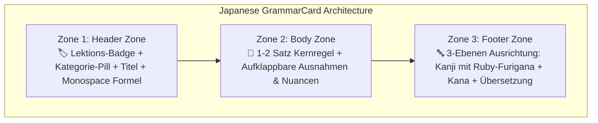

import { Badge, Card, CardGrid, Tabs, TabItem } from '@astrojs/starlight/components';
import JapaneseStudyDashboard from '../../../../../../components/japanese/JapaneseStudyDashboard.astro';
import JapaneseGrammarExplorer from '../../../../../../components/japanese/JapaneseGrammarExplorer.astro';
import JapaneseConfusableCard from '../../../../../../components/japanese/JapaneseConfusableCard.astro';
import JapaneseGrammarCard from '../../../../../../components/japanese/JapaneseGrammarCard.astro';
import JapaneseVocabVault from '../../../../../../components/japanese/JapaneseVocabVault.astro';
import DriveAsset from '../../../../../../components/DriveAsset.astro';
import LanguageSwitch from '../../../../../../components/LanguageSwitch.astro';
import { JAPANESE_CONFUSABLE_PAIRS, JAPANESE_GRAMMAR_RULES } from '../../../../../../data/japaneseGrammarData';

# 🇯🇵 Japanisch Design-Prototyp <Badge text="Argon UX Architecture" variant="tip" size="medium" />

<LanguageSwitch current="de" enHref="/lectures/languages/japanese/prototype/" deHref="/lectures/languages/japanese/de/prototype/" />

Interaktiver Prototyp auf Basis der **Argon UX Architecture** für den Japanisch-Bereich auf `nikku.tech`. Entwickelt, um visuelle Überladung zu beseitigen und Studierenden des B1.1-Niveaus moderne Werkzeuge für aktives Lernen bereitzustellen.

:::tip[Warum diese Architektur das Japanisch-Lernen revolutioniert]
* **Die visuelle Überlastung**: Japanische Notizen leiden unter extremer Datenschicht-Dichte: **Kanji**, **Kana/Furigana**, **Romaji/Pitch** und **Übersetzung**, kombiniert mit komplexen Konjugationsmustern (Godan/Ichidan/Unregelmäßig). In linearen Texten spicken Lernende unbewusst auf die Furigana, anstatt aktiv Kanji zu lesen.
* **Argons modulare Lösung**:
  1. **📐 Grammatik-Explorer**: 26 Regeln mit Bento Grid, Formel-Pills und aufklappbaren Nuancen.
  2. **⚖️ Confusables Spotlight**: 2-Spalten Direktvergleich kniffliger Grammatikpaare (`〜ている` vs. `〜てある`, `見える` vs. `見られる`, `つもり` vs. `予定`).
  3. **🔤 Vokabel-Vault**: 335 verifizierte Vokabeln mit **Furigana Active Recall** (Hover zum Aufdecken!).
  4. **🛠️ Konjugations-Matrizen**: Master-Cheat-Sheets für Möglichkeitsform, Volitionalform und Prädikatsanschlüsse.
  5. **🗂️ Kurs-Assets**: Anki-Deck (.apkg) und wissenschaftlicher Errata-Bericht zur iMina-App.
:::

---

## 🧭 Lernmodus-Dashboard (Study Mode Navigation)

Klicke auf eine der Kacheln unten, um den **sichtbaren Inhalt der Seite live umzuschalten**:

<JapaneseStudyDashboard activeSection="grammar" lang="de" />

---

{/* ========================================================================= */}
{/* SECTION 1: GRAMMATIK-EXPLORER (DEFAULT ACTIVE) */}
{/* ========================================================================= */}

## 📐 Modus: Systematischer Grammatik-Explorer <Badge text="26 Regeln • Lektionen 26–32" variant="success" />

Der **Grammatik-Explorer** löst das Problem des endlosen Scrollens durch gezielte Filterung, konfigurierbare Furigana-Sichtbarkeit und kompakte Kartendarstellung:

* **Suchfeld (`Ctrl+K`)**: Schnelles Nachschlagen nach Regeln, Kanji oder Kana (z. B. `可能形`, `てある`, `見える`, `つもり`, `んです`).
* **Layout-Umschalter**: Wähle zwischen **🗂️ Bento Grid** (Desktop-Dashboard), **📑 Akkordeon-Liste** (kompakt) und **⚖️ Confusables Spotlight**.
* **Furigana-Modus (Active Recall)**:
  * **👁️ Immer sichtbar**: Standard-Lernmodus.
  * **👆 Hover-Modus**: Furigana ist unscharf/verborgen und erscheint erst bei Mouseover oder Tap — ideal zur Selbstüberprüfung der Kanji-Lesekompetenz!
  * **🙈 Verbergen**: Pures Schriftzeichentraining ohne Stützräder.

<JapaneseGrammarExplorer lang="de" />

---

### 🔍 Standardisierte 3-Zonen "GrammarCard" im Detail

Argons Leitlinie für saubere Sprachdokumentation: *„Standardisiere jeden Grammatikpunkt in eine visuelle Komponente mit drei klar getrennten Zonen.“*

Hier sind zwei isolierte Einzelkarten zur Demonstration der Zoneneinteilung:

<CardGrid>
  <JapaneseGrammarCard rule={JAPANESE_GRAMMAR_RULES[0]} lang="de" />
  <JapaneseGrammarCard rule={JAPANESE_GRAMMAR_RULES[4]} lang="de" />
</CardGrid>

---

### 📊 Vergleich der Layout-Muster (Argons UX-Matrix)

| Layout-Muster | Geeignet für | Visuelle Wirkung & Interaktion |
| :--- | :--- | :--- |
| **Bento Grid Cards** | Schnelles Scannen & Nachschlagen auf dem Desktop | Moderner Dashboard-Look; klare Formel-Pills fangen den Blick sofort ein. |
| **Akkordeon-Liste (`
`)** | Kompaktes Kompendium von 26+ Regeln auf einer Seite | Maximale Übersichtlichkeit; Lernende sehen nur Titel + Formel, bis Details aufgeklappt werden. |
| **Confusables Spotlight** | Problemwörter & Fehlerprävention (`ている / てある`, `見える / 見られる`) | 2-Spalten Direktvergleich mit ✅ und ❌ Beispielen verhindert typische Fallstricke. |
| **Hover-Furigana Active Recall** | Vokabel- & Kanji-Lesetraining | Ermöglicht Selbsttests direkt im Fließtext ohne störende Kana-Trainingsräder. |

{/* ========================================================================= */}
{/* SECTION 2: CONFUSABLES SPOTLIGHT */}
{/* ========================================================================= */}

## ⚖️ Modus: Confusables Spotlight <Badge text="5 Schlüssel-Paare" variant="tip" />

Japanisch-Lernende verwechseln häufig semantisch ähnliche Ausdrücke mit unterschiedlichen syntaktischen Regeln. Der Prototyp bietet hierfür dedizierte 2-Spalten-Gegenüberstellungen mit **✅ Richtig-** und **❌ Falsch-Mustern** inklusive Begründung:

<JapaneseConfusableCard pair={JAPANESE_CONFUSABLE_PAIRS[0]} lang="de" />

<JapaneseConfusableCard pair={JAPANESE_CONFUSABLE_PAIRS[1]} lang="de" />

<JapaneseConfusableCard pair={JAPANESE_CONFUSABLE_PAIRS[2]} lang="de" />

<JapaneseConfusableCard pair={JAPANESE_CONFUSABLE_PAIRS[3]} lang="de" />

<JapaneseConfusableCard pair={JAPANESE_CONFUSABLE_PAIRS[4]} lang="de" />

{/* ========================================================================= */}
{/* SECTION 3: VOKABEL-VAULT */}
{/* ========================================================================= */}

## 🔤 Modus: Vokabel-Vault & Furigana Trainer <Badge text="335 Wörter" variant="note" />

Greife auf die vollständigen, verifizierten Vokabelregister aus *Minna no Nihongo Shokyu II* (Lektionen 26–32) zu. Nutze die Filter-Pills oder das Suchfeld und aktiviere den **Hover-Modus**, um deine Kanji-Lesung aktiv zu testen:

<JapaneseVocabVault lang="de" />

{/* ========================================================================= */}
{/* SECTION 4: KONJUGATIONS-MATRIZEN & CHEAT SHEETS */}
{/* ========================================================================= */}

## 🛠️ Modus: Konjugations-Matrizen & Cheat Sheets <Badge text="B1.1 Master-Tabellen" variant="success" />

Meistere die Konjugationen und Prädikatsanschlüsse mit diesen kompakten Referenztabellen:

### 1. Möglichkeitsform (`可能形`, L27) vs. Volitionalform (`意向形`, L31)

| Verbgruppe | Höflich (`ます`-Form) | Wörterbuch (`辞書形`) | Möglichkeitsform (`可能形`: "können") | Volitionalform (`意向形`: "Lass uns / Wollen") |
| :--- | :--- | :--- | :--- | :--- |
| **Gruppe I (`五段`)** *Möglichkeit: `i`-Stamm → `e`+ます (höflich) / `e`+る (plain)* *Volitional: `i`-Stamm → `o`+う* | 書**き**ます (*kaki-masu*) 話**し**ます (*hanashi-masu*) 買**い**ます (*kai-masu*) 待**ち**ます (*machi-masu*) 飲**み**ます (*nomi-masu*) | 書**く** (*kaku*) 話**す** (*hanasu*) 買**う** (*kau*) 待**つ** (*matsu*) 飲**む** (*nomu*) | 書**け**ます / 書**ける** 話**せ**ます / 話**せる** 買**え**ます / 買**える** 待**て**ます / 待**てる** 飲**め**ます / 飲**める** | 書**こう** (*kakō*) 話**そう** (*hanasō*) 買**おう** (*kaō*) 待**とう** (*matō*) 飲**もう** (*nomō*) |
| **Gruppe II (`一段`)** *Regel: Stamm + `られます` / `よう`* | 食**べ**ます (*tabe-masu*) 見ます (*mi-masu*) 寝ます (*ne-masu*) | 食**べる** (*taberu*) 見る (*miru*) 寝る (*neru*) | 食べ**られます** / 食べ**られる** 見**られます** / 見**られる** 寝**られます** / 寝**られる** | 食べ**よう** (*tabeyō*) 見**よう** (*miyō*) 寝**よう** (*neyō*) |
| **Gruppe III (Unregelmäßig)** | **します** (*shi-masu*) **来[き]ます** (*ki-masu*) | **する** (*suru*) **来[く]る** (*kuru*) | **できます** / **できる** **来[こ]られます** / **来[こ]られる** | **しよう** (*shiyō*) **来[こ]よう** (*koyō*) |

---

### 2. Satzanschluss-Matrix (`〜んです`, `〜し`, `〜でしょう`, `〜かもしれません`)

| Wortart | `+ んです` (L26) | `+ し` (L28) | `+ でしょう` (L32) | `+ かもしれません` (L32) |
| :--- | :--- | :--- | :--- | :--- |
| **Verb** (Plain) | 行く / 行った / 行かない / 行かなかった **+ んです** | Plain form **+ し** | Plain form **+ でしょう** | Plain form **+ かもしれません** |
| **い-Adjektiv** | 高い / 高かった / 高くない / 高くなかった **+ んです** | Plain form **+ し** | Plain form **+ でしょう** | Plain form **+ かもしれません** |
| **な-Adjektiv** | 暇**なんです** / 暇だったんです / 暇じゃないんです / 暇じゃなかったんです | 暇**だ** / 暇だった **+ し** | 暇 *(ohne だ)* / 暇だった **+ でしょう** | 暇 *(ohne だ)* / 暇だった **+ かもしれません** |
| **Nomen** | 雨**なんです** / 雨だったんです / 雨じゃないんです / 雨じゃなかったんです | 雨**だ** / 雨だった **+ し** | 雨 *(ohne だ)* / 雨だった **+ でしょう** | 雨 *(ohne だ)* / 雨だった **+ かもしれません** |

:::tip[Wichtige Prüfungsfalle]
Beachte, was bei präsentisch-bejahten **Nomen** und **な-Adjektiven** (`だ`) passiert:
* Vor **`〜んです`** (L26): `だ` wechselt zu **`な`** (`好きなんです`, `先生なんです`).
* Vor **`〜し`** (L28): `だ` wird **beibehalten** (`まじめだし`, `上手だし`).
* Vor **`〜でしょう`** und **`〜かもしれません`** (L32): `だ` **entfällt komplett** (`先生でしょう`, `先生かもしれません`).
:::

---

### 3. Transitiv- (`他動詞`) vs. Intransitiv-Paare (`自動詞`) (L29 vs. L30)

| Bedeutung | Intransitiv (`自動詞` + `が 湧/割/開... 〜ています`) | Transitiv (`他動詞` + `を/が 〜てあります`) |
| :--- | :--- | :--- |
| **Öffnen** | ドアが **開[あ]きます** (`開いています`) | ドアを **開[あ]けます** (`開けてあります`) |
| **Schließen** | ドアが **閉[し]まります** (`閉まっています`) | ドアを **閉[し]めます** (`閉めてあります`) |
| **Einschalten** | 電気[でんき]が **つきます** (`ついています`) | 電気[でんき]を **つけます** (`つけてあります`) |
| **Ausschalten** | 電気[でんき]が **消[き]えます** (`消えています`) | 電気[でんき]を **消[け]します** (`消してあります`) |
| **Brechen / Abknicken** | 木[き]が **折[お]れます** (`折れています`) | 木[き]を **折[お]ります** (`折ってあります`) |
| **Kaputtgehen** | 機械[きかい]が **壊[こわ]れます** (`壊れています`) | 機械[きかい]を **壊[こわ]します** (`壊してあります`) |
| **Herunterfallen** | 財布[さいふ]が **落[お]ちます** (`落ちています`) | 財布[さいふ]を **落[お]とします** (`落としてあります`) |

{/* ========================================================================= */}
{/* SECTION 5: KURS-ASSETS & ERRATA */}
{/* ========================================================================= */}

## 🗂️ Modus: Kurs-Assets & Verifizierter Errata-Bericht <Badge text="Downloads & Reports" variant="note" />

Zugriff auf das Anki-Deck und den akademischen Errata-Audit für den *Minna no Nihongo Shokyu II*-Datensatz:

### 📥 Direkte Downloads

<CardGrid>
  <Card title="335-Noten Anki Spaced-Repetition Deck" icon="document">
    Verifiziertes Anki-Paket (.apkg) mit allen 335 Vokabeln der Lektionen 26–32, standardisierter Furigana und dualer EN/DE-Glossierung.
    
    <DriveAsset
      title="Download Japanisch B1.1 Anki Deck"
      type="anki"
      description="Google Drive: Japanese_Minna_no_Nihongo_B1_1_v2.apkg"
      wip={true}
      wipLabel="Work In Progress"
    />
  </Card>

  <Card title="Grammatik-Matrizen Cheat Sheet (PDF)" icon="laptop">
    Druckbare 2-seitige Schnellübersicht mit Möglichkeitsform, Volitionalform und Satzanschluss-Matrizen.
    
    <DriveAsset
      title="Japanisch B1.1 Grammatik Cheat Sheet (PDF)"
      type="dataset"
      description="Google Drive: University/Japanese_B1_1_CheatSheet.pdf"
      wip={true}
      wipLabel="Work In Progress"
    />
  </Card>
</CardGrid>

---

### 🔍 Quellenaudit: Errata & Orthographische Standardisierungen

Bei der Verifikation der 27 **iMina**-Screenshots und der **Anki `.apkg` Datenbank** wurden 14 Korrekturen angewandt:

1. **Lektion 30 (`て-form あります`)**: Korrektur von `✕ まどが しめって あります` $\to$ **`〇 まどが しめて あります`** (Gruppe II transitiv `閉めます` bildet `しめて`, nicht `しめって`).
2. **Lektion 30 (`て-form おきます`)**: Korrektur von `✕ はさみを つかたら` $\to$ **`〇 つかったら`** (`使います` verlangt `っ`).
3. **Lektion 30 (Umgangssprachliche Kontraktion)**: `〜ておきます` kontrahiert zu **`〜ときます`** (`おいといて`), niemals zu `てきます`.
4. **Lektion 31 (`予定です`)**: `✕ しゅちょう` $\to$ **`出張［しゅっちょう］`** (Geschäftsreise mit `っ`).
5. **Lektion 27 (`できます`)**: `✕ とかいの しゅうり` $\to$ **`時計［とけい］の 修理［しゅうり］`** (Uhrenreparatur).
6. **Lektion 28 (`Plain-し`)**: `✕ あたらしし` $\to$ **`新しいし［あたらしいし］`**.
7. **Lektion 29 (`開きます`)**: Intransitive Türlesung standardisiert zu **`開［あ］きます`** (nicht `ひらきます`).

